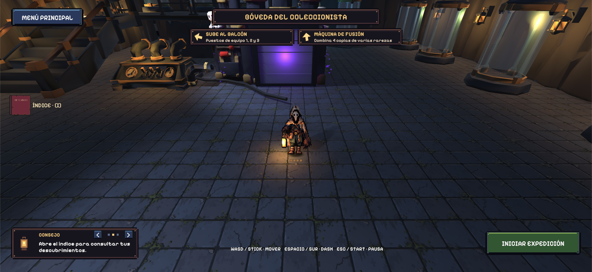

# EchoScrap: avance jugable

**GDD 0.6.6 · 13 de noviembre de 2026 (`main` @ `b381ef4` / `develop` @ `977bac5`).**

El Coleccionista prepara su equipo en la bóveda y sale al Vertedero para reunir experiencia y entidades. Durante la expedición combate con una linterna automática, escoge mejoras y se enfrenta a Gólgora. Al terminar vuelve a la bóveda con su colección, donde puede consultar el Índice de Colección (`[I]`), editar el equipo activo, liberar copias para hacer hueco o usar la máquina de fusión.

## Recorrido de una sesión

Menú inicial (con registro de nombre para el ranking de evento) → continuar o crear colección → bóveda → consultar el Índice (`[I]`), fusionar copias (`E`) y seleccionar entidades equipadas en el balcón → elegir ronda demo o completa → expedición → regreso a la bóveda.

La preparación en la bóveda está guiada mediante rótulos 3D sobre los pedestales superiores (`EQUIPO 1`, `EQUIPO 2`, `EQUIPO 3`), dos indicadores direccionales en la parte superior de la pantalla (`VaultDirections`) que apuntan hacia la máquina de fusión y el balcón de equipo, y un panel inferior izquierdo de consejos (`VaultTips`) que rota cada `8 s`. En los puestos 1 a 3 del balcón, pulsar `E` (o botón oeste en mando; `E · EQUIPAR` / `E · EDITAR`) abre el selector de acompañantes (con botones `QUITAR DEL PUESTO`, `LIBERAR COPIA` y `CERRAR · E / ESC`), mientras que `T` (o botón norte en mando) retira directamente la entidad equipada al mundo; en los pedestales de exposición de la planta baja, pulsar `E` (`E · LIBERAR`) abre el diálogo de confirmación para liberar una copia de la colección.

*Captura de la Bóveda en la versión final (`b381ef4`), mostrando las tarjetas direccionales superiores (`VaultDirections`), el botón superior izquierdo `ÍNDICE · [I]`, los rótulos 3D de pedestales `EQUIPO 1..3` y el panel de consejos rotatorio `CONSEJO` (`VaultTips`).*

| Área | Contenido de esta versión |
| --- | --- |
| Partida | Menú inicial con nombre de jugador para el ranking en vivo (`EventLeaderboardSync`), colección nueva o existente, preparación guiada en bóveda, selección de ronda (`ELIGE LA RONDA`), resultados con retorno a la bóveda y ejecutable publicado en [`https://naked-hiro.itch.io/echoscrap`](https://naked-hiro.itch.io/echoscrap). |
| Control | Movimiento con teclado o mando, dash con invulnerabilidad (`0,22 s`), relieve y colisiones. Interacción con `E` / botón oeste (`X`/`Cuadrado`), desequipado rápido en balcón con `T` / botón norte (`Y`/`Triángulo`), Índice de Colección con `I` / `Select` y consulta rápida de detalles del HUD en combate manteniendo `Q` o `Select`. |
| Combate | Linterna de cuatro pulsos con autoapuntado y 35 mejoras en cuatro rarezas. |
| Enemigos | Cinco arquetipos de horda, dos élites y Gólgora. |
| Rondas | Demo: jefe a los 3:00 y 3600 HP. Completa: jefe a los 8:00 y 9000 HP (15 000 HP base en código). La victoria exige derrotarlo. |
| Mundo | Arena de 200 × 200 m, acceso norte, bóveda modular en dos niveles y caldera central del jefe. Las zonas de lava fija del mapa están desactivadas. |
| Colección | Quince entidades en seis rarezas, capacidad máxima estricta de **10 unidades** en posesión (`FusionProgress.Capacity = 10`, con `DisplaySlots[10]`: 3 puestos de equipo en el balcón y 7 pedestales de exposición/reserva en planta baja; los poderes **se acumulan por copia equipada** hasta `×3`) e **Índice de Colección (`[I]`)** con pestañas `POR RAREZAS` (`TODAS` y 6 rarezas) y `EN TU BÓVEDA`. |
| Fusión | Cuatro copias cualesquiera (de la misma rareza o de rarezas mixtas, incluidas copias equipadas en los puestos 1–3 y excluida Yanikua), duración fija de **30 segundos (`00:30`)** en todas las recetas y botón único `COLECCIONAR` al reclamar el resultado (requiere espacio libre en las 10 unidades). |
| Presentación | Tipografía unificada `Pixelify Sans`, panel unificado de configuración y pausa en 3 pestañas (`General`, `Interfaz`, `Sonido` en `MenuSettingsView.cs`), sprites animados, modelo 3D del jefe, minimapa con exploración, retratos, VFX y audio contextual. |

## Dónde consultar cada parte

- [[01 - Jugabilidad]] y [[01 - UX y Flujo del Jugador]] describen la preparación en la bóveda y la expedición.
- [[04 - Objetos y Coleccionables]] reúne las quince entidades, sus poderes, el Índice de Colección (`[I]`), la capacidad de 10 unidades y las reglas de fusión.
- [[03 - Personajes]] identifica individualmente a los enemigos y su papel.
- [[03 - Enemigos y NPC]] contiene los valores, la respuesta al empuje y las reglas de los ataques.
- [[02 - Personajes y Animación]] reúne las fichas visuales, fuentes editables, spritesheets y GIFs de personajes y enemigos.
- [[06 - Registro visual]] reúne los GIFs de VFX y las condiciones de las capturas.

> **Navegación:** [[00 - Índice]] · [[00 - Avance jugable]]
