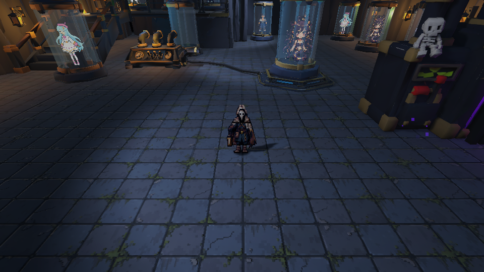

# EchoScrap: avance jugable

**GDD 0.5.2 · 5 de noviembre de 2026.**

El Coleccionista prepara su equipo en la bóveda y sale al Vertedero para reunir experiencia y entidades. Durante la expedición combate con una linterna automática, escoge mejoras y se enfrenta a Gólgora. Al terminar vuelve a la bóveda con su colección, donde puede cambiar el equipo o usar la máquina de fusión.

## Recorrido de una sesión

Menú inicial → continuar o crear colección → bóveda → revisar y seleccionar entidades equipadas → elegir ronda demo o completa → expedición → regreso a la bóveda.

La elección de entidades forma parte de la preparación. Se pueden ocupar hasta tres puestos con copias del inventario o salir con puestos vacíos. El sistema ya funciona al acercarse a cada puesto y pulsar E, pero el recorrido actual no explica este paso con suficiente claridad. La señalización de esa preparación queda pendiente; se detalla en [[03 - Bugs y Seguimiento]].

| Área | Contenido de esta versión |
| --- | --- |
| Partida | Menú inicial, colección nueva o existente, preparación en bóveda, selección de ronda y resultados con retorno a la bóveda. |
| Control | Movimiento con teclado o mando, dash con invulnerabilidad, relieve y colisiones. La interacción de colección, equipo y fusión usa E. |
| Combate | Linterna de cuatro pulsos con autoapuntado y 35 mejoras en cuatro rarezas. |
| Enemigos | Cinco arquetipos de horda, dos élites y Gólgora. |
| Rondas | Demo: jefe a los 3:00 y 3600 HP. Completa: jefe a los 8:00 y 9000 HP. La victoria exige derrotarlo. |
| Mundo | Arena de 200 × 200 m, acceso norte, bóveda modular y caldera central del jefe. Las zonas de lava fija del mapa están desactivadas. |
| Colección | Quince entidades, seis rarezas, recogida manual en arena, tres puestos de equipo y siete de exposición. |
| Fusión | Cuatro copias disponibles, consumo al comenzar, probabilidades por calidad y resultado que se colecciona o libera. |
| Presentación | Sprites animados, modelo del jefe, minimapa con exploración, retratos, VFX y audio contextual. |

## Dónde consultar cada parte

- [[01 - Jugabilidad]] y [[01 - UX y Flujo del Jugador]] describen la preparación y la expedición.
- [[04 - Objetos y Coleccionables]] reúne las quince entidades, sus poderes y las reglas de fusión.
- [[03 - Personajes]] identifica individualmente a los enemigos y su papel.
- [[03 - Enemigos y NPC]] contiene los valores y las reglas de los ataques.
- [[02 - Personajes y Animación]] reúne las fichas visuales, fuentes editables, spritesheets y GIFs de personajes y enemigos; señala la integración pendiente del Caballero y el gólem.
- [[06 - Registro visual]] reúne los GIFs de VFX y las condiciones de las capturas.

Los GIFs de atlas se han compuesto con los fotogramas y tiempos exportados del proyecto; las capturas de Unity se identifican aparte. Las imágenes de preparación utilizan un inventario de muestra para enseñar las opciones. Una colección nueva empieza vacía.

> **Navegación:** [[00 - Índice]] · [[00 - Avance jugable]]
