# EchoScrap — Documento de diseño de videojuego

**GDD 0.5.2 · 5 de noviembre de 2026**

Equipo EchoScrap: Mora Alejandro Angel Gabriel, Sierra Sosa David Alejandro, Cupul Dzul Mirian Leticia, Obispo Navarro Samuel Alejandro y Nuñez Chan Luis Fernando.

Plantilla original: Ing. Luis Fernando Villafaña Rejón.

Esta edición describe el montaje jugable consultado y distingue la selección de equipo disponible de su guía visual pendiente. Los GIFs se reproducen en lectores compatibles; una exportación a PDF conserva imágenes estáticas.

---

# EchoScrap: avance jugable

**GDD 0.5.2 · 5 de noviembre de 2026.**

El Coleccionista prepara su equipo en la bóveda y sale al Vertedero para reunir experiencia y entidades. Durante la expedición combate con una linterna automática, escoge mejoras y se enfrenta a Gólgora. Al terminar vuelve a la bóveda con su colección, donde puede cambiar el equipo o usar la máquina de fusión.

## Recorrido de una sesión

Menú inicial → continuar o crear colección → bóveda → revisar y seleccionar entidades equipadas → elegir ronda demo o completa → expedición → regreso a la bóveda.

La elección de entidades forma parte de la preparación. Se pueden ocupar hasta tres puestos con copias del inventario o salir con puestos vacíos. El sistema ya funciona al acercarse a cada puesto y pulsar E, pero el recorrido actual no explica este paso con suficiente claridad. La señalización de esa preparación queda pendiente; se detalla en [[03 - Bugs y Seguimiento]].

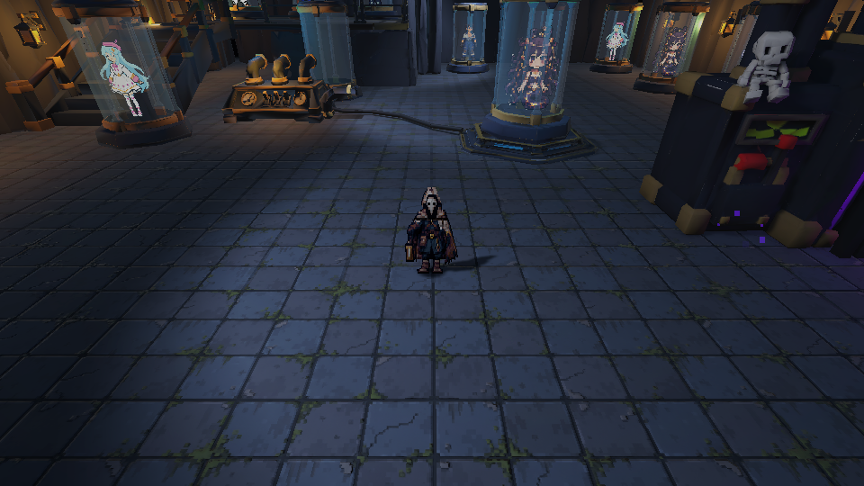

| Área | Contenido de esta versión |
| --- | --- |
| Partida | Menú inicial, colección nueva o existente, preparación en bóveda, selección de ronda y resultados con retorno a la bóveda. |
| Control | Movimiento con teclado o mando, dash con invulnerabilidad, relieve y colisiones. La interacción de colección, equipo y fusión usa E. |
| Combate | Linterna de cuatro pulsos con autoapuntado y 35 mejoras en cuatro rarezas. |
| Enemigos | Cinco arquetipos de horda, dos élites y Gólgora. |
| Rondas | Demo: jefe a los 3:00 y 3600 HP. Completa: jefe a los 8:00 y 9000 HP. La victoria exige derrotarlo. |
| Mundo | Arena de 200 × 200 m, acceso norte, bóveda modular y caldera central del jefe. Las zonas de lava fija del mapa están desactivadas. |
| Colección | Quince entidades, seis rarezas, recogida manual en arena, tres puestos de equipo y siete de exposición. |
| Fusión | Cuatro copias disponibles, consumo al comenzar, probabilidades por calidad y resultado que se colecciona o libera. |
| Presentación | Sprites animados, modelo del jefe, minimapa con exploración, retratos, VFX y audio contextual. |

## Dónde consultar cada parte

- [[01 - Jugabilidad]] y [[01 - UX y Flujo del Jugador]] describen la preparación y la expedición.
- [[04 - Objetos y Coleccionables]] reúne las quince entidades, sus poderes y las reglas de fusión.
- [[03 - Personajes]] identifica individualmente a los enemigos y su papel.
- [[03 - Enemigos y NPC]] contiene los valores y las reglas de los ataques.
- [[02 - Personajes y Animación]] reúne las fichas visuales, fuentes editables, spritesheets y GIFs de personajes y enemigos; señala la integración pendiente del Caballero y el gólem.
- [[06 - Registro visual]] reúne los GIFs de VFX y las condiciones de las capturas.

Los GIFs de atlas se han compuesto con los fotogramas y tiempos exportados del proyecto; las capturas de Unity se identifican aparte. Las imágenes de preparación utilizan un inventario de muestra para enseñar las opciones. Una colección nueva empieza vacía.

---

# Ficha del proyecto

| Campo | Información |
| --- | --- |
| Nombre | EchoScrap |
| Versión del GDD | 0.5.2 |
| Estado | Versión jugable en iteración: preparación, expediciones, colección, fusión y encuentro final. |
| Actualización | 5 de noviembre de 2026 |
| Plataforma | PC, Windows, un jugador local. |
| Motor | Unity 6000.6.3f1 y Universal Render Pipeline. |
| Lenguaje | C# y shaders en HLSL. |
| Perspectiva | Mundo 3D con personajes 2D; cámara exterior a 35,5° y encuadre propio para bóveda y jefe. |
| Repositorio del juego | https://github.com/ShiroRex/EchoScrap |
| Revisión consultada | 30b88c6 y montaje local del 4 de noviembre para reglas y personajes; b9e3136 y montaje local del 5 de noviembre para las nuevas capturas de VFX. |
| Repositorio del GDD | https://github.com/ShiroRex/GDD-Echoscrap |

## Equipo

- **Mora Alejandro Angel Gabriel:** líder y coordinación del proyecto.
- **Sierra Sosa David Alejandro:** desarrollo, diseño funcional y balance.
- **Cupul Dzul Mirian Leticia:** personajes y animación.
- **Obispo Navarro Samuel Alejandro:** entornos e interfaz.
- **Nuñez Chan Luis Fernando:** audio, narrativa, UX y calidad.

## El juego en una frase

El Coleccionista reúne entidades en un vertedero dimensional, prepara sus poderes en la bóveda y combina mejoras durante cada expedición para enfrentarse al MataColeccionista.

El contenido actual incluye una arena de 200 × 200 m, cinco enemigos de horda, dos élites, un jefe, 35 mejoras y una colección de quince entidades. La selección de equipo existe, aunque falta guiar mejor al jugador hacia sus tres puestos antes de salir.

---

# Visión del juego

EchoScrap combina supervivencia frente a hordas con la preparación de una colección. En la bóveda, el jugador puede elegir hasta tres entidades del inventario. Cada una aporta un poder de combate que estará disponible al comenzar la expedición. Después decide entre la ronda demo y la completa.

En la arena controla el movimiento y el dash del Coleccionista. La linterna apunta automáticamente al enemigo más cercano dentro de su alcance, lo que permite atender a las rutas de escape, los ataques anunciados y la recogida. La XP abre elecciones entre hasta tres cartas; las 35 mejoras permiten construir una configuración distinta durante cada intento.

También aparecen entidades que se recogen con E. Esas copias pasan a la colección guardada y sirven para equipar poderes o alimentar una fusión de cuatro ingredientes. La bóveda conecta esa actividad entre expediciones mediante sus puestos de equipo, la exposición y la máquina.

Gólgora cierra la expedición en una caldera central. Sus ataques cubren distancias y formas diferentes, y su segunda fase acelera el encuentro. La muerte del jugador produce derrota; la del jefe con el jugador vivo produce victoria. El resultado permite volver a preparar el siguiente intento.

La preparación necesita una explicación más visible en el juego. Esta edición incorpora la selección de entidades al flujo y registra como pendiente la guía que permita descubrirla.

---

# Público y plataforma

EchoScrap es una experiencia de acción y supervivencia para Windows y un solo jugador. El combate acepta teclado y ratón o mando: el desplazamiento y el dash son directos y la linterna funciona con autoapuntado.

Las cartas introducen pausas de decisión. Antes de salir, la bóveda permite revisar la colección y escoger hasta tres entidades equipadas. En el montaje actual, recoger entidades y abrir los puestos de equipo o la fusión requiere la tecla E; esa parte del recorrido todavía necesita una guía más clara y no tiene una interacción equivalente de mando documentada en el código.

La ronda demo lleva al jefe a los tres minutos y la completa a los ocho. Estos tiempos corresponden al reloj de combate, que se detiene con las pausas y elecciones. La duración total incluye la preparación, los menús y el enfrentamiento final.

Los ataques se comunican con avisos de suelo, animaciones y texto. Las opciones permiten reducir efectos y sacudidas y elegir el detalle del panel de estadísticas.

---

# Pilares de diseño

## Movimiento que abre oportunidades

El desplazamiento a 8 m/s, el dash y el empuje del cuarto pulso ayudan a atravesar huecos y cambiar la posición de la horda. La linterna apunta por su cuenta, por lo que el Coleccionista puede retirarse mientras ataca en otra dirección.

## Preparar una colección y construir una configuración

Las entidades equipadas aportan poderes iniciales. Las 35 mejoras de la expedición amplían las herramientas disponibles mediante estadísticas, dispositivos, ataques automáticos y control de masas. Los requisitos relacionan las decisiones: Cero absoluto parte de Freón residual y las mejoras de explosión necesitan una fuente compatible.

## Ataques que se pueden leer

La carga del Coloso, el ácido del Mortero, la mecha de la Polilla, los ataques élite y los patrones de Gólgora muestran señales antes de resolver el daño. Los efectos reducidos conservan los avisos esenciales.

## Una bóveda que da continuidad a las expediciones

Las entidades recogidas pasan al inventario local. En la bóveda se pueden equipar hasta tres copias, observar la colección y consumir cuatro ingredientes en una fusión. El resultado de una expedición devuelve al jugador a esa preparación. Falta hacer más visible el paso de elegir equipo dentro del recorrido inicial.

---

# Jugabilidad

## Preparación y salida

Menú inicial → continuar o crear colección → bóveda → revisar y seleccionar entidades equipadas → elegir ronda demo o completa → expedición → regreso a la bóveda.

Continuar recupera la colección guardada. Nueva colección reinicia el inventario, el equipo y la fusión en curso, con confirmación cuando ya existe una colección.

En la bóveda se revisan los tres puestos de entidades equipadas. Al acercarse a un puesto y pulsar E se abre su selector. Solo se pueden usar copias que pertenecen al inventario y es posible dejar puestos vacíos. En una colección nueva no hay entidades disponibles todavía: la primera expedición permite reunirlas.

La preparación forma parte del flujo, pero el juego permite iniciar una expedición sin pasar por sus puestos y no explica suficientemente su función. Queda pendiente la señalización que acompañe este paso, descrita en [[03 - Bugs y Seguimiento]].

El portal o el botón Iniciar expedición abre la elección de ronda. La demo lleva a Gólgora a los 3:00; la completa, a los 8:00. Tras la selección se presenta la entrada del Coleccionista en la arena.

## Bucle de combate

1. Mantener una ruta de escape con movimiento y dash.
2. Dañar a la horda con la linterna y los poderes de la configuración.
3. Recoger XP y elegir una mejora al subir de nivel.
4. Acercarse a las entidades que aparecen y recogerlas con E antes de que desaparezcan.
5. Responder a las composiciones de horda y a los ataques de los dos élites.
6. Combatir contra Gólgora en la caldera central.
7. Consultar el resultado y volver a la bóveda para revisar equipo y colección.

Las cartas pausan el combate. Si una recogida produce varias subidas de nivel, las elecciones se resuelven una tras otra.

## Cierre y continuidad

La vida del jugador a cero produce derrota. La muerte de Gólgora con el jugador vivo produce victoria. Si ambos mueren en el mismo paso de simulación, prevalece la derrota. El resumen muestra tiempo, nivel, bajas y XP, y ofrece Volver a la bóveda.

Las cartas, el nivel y la salud de la expedición se restablecen. Las copias ya recogidas, las entidades equipadas y el progreso de fusión pertenecen a la colección y se conservan. Abandonar desde pausa también vuelve a la bóveda tras una confirmación.

## Bóveda y fusión

La máquina está dentro de la bóveda. Se abre con E a corta distancia y necesita cuatro copias disponibles. Las consume al comenzar y el proceso sigue durante el tiempo de juego activo, incluida la estancia en la bóveda. Al terminar espera la interacción del jugador para abrirse; después permite coleccionar o liberar el resultado.

Durante una expedición sigue siendo posible visitar la bóveda por el acceso norte. Esa visita conserva la sesión en memoria y suspende su combate; al regresar se retoma. Volver desde un resultado inicia la preparación de una nueva expedición.

---

# Mecánicas

## Movimiento y dash

El movimiento parte de 8 m/s, con aceleración de 80 m/s² y frenado de 70 m/s². La diagonal mantiene la misma velocidad máxima. La dirección de entrada se interpreta respecto a la cámara y el personaje se apoya sobre el relieve y las escaleras del escenario.

El dash avanza a 22 m/s durante 0,15 s, aproximadamente 3,3 m si el recorrido está libre. Concede invulnerabilidad durante ese intervalo y atraviesa cuerpos enemigos. Los muros y obstáculos sólidos limitan el recorrido. La recarga base es de un segundo desde el final.

## Linterna

| Parámetro base | Valor |
| --- | ---: |
| Alcance | 7 m |
| Apertura del cono | 60° |
| Daño de cada pulso | 3,75 sobrenatural |
| Pulsos por ráfaga | 4 |
| Separación entre pulsos | 0,2 s |
| Descanso entre ráfagas | 0,4 s |
| Impulso del cuarto pulso | 10 m/s, modulado por la susceptibilidad del enemigo |

La ráfaga base emite en 0,2, 0,4, 0,6 y 0,8 s y vuelve a empezar tras el descanso. La linterna busca objetivos en 360° dentro de su alcance y aplica los impactos a su cono frontal. Sin objetivos, vuelve hacia la orientación de movimiento. Rayo solar elimina el descanso, aumenta el alcance base a 14 m y multiplica el daño por 2,5.

## Salud y daño

El Coleccionista empieza con 100 HP y 0,4 s de protección después de recibir daño. El daño puede ser físico o sobrenatural según su fuente; los números conservan esa categoría. La armadura reduce el daño recibido hasta un límite del 60%. La probabilidad crítica empieza en 0% y su multiplicador base es ×1,75.

Los números muestran la salud realmente perdida. Los impactos normales de una ráfaga pueden agruparse, mientras que los críticos se distinguen con tamaño, color y un signo de exclamación. Los impactos mitigados por resistencia muestran «Resistido» bajo el valor y una ejecución causada por la mejora correspondiente muestra «EJECUTADO».

## Recogida

El imán base alcanza 2,5 m y atrae los objetos a 12 m/s. Las gemas conceden experiencia; el botiquín base recupera 15 HP. El ácido y las áreas de ataque utilizan las mismas reglas de salud e invulnerabilidad que el resto del combate. Las zonas de lava fija del mapa están desactivadas; el magma de Gólgora sigue formando parte del encuentro.

Las mejoras modifican estos parámetros o añaden acciones automáticas. Sus niveles y efectos se describen en [[05 - Progresión]].

## Entidades y poderes de inicio

Hasta tres copias equipadas aportan niveles iniciales de sus mejoras asociadas. Varias copias con el mismo poder aumentan ese nivel hasta el máximo de la mejora. Al combinar equipo y cartas, el valor efectivo es el mayor de ambos niveles; no se suman entre sí. El detalle de cada entidad está en [[04 - Objetos y Coleccionables]].

Los coleccionables que aparecen en arena requieren E dentro de unos 2,5 m y una línea de interacción despejada. No se recogen con el imán de las gemas y botiquines.

---

# Sistemas

| Sistema | Funcionamiento actual |
| --- | --- |
| Flujo general | Menú inicial, colección, preparación en bóveda, selección de ronda, expedición y retorno desde resultados. |
| Entradas y locomoción | Teclado y mando para movimiento y dash; colisiones, relieve e interacción E para colección, equipo y fusión. |
| Sesión | Reloj, razones de pausa, entrada del jefe, resolución de resultados y limpieza entre expediciones. |
| Salud y daño | HP, armadura, críticos, protección temporal, curación y muerte. |
| Linterna | Autoapuntado, cuatro pulsos, empuje final y modificaciones por mejoras. |
| Enemigos | Cinco arquetipos de horda, dos élites y Gólgora con navegación, ataques y estados propios. |
| Oleadas | Grupos por fase, apariciones fuera de cámara, límites de población y aparición alterna de élites. |
| Encuentro del jefe | Traslado seguro, caldera cerrada, cámara compartida, refuerzos anunciados y dos fases. |
| Progresión | XP, subidas de nivel y cola de elecciones entre 35 mejoras. |
| Entidades | Apariciones temporales en arena, recogida manual y almacenamiento de copias. |
| Equipo | Tres puestos; las entidades elegidas aportan poderes iniciales y reservan sus copias. |
| Fusión | Consumo de cuatro copias, probabilidades por calidad, temporizador, apertura manual y decisión sobre el resultado. |
| Bóveda | Tres puestos de equipo, siete de exposición, máquina de fusión y portal. |
| Interfaz | Menús, HUD, minimapa con exploración, cartas, estadísticas, retratos y resultados. |
| Audio | Música de arena, jefe y bóveda; sonidos de linterna, recogida, entrada, fusión y ataques del jefe. |

El reloj distingue pausa manual, pérdida de foco, cartas, fusión, equipo y menús generales. Resolver una de esas razones no reanuda una sesión que sigue detenida por otra. La interfaz puede animarse mientras el combate está pausado.

La simulación resuelve daño y resultados. La presentación representa esos eventos con animación, sonido y VFX. Las reservas de actores y efectos se reutilizan entre expediciones.

---

# Controles

| Acción | Teclado y ratón | Mando |
| --- | --- | --- |
| Moverse | WASD o flechas | Stick izquierdo o cruceta |
| Dash | Espacio | Botón sur: A / Cruz |
| Pausar | Esc | Start |
| Elegir una carta | 1, 2 o 3; clic | Navegación y confirmación |
| Cambiar carta enfocada | A/D, izquierda/derecha o puntero | Stick o cruceta |
| Confirmar carta | Enter o clic | Botón sur: A / Cruz |
| Reintentar con Sintonizador | R o botón de interfaz | Botón norte |
| Recoger una entidad cercana en arena | E | Sin asignación de interacción equivalente en el sistema actual |
| Abrir el puesto de equipo cercano en bóveda | E | Sin asignación de interacción equivalente en el sistema actual |
| Abrir la máquina de fusión | E | Sin asignación de interacción equivalente en el sistema actual |
| Cerrar equipo | E o Esc; botón Cerrar | — |
| Cerrar selector de fusión | E o su botón Cerrar | — |
| Cancelar selección de ronda o confirmación general | Esc o botón de interfaz | Botón este: B / Círculo |

La linterna ataca automáticamente. Los portales se activan por contacto; el de la bóveda abre la selección de ronda durante la preparación.

Espacio se reserva al dash y no confirma cartas. Las elecciones exigen soltar la confirmación anterior y la entrada que devuelve el foco para evitar acciones accidentales.

El laboratorio usa Tab para mostrar el panel y R para reiniciar. Sus botones permiten generar e inspeccionar los ocho arquetipos, congelar actores y avanzar la simulación.

---

# Progresión

## Experiencia y elecciones

El Coleccionista empieza en nivel 1. La primera subida necesita 100 XP; el siguiente umbral es el anterior multiplicado por 1,5 y redondeado a entero. La experiencia que sobra se conserva para el siguiente nivel. Una misma recogida puede acumular varias elecciones.

Cada elección ofrece hasta tres cartas distintas. La rareza base se sortea con pesos Común 60, Rara 25, Épica 12 y Legendaria 3, considerando únicamente las rarezas que todavía tienen cartas válidas. Después se elige una carta de esa rareza. Las cartas al máximo se retiran de la oferta.

Sintonizador permite gastar reintentos durante la sesión. También mueve peso hacia raras y épicas: cinco y tres puntos por nivel, respectivamente, desde el peso común. El peso legendario permanece en tres.

## Catálogo de 35 mejoras

Las series separadas por barras corresponden a sus niveles. Los valores describen la mejora por sí sola; otras cartas pueden modificar daño, radios, críticos y estadísticas finales.

| ID | Mejora | Rareza | Nivel máximo | Efecto actual | Tipo de daño |
| --- | --- | --- | ---: | --- | --- |
| FLASH_01 | Más alcance | Común | 5 | +1 m de alcance y +10° de apertura por nivel. | Sobrenatural |
| FLASH_02 | Pulso rápido | Común | 5 | +15% de velocidad de ataque por nivel; reduce el intervalo y el descanso. | Sobrenatural |
| FLASH_03 | Prisma voltaico | Rara | 3 | El cuarto pulso enlaza 2/3/4 enemigos a 5 m, con 40/60/80% del daño del impacto inicial. | Sobrenatural |
| FLASH_04 | Golpe potente | Épica | 3 | Daño ×1,5/1,8/2,2 y más empuje; reduce 20° la apertura al adquirirla. | Sobrenatural |
| FLASH_05 | Rayo solar | Legendaria | 1 | Suprime el descanso, establece 14 m de alcance base y multiplica el daño de luz por 2,5. | Sobrenatural |
| DASH_01 | Dash ágil | Común | 5 | +8% de velocidad de dash y -10% de recarga por nivel. | Sin daño directo |
| DASH_02 | Onda sísmica | Rara | 3 | Al terminar el dash: 25/45/70 de daño y aturdimiento de 0,6/0,9/1,2 s. | Físico |
| DASH_03 | Holo-señuelo | Épica | 3 | Deja una copia que atrae enemigos durante 2/2,5/3 s; su implosión causa 50/85/120 de daño. | Sobrenatural |
| DASH_04 | Cataclismo | Legendaria | 1 | Dash con recarga de 0,5 s, explosión de salida de 120 y cuchilla de llegada de 80. | Físico |
| BIO_01 | Más vida | Común | 5 | +20 HP máximos y curación de 15 HP en cada adquisición. | Sin daño directo |
| BIO_02 | Sifón | Rara | 3 | El cuarto pulso tiene 12/20/30% de curar 2/3/4 HP por enemigo alcanzado. | Sin daño directo |
| BIO_03 | Nanobots | Épica | 3 | Regenera 1/2/3 HP cada 2,5 s; al quedar bajo 20% de vida puede proteger 2 s, con recarga de 60 s. | Sin daño directo |
| BIO_04 | Nova de plasma | Legendaria | 1 | Cada 15 HP de curación sobrante generan una nova de 80 de daño y 6 m de radio. | Sobrenatural |
| GREED_01 | Imán | Común | 5 | +2 m al radio de recogida por nivel. | Sin daño directo |
| GREED_02 | Chatarrero | Común | 5 | +15% de experiencia recibida por nivel. | Sin daño directo |
| GREED_03 | Botiquín mejor | Rara | 3 | Botiquines de 17/19/21 HP; aumentan también sus probabilidades de aparición. | Sin daño directo |
| GREED_04 | Sintonizador | Épica | 3 | Concede 1/2/3 reintentos totales y aumenta el peso de ofertas raras y épicas. | Sin daño directo |
| GREED_05 | Pulso colector | Legendaria | 1 | Atrae gemas y botiquines del mapa al adquirirla y al subir de nivel. | Sin daño directo |
| CRIT_01 | Óptica precisa | Común | 5 | +8 puntos porcentuales de probabilidad crítica por nivel. | Según ataque |
| CRIT_02 | Calibración letal | Común | 5 | +0,2 al multiplicador crítico por nivel, desde ×1,75. | Según ataque |
| CRIT_03 | Ejecución | Rara | 3 | Remata tras un golpe a enemigos bajo 6/8/10% de vida; excluye a los jefes. | Según ataque |
| CRIT_04 | Ráfaga crítica | Épica | 3 | Un crítico en el cuarto pulso garantiza 2/3/4 críticos al inicio de la siguiente ráfaga. | Según ataque |
| CRIT_05 | Ojo del verdugo | Legendaria | 1 | +20 puntos de crítico; contra objetivos bajo 35% de vida, críticos ×3 y aturdimiento cercano. | Según ataque |
| DEMO_01 | Pólvora volátil | Común | 5 | +12% de daño y +15% de radio de explosión por nivel. | Según explosión |
| DEMO_02 | Reacción en cadena | Rara | 3 | 25/40/55% de provocar una explosión de 35/60/90 al morir un enemigo. | Físico |
| DEMO_03 | Minas de chatarra | Épica | 3 | Coloca una mina cada 4/3,2/2,5 s; explosión de 70/110/160 en 4 m de radio. | Físico |
| DEMO_04 | Termobárica | Legendaria | 1 | Tras 0,4 s, una implosión repite el 75% del daño de la explosión y atrae enemigos. | Sobrenatural |
| SCRAP_01 | Blindaje | Común | 5 | +4 puntos porcentuales de armadura y +10 HP máximos por nivel. | Sin daño directo |
| SCRAP_02 | Micro-ensamblador | Rara | 3 | Cada 15 gemas recogidas lanza un proyectil guiado de 40/70/105. | Físico |
| SCRAP_03 | Sierras orbitales | Épica | 3 | 2/3/4 sierras giran a 2,5 m; cada contacto causa 18/28/40 y empuja. | Físico |
| SCRAP_04 | Torreta centinela | Legendaria | 1 | Aparece cada 10 s, dura 8 s y dispara ráfagas de tres proyectiles de 35 a 8 m. | Físico |
| CRYO_01 | Freón residual | Común | 5 | La luz ralentiza 12/20/28/36/44% durante 1,5 s. | Sobrenatural |
| CRYO_02 | Cero absoluto | Rara | 3 | Congela tras 4/3/3 pulsos durante 1,2/1,8/2,4 s; el congelado recibe 30% más de daño. | Sobrenatural |
| CRYO_03 | Ventisca | Épica | 3 | Cada 6/5/4 s: onda de 30/50/75 en 5,5 m que congela 1,5 s. | Sobrenatural |
| CRYO_04 | Quiebre de hielo | Legendaria | 1 | Una muerte congelada emite seis esquirlas perforantes de 50 que congelan 1,5 s. | Sobrenatural |

## Requisitos y combinaciones

- **Pólvora volátil y Termobárica:** necesitan una fuente de explosiones en la configuración.
- **Cero absoluto:** requiere Freón residual.
- **Quiebre de hielo:** necesita Cero absoluto o Ventisca.
- **Ráfaga crítica:** requiere una probabilidad crítica mayor que cero.

Prisma voltaico se activa desde el cuarto pulso de luz y su daño derivado no inicia otra cadena. La repetición de Termobárica tampoco vuelve a repetirse a sí misma. Estos límites permiten combinar efectos sin crear bucles de activación.

## Oleadas

| Tiempo de combate | Tamaño del grupo | Intervalo |
| --- | ---: | --- |
| 0:00–1:00 | 1 | 1,2 s |
| 1:00–2:00 | 2 | 0,8 s |
| 2:00–3:00 | 3 | 0,6 s |
| 3:00–5:00 | 4 | 0,4 a 0,32 s |
| 5:00–8:00 | 4 | 0,32 a 0,2 s |

Los grupos cambian de composición y se colocan fuera de cámara, sobre suelo válido y sin solapar obstáculos ni actores. El límite normal es de 150 vivos. La ronda demo recorre los tramos anteriores a los tres minutos; la completa utiliza la escalada de ocho minutos. Desde los 90 s pueden aparecer Caballero Fantasma y Centinela de Cobre, alternándose cada 25 s cuando hay espacio y con un límite conjunto de dos élites vivos.

Las mejoras de estadísticas y probabilidades se representan en las cartas y el HUD. Los efectos visuales observables se reúnen con sus GIFs en [[06 - Registro visual]].

## Preparación con entidades

Antes de elegir ronda se pueden ocupar tres puestos de equipo en la bóveda. Cada entidad aporta un nivel de su poder asociado. Las copias con el mismo poder acumulan niveles dentro del equipo hasta el máximo de esa mejora. Las cartas obtenidas durante la expedición conservan su progresión independiente; el nivel efectivo usa el mayor entre equipo y cartas.

Los puestos pueden quedar vacíos y una colección nueva comienza sin copias. Las entidades se obtienen en arena y mediante fusión; el catálogo completo y sus poderes están en [[04 - Objetos y Coleccionables]]. Esta preparación necesita señalización más clara en el recorrido del jugador.

---

# Economía y recursos

## Recursos de la expedición

La XP y las cartas pertenecen al intento actual. Las gemas de los cinco enemigos de horda conceden 10, 15, 25 o 50 XP según el arquetipo; los élites entregan 65 y 80 XP. Chatarrero multiplica la experiencia recogida. Gólgora añade 500 XP al resumen de victoria sin abrir nuevas elecciones.

El botiquín base recupera 15 HP. La probabilidad parte del 3% en enemigos normales y del 8% en los de recompensa fuerte. Hay seis segundos como mínimo entre apariciones, hasta cinco botiquines en el suelo y 22 s de duración. Botiquín mejor modifica la curación y esas probabilidades.

## Copias de entidades

La colección guarda cantidades de quince entidades. Empieza vacía y recibe las copias recogidas en arena o los resultados de fusión que se coleccionan. Las recogidas se guardan al obtenerlas; no dependen de derrotar a Gólgora.

Una copia equipada queda reservada para su puesto. Las demás están disponibles como ingredientes o para liberarse desde el inventario. Cada fusión consume exactamente cuatro copias al comenzar. Liberar una unidad del inventario pide confirmación; liberar el resultado de la máquina descarta ese resultado.

Tres puestos muestran las entidades equipadas y otros siete exponen copias disponibles, ordenadas por rareza. La capacidad del inventario no está limitada por esos siete puestos: las copias sobrantes siguen guardadas y se consultan en los selectores paginados.

Las probabilidades, tiempos y fuentes de cada entidad están en [[04 - Objetos y Coleccionables]].

---

# Reglas y estados del juego

| Momento | Regla |
| --- | --- |
| Menú inicial | Continuar, Nueva colección, Configuración y Salir. El mundo se carga después de elegir colección. |
| Preparación en bóveda | Movimiento, revisión de inventario, equipo de hasta tres entidades y fusión. El reloj de expedición no avanza. |
| Selección de entidades | Al acercarse a cada puesto y pulsar E se pausa la interacción del mundo y se escoge una copia disponible. Puede dejarse vacío. |
| Selección de ronda | Se elige demo o completa antes de entrar. |
| Combate | Avanzan reloj, oleadas, ataques, recogida y temporizadores activos. |
| Cartas o pausa | El combate se detiene; la interfaz mantiene sus animaciones y confirmaciones. |
| Visita a la bóveda | Se conserva la expedición en memoria y se suspenden enemigos y peligros hasta volver. |
| Entrada de Gólgora | Se retira la horda, se limpian amenazas y se traslada al jugador a la caldera con protección. |
| Transición del jefe | Al llegar al 50% de vida, Gólgora entra en su segunda fase con una presentación protegida. |
| Victoria o derrota | Se muestra el resultado y se puede volver a la bóveda. |

## Encuentro con Gólgora

La demo activa la entrada a los 180 s y usa 3600 HP; la completa, a los 480 s y con 9000 HP. El tiempo inicia el encuentro. No concede una victoria por sí mismo.

La caldera central tiene 22 m de radio y cierra su perímetro. La entrada reposiciona al jugador sin daño y la cámara encuadra a ambos combatientes. Durante la presentación inicial el jefe no es un objetivo válido.

Los refuerzos se solicitan cada cuatro segundos, en grupos de hasta cuatro y con el orden Residual, Residual, Mortero y Polilla. En la caldera el límite efectivo es de ocho secuaces, incluyendo las apariciones pendientes. Cada entrada se anuncia durante 0,9 s. El cerco de magma y la transición de fase suspenden los refuerzos y retiran los que quedaban activos.

Los ataques, inmunidades y tiempos de las dos fases están en [[03 - Enemigos y NPC]].

## Cierre y nueva preparación

La muerte del jugador tiene prioridad si coincide con la del jefe en el mismo paso. La victoria incluye la presentación final, absorción de gema y 500 XP para el resumen, sin nuevas cartas.

Volver a la bóveda limpia actores, peligros y efectos, restablece la configuración de combate y vuelve a aplicar los poderes del equipo guardado. La colección y la fusión siguen conservadas. Abandonar una expedición requiere confirmación; Nueva colección también confirma antes de borrar la colección existente.

---

# Premisa y trama

El Coleccionista era un humano obsesionado con acumular rarezas. Una entidad le ofreció acceso a un mundo donde podría construir la colección definitiva. La oferta lo llevó al Vertedero de Ecos: un nexo al que llegan restos de realidades destruidas y del que no encuentra una salida.

Al cruzar pierde sus recuerdos, pero conserva el impulso de recolectar. Entre metal, ruinas y criaturas residuales, su linterna se convierte en la herramienta con la que abre espacio para seguir moviéndose. El almacén es su refugio y el lugar donde expone lo que reúne.

Gólgora, el MataColeccionista, representa al guardián de ese lugar. El enfrentamiento con él da forma al cierre de cada expedición. La derrota detiene el intento; la victoria resuelve el combate, pero el mundo continúa como escenario de nuevas partidas.

La premisa acompaña la experiencia mediante el personaje, el entorno, la colección y el ciclo de supervivencia. El recorrido jugable de la versión actual está descrito en [[01 - Jugabilidad]], y los mensajes visibles durante el juego se recogen en [[04 - Diálogos y Narrativa]].

---

# Mundo

El Vertedero de Ecos es un espacio atemporal donde se mezclan restos de épocas y realidades distintas. La chatarra, las ruinas y la energía residual dan continuidad a esa mezcla. La bóveda funciona como refugio y lugar de preparación entre expediciones.

| Lugar | Presencia actual | Función |
| --- | --- | --- |
| Vertedero | Arena de 200 × 200 m con relieve, obstáculos y restos industriales. | Horda, XP y recogida de entidades. |
| Caldera central | Área circular de 22 m de radio con cierre durante el encuentro. | Combate contra Gólgora y sus refuerzos. |
| Acceso norte | Descenso, muros, rellano y portal. | Conexión física con la bóveda. |
| Bóveda | Sala modular con tres puestos de equipo y siete de exposición. | Preparar poderes y observar la colección. |
| Máquina de fusión | Cámara con persiana dentro de la bóveda. | Consumir cuatro copias y presentar una nueva entidad. |

Las gemas de XP ayudan a crecer durante un intento. Las entidades pasan a una colección que continúa entre expediciones. El catálogo tiene quince entradas con fuentes de obtención distintas, descritas en [[04 - Objetos y Coleccionables]].

Las tres zonas de lava fija del mapa están desactivadas en este montaje. El magma se mantiene como parte de Gólgora y sus ataques.

La entidad del pacto pertenece al trasfondo de la premisa. Gólgora es el guardián presente en el combate final. La narrativa de origen se conserva en [[01 - Premisa y Trama]].

---

# Personajes

El reparto incluye al Coleccionista, cinco enemigos de horda, dos élites, Gólgora y las entidades de la colección. Cada enemigo tiene aquí una ficha de identidad y función. Sus recursos visuales se reúnen en [[02 - Personajes y Animación]] y sus reglas de combate en [[03 - Enemigos y NPC]].

## El Coleccionista

Es el personaje que controla el jugador. Lleva capucha clara, máscara con pico, ropa oscura y farol. Su luz apunta de forma independiente del movimiento. Tiene sprites de reposo, marcha, dash y muerte en cuatro direcciones.

[Ver atlas, fuente editable y animaciones del Coleccionista](05%20-%20Arte%20y%20Audio/02%20-%20Personajes%20y%20Animaci%C3%B3n.md#el-coleccionista).

## Residual: Esqueleto

Enemigo básico de la horda. Su apariencia actual es un esqueleto animado en cuatro direcciones. Persigue al Coleccionista y ejerce presión por acumulación y contacto. Su sprite está integrado.

[Ver ficha visual y animaciones](05%20-%20Arte%20y%20Audio/02%20-%20Personajes%20y%20Animaci%C3%B3n.md#residual-esqueleto).

## Interceptor: galgo de chatarra

Perseguidor rápido representado por un galgo de chatarra. Anticipa el movimiento del Coleccionista y obliga a variar las rutas de escape. Su sprite está integrado y sustituye el cuerpo geométrico anterior.

[Ver ficha visual y animaciones](05%20-%20Arte%20y%20Audio/02%20-%20Personajes%20y%20Animaci%C3%B3n.md#interceptor-galgo-de-chatarra).

## Coloso: Wendigo

Enemigo pesado representado por un Wendigo. Compromete una dirección de embestida tras un aviso, atraviesa el espacio libre y necesita recuperarse. Su sprite está integrado, con ciclos propios para preparación, carga y recuperación.

[Ver ficha visual y animaciones](05%20-%20Arte%20y%20Audio/02%20-%20Personajes%20y%20Animaci%C3%B3n.md#coloso-wendigo).

## Mortero: Campana

Enemigo de artillería con forma de campana flotante. Mantiene distancia y lanza ácido que deja zonas peligrosas. Su sprite está integrado, con flotación, carga, disparo, recuperación y muerte.

[Ver ficha visual y animaciones](05%20-%20Arte%20y%20Audio/02%20-%20Personajes%20y%20Animaci%C3%B3n.md#mortero-campana).

## Polilla: Reactor

Enemigo explosivo que se aproxima y ceba una mecha antes de estallar. La explosión puede afectar al Coleccionista y a otros enemigos. Su sprite está integrado, con vuelo, cebado y estallido.

[Ver ficha visual y animaciones](05%20-%20Arte%20y%20Audio/02%20-%20Personajes%20y%20Animaci%C3%B3n.md#polilla-reactor).

## Caballero Fantasma

Élite de ataque sobrenatural y resistencia al daño físico. Amenaza al Coleccionista con un barrido anunciado. El arte de su sprite está preparado, pero su integración en Unity queda pendiente; la representación jugable documentada mantiene un cuerpo geométrico.

[Ver estado de integración visual](05%20-%20Arte%20y%20Audio/02%20-%20Personajes%20y%20Animaci%C3%B3n.md#caballero-fantasma).

## Centinela de Cobre: gólem

Élite pesado de proyectiles físicos y resistencia al daño sobrenatural. El gólem se denomina Centinela de Cobre en el juego y ofrece una ventana de vulnerabilidad tras disparar. El arte de su sprite está preparado, pero su integración en Unity queda pendiente; la representación jugable documentada mantiene un cuerpo geométrico.

[Ver estado de integración visual](05%20-%20Arte%20y%20Audio/02%20-%20Personajes%20y%20Animaci%C3%B3n.md#centinela-de-cobre-g%C3%B3lem).

## Gólgora: el MataColeccionista

Jefe de la expedición. Su modelo 3D combina cuerpo pesado, arma y magma. Combate dentro de la caldera, alterna seis patrones y cambia sus tiempos y velocidad durante la segunda fase. El modelo animado está integrado.

[Ver ficha visual y animaciones](05%20-%20Arte%20y%20Audio/02%20-%20Personajes%20y%20Animaci%C3%B3n.md#g%C3%B3lgora-matacoleccionista).

## Entidades de la colección

La colección reúne Lobito, Mago, Demonio, Shireen, Yanikua, Basket, Hada, Lisa, Reaper, Chico Emo, Conde Alucard, Murciélago Cristal, Sirena, Soldier y Joel. Son quince entradas del inventario; Demonio y Demonio2 siguen siendo vistas de una misma entrada.

Cada entidad puede aportar un poder al ocupar uno de los tres puestos de equipo. Su rareza y fuente de obtención pertenecen a las reglas del catálogo, recogidas en [[04 - Objetos y Coleccionables]]. Esta edición no añade historias de origen para personajes que todavía no las tienen documentadas.

---

# Diálogos y narrativa

El juego comunica su situación mediante nombres, entorno, presentaciones y mensajes de interfaz. El menú ofrece Continuar o Nueva colección y la bóveda invita a revisar la colección antes de salir. La selección de ronda muestra Ronda demo y Ronda completa.

La preparación también incluye elegir entidades equipadas. Al acercarse a un puesto aparece la interacción local para equiparlo, pero falta una indicación general que explique ese paso y lleve al jugador hasta los tres puestos. Esa necesidad sigue pendiente; no se presenta aquí como una guía ya integrada.

La entrada a la arena tiene una presentación del Coleccionista y del objetivo. Las apariciones anuncian «¡NUEVOS COLECCIONABLES!». Los selectores muestran nombres, rarezas y copias, y la máquina informa de ingredientes, probabilidades, tiempo restante y resultado.

Gólgora se anuncia con título y rugido. Su barra y los avisos del suelo acompañan los cambios del encuentro. «VICTORIA» o «DERROTA» cierran el intento y «VOLVER A LA BÓVEDA» conduce a la siguiente preparación.

La premisa del pacto se conserva en [[01 - Premisa y Trama]]. Estos mensajes describen la comunicación presente en el juego y sus necesidades de claridad.

---

# Estructura del contenido

| Contenido | Cantidad y uso actual |
| --- | --- |
| Protagonista | El Coleccionista. |
| Escenario de expedición | Vertedero de 200 × 200 m con relieve, obstáculos y acceso norte. |
| Caldera | Encuentro cerrado de 22 m de radio para Gólgora. |
| Bóveda | Tres puestos de equipo, siete de exposición, máquina de fusión y portal. |
| Horda | Residual, Interceptor, Coloso, Mortero y Polilla. |
| Élites | Caballero Fantasma y Centinela de Cobre. |
| Jefe | Gólgora / MataColeccionista, con seis ataques y dos fases. |
| Mejoras | 35 cartas, cuatro rarezas, niveles y requisitos. |
| Objetos de combate | Gemas de experiencia y botiquines. |
| Entidades | Quince: nueve se obtienen en mapa y seis como resultados de fusión. |
| Equipo | Hasta tres copias con poderes iniciales; puede quedar incompleto. |
| Rondas | Demo y completa, seleccionables desde la bóveda. |
| Pruebas | Laboratorio de ocho arquetipos y sandboxes de movimiento y combate. |

La compilación principal habilita MainMenu y CombatArena. Las escenas CombatArena_3Min y CombatArena_8Min permanecen en el proyecto como variantes de desarrollo y están deshabilitadas en la lista principal de compilación. La selección del jugador utiliza los assets de oleadas dentro de CombatArena.

---

# Niveles

## El Vertedero

La arena mide 200 × 200 m. El suelo tiene relieve y los grupos de chatarra, rocas, árboles y restos industriales forman rutas y obstáculos. Los límites físicos contienen al jugador.

El centro alberga una caldera de 22 m de radio. Al aparecer Gólgora se cierra el perímetro, se traslada al jugador con protección y la cámara adopta un encuadre que contiene a ambos combatientes. Los refuerzos se anuncian junto al borde interior.

Las tres zonas de lava fija están desactivadas en CombatArena. El magma de los ataques del jefe continúa activo. La iluminación exterior utiliza tonos violetas, niebla, haces y partículas ambientales; el perfil aplica una cámara a 35,5° con campo de visión de 34°.

## Acceso norte y bóveda

El acceso al almacén está al norte de la arena, alrededor de x = 0 y z = 78. La escalera baja hasta el portal. La bóveda ocupa otra zona de la misma escena; el portal traslada al mismo jugador sin descargar el mundo.

La sala modular tiene diez puestos: los tres primeros corresponden al equipo y otros siete a la exposición de copias disponibles. La máquina de fusión está dentro. Su cámara utiliza una inclinación de 32° y campo de visión de 65°, con límites de seguimiento para mantener la sala encuadrada.

Al preparar una expedición, el portal abre la selección de ronda. Durante una visita desde el combate se conserva la sesión y se suspenden sus enemigos y peligros hasta volver.

## Escenas y rondas

| Elemento | Uso | Entrada del jefe |
| --- | --- | --- |
| MainMenu | Menú inicial independiente del mundo de combate. | No aplica |
| CombatArena · Ronda demo | Mundo principal con ajustes rápidos seleccionados en la bóveda. | 3:00; 3600 HP |
| CombatArena · Ronda completa | Mismo mundo con escalada de ocho minutos. | 8:00; 9000 HP |
| CombatArena_3Min / CombatArena_8Min | Variantes guardadas para desarrollo; fuera de la lista principal de compilación. | Según su asset |
| EnemyLaboratory | Generación e inspección manual de ocho arquetipos. | Manual |
| LocomotionSandbox / CombatSandbox | Comprobaciones aisladas. | Sin flujo completo |

El tiempo indica cuándo empieza la entrada del jefe. Las cartas, pausas y visitas a la bóveda detienen el reloj de combate.

---

# Enemigos y NPC

El combate tiene cinco arquetipos de horda, dos élites y Gólgora. Las cifras de esta página corresponden a sus assets actuales. Las fichas visuales, spritesheets, fuentes editables y GIFs por acción se reúnen en [[02 - Personajes y Animación]]. Caballero Fantasma y Centinela de Cobre (gólem) mantienen su representación geométrica mientras se integra su nuevo sprite.

| Enemigo | Vida | Velocidad base | Daño principal | XP |
| --- | ---: | ---: | --- | ---: |
| Residual / Esqueleto | 15 HP | 3,5 m/s ±15% | Contacto: 10; recarga de contacto 0,5 s. | 10 |
| Interceptor | 9 HP | 6,2 m/s ±10% | Contacto: 8; recarga de contacto 0,5 s. | 10 |
| Coloso / Wendigo | 80 HP | 1,8 m/s | Contacto o carga: 25. | 50 |
| Mortero Campana | 25 HP | 2,2 m/s ±10% | Contacto: 5; ácido: 5 cada 0,5 s. | 25 |
| Polilla Reactor | 12 HP | 4,8 m/s ±10% | Explosión: 35. | 15 |
| Caballero Fantasma | 110 HP | 2,8 m/s | Barrido sobrenatural: 22. | 65 |
| Centinela de Cobre | 160 HP | 1,7 m/s | Abanico de tres proyectiles físicos: 16 por impacto. | 80 |
| Gólgora / MataColeccionista | 3600 HP demo; 9000 completa | 1,6 m/s en primera fase | Contacto: 30; seis patrones descritos más abajo. | 500 de cierre |

## Residual: Esqueleto

Forma la masa básica de la horda. Persigue al jugador, se separa de otros cuerpos y busca paso entre obstáculos. Los cuatro pulsos base suman sus 15 HP cuando todos aciertan. Acepta empuje y su ataque de contacto se acompaña de la animación de golpe.

[Ver spritesheet, fuente editable y GIFs de todas sus acciones](05%20-%20Arte%20y%20Audio/02%20-%20Personajes%20y%20Animaci%C3%B3n.md#residual-esqueleto).

## Interceptor: galgo de chatarra

Anticipa hasta 0,4 s del movimiento del jugador, con una velocidad de referencia limitada a 8 m/s. A corta distancia pasa a perseguir la posición actual. Su menor frenado tras el empuje le permite deslizarse más lejos que el Residual.

[Ver spritesheet, fuente editable y GIFs de todas sus acciones](05%20-%20Arte%20y%20Audio/02%20-%20Personajes%20y%20Animaci%C3%B3n.md#interceptor-galgo-de-chatarra).

## Coloso: Wendigo

Es pesado, sólido e inmune al empuje. Cuando dispone de carga y el jugador está a 8 m o menos, fija la dirección y muestra un corredor durante 0,8 s. Embiste a 12 m/s durante 0,35 s, unos 4,2 m libres, y se recupera durante 0,6 s. Las paredes detienen el recorrido; la dirección queda comprometida tras el aviso. El intervalo entre cargas se sortea entre cinco y siete segundos.

Preparación y recuperación no infligen contacto. El dash permite atravesar su cuerpo durante la protección.

[Ver spritesheet, fuente editable y GIFs de todas sus acciones](05%20-%20Arte%20y%20Audio/02%20-%20Personajes%20y%20Animaci%C3%B3n.md#coloso-wendigo).

## Mortero: Campana

Mantiene una banda de distancia entre 5,5 y 6,5 m y ataca hasta 12 m. Tiene un intervalo de cinco segundos, aviso de 0,45 s y vuelo de 0,85 s. El proyectil deja un charco de radio 1,2 m durante tres segundos, con 5 de daño cada 0,5 s. El director limita los Morteros simultáneos a seis.

[Ver spritesheet, fuente editable y GIFs de todas sus acciones](05%20-%20Arte%20y%20Audio/02%20-%20Personajes%20y%20Animaci%C3%B3n.md#mortero-campana).

## Polilla: Reactor

Se aproxima hasta cebar la explosión. La mecha por proximidad dura 0,9 s; si procede de daño letal, 1,2 s. Explota en un radio de 3 m y afecta al jugador y a otros enemigos. Durante la mecha acepta empuje, por lo que puede desplazarse hacia la horda.

[Ver spritesheet, fuente editable y GIFs de todas sus acciones](05%20-%20Arte%20y%20Audio/02%20-%20Personajes%20y%20Animaci%C3%B3n.md#polilla-reactor).

## Caballero Fantasma

Es uno de los dos élites. Recibe el 25% del daño físico y el daño sobrenatural completo. Su barrido tiene 3,6 m de alcance, arco de 120°, daño sobrenatural de 22, preparación de 0,8 s, recuperación de 0,8 s y recarga de 3,5 s. No causa daño por contacto normal.

Su cuerpo actual usa geometría de presentación y el barrido emplea un efecto animado. El arte de sprite está preparado, con su integración en Unity pendiente, según [[02 - Personajes y Animación]].

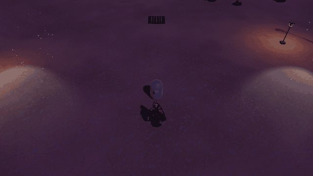

## Centinela de Cobre

Recibe el 25% del daño sobrenatural salvo durante la recuperación, cuando se abre su ventana de vulnerabilidad y recibe el daño completo. El daño físico se mantiene completo. Prepara un abanico de tres proyectiles durante un segundo, se recupera dos y recarga en 3,5 s. El alcance es de 11 m y cada impacto causa 16 de daño físico. Es pesado, inmune al empuje y no causa contacto normal.

La presentación anuncia los rayos del abanico y muestra «Vulnerable» en su recuperación. Los misiles tienen animación, iluminación y un límite de luces simultáneas. El gólem mantiene su cuerpo geométrico mientras se integra el arte de sprite preparado, según [[02 - Personajes y Animación]].

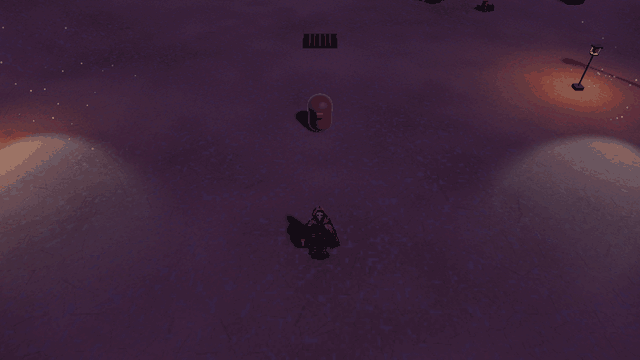

Los élites empiezan a aparecer desde los 90 s y se alternan cada 25 s cuando hay capacidad, con un límite conjunto de dos vivos. Sus efectos de barrido y proyectiles están en [[06 - Registro visual]].

## Gólgora: MataColeccionista

La ronda demo usa 3600 HP y la completa 9000 HP. La entrada ocurre a los tres u ocho minutos y retira la horda ordinaria sin recompensas. El jugador se traslada con protección a una caldera de 22 m de radio cuyo perímetro se cierra. Una presentación con título y rugido precede al combate; la cámara encuadra al jugador y al jefe.

Gólgora usa un modelo 3D animado y efectos de magma propios. Las capturas de sus seis patrones se muestran en [[02 - Personajes y Animación]].

| Patrón | Regla de primera fase, salvo donde se indica |
| --- | --- |
| Martillazo | Círculo de 3 m, situado 3 m por delante; 40 de daño, preparación de 1,2 s, recuperación de 1 s y recarga de 6 s. Puede dañar y empujar secuaces. |
| Barrido | Radio de 6 m y arco de 180°; 30 de daño, preparación y recuperación de 1 s, recarga de 7 s. |
| Bombardeo | Tres posiciones previstas; 25 de daño en radio 2,5 m, preparación de 0,7 s, vuelo base de 0,8 s y recarga de 8 s. Deja magma durante 4 s. |
| Cerco de magma | Salto al centro, impacto de llegada y ondas expansivas con un hueco de 60°. Las ondas avanzan a 6 m/s y causan 30 de daño. Una onda en primera fase y tres en segunda, separadas 1,3 s y con el hueco rotado 45°. |
| Fisura de magma | Cinco puntos a lo largo de una línea hacia el jugador, hasta 22 m; 24 de daño en radio 1,4 m. Preparación de 1,1 s, recuperación de 0,8 s, recarga de 10 s y zonas de 3 s. |
| Lluvia de escoria | Segunda fase: cinco impactos alrededor de la posición prevista, 26 de daño en radio 1,8 m. Preparación base de 1,35 s, vuelo base de 0,9 s, recuperación de 1 s y recarga de 14 s antes de los modificadores de fase. Zonas de 3,5 s. |

Las zonas de magma de estos proyectiles causan 5 de daño cada 0,5 s. El cerco empieza a estar disponible a los doce segundos de combate del jefe y después se programa con una recarga base de 18 s al completar la secuencia.

[Ver los seis patrones de Gólgora en GIFs capturados en Unity](05%20-%20Arte%20y%20Audio/02%20-%20Personajes%20y%20Animaci%C3%B3n.md#g%C3%B3lgora-matacoleccionista).

### Segunda fase y resistencia al control

Al llegar al 50% de vida se inicia una transición protegida con rugido. La velocidad pasa a ×1,3; las preparaciones de los ataques que usan ese modificador, a ×0,85; las recuperaciones y recargas, a ×0,75. El cerco emite tres ondas y se incorpora la lluvia de escoria.

Gólgora es inmune al empuje. La ralentización tiene un máximo del 25%. Congelaciones y aturdimientos se reducen al 35% de su duración, con un máximo de 0,6 s y una ventana de inmunidad posterior de 1,5 s. Durante introducción, transición y salto no admite el control normal y no recibe daño. El estado activo del cerco aplica su reducción de daño configurada del 35%.

### Refuerzos y cierre

El director solicita grupos de hasta cuatro cada cuatro segundos. La caldera limita el conjunto a ocho secuaces y apariciones pendientes, con 0,9 s de aviso. La composición rota entre Residual, Residual, Mortero y Polilla. Cerco y transición de fase suspenden esos refuerzos y retiran los presentes.

La muerte de Gólgora cierra el encuentro si el jugador vive. La presentación final incluye la absorción de una gema y 500 XP de resumen, sin nuevas cartas. Si el jugador muere en el mismo paso, prevalece la derrota.

---

# Objetos y coleccionables

## Gemas y botiquines

Las gemas conceden la XP del enemigo que las dejó y permanecen hasta recogerse. Los botiquines curan 15 HP de base y caducan tras 22 s. Ambos responden al imán y al Pulso colector; se consumen al llegar al personaje y conservan su valor durante el vuelo.

## Entidades de la colección

Las entidades son copias de un inventario persistente. La colección empieza vacía. Nueve personajes aparecen en la arena y seis son resultados de fusión. Las probabilidades de la tabla corresponden a cada aparición de mapa; suman el 100% entre sus nueve entradas.

| Entidad | Rareza | Fuente | Poder al equiparla |
| --- | --- | --- | --- |
| Lobito | Común | Arena · 25% | Dash ágil |
| Mago | Raro | Arena · 10% | Freón residual |
| Demonio | Raro | Arena · 10% | Reacción en cadena |
| Shireen | Especial | Arena · 5% | Sifón |
| Yanikua | Mítico | Fusión | Rayo solar |
| Basket | Común | Arena · 25% | Pulso rápido |
| Hada | Épico | Arena · 7% | Nanobots |
| Lisa | Legendario | Arena · 3% | Ventisca |
| Reaper | Común | Fusión | Óptica precisa |
| Chico Emo | Raro | Fusión | Onda sísmica |
| Conde Alucard | Especial | Fusión | Sifón |
| Murciélago Cristal | Épico | Fusión | Prisma voltaico |
| Sirena | Legendario | Fusión | Cero absoluto |
| Soldier | Especial | Arena · 5% | Reacción en cadena |
| Joel | Raro | Arena · 10% | Óptica precisa |

Las seis rarezas de entidades son Común, Raro, Especial, Épico, Legendario y Mítico. El catálogo de cartas de combate mantiene sus cuatro rarezas propias.

Cada 30 s de combate activo se intenta generar entre una y tres entidades en posiciones válidas del mapa. Hay un máximo de doce presentes y cada aparición dura diez segundos. El jugador debe acercarse y pulsar E a menos de unos 2,5 m, con la interacción despejada. La recogida incorpora una copia y la guarda en ese momento. Yanikua solo puede obtenerse mediante fusión.

## Selección de entidades equipadas

La bóveda tiene tres puestos de equipo. Se abre el selector con E junto al puesto que se quiere cambiar. El inventario muestra cada copia, sus retratos y su disponibilidad, con paginación cuando hace falta. Se puede cambiar la entidad o dejar el puesto vacío.

Cada copia aporta un nivel de su poder. Varias entidades con el mismo poder acumulan niveles hasta el máximo de la mejora. Las cartas de la expedición se calculan por separado: el nivel efectivo usa el mayor entre cartas y equipo. Una copia equipada no está disponible para consumirse en la máquina o liberarse del inventario.

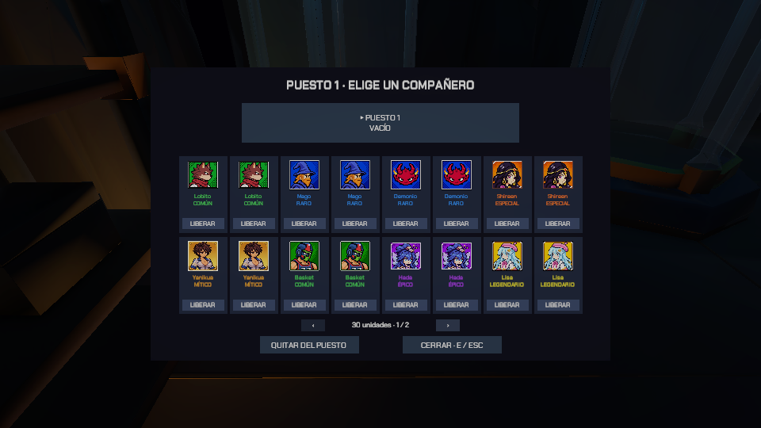

Elegir equipo debe formar parte de la preparación antes de escoger ronda. El sistema está implementado, pero falta señalizarlo de forma que el jugador comprenda sus tres puestos y sus poderes sin tener que encontrarlos por su cuenta.

## Fusión de cuatro copias

La máquina está dentro de la bóveda y se abre con E. Se eligen cuatro copias disponibles; al comenzar se consumen y se sortea una sola vez el resultado. Las equipadas y Yanikua están protegidas como ingredientes.

El sorteo usa la calidad media de los ingredientes. Cada banda ofrece resultados de su rareza y la siguiente, y las mezclas interpolan entre bandas. Los seis resultados posibles son Reaper, Chico Emo, Conde Alucard, Murciélago Cristal, Sirena y Yanikua.

| Cuatro ingredientes de la misma rareza | Tiempo | Resultados |
| --- | ---: | --- |
| Comunes | 60 s | Reaper 60%; Chico Emo 40%. |
| Raros | 120 s | Chico Emo 60%; Conde Alucard 40%. |
| Especiales | 180 s | Conde Alucard 60%; Murciélago Cristal 40%. |
| Épicos | 180 s | Murciélago Cristal 59,4%; Sirena 39,6%; Yanikua 1%. |
| Legendarios | 180 s | Sirena 70%; Yanikua 30%. |

En mezclas, Yanikua tiene 30% con cuatro legendarios, 15% con tres y 5% con dos. Con un legendario o algún épico su probabilidad es del 1%; sin épicos ni legendarios es cero. Esa cuota se reserva antes de repartir el resto de resultados. El tiempo es 60 s cuando todos son comunes, 120 s si la calidad media está por debajo de Especial y 180 s desde esa calidad.

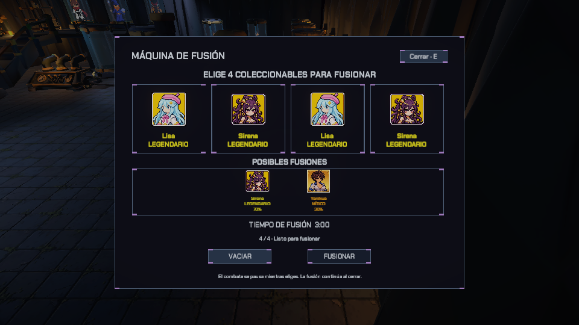

La selección pausa el mundo. Al iniciar se cierra el menú y el proceso avanza durante el juego activo, también en la bóveda. Las pausas y el tiempo fuera de la aplicación no lo adelantan. Al llegar a cero queda listo: hay que volver a interactuar para abrir la persiana. El resultado espera Coleccionar o Liberar antes de comenzar otra fusión.

## Exposición y duplicados

Los siete puestos de exposición muestran copias disponibles ordenadas por rareza. Las cantidades del inventario pueden superar esos puestos. Los duplicados siguen siendo copias utilizables; la selección de equipo y las recetas respetan cuántas quedan libres.

Liberar una copia del inventario muestra una confirmación con su nombre. Coleccionar el resultado de fusión suma una copia; Liberar descarta ese resultado.

---

# Misiones y desafíos

La expedición tiene una condición principal: sobrevivir a la horda y derrotar a Gólgora con el Coleccionista vivo. La ronda demo activa su entrada a los tres minutos y la completa a los ocho; el combate continúa hasta resolver el resultado.

Antes de salir, la preparación incluye revisar y seleccionar hasta tres entidades equipadas. Se puede comenzar sin equipo si aún no hay copias o se dejan puestos vacíos. La guía hacia esta preparación sigue siendo una necesidad de UX.

Los desafíos del combate surgen de mantener rutas entre enemigos y obstáculos, recoger XP, aprovechar las Polillas cebadas, esquivar cargas y responder a resistencias de los élites. Las entidades que aparecen durante diez segundos añaden una decisión de recorrido: acercarse a recogerlas con E mientras continúa la presión.

El cierre cambia el espacio de juego a la caldera. Gólgora alterna distancias, áreas, cercos y proyectiles, y acelera sus patrones en la segunda fase. Las cartas y los poderes iniciales ofrecen herramientas distintas para cada intento.

El resumen muestra tiempo, nivel, bajas y XP. Volver a la bóveda permite revisar las copias reunidas, cambiar el equipo o preparar una fusión. Las recogidas ya guardadas se conservan tanto tras victoria como tras derrota.

---

# Dirección de arte

El juego combina un escenario 3D de formas angulares con sprites de pixel art, un jefe con modelo animado y efectos de luz y partículas. Metal, roca, madera y chatarra ocupan el fondo oscuro; las siluetas, los avisos y las fuentes luminosas separan lo que requiere atención.

El perfil exterior coloca la cámara a 35,5° con campo de visión de 34°. La bóveda usa una perspectiva propia y el encuentro de Gólgora adapta la distancia para encuadrar a ambos combatientes. El Coleccionista se representa en un plano vertical con proporciones fijas dentro del mundo.

| Uso | Tratamiento presente |
| --- | --- |
| Exterior | Azules y violetas oscuros, niebla, haces y polvo ambiental. |
| Materiales | Acero apagado, cobre, óxido, piedra y madera. |
| Jugador | Capucha clara, farol y haz automático; brillo pasivo en la bóveda. |
| Ácido | Verde sobre el terreno oscuro. |
| Peligro anunciado | Ámbar y naranja, contornos y progreso visible. |
| Hielo | Tinte celeste, cristales y niebla fría. |
| Jefe | Armadura oscura, núcleo y efectos de magma. |
| Colección | Retratos enmarcados, rótulos y colores por rareza. |

Apollo permanece como referencia de paleta. Los sprites activos del Coleccionista, Mortero y Polilla usan celdas de 64 × 64; Esqueleto, Interceptor y Wendigo usan 96 × 96. Sus atlas y animaciones están en [[02 - Personajes y Animación]].

Los efectos reducidos retiran decoración y movimiento accesorio, conservando los avisos necesarios para jugar.

---

# Personajes y animación

Esta página reúne las fichas visuales del Coleccionista, los cinco enemigos de horda, los dos élites y Gólgora. Cada enemigo de horda tiene su spritesheet, la fuente editable y los GIFs de todas sus acciones. Los recursos y capturas corresponden al 4 de noviembre de 2026; esta organización documental se revisó el 5 de noviembre.

Las reglas y cifras de combate se consultan en [[03 - Enemigos y NPC]]. La identidad y el papel general de cada personaje se recogen en [[03 - Personajes]].

## Recursos actuales y estado de integración

| Personaje o arquetipo | Recurso y estado | Animaciones por dirección |
| --- | --- | --- |
| Coleccionista | Sprite integrado; atlas de 108 fotogramas de 64 × 64. | Reposo 8, marcha 8, dash 3 y muerte 8. |
| Residual / Esqueleto | Sprite integrado; atlas de 144 fotogramas de 96 × 96. | Reposo 8, marcha 8, ataque 8, impacto 4 y muerte 8. |
| Interceptor / galgo de chatarra | Sprite integrado; atlas de 152 fotogramas de 96 × 96. | Reposo 6, marcha 12, ataque 6, impacto 4 y muerte 10. |
| Coloso / Wendigo | Sprite integrado; atlas de 200 fotogramas de 96 × 96. | Reposo 8, marcha 8, preparación 8, carga 6, recuperación 6, impacto 4 y muerte 10. |
| Mortero Campana | Sprite integrado; atlas de 112 fotogramas de 64 × 64. | Flotación 6, carga 6, disparo 4, recuperación 4 y muerte 8. |
| Polilla Reactor | Sprite integrado; atlas de 62 fotogramas de 64 × 64. | Vuelo 8 y cebado 6; estallido común de 6. |
| Caballero Fantasma | Arte de sprite preparado; integración en Unity pendiente. La representación jugable documentada usa geometría y VFX. | Los ciclos del nuevo sprite quedan pendientes de comprobar dentro del juego. |
| Centinela de Cobre / gólem | Arte de sprite preparado; integración en Unity pendiente. La representación jugable documentada usa geometría y VFX. | Los ciclos del nuevo sprite quedan pendientes de comprobar dentro del juego. |
| Gólgora / MataColeccionista | Modelo 3D animado integrado y VFX de magma. | Entrada, locomoción, martillazo, barrido, lanzamiento, salto y presentación final. |

## Cómo leer las previsualizaciones

Los GIFs de atlas colocan juntas las cuatro vistas y usan sus fotogramas y tiempos exportados. La escala es el doble del píxel original, sin interpolación. El estallido de la Polilla es una acción compartida. El bucle facilita revisar una acción; los golpes y las muertes se reproducen según su estado durante el juego.

Estas previsualizaciones muestran el recurso de animación. Las luces, sombras, movimiento físico y VFX se observan en las capturas de Unity, identificadas con su fecha y condiciones. Los registros anteriores de octubre que muestran cuerpos geométricos de Residual, Interceptor y Coloso no representan sus sprites actuales.

## El Coleccionista

El farol sigue al personaje y el haz acompaña al apuntado automático. El sprite mantiene un plano vertical con proporciones fijas en el mundo y se apoya sobre el terreno. La iluminación, sombras y reacciones al daño se añaden durante la ejecución.

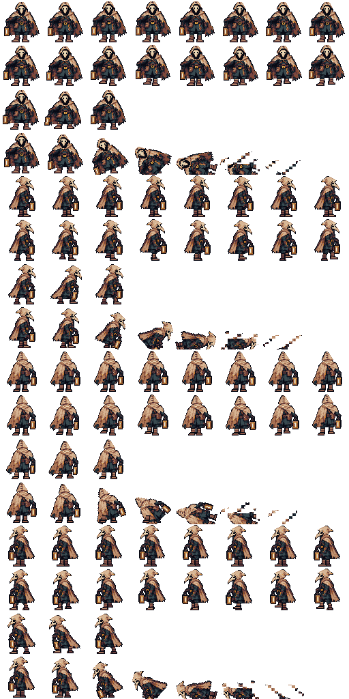

[Fuente editable del Coleccionista](Media/Avance_2026-11-04/Spritesheets/Coleccionista.aseprite).

| Animación | Cuatro direcciones |
| --- | --- |
| Reposo |  |
| Marcha |  |
| Dash | 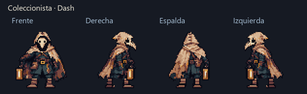 |
| Muerte | 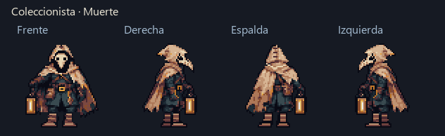 |

## Residual: Esqueleto

Es la masa básica de la horda. Su representación actual es un esqueleto animado en cuatro direcciones. La marcha acompaña la persecución y el ataque acompaña el contacto; impacto y muerte permiten reconocer la respuesta al daño.

Su atlas tiene 144 fotogramas de 96 × 96: reposo, marcha y ataque de ocho, impacto de cuatro y muerte de ocho por dirección.

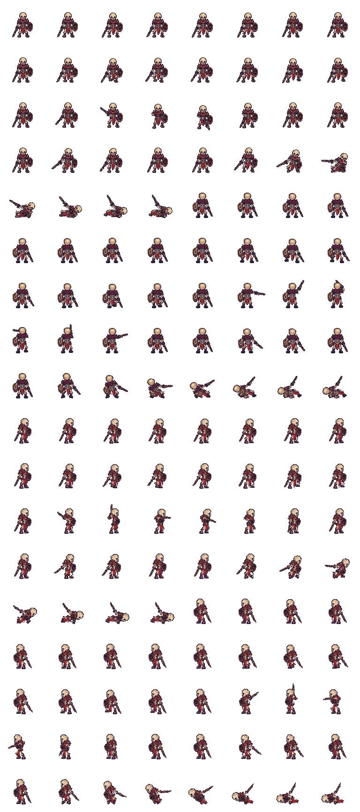

[Fuente editable](Media/Avance_2026-11-04/Spritesheets/Esqueleto.aseprite).

| Animación | Cuatro direcciones |
| --- | --- |
| Reposo | 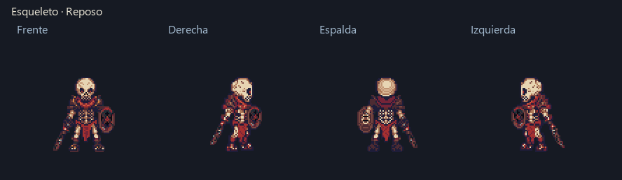 |
| Marcha |  |
| Ataque |  |
| Impacto recibido | 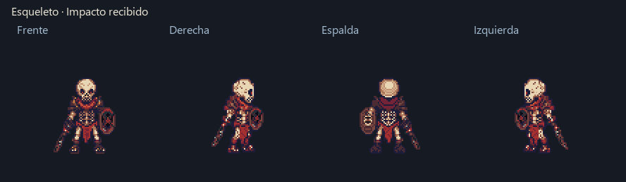 |
| Muerte |  |

## Interceptor: galgo de chatarra

Es el perseguidor rápido de la horda. El galgo de chatarra sustituye su antigua representación geométrica. Su silueta baja y la marcha rápida distinguen la persecución del Residual.

El atlas tiene 152 fotogramas de 96 × 96: reposo de seis, marcha de doce, ataque de seis, impacto de cuatro y muerte de diez por dirección. El sprite de galgo sustituye su representación geométrica anterior.

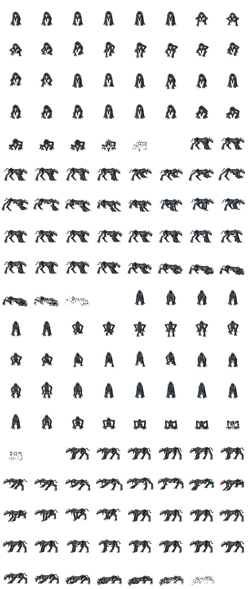

[Fuente editable](Media/Avance_2026-11-04/Spritesheets/Interceptor.aseprite).

| Animación | Cuatro direcciones |
| --- | --- |
| Reposo | 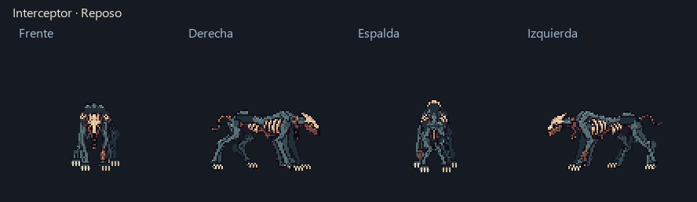 |
| Marcha | 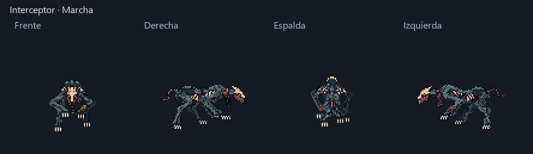 |
| Ataque | 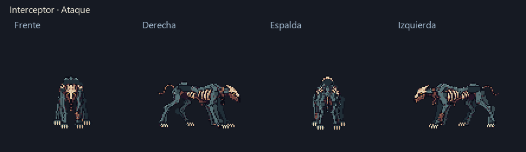 |
| Impacto recibido | 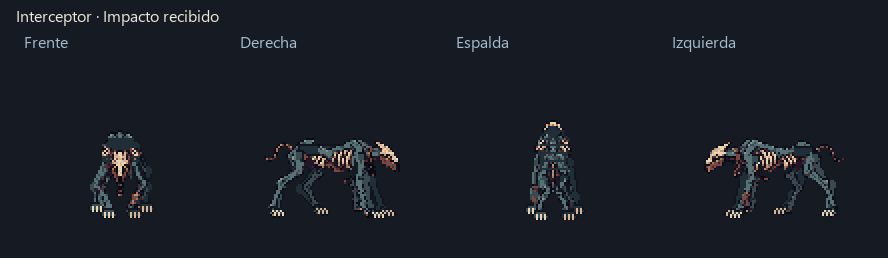 |
| Muerte | 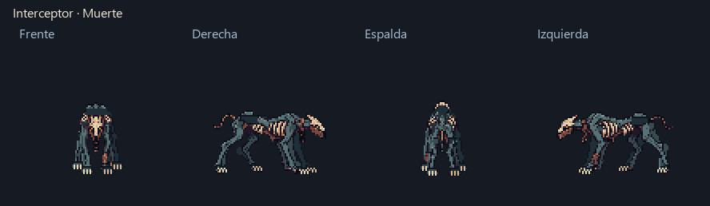 |

## Coloso: Wendigo

Es el enemigo pesado que abre corredores con su embestida. El sprite de Wendigo acompaña la marcha, la preparación, la carga y la recuperación; cada estado tiene su propio ciclo para que se lea la secuencia del ataque.

El atlas de Wendigo tiene 200 fotogramas de 96 × 96: reposo, marcha y preparación de ocho; embestida y recuperación de seis; impacto de cuatro y muerte de diez por dirección.

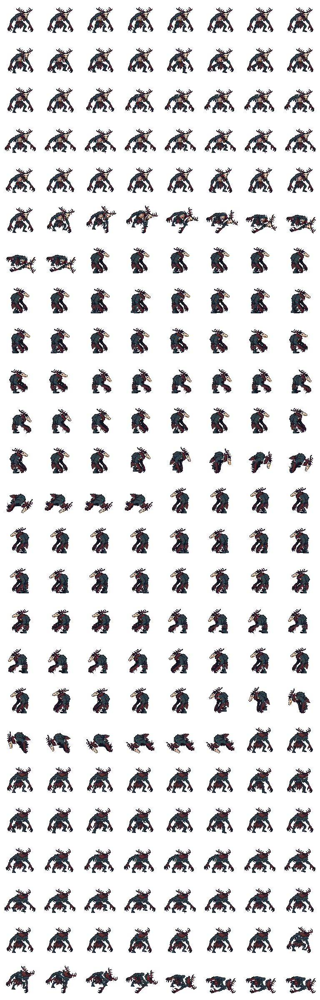

[Fuente editable](Media/Avance_2026-11-04/Spritesheets/Wendigo.aseprite).

| Animación | Cuatro direcciones |
| --- | --- |
| Reposo |  |
| Marcha | 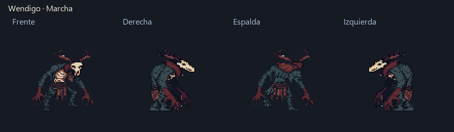 |
| Preparación de carga | 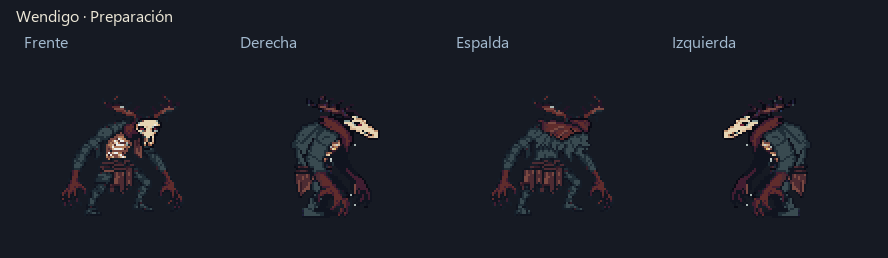 |
| Embestida | 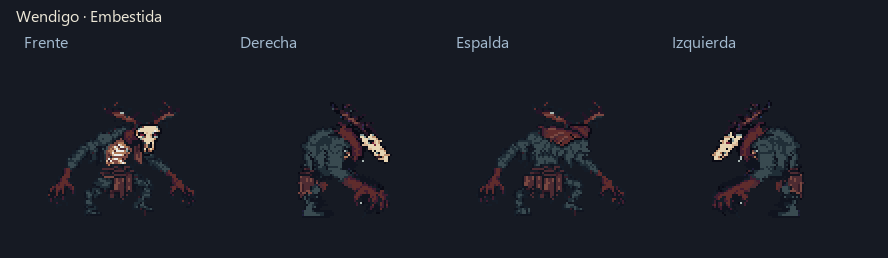 |
| Recuperación | 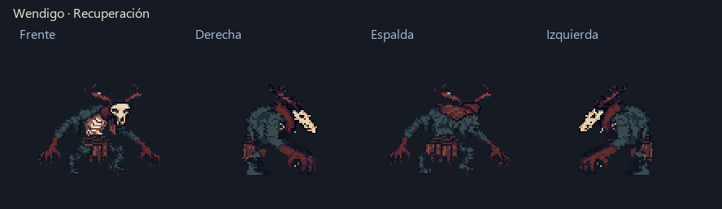 |
| Impacto recibido | 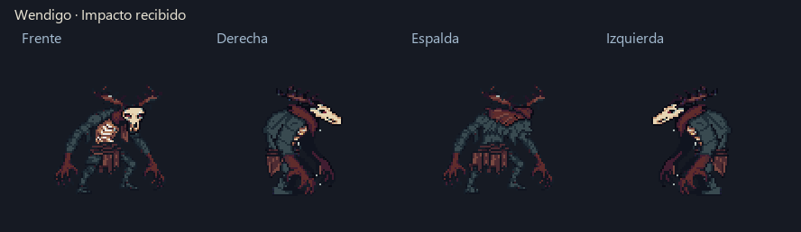 |
| Muerte | 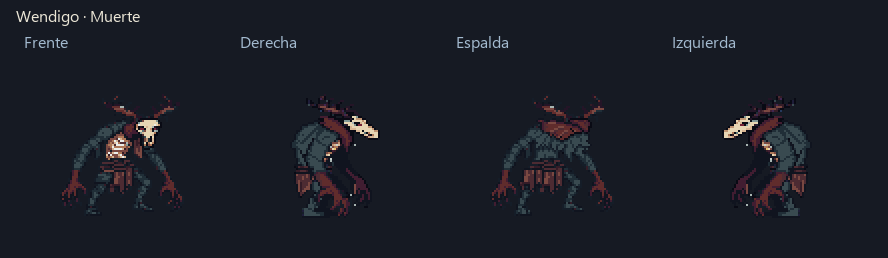 |

## Mortero: Campana

Es la artillería de la horda. Su cuerpo de campana flotante encadena flotación, carga del emisor, disparo y recuperación. El proyectil y el charco de ácido se añaden durante la ejecución en Unity.

Su atlas contiene 112 fotogramas de 64 × 64: flotación y carga de seis, disparo y recuperación de cuatro, y muerte de ocho por dirección.

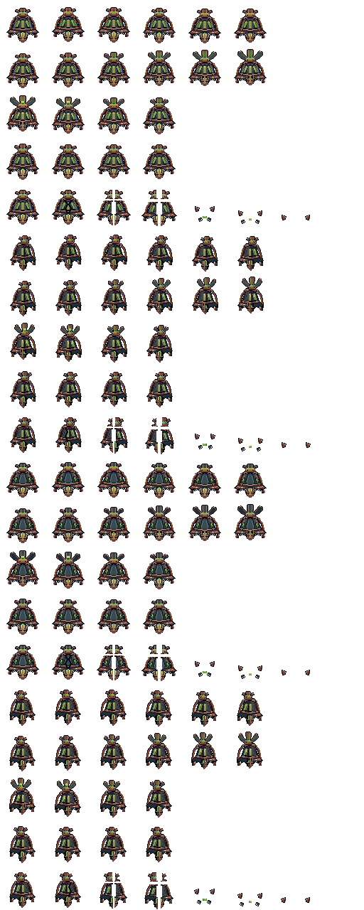

[Fuente editable](Media/Avance_2026-11-04/Spritesheets/Mortero.aseprite).

| Animación | Cuatro direcciones |
| --- | --- |
| Flotación | 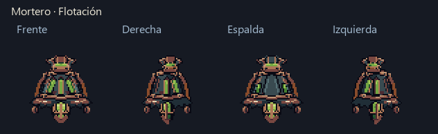 |
| Carga del emisor | 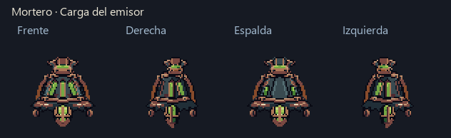 |
| Disparo | 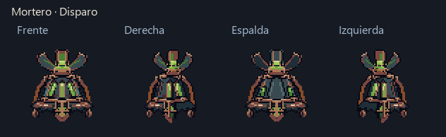 |
| Recuperación | 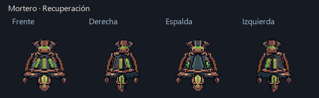 |
| Muerte | 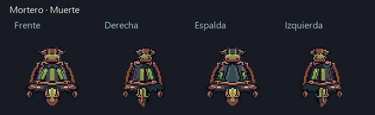 |

## Polilla: Reactor

Es el enemigo explosivo de la horda. Su presentación distingue el vuelo de aproximación, el cebado de la mecha y el estallido. Vuelo y cebado tienen cuatro vistas; el estallido es compartido.

Su atlas tiene 62 fotogramas de 64 × 64: vuelo de ocho y cebado de seis por dirección, más seis de estallido compartido.

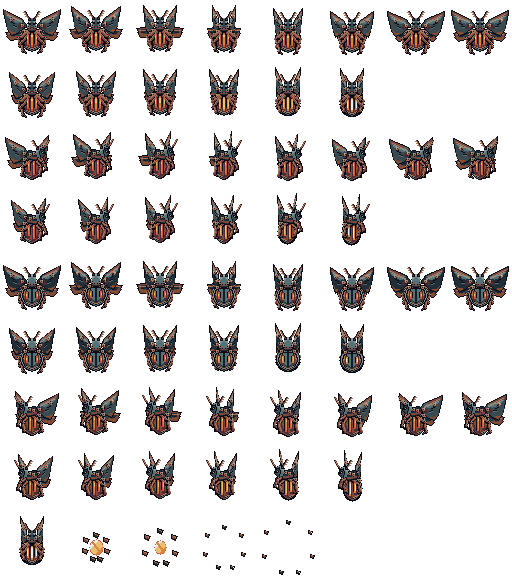

[Fuente editable](Media/Avance_2026-11-04/Spritesheets/PolillaReactor.aseprite).

| Animación | Cuatro direcciones |
| --- | --- |
| Vuelo | 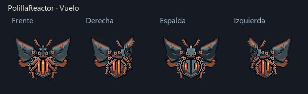 |
| Cebado | 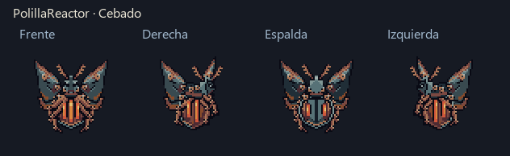 |
| Estallido compartido | 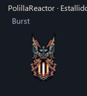 |

## Caballero Fantasma

Élite de barrido sobrenatural y resistencia al daño físico. Su presentación jugable documentada todavía usa geometría de personaje y un efecto animado para el barrido.

**Pendiente: integrar el sprite en Unity.** El arte del personaje está preparado, pero falta conectar sus ciclos a la locomoción, preparación, ataque, recuperación, impacto y muerte del enemigo. Después de esa conexión se incorporarán aquí el atlas y los GIFs verificados dentro del juego.

La captura del montaje geométrico conservada en [[03 - Enemigos y NPC]] corresponde al 4 de noviembre. Sirve como referencia de combate; no valida la integración del nuevo sprite.

## Centinela de Cobre: gólem

Élite pesado de proyectiles físicos y resistencia al daño sobrenatural. El gólem se denomina Centinela de Cobre en los ajustes del juego. Su ataque abre una ventana de vulnerabilidad durante la recuperación.

**Pendiente: integrar el sprite en Unity.** El arte está preparado, pero falta conectar los ciclos del cuerpo y la secuencia de apertura, preparación, disparo, vulnerabilidad y cierre con los estados del enemigo. Después de esa conexión se incorporarán aquí el atlas y los GIFs verificados dentro del juego.

La captura del montaje geométrico conservada en [[03 - Enemigos y NPC]] corresponde al 4 de noviembre. El efecto animado de los misiles pertenece a los VFX y no confirma que el sprite del cuerpo esté integrado.

## Gólgora: MataColeccionista

Es el jefe de la expedición. Su cuerpo pesado, arma y magma se representan con un modelo 3D animado integrado. Sus recursos de magma son efectos propios; el personaje no utiliza un spritesheet 2D.

### Ataques dentro de la arena

Las siguientes capturas de Unity son del 4 de noviembre de 2026. Cada patrón se invocó de forma aislada, con jugador protegido, cámara de detalle y oleadas detenidas. La lluvia corresponde a la segunda fase. Permiten observar el modelo y sus efectos durante el ataque.

| Ataque en Unity | Registro |
| --- | --- |
| Martillazo | 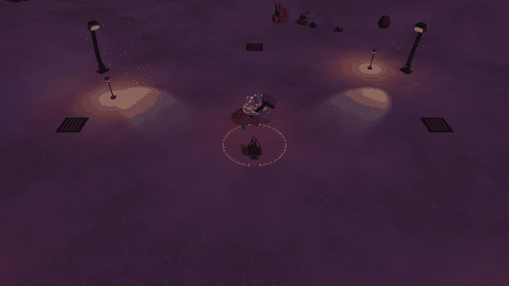 |
| Barrido | 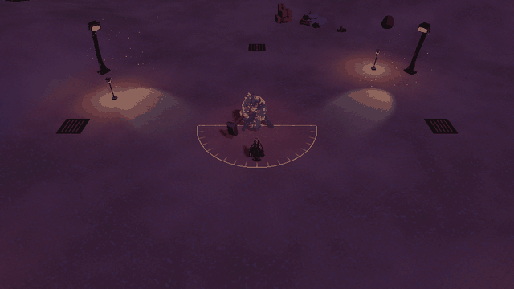 |
| Bombardeo |  |
| Cerco y salto central | 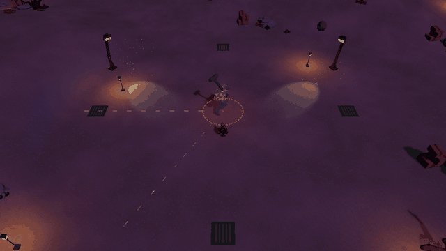 |
| Fisura | 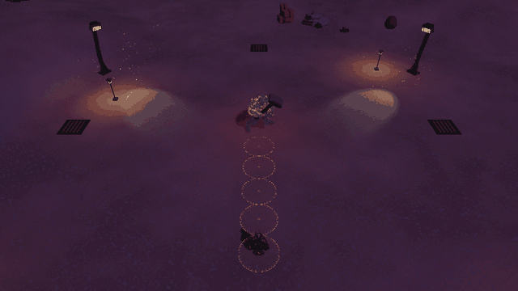 |
| Lluvia de segunda fase | 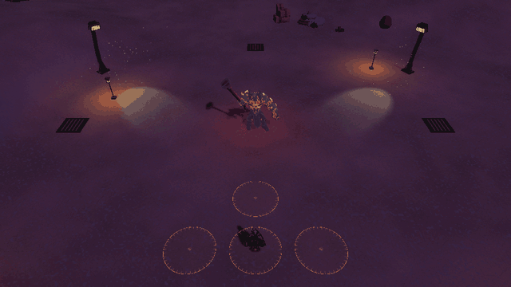 |

Los daños, tiempos, fases, refuerzos y reglas de cierre están en [[03 - Enemigos y NPC]]. Los efectos de ataques y mejoras se reúnen en [[06 - Registro visual]].

---

# Entornos

El Vertedero ocupa 200 × 200 m de relieve, restos industriales, rocas y árboles. Las colisiones participan en las rutas del jugador y de los enemigos. El acceso a la bóveda se encuentra al norte y desciende hasta el portal.

El centro contiene la caldera de Gólgora, con perímetro que se cierra durante el encuentro, avisos para refuerzos y materiales que responden a su activación. Los ataques aportan ondas, impactos, meteoros y zonas de magma. Las tres zonas de lava fija del mapa están desactivadas en esta versión.

La iluminación exterior utiliza un perfil compartido de luz, atmósfera y enfoque. La niebla y los haces acompañan los puntos luminosos sin sustituir los contornos que anuncian daño.

La bóveda modular ocupa otra zona de la misma escena. Su suelo continuo y sus muros enmarcan diez puestos: tres de equipo y siete de exposición. Dentro se encuentran la máquina de fusión y el portal. La cámara tiene un encuadre propio, seguimiento limitado por la sala e iluminación interior.

La máquina combina cámara de resultado, persiana móvil y efectos de apertura. Cuando termina una fusión permanece cerrada en estado listo hasta que el jugador interactúa. El sonido y el humo acompañan la apertura.

---

# Interfaz visual

El menú inicial utiliza un portal animado, elementos de la colección en órbita y botones de Continuar, Nueva colección, Configuración y Salir. La transición al mundo tiene una pantalla de carga con animación del Coleccionista.

En la bóveda, el jugador puede preparar las tres entidades equipadas. El selector de cada puesto muestra retratos enmarcados, copias disponibles y su poder. Falta un indicador general que explique esta preparación antes de iniciar la expedición; los avisos locales de proximidad no resuelven por sí solos ese descubrimiento.

La selección de ronda presenta Demo, Completa y Salir. Su confirmación se acompaña de una animación de salida y un rugido antes de la entrada a la arena.

El HUD de combate muestra vida, XP, nivel, tiempo, bajas, dash, mejoras, retratos de las tres entidades equipadas y un minimapa circular. El mapa descubre terreno al recorrerlo, sitúa al jugador y los coleccionables, y muestra el portal cuando su zona ha sido explorada. Gólgora dispone de barra roja e indicador fuera de pantalla.

Las cartas conservan marcos por rareza, nombre, nivel, tipo de daño y cambio de valores. La entrada, el enfoque y la confirmación tienen animación, reducida cuando se solicita. Chakra Petch sigue presente en HUD, cartas y números de daño; el menú inicial usa sus recursos tipográficos propios.

La pausa reúne Reanudar, Abandonar o Menú inicial según el contexto, volumen general, preferencias visuales y modo de estadísticas. Los resultados muestran tiempo, nivel, bajas y XP, con Volver a la bóveda. La máquina tiene cuatro espacios de ingredientes y un selector de copias paginado.

---

# Audio y música

El juego ya tiene música y efectos integrados. El área sonora acompaña el lugar, los ataques y las acciones del Coleccionista.

| Contexto | Audio presente |
| --- | --- |
| Arena | Pista de combate en bucle. El recurso conserva el nombre de prueba Arena_combat_Test. |
| Gólgora | Pista de jefe con transición desde la arena y reducción de mezcla durante el rugido. El recurso sigue identificado como prueba. |
| Bóveda | Pista propia que se detiene al salir hacia combate o menú. |
| Linterna | Inicio de ráfaga, tres variantes de pulso, cuarto pulso, descanso, impacto normal y crítico, activación y bucle solar. |
| Experiencia | Sonido de recogida con variación de tono. |
| Transiciones | Entrada del Coleccionista, llegada por portal y rugido al elegir ronda. |
| Fusión | Sonido de apertura de la cámara al revelar el resultado. |
| Jefe | Rugido, pasos, ataques e impactos mediante sus componentes de audio. |

La música de arena y jefe continúa durante cartas y pausa manual. La pérdida de foco pausa su reproducción. La bóveda tiene su propia mezcla y las transiciones evitan que siga sonando fuera de su contexto.

El menú de pausa incorpora volumen general, guardado localmente bajo EchoScrap.Audio.MasterVolume. El control actúa sobre el volumen global de escucha.

## Procedencia documentada

La mezcla de la linterna utiliza grabaciones de microondas de pinto0lucas y contador Geiger de cookies+policy. El archivo Sources.txt del proyecto registra sus enlaces, la licencia CC0 indicada para ambas y las transformaciones realizadas: conversión a mono, selección de clics, capas, envolventes y tonos sintetizados. Los WAV entregados son mono, 44,1 kHz y 16 bits.

La integración de una pista no implica que sea una composición final. Los nombres de prueba de arena y jefe se mantienen identificados como tales. La autoría y los recursos de cada incorporación deben conservarse en su registro de fuentes.

Los GIFs de este GDD no contienen audio. Sirven para revisar animación y VFX; la escucha se comprueba en el juego.

---

# Registro visual

## Procedencia de los medios

El registro reúne previsualizaciones de recursos y capturas de ejecución, con su procedencia y fecha:

- **Previsualizaciones de atlas, 4 de noviembre.** Copias de los PNG activos y GIFs compuestos con sus rectángulos, etiquetas y tiempos JSON. Las acciones de personaje muestran cuatro direcciones a escala 2×, sin interpolación. No incluyen la iluminación ni la simulación del juego.
- **Capturas de Unity, 4 de noviembre.** CombatArena ejecutada desde una copia externa del proyecto, a 960 × 540 y doce imágenes por segundo. Se usaron cámara de detalle, jugador protegido y oleadas detenidas. Los patrones del jefe se invocaron individualmente con sus componentes y ajustes; para la lluvia se activó la segunda fase. Las pantallas de preparación utilizan un inventario de muestra, sin guardar esa colección.

- **Capturas de Unity, 5 de noviembre.** Veintiuna secuencias nuevas de linterna, mejoras, daño, fusión y portal del menú. Se ejecutaron desde una copia externa del montaje local basado en b9e3136, con cámara de detalle a 960 × 540 (1280 × 720 en números de daño) y doce imágenes por segundo, salvo el Micro-ensamblador y los números de daño, registrados a 24; los GIFs se exportan a 768 × 432. Las oleadas están detenidas, los objetivos tienen locomoción desactivada y se activan eventos y estados reales del código para aislar cada efecto. Algunos disparadores se repiten para facilitar su revisión. El jugador está protegido salvo el daño controlado de Nanobots; la fusión utiliza ingredientes de muestra y el guardado permanece desactivado.

Los registros del 4 de noviembre corresponden al montaje local basado en 30b88c6 y conservan sus dimensiones: PNG de 960 × 540 y GIF de Unity de 640 × 360. La cámara de detalle permite leer animaciones y efectos; no representa el encuadre de toda una partida ni una medición de rendimiento.

## Enemigos y personajes

[[02 - Personajes y Animación]] reúne el atlas y los GIFs del Coleccionista, los cinco spritesheets completos de horda con todas sus acciones y las capturas de los seis patrones de Gólgora. Caballero Fantasma y Centinela de Cobre (gólem) tienen su integración de sprite pendiente. Las capturas geométricas de esos élites se conservan como referencia fechada en [[03 - Enemigos y NPC]], junto a sus reglas de combate.

## Efectos de enemigos

La biblioteca activa contiene quince clips y 120 fotogramas. La siguiente hoja pertenece a esos efectos, no a los cuerpos de los élites o del jefe.

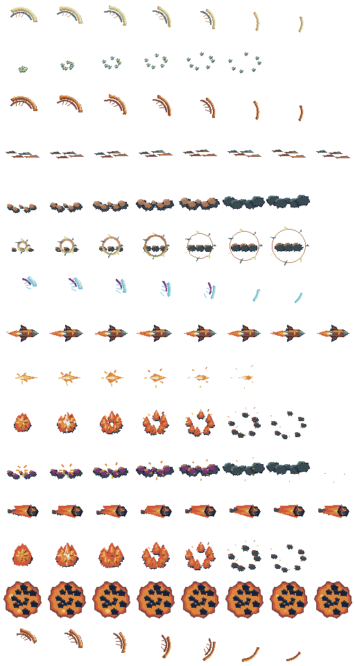

Los GIFs de esta tabla son previsualizaciones del atlas. La iluminación de los misiles, las trayectorias y los avisos de daño se observan en las capturas de los enemigos.

| Efecto | Animación del recurso |
| --- | --- |
| Golpe del Residual | 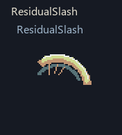 |
| Fragmentos de hueso | 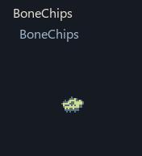 |
| Golpe del Interceptor | 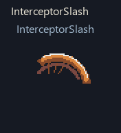 |
| Estela del Interceptor | 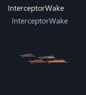 |
| Polvo del Coloso | 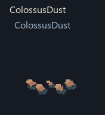 |
| Impacto del Coloso | 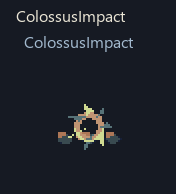 |
| Barrido espectral | 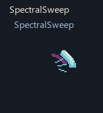 |
| Misil de cobre | 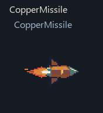 |
| Salida del disparo de cobre | 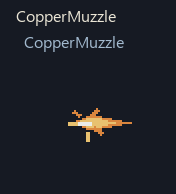 |
| Impacto de cobre | 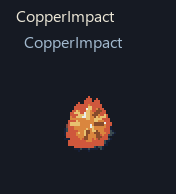 |
| Humo de la Polilla |  |
| Meteoro de magma |  |
| Impacto de magma |  |
| Zona de magma |  |
| Barrido de magma |  |

## Torreta centinela

La torreta actual usa trípode y cañón separados, orientación del cañón, boca de salida y retroceso. La secuencia de direcciones es una previsualización técnica del recurso preparada el 3 de noviembre; el disparo siguiente se capturó en Unity el 4.

## Linterna

Las dos capturas usan los mismos objetivos inmóviles y la misma cámara. La presentación cambia con las mejoras de la linterna: alcance y apertura, cadencia, intensidad y color. Estas variantes reutilizan el haz y los impactos del arma.

### Linterna base

La ráfaga muestra el haz, los pulsos y las reacciones de los enemigos alcanzados.

### Rayo solar

La mejora legendaria cambia la luz a dorado y mantiene los pulsos sin el descanso normal de la ráfaga. La secuencia permite comparar su continuidad con la linterna base.

## Efectos de mejoras

Estas capturas del 5 de noviembre sustituyen las muestras de mejoras del 26 de octubre. Cada secuencia identifica la acción que se está mostrando; los valores y condiciones de adquisición están en [[05 - Progresión]].

### Prisma voltaico

Tras un impacto del cuarto pulso, la descarga enlaza objetivos sucesivos y produce destellos eléctricos en los alcanzados. Los impactos iniciales se repiten durante la captura para mostrar la cadena.

### Frío y congelación

El primer impacto aplica la ralentización. Los pulsos siguientes alcanzan el umbral de congelación y añaden escarcha, partículas y niebla fría al objetivo.

### Ventisca

La mejora emite una onda de frío desde el jugador y congela a los objetivos alcanzados. Para aislar la emisión se adelanta su temporizador mediante el código de ejecución; el GIF no representa el intervalo completo entre activaciones.

### Quiebre de hielo

La muerte de un enemigo congelado libera seis esquirlas radiales. La captura activa el estado de congelación y resuelve el golpe letal para mostrar el disparador y la salida de los proyectiles.

### Minas de chatarra

La mina se coloca en el suelo y explota al detectar un enemigo cercano. La captura adelanta el temporizador de colocación; el radio visible pertenece a la explosión.

### Termobárica

Después de la explosión inicial aparece una implosión que se contrae y atrae enemigos. La explosión de Cataclismo se utiliza como fuente para demostrar esta combinación.

### Nova de plasma

La curación que excede la vida máxima acumula la condición de activación y emite una nova alrededor del jugador. La captura suministra curación sobrante para mostrar varias activaciones.

### Curación y reparación

El efecto de reparación acompaña la recuperación efectiva de vida. Más vida, Sifón, Botiquín mejor y la regeneración de Nanobots comparten esta presentación cuando producen una curación.

### Nanobots: protección de emergencia

Un daño controlado deja al jugador por debajo del umbral y activa el escudo temporal. La captura muestra su aparición y desaparición; la regeneración utiliza el efecto de curación anterior.

### Micro-ensamblador

La recogida del grupo de gemas requerido dispara un proyectil guiado hacia un enemigo. Se observan el vuelo, la estela y el impacto; las gemas se suministran en la situación de captura.

### Sierras orbitales

Las sierras giran alrededor del Coleccionista. Sus arcos y chispas acompañan el contacto con los enemigos colocados cerca del recorrido.

### Pulso colector

El remolino de recogida acompaña el vuelo de gemas hacia el jugador. La animación mantiene el valor real de las recogidas y usa un conjunto de gemas de muestra.

### Onda sísmica

El evento de llegada del dash emite una expansión radial de daño y aturdimiento. La captura aísla la llegada y repite el disparador para revisar la onda.

### Holo-señuelo

El inicio del dash deja una copia del Coleccionista. El jugador se aparta para hacerla visible y, al agotarse su duración, la copia desaparece con una implosión. Los enemigos de captura permanecen inmóviles; este registro muestra el efecto visual, no una prueba de su persecución.

### Cataclismo

La explosión nace en el punto de salida y la cuchilla se lanza desde la llegada. La posición del jugador se desplaza de forma controlada entre ambos eventos para mostrar los dos componentes.

## Números de daño

Los valores siguen arcos y distinguen daño físico y sobrenatural, con variantes de impacto normal y crítico, además del indicador `Resistido` en resistencias física y sobrenatural y el rótulo `EJECUTADO` al cumplirse el umbral de ejecución. La captura provoca impactos controlados para revisar los siete casos en pantalla.

## Fusión y portal

### Aura de la máquina de fusión

Las partículas ascienden por los costados de la máquina y dejan libre la puerta. La secuencia muestra el efecto ambiental en la bóveda.

### Apertura y revelación de la fusión

Al abrir una fusión lista se eleva la puerta, aparece humo y se muestra la entidad resultante. La captura utiliza cuatro copias de muestra y adelanta la espera de producción; la apertura y su humo se ejecutan con sus componentes del juego.

### Portal del menú

El vórtice animado y las entidades en órbita forman el fondo del menú inicial. Este GIF registra la interfaz real con su tiempo de presentación recorrido de forma controlada, para observar el ciclo del vórtice y las órbitas que una captura estática no muestra.

## Efectos compartidos y mejoras de estadísticas

Las 35 mejoras no necesitan 35 animaciones distintas. El catálogo de [[05 - Progresión]] conserva sus reglas; esta tabla identifica la presentación compartida y evita confundir una mejora sin VFX exclusivo con una captura ausente.

| Mejora o grupo | Presentación |
| --- | --- |
| Más alcance, Pulso rápido y Golpe potente | Reutilizan el haz, los impactos y la presentación de la linterna; cambian su apertura, alcance, cadencia, color o intensidad. |
| Dash ágil | Reutiliza la animación y las imágenes residuales del dash; modifica velocidad y recarga. Sus animaciones están en [[02 - Personajes y Animación]]. |
| Más vida, Sifón y Botiquín mejor | Reutilizan curación y reparación; el HUD expresa los cambios de vida. |
| Imán | Reutiliza el vuelo de recogida de gemas y botiquines. |
| Chatarrero | Cambia la XP recibida y su lectura en el HUD; no añade un efecto de combate propio. |
| Sintonizador | Se representa mediante reintentos y ofertas en la interfaz de cartas. |
| Óptica precisa y Calibración letal | Reutilizan los destellos y números críticos; cambian sus probabilidades o valores. |
| Ejecución | Muestra el rótulo `EJECUTADO` en los números de daño, resuelve la muerte del enemigo al cumplir su condición y reutiliza la presentación de muerte. |
| Ráfaga crítica y Ojo del verdugo | Reutilizan los avisos de onda, aturdimiento y daño crítico; no introducen una biblioteca de sprites separada. |
| Pólvora volátil y Reacción en cadena | Reutilizan explosiones; cambian su radio, daño o condición de aparición. |
| Blindaje | Se lee en las placas y valores del HUD; no añade una explosión o aura exclusiva. |

## Alcance de estas imágenes

La galería reúne 21 capturas nuevas del 5 de noviembre, los quince clips de la biblioteca de efectos de enemigos y los registros de torreta del 3 y 4 de noviembre. Los patrones de Gólgora están en [[02 - Personajes y Animación]]. Las muestras anteriores de octubre permanecen en el historial del repositorio.

Los GIFs permiten revisar aparición, trayectoria, impacto y desaparición visual. Las cifras de daño, probabilidades y condiciones de activación se contrastan con las reglas del juego. Las situaciones controladas y los temporizadores adelantados se identifican en cada caso. Las animaciones no contienen audio y no certifican un mínimo de FPS.

---

# UX y flujo del jugador

Menú inicial → continuar o crear colección → bóveda → revisar y seleccionar entidades equipadas → elegir ronda demo o completa → expedición → regreso a la bóveda.

## Preparar el equipo en la bóveda

Continuar recupera la colección guardada. Nueva colección empieza con el inventario vacío y restablece la fusión y el equipo, tras confirmar si ya existe progreso.

La preparación incluye revisar los tres puestos de entidades equipadas antes de elegir ronda. Se interactúa con E junto a cada puesto y se escoge una copia del inventario. Cada entidad indica el poder que aporta. Se puede cambiar o quitar y los puestos pueden quedar vacíos; la primera expedición permite conseguir las primeras copias.

**Situación actual:** el sistema funciona, pero el recorrido puede saltarse esta preparación porque no hay una señalización general clara que la presente. Los avisos de E aparecen al acercarse a un puesto, sin explicar antes por qué conviene visitarlo. Hace falta guiar al jugador hasta esos puestos y relacionar las entidades con sus poderes. Esta mejora sigue pendiente de implementación.

El portal y el botón Iniciar expedición conducen a la selección de ronda. La confirmación se presenta antes de la transición y de la entrada del Coleccionista en la arena.

## Durante la expedición

La linterna ataca automáticamente y el HUD comunica salud, experiencia y dash. El minimapa descubre terreno al recorrerlo. Las entidades nuevas tienen un aviso breve y una interacción E al aproximarse; desaparecen a los diez segundos si no se recogen.

Las subidas de nivel pausan el combate y presentan hasta tres cartas. La confirmación aplica la mejora y continúa, o abre otra elección si hay niveles pendientes. Se evita reutilizar esa pulsación para un dash accidental.

Gólgora anuncia su entrada, se prepara el traslado a la caldera y la cámara mantiene a ambos combatientes encuadrados. El rugido y la transición distinguen su segunda fase.

## Volver a preparar

Victoria y derrota muestran un resumen con Volver a la bóveda. La colección obtenida se conserva y las cartas de combate se restablecen para el siguiente intento. Desde pausa, Abandonar pide confirmación antes de volver.

La fusión es otra actividad de la bóveda: cuatro copias, probabilidades visibles, proceso activo y apertura manual al terminar. Una visita desde una expedición suspende el combate y permite retomar después la misma sesión.

---

# UI y menús

| Interfaz | Información y acciones |
| --- | --- |
| Menú inicial | Continuar, Nueva colección, Configuración y Salir; confirmación al sustituir una colección. |
| Bóveda | Acceso al menú inicial, inicio de expedición y preparación en el mundo. |
| Equipo de entidades | Selector del puesto cercano, copias paginadas, retrato, rareza y poder; equipar o quitar. |
| Selección de ronda | Demo, Completa o cancelar la entrada. |
| Carga y entrada | Animación del Coleccionista, transición y presentación del objetivo. |
| HUD | Vida, XP, nivel, tiempo, bajas, dash, mejoras, tres retratos equipados y minimapa circular con exploración. |
| Cartas | Hasta tres opciones; rareza, nivel, efecto, confirmación y reintento con Sintonizador. |
| Pausa | Reanudar, Abandonar o Menú inicial, volumen general, sacudida, decoración, efectos reducidos y estadísticas. |
| Estadísticas | Completa: veinte valores; Reducida: seis principales; Sin: panel oculto. |
| Fusión | Cuatro ingredientes, copias disponibles, probabilidades, tiempo y decisión de resultado. |
| Resultados | Victoria o derrota, tiempo, nivel, bajas, XP y Volver a la bóveda. |
| Laboratorio | Ocho arquetipos, generación, inspección, daño de prueba, congelación, pausa y avance. |

La selección de entidades debe figurar como parte de la preparación anterior a la ronda. Su señalización general todavía está pendiente; actualmente se descubre por la proximidad a cada puesto.

Las cartas aceptan ratón, teclado y mando. El puntero inmóvil no desplaza el enfoque de otro dispositivo. Las interfaces de colección tienen botones y selectores propios; su interacción de acceso usa E.

Las confirmaciones generales protegen Nueva colección y Abandonar. El inventario también confirma la liberación de una copia e indica su nombre.

---

# Accesibilidad

La configuración y la pausa permiten reducir decoración y sacudida de cámara o activar efectos reducidos. Los avisos esenciales de ataque y los indicadores se mantienen. Las cartas expresan enfoque y rareza mediante texto y borde; los críticos añaden un signo de exclamación al color.

El panel de estadísticas puede mostrarse completo, reducido u oculto. El volumen general se ajusta en pausa y se conserva al cerrar la aplicación. Las preferencias visuales se conservan entre reinicios y transiciones de la sesión.

La pausa y la pérdida de foco bloquean el control de combate y exigen liberar las entradas que podrían provocar confirmaciones accidentales al regresar. Los menús principales y las cartas tienen navegación de mando.

## Aspectos pendientes

La preparación de entidades necesita señales claras que lleven al jugador a los tres puestos y expliquen sus poderes antes de salir. Los mensajes locales por proximidad no bastan para descubrir el sistema en el primer recorrido.

La recogida de entidades y la apertura de equipo y fusión dependen actualmente de E. Hace falta revisar el acceso equivalente con mando antes de considerar completo ese recorrido para ambos dispositivos.

---

# Guardado y configuración

## Colección persistente

La estación guarda JSON en PlayerPrefs bajo EchoScrap.Collection.Production.v1. El formato interno actual es la versión 4 e incluye las cantidades de quince entidades, los tres puestos equipados, los datos de exposición, la fase de fusión, el resultado sorteado y sus temporizadores.

Se guarda al recoger una entidad, cambiar el equipo, liberar copias, iniciar o resolver una fusión, durante el proceso y al cerrar. El resultado se decide una vez al comenzar y las cuatro copias se consumen en ese momento.

El tiempo fuera de la aplicación no adelanta la fusión. Al terminar queda lista para una apertura manual. Si se cierra durante la apertura, la carga la devuelve al estado listo para volver a interactuar.

La validación ajusta inventarios, identificadores, puestos y tiempos. Las colecciones de formato 4 que tenían trece entidades amplían su array a quince y conservan sus copias. Los formatos internos anteriores a 4 se restablecen. La antigua clave EchoScrap.FusionPrototype.v1 no se consulta desde el cargador de producción.

## Perfil y opciones

EchoScrap.CollectionStarted.v1 identifica que se ha iniciado una colección. Nueva colección confirma antes de restablecer inventario, equipo y fusión cuando existe progreso.

El volumen general se guarda bajo EchoScrap.Audio.MasterVolume. Los ajustes de decoración, efectos reducidos, sacudida y modo de estadísticas se mantienen entre los reinicios y transiciones de la aplicación en curso; no tienen en este montaje un guardado permanente equivalente al del volumen.

## Estado de la expedición

La salud, XP, nivel y cartas pertenecen al intento activo. Volver desde resultados o abandonar limpia el combate y devuelve a la preparación en bóveda. Las entidades equipadas vuelven a aplicar sus poderes al empezar otro intento.

La visita a la bóveda durante una expedición conserva esa sesión en memoria y suspende el combate. Cerrar la aplicación no guarda una partida de combate para retomarla en el mismo punto.

---

# Arquitectura técnica

El proyecto activo es EchoScrap/. La compilación principal empieza en MainMenu y carga CombatArena después de elegir colección. El mundo conserva sus sistemas para preparar y reiniciar expediciones sin recargar a todos los actores.

| Responsabilidad | Componentes actuales |
| --- | --- |
| Menú y escenas | MainMenuEntry, MainMenuController, GameMenuView, SceneTransitionState, LoadingScreen |
| Preparación y expedición | GameFlowController, ExpeditionEntrySettings, ExpeditionIntro |
| Composición del mundo | CombatGameBootstrap |
| Tiempo, pausas y resultado | CombatSession, GameplayClock, CombatOutcomeResolver |
| Movimiento y salud | PlayerInputReader, PlayerMotor, TerrainPlayerCollision, PlayerHealth, PlayerRuntimeStats |
| Linterna | FlashlightWeapon, FlashlightPresentation, FlashlightAudio |
| Horda y élites | EnemyActor, EnemyPool, EnemyObstacleNavigator, EliteEnemyController, EliteProjectilePool |
| Jefe | CombatWaveDirector, BossEncounter, BossArena, GolgoraActor, GolgoraCombatSettings |
| Progresión | CombatProgression, UpgradeDraftController, UpgradeCatalog, UpgradeCombatRuntime |
| Bóveda y colección | WarehouseTravel, WarehouseCameraDirector, WarehouseCameraFraming, FusionStation, FusionProgress |
| Equipo y obtención | CompanionSystem, CompanionView, CollectibleUnitGrid |
| Arte y efectos | EnemySpriteView, MortarSpriteView, MothSpriteView, EnemyEffectPool, UpgradeEffectPool |
| Interfaz y audio | CombatHud, CombatMinimap, PlayerStatsReadout, DamageNumberPresenter, CombatMusicPlayer |
| Iluminación | ArenaLightingController, ArenaLightingProfile y renderer de atmósfera |

La simulación comunica daño, muerte y resultados mediante eventos. Las reservas reutilizan actores, objetos y efectos. Las reglas del combate y su presentación mantienen responsabilidades separadas; las capturas controladas no cambian los assets originales del proyecto.

---

# Motor y herramientas

| Tecnología | Uso en el proyecto actual |
| --- | --- |
| Unity 6000.6.3f1 | Escenas, física, integración, Play Mode y ejecutable Windows. |
| URP 17.6.0 | Iluminación, materiales, shaders y render de los registros visuales. |
| Input System 1.20.0 | Teclado, ratón y mando. |
| Cinemachine 6.6.0 | Seguimiento de cámara y ajustes del recorrido por el almacén. |
| Unity Test Framework 1.8.0 | Pruebas de reglas, integración y capturas controladas. |
| C# | Sistemas del juego y herramientas activas del Editor. |
| HLSL | Luz, magma, portal, materiales de interfaz y efectos. |
| Aseprite | Fuentes editables, animaciones, atlas e interfaz de pixel art. |
| Blender | Preparación y edición de modelos 3D. |
| Obsidian / Markdown | Redacción del GDD y presentación de imágenes y GIFs. |
| Git y GitHub | Versionado separado del juego y del documento. |

## Organización

El juego guarda código en `Assets/_Project/Scripts`, escenas en `Scenes`, ajustes en `Settings` y recursos visuales en `Art` y `Resources`. Las fuentes finales editables se conservan en `ArtSource`.

El Editor mantiene herramientas para el laboratorio, el balance, la iluminación y atmósfera, el inspector de la linterna y la conexión del arte actual. Los generadores de montajes anteriores, los informes auxiliares y las galerías de revisión se archivaron fuera del proyecto del juego. Los medios seleccionados para este GDD se encuentran en las carpetas `Media/Avance_2026-10-27` y `Media/Avance_2026-11-04` del documento.

---

# Requisitos técnicos

La plataforma del proyecto es Windows PC. El montaje usa Unity 6000.6.3f1, URP 17.6.0, Input System 1.20.0 y Cinemachine 6.6.0. La compilación principal habilita MainMenu y CombatArena.

El director limita normalmente la población a 150 enemigos; el modo de estrés usa 250. Los Morteros tienen un límite de seis, los élites uno conjunto de dos y los refuerzos de la caldera uno efectivo de ocho.

## Alcance de los registros

Los GIFs nuevos de animación proceden de los atlas y tiempos exportados del proyecto. Las capturas de Unity se ejecutan sobre una copia externa, con cámara de detalle, jugador protegido y oleadas detenidas. Sus condiciones se describen en [[06 - Registro visual]].

Las imágenes y GIFs comprueban recursos y presentación. No establecen una tasa mínima de FPS ni certifican requisitos mínimos de hardware. Las mediciones de builds anteriores deben conservar su fecha, equipo y configuración para poder compararse.

El combate admite teclado y mando. Las interacciones de entidades, equipo y fusión usan E y necesitan una revisión adicional para completar su recorrido con mando.

---

# Datos y persistencia

Los valores del jugador, los arquetipos y las oleadas se configuran mediante assets. ExpeditionEntrySettings enlaza las rondas demo y completa; sus assets seleccionan el tiempo del jefe y las variantes de 3600 o 9000 HP. GolgoraCombatSettings reúne tiempos, daños, áreas y modificadores de fase.

El catálogo de combate tiene 35 identificadores. El catálogo de entidades tiene quince, seis rarezas y dos fuentes separadas: nueve entradas de mapa y seis resultados de fusión. CompanionSystem relaciona cada entidad con su poder inicial; PlayerRuntimeStats combina los niveles efectivos de equipo y cartas.

## Sesión en memoria

El reloj, salud, XP, cartas, enemigos, peligros y objetos pertenecen a la expedición. Las transiciones entre preparación y combate restablecen ese estado. Una visita temporal a la bóveda conserva la sesión en memoria.

## Datos locales

FusionProgress serializa el inventario, equipo, exposición y proceso en JSON de formato 4. FusionStation lo guarda bajo EchoScrap.Collection.Production.v1. La validación amplía los inventarios de trece entradas del mismo formato, protege copias equipadas y restablece formatos anteriores a 4. La clave de prototipo no se carga desde este sistema.

El perfil usa EchoScrap.CollectionStarted.v1 y el volumen EchoScrap.Audio.MasterVolume. Las preferencias visuales y el modo de estadísticas se pasan entre escenas durante la aplicación en curso.

Los JSON de los atlas registran rectángulos, etiquetas y tiempos. Los GIFs documentales de animación se componen a partir de esos datos y las copias PNG se verifican contra los atlas activos.

---

# Seguridad y riesgos técnicos

El inventario de entidades, los tres puestos de equipo y la fusión se conservan de forma local. Al cargarlo se validan sus arrays, identificadores y temporizadores antes de continuar el proceso. La colección y el estado del combate se gestionan por separado.

## Comportamientos que requieren atención al revisar cambios

- Un objeto reciclado debe limpiar sus estados, objetivos y efectos antes de volver a aparecer.
- La pausa debe detener temporizadores de combate y mantener la coherencia al recuperar el foco.
- Un ataque anunciado debe conservar su área, posición y tiempo de resolución.
- La saturación de una reserva de peligros debe posponer el ataque sin sustituir zonas ya anunciadas.
- La entrada del jefe necesita espacio libre para no activar colisiones encima del jugador.
- El guardado de una fusión debe conservar el resultado ya sorteado, incluidos los reinicios de la aplicación.

Los generadores históricos del escenario se conservan en el archivo externo. El montaje actual vive en sus escenas y assets, evitando que una herramienta de una fase anterior reemplace colocaciones posteriores.

La fusión debe consumir cuatro copias disponibles una sola vez, conservar el resultado sorteado y respetar las copias equipadas. Cambiar la dimensión del catálogo debe conservar los guardados compatibles del formato 4. La configuración anterior de prototipo tiene una clave y un contrato distintos.

El traslado a la caldera y las transiciones del jefe protegen al jugador y detienen sus entradas mientras corresponde. Los refuerzos deben respetar su aviso y el límite efectivo de la arena del jefe.

---

# Alcance de la versión jugable

El juego contiene un menú inicial independiente, preparación en bóveda y expediciones demo o completas. La preparación permite elegir hasta tres entidades del inventario y usar la máquina de fusión. Hace falta señalizar mejor el paso de equipar entidades; esta edición lo incluye en el flujo y lo mantiene como trabajo pendiente de UX.

El combate reúne cinco arquetipos de horda, dos élites, 35 mejoras y Gólgora. El jefe tiene dos variantes de vida, seis patrones, segunda fase y una caldera propia. Victoria, derrota y abandono conducen a la bóveda conservando la colección.

La arena de 200 × 200 m incorpora relieve, obstáculos y acceso norte. Las zonas de lava fija están desactivadas. La bóveda tiene tres puestos de equipo, siete de exposición y una máquina que consume cuatro copias por fusión.

La colección tiene quince entidades en seis rarezas. Nueve aparecen en arena y seis se obtienen mediante fusión. El inventario, el equipo y el proceso tienen guardado local.

La presentación incluye sprites animados de los cinco enemigos de horda, modelo de Gólgora, efectos de enemigos y mejoras, minimapa, retratos, iluminación y audio contextual. El laboratorio y los sandboxes permanecen como herramientas de prueba.

---

# Roles y Responsabilidades

## Objetivo de este reparto

El reparto organiza el mantenimiento del GDD y el trabajo del equipo sobre la versión jugable. La documentación combina reglas actuales, recursos integrados y registros visuales para que cada área pueda revisar el mismo estado del juego.

El equipo consta de cinco integrantes con roles definidos. Sierra Sosa David Alejandro es responsable del balance, las mecánicas y el diseño funcional y técnico del juego; Mora Alejandro Angel Gabriel coordina la visión global y la producción; Cupul Dzul Mirian Leticia (Artista 1) lleva dirección de arte, personajes y animación; Obispo Navarro Samuel Alejandro (Artista 2) lleva mundo, entornos e interfaz visual y colabora en audio; y Nuñez Chan Luis Fernando lleva la narrativa presentada al jugador, audio, experiencia de usuario (UX/UI), calidad (QA) y referencias.

## Equipo y responsabilidad principal

| Integrante / Rol | Responsabilidad en el GDD | Apartados como redactor |
|---|---|---:|
| **Mora Alejandro Angel Gabriel** (Líder) | Visión, premisa, alcance, producción, acuerdos y cierre de entrega. | 12 |
| **Sierra Sosa David Alejandro** (Desarrollo y diseño de juego) | Mecánicas, balance, contenido jugable, tecnología y guardado. | 18 |
| **Cupul Dzul Mirian Leticia** (Artista 1) | Dirección visual, fichas de personajes y animaciones. | 3 |
| **Obispo Navarro Samuel Alejandro** (Artista 2 — apoya audio) | Mundo, entornos e interfaz visual; apoyo al responsable de audio. | 3 |
| **Nuñez Chan Luis Fernando** (Audio, UX y apoyo general) | Narrativa presentada al jugador, sonido, UX, QA y referencias. | 11 |

La cantidad de archivos no mide la carga por sí sola: una ficha de animaciones o un inventario de interfaz requiere un nivel alto de detalle. Se aprovechan las reglas documentadas por David y se distribuyen revisión, narrativa y calidad para que cada área pueda cerrarse con coherencia.

## Cómo se entrega cada apartado

- **Redactor:** escribe y deja el apartado completo, coherente y enlazado. Hay exactamente uno por archivo.
- **Revisor:** lee el borrador, verifica su coherencia y devuelve observaciones; no edita en paralelo sin coordinarse.
- **Apoyos:** aportan datos o recursos concretos cuando el apartado los necesita. No sustituyen al redactor.
- **David valida reglas, valores y viabilidad técnica.** Los artistas deciden su presentación visual; el responsable de audio decide su presentación sonora.
- **El líder coordina decisiones globales de alcance y la entrega.** Los cambios que afecten a varias áreas se acuerdan con el equipo.
- **El profesor aprueba el GDD.** La revisión interna del equipo no equivale a aprobación docente.

Un apartado está listo cuando contiene decisiones propias de *EchoScrap*, sus límites y casos relevantes, y coincide con los documentos relacionados. Cuando algo no aplica, debe explicarse; no se añaden funciones sólo por aparecer como ejemplo en la plantilla.

## Asignación por apartado

| Apartado | Redactor | Revisor |
|---|---|---|
| 01 - Visión · 01 - Ficha del Proyecto | Mora Alejandro Angel Gabriel (Líder) | Sierra Sosa David Alejandro |
| 01 - Visión · 02 - Visión del Juego | Mora Alejandro Angel Gabriel (Líder) | Sierra Sosa David Alejandro |
| 01 - Visión · 03 - Público y Plataforma | Mora Alejandro Angel Gabriel (Líder) | Sierra Sosa David Alejandro |
| 01 - Visión · 04 - Pilares de Diseño | Mora Alejandro Angel Gabriel (Líder) | Sierra Sosa David Alejandro |
| 02 - Diseño · 01 - Jugabilidad | Sierra Sosa David Alejandro | Nuñez Chan Luis Fernando |
| 02 - Diseño · 02 - Mecánicas | Sierra Sosa David Alejandro | Nuñez Chan Luis Fernando |
| 02 - Diseño · 03 - Sistemas | Sierra Sosa David Alejandro | Nuñez Chan Luis Fernando |
| 02 - Diseño · 04 - Controles | Sierra Sosa David Alejandro | Nuñez Chan Luis Fernando |
| 02 - Diseño · 05 - Progresión | Sierra Sosa David Alejandro | Nuñez Chan Luis Fernando |
| 02 - Diseño · 06 - Economía y Recursos | Sierra Sosa David Alejandro | Mora Alejandro Angel Gabriel (Líder) |
| 02 - Diseño · 07 - Reglas y Estados del Juego | Sierra Sosa David Alejandro | Nuñez Chan Luis Fernando |
| 03 - Historia y Mundo · 01 - Premisa y Trama | Mora Alejandro Angel Gabriel (Líder) | Nuñez Chan Luis Fernando |
| 03 - Historia y Mundo · 02 - Mundo | Obispo Navarro Samuel Alejandro (Artista 2) | Mora Alejandro Angel Gabriel (Líder) |
| 03 - Historia y Mundo · 03 - Personajes | Cupul Dzul Mirian Leticia (Artista 1) | Mora Alejandro Angel Gabriel (Líder) |
| 03 - Historia y Mundo · 04 - Diálogos y Narrativa | Nuñez Chan Luis Fernando | Mora Alejandro Angel Gabriel (Líder) |
| 04 - Contenido · 01 - Estructura del Contenido | Sierra Sosa David Alejandro | Mora Alejandro Angel Gabriel (Líder) |
| 04 - Contenido · 02 - Niveles | Sierra Sosa David Alejandro | Obispo Navarro Samuel Alejandro (Artista 2) |
| 04 - Contenido · 03 - Enemigos y NPC | Sierra Sosa David Alejandro | Nuñez Chan Luis Fernando |
| 04 - Contenido · 04 - Objetos y Coleccionables | Sierra Sosa David Alejandro | Nuñez Chan Luis Fernando |
| 04 - Contenido · 05 - Misiones y Desafíos | Sierra Sosa David Alejandro | Mora Alejandro Angel Gabriel (Líder) |
| 05 - Arte y Audio · 01 - Dirección de Arte | Cupul Dzul Mirian Leticia (Artista 1) | Obispo Navarro Samuel Alejandro (Artista 2) |
| 05 - Arte y Audio · 02 - Personajes y Animación | Cupul Dzul Mirian Leticia (Artista 1) | Obispo Navarro Samuel Alejandro (Artista 2) |
| 05 - Arte y Audio · 03 - Entornos | Obispo Navarro Samuel Alejandro (Artista 2) | Cupul Dzul Mirian Leticia (Artista 1) |
| 05 - Arte y Audio · 04 - Interfaz Visual | Obispo Navarro Samuel Alejandro (Artista 2) | Cupul Dzul Mirian Leticia (Artista 1) |
| 05 - Arte y Audio · 05 - Audio y Música | Nuñez Chan Luis Fernando | Obispo Navarro Samuel Alejandro (Artista 2) |
| 06 - Experiencia · 01 - UX y Flujo del Jugador | Nuñez Chan Luis Fernando | Sierra Sosa David Alejandro |
| 06 - Experiencia · 02 - UI y Menús | Nuñez Chan Luis Fernando | Sierra Sosa David Alejandro |
| 06 - Experiencia · 03 - Accesibilidad | Nuñez Chan Luis Fernando | Sierra Sosa David Alejandro |
| 06 - Experiencia · 04 - Guardado y Configuración | Sierra Sosa David Alejandro | Nuñez Chan Luis Fernando |
| 07 - Tecnología · 01 - Arquitectura Técnica | Sierra Sosa David Alejandro | Nuñez Chan Luis Fernando |
| 07 - Tecnología · 02 - Motor y Herramientas | Sierra Sosa David Alejandro | Mora Alejandro Angel Gabriel (Líder) |
| 07 - Tecnología · 03 - Requisitos Técnicos | Sierra Sosa David Alejandro | Nuñez Chan Luis Fernando |
| 07 - Tecnología · 04 - Datos y Persistencia | Sierra Sosa David Alejandro | Nuñez Chan Luis Fernando |
| 07 - Tecnología · 05 - Seguridad y Riesgos Técnicos | Sierra Sosa David Alejandro | Mora Alejandro Angel Gabriel (Líder) |
| 08 - Producción · 01 - Alcance | Mora Alejandro Angel Gabriel (Líder) | Sierra Sosa David Alejandro |
| 08 - Producción · 02 - Roles y Responsabilidades | Mora Alejandro Angel Gabriel (Líder) | Sierra Sosa David Alejandro |
| 08 - Producción · 03 - Roadmap | Mora Alejandro Angel Gabriel (Líder) | Sierra Sosa David Alejandro |
| 08 - Producción · 04 - Backlog del Proyecto | Mora Alejandro Angel Gabriel (Líder) | Sierra Sosa David Alejandro |
| 08 - Producción · 05 - Gestión de Cambios | Mora Alejandro Angel Gabriel (Líder) | Sierra Sosa David Alejandro |
| 09 - Calidad · 01 - Criterios de Calidad | Nuñez Chan Luis Fernando | Sierra Sosa David Alejandro |
| 09 - Calidad · 02 - Pruebas | Nuñez Chan Luis Fernando | Sierra Sosa David Alejandro |
| 09 - Calidad · 03 - Bugs y Seguimiento | Nuñez Chan Luis Fernando | Sierra Sosa David Alejandro |
| 09 - Calidad · 04 - Criterios de Aceptación | Nuñez Chan Luis Fernando | Sierra Sosa David Alejandro |
| 10 - Referencia · 01 - Glosario | Nuñez Chan Luis Fernando | Sierra Sosa David Alejandro |
| 10 - Referencia · 02 - Referencias e Inspiración | Nuñez Chan Luis Fernando | Mora Alejandro Angel Gabriel (Líder) |
| 10 - Referencia · 03 - Registro de Decisiones | Mora Alejandro Angel Gabriel (Líder) | Sierra Sosa David Alejandro |
| 10 - Referencia · 04 - Historial de Versiones | Mora Alejandro Angel Gabriel (Líder) | Nuñez Chan Luis Fernando |

Los apoyos y el entregable específico de cada archivo se detallan en la matriz de reparto. Cada área proporciona sus referencias al responsable que las consolida en `10 - Referencia/02 - Referencias e Inspiración.md`.

## Qué corresponde específicamente a David

1. **02 — Diseño: los siete apartados.** Jugabilidad, Mecánicas, Sistemas, Controles, Progresión, Economía y Recursos, Reglas y Estados del Juego.
2. **04 — Contenido: los cinco apartados.** Estructura del Contenido, Niveles, Enemigos y NPC, Objetos y Coleccionables, Misiones y Desafíos.
3. **06 — Experiencia: Guardado y Configuración.**
4. **07 — Tecnología: los cinco apartados.** Arquitectura, Motor y Herramientas, Requisitos, Datos y Persistencia, Seguridad y Riesgos Técnicos.

En Niveles, David define dimensiones, límites, *spawn* y función jugable; Samuel (Artista 2) prepara el esquema y la ambientación. En Enemigos, David define comportamiento, estadísticas y ataques; Mirian (Artista 1) prepara aspecto y animaciones en sus apartados. En Objetos, David define efectos y condiciones; los artistas especifican iconos y representación visual.

Además revisa Visión y Producción, el flujo funcional de UX/UI, accesibilidad, glosario y criterios de prueba. Revisar estos archivos no lo convierte en su redactor.

## Dependencias para avanzar

1. El líder cierra con el equipo qué incluye la entrega, el MVP y el juego final.
2. David entrega las reglas y el catálogo de contenido con valores canónicos.
3. Los artistas y audio documentan presentación y recursos necesarios usando esas reglas.
4. Luis Fernando (Audio y apoyo general) redacta UX y QA; David verifica las reglas y los resultados esperados.
5. El líder integra observaciones, actualiza la versión y prepara la entrega al profesor.

El trabajo puede avanzar en paralelo en las partes que no dependan de una decisión pendiente. Una modificación de balance o alcance debe registrarse y comunicarse para que no queden valores distintos en dos páginas.

## Índice y biblioteca

El líder mantiene `00 - Índice.md`, la navegación y la autoría de la guía. La sección 11 es biblioteca de consulta; se conserva como referencia y no se reparte como siete tareas nuevas de diseño del juego.

---

# Hitos del desarrollo documentado

| Periodo | Resultado incorporado al juego |
| --- | --- |
| 21–22 de octubre | Proyecto Unity, locomoción, cámara, salud, dash y linterna. |
| 22 de octubre | Cinco enemigos de horda, XP, botiquines, cartas, oleadas, Gólgora, HUD y cierre de partida. |
| 23–24 de octubre | Ajustes de aparición y balance, sprites animados, iluminación, cartas y presentación de daños. |
| 24–25 de octubre | Mundo 3D, MataColeccionista, acceso a la bóveda, colisiones y laboratorio de enemigos. |
| 25–26 de octubre | Catálogo de 35 mejoras, variantes de tres y ocho minutos, interfaz y estadísticas del jugador. |
| 26 de octubre | Fusión por rareza, colección expuesta, barra de XP, magma, portal y renovación de VFX. |
| 27 de octubre | Limpieza de material auxiliar del repositorio y actualización del GDD con registros del juego. |

## Incorporaciones posteriores al registro del 27 de octubre

El estado del 4 de noviembre añade menú independiente y carga, preparación en bóveda, selección de ronda y retorno desde resultados; colección de quince entidades con equipo de tres puestos; fusión de cuatro copias; dos élites; sprites de Esqueleto, Interceptor y Wendigo; minimapa, audio contextual, iluminación y ampliación del encuentro de Gólgora.

La siguiente necesidad identificada en esta revisión es guiar la selección de entidades antes de salir. Su implementación está pendiente. No se fija aquí una fecha que el equipo no haya acordado.

Las reglas y los recursos se desarrollan en las secciones de diseño, contenido y registro visual.

---

# Entregas y trabajo pendiente

| Área | Estado al 4 de noviembre |
| --- | --- |
| Flujo | Menú, colección, bóveda, elección de ronda, expedición y regreso desde resultados integrados. |
| Equipo | Tres puestos funcionales con poderes iniciales y copias disponibles. |
| Colección y fusión | Quince entidades, recogida manual, inventario por copias y fusión de cuatro ingredientes. |
| Combate | Cinco arquetipos de horda, dos élites, linterna y 35 mejoras. |
| Gólgora | Caldera, seis patrones, dos fases, dos valores de vida y refuerzos anunciados. |
| Presentación | Sprites, VFX, minimapa, retratos, menús, audio e iluminación integrados. |
| Documentación | Reglas actualizadas, spritesheets y GIFs diferenciados por su procedencia. |

## Pendientes identificados

1. **Guiar la preparación de entidades.** Hacer visibles los tres puestos y explicar su relación con los poderes antes de elegir ronda. El juego permite omitirlos y los avisos locales no presentan el sistema en el recorrido inicial.
2. **Revisar las interacciones con mando.** Recoger entidades y abrir equipo o fusión usa E; falta resolver ese acceso dentro del recorrido completo con mando.
3. **Cerrar el uso de las pistas de prueba.** La música de arena y jefe está integrada con nombres provisionales; su elección final corresponde al área de audio.

Estos puntos son necesidades de revisión, no funcionalidades que esta actualización del GDD haya añadido al juego.

---

# Gestión de Cambios

## Descripción de la sección

El diseño de un videojuego evoluciona durante la revisión del equipo y la retroalimentación del profesor. Esta sección establece el protocolo para evaluar y registrar modificaciones sin romper la coherencia entre apartados.

## Flujo para aprobar un cambio

1. **Propuesta:** Cualquier integrante identifica una necesidad de ajuste (de balance, alcance, arte o interfaz) y describe el motivo y los archivos afectados.
2. **Validación técnica y de reglas:** Sierra Sosa David Alejandro verifica cómo impacta el cambio en las estadísticas, las 35 mejoras, el rendimiento o la persistencia.
3. **Coordinación y cierre:** Mora Alejandro Angel Gabriel (Líder) confirma que el cambio respeta el alcance de entrega y coordina la actualización simultánea en todos los documentos relacionados antes de subirlo al repositorio.

## Registro de cambios aplicados al diseño

| Fecha | Cambio | Motivo | Impacto en otros sistemas | Responsable | Estado |
|---|---|---|---|---|---|
| **15/10/2026** | Unificación de historia de origen del Coleccionista (humano atrapado por un pacto engañoso). | Alinear `01 - Visión` y `03 - Historia y Mundo` bajo una sola premisa narrativa. | Actualización de fichas de lore y descripción general del protagonista. | Mora Alejandro Angel Gabriel / Nuñez Chan Luis Fernando | Histórico |
| **15/10/2026** | Eliminación de divisas residuales y fijación de **hasta 3 Entidades equipables** con **+1 nivel por duplicado**. | Simplificar la meta-progresión y hacer que cada victoria contra Gólgora sea significativa. | Sincronización de `02 - Diseño`, `04 - Contenido`, `05 - Interfaz Visual`, `06 - Experiencia` y `07 - Datos y Persistencia`. | Sierra Sosa David Alejandro / Mora Alejandro Angel Gabriel | Histórico |
| **15/10/2026** | Definición de **muros perimetrales físicos** de chatarra y cámara cenital unificada a **60°**. | Delimitar físicamente la arena de $120 \times 120\text{ m}$ y estandarizar la proyección de *sprites* 2D en el entorno 3D. | Ajuste en `02 - Mecánicas`, `04 - Niveles`, `05 - Entornos` y `05 - Personajes y Animación`. | Sierra Sosa David Alejandro / Obispo Navarro Samuel Alejandro | Histórico |
| **16/10/2026** | Invocación periódica de esbirros por Gólgora cada $4.0\text{ s}$ en la Fase 5. | Mantener activas las mejoras de área, curación y recolección de XP durante el jefe final. | Actualización de `02 - Sistemas`, `04 - Niveles`, `04 - Enemigos y NPC` y `05 - Personajes y Animación`. | Sierra Sosa David Alejandro | Histórico |

## Revisión del 4 de noviembre de 2026

La edición 0.5.0 actualiza el estado documentado: preparación y selección de entidades, rondas desde la bóveda, quince entidades, cuatro ingredientes consumibles, dos élites, nuevos sprites, cámara exterior de 35,5°, minimapa, audio y ampliación de Gólgora. Los valores históricos de las filas anteriores se conservan como antecedentes y no describen el montaje vigente.

La selección de equipo se incorpora al flujo de preparación. La falta de señalización que permita descubrirla se registra como pendiente de UX; no se ha implementado una guía durante esta tarea documental.

---

# Criterios de calidad

El diseño se revisa junto con el control y su presentación. Las opciones deben explicar qué cambia, los avisos deben preceder al daño y la colección debe conservar las copias que corresponden.

| Aspecto | Comprobación |
| --- | --- |
| Preparación | El jugador puede encontrar los tres puestos y entender el poder de las entidades antes de elegir ronda. La señalización general sigue pendiente. |
| Control | Movimiento y dash responden y respetan obstáculos; las interacciones de colección deben tener acceso claro. |
| Lectura | Ataques anunciados, resistencias élite y cambios de fase legibles con efectos completos y reducidos. |
| Progresión | Cartas válidas, niveles correctos y combinación coherente con los poderes equipados. |
| Colección | Recogidas únicas, copias disponibles correctas, consumo de cuatro ingredientes y equipo protegido. |
| Sesión | Pausa, visitas a bóveda, traslado, abandono y resultados mantienen el reloj y los estados coherentes. |
| Persistencia | Inventario, equipo y fusión se recuperan sin volver a sortear ni devolver ingredientes consumidos. |
| Documentación | Atlas correspondientes al juego y GIFs con procedencia y condiciones de registro claras. |

La presencia de un sistema funcional no demuestra que el jugador pueda descubrirlo. La selección de entidades debe evaluarse también durante un primer recorrido sin instrucciones externas.

---

# Pruebas

El proyecto dispone de pruebas de locomoción, dash, daño, navegación, oleadas, élites, jefe, cartas, recogida, pausas, menús, bóveda, colección y fusión. El laboratorio permite generar ocho arquetipos y observar sus estados.

## Verificación de esta edición

La revisión documental contrasta los textos con los scripts, assets y montaje local de CombatArena. Se comprueban los 35 identificadores de mejora, las quince entidades, sus poderes y fuentes, las recetas de cuatro ingredientes y los parámetros vigentes del jefe y la cámara.

Los spritesheets se copian de los PNG activos. Sus previsualizaciones usan los rectángulos y tiempos de los JSON exportados; cada acción muestra sus cuatro vistas cuando existen. Son previsualizaciones del recurso, no capturas de una partida.

Las secuencias nuevas de Unity se obtienen desde una copia externa del proyecto, con jugador protegido, oleadas detenidas y cámara de detalle. Los patrones del jefe se invocan de forma aislada con los componentes del juego. La lluvia se registra en segunda fase. Las pantallas de preparación tienen un inventario de muestra y la persistencia de colección está desactivada en esa captura.

Los registros de VFX del 26 de octubre y cartas del 27 se mantienen identificados por su fecha. Las comprobaciones de medios y documentos no equivalen a una ejecución completa de todas las pruebas del juego ni a una certificación de rendimiento.

Las veinte pruebas de FusionRulesTests pasaron en Edit Mode, al igual que la prueba de captura en Play Mode. La revisión documental verificó las 35 mejoras, las quince entidades y sus poderes, los atlas y los enlaces locales. Esos resultados corresponden a estas comprobaciones concretas.

## Revisión de UX pendiente

Hay que observar si una persona que abre el juego por primera vez entiende que puede equipar entidades antes de salir. En el estado actual esa información no queda presentada de forma suficiente. También queda por revisar el recorrido de colección, equipo y fusión con mando.

---

# Bugs y seguimiento

## Preparación de entidades difícil de descubrir

**Estado: pendiente de implementación.** El sistema de tres entidades equipadas existe, pero el recorrido desde el menú hasta la selección de ronda permite pasarlo por alto. La interacción local aparece al acercarse a un puesto y pulsar E; falta una indicación general que muestre dónde están esos puestos y qué aportan.

El flujo documentado incluye revisar y seleccionar entidades después de entrar a la bóveda y antes de elegir ronda. Se puede salir con puestos vacíos, especialmente al comenzar una colección nueva. El problema consiste en que el jugador tome esa decisión conociendo el sistema.

La revisión debe comprobar que el recorrido presenta los tres puestos, explica que cada entidad aporta un poder e indica cómo abrir el selector. No hay una guía nueva implementada por esta actualización documental.

## Acceso con mando

La recogida de entidades y la apertura de equipo y fusión usan E. Los controles de combate y menús principales aceptan mando, pero estas interacciones necesitan una revisión propia antes de considerar completo ese recorrido.

## Límites de las oleadas

La población cuenta a los enemigos que quedan fuera de cámara. Una retirada continua puede alejar gran parte de la horda y reducir la presión cercana cuando el límite ya está ocupado.

La ronda demo utiliza los primeros tramos de la misma curva de oleadas. No comprime proporcionalmente todas las fases de ocho minutos.

## Registros visuales

Las capturas anteriores tienen fecha y condiciones propias. Los GIFs de atlas enseñan fotogramas y tiempos; los de Unity enseñan la presentación de una situación controlada. Ninguno sustituye por sí solo una partida completa o una medición de FPS.

---

# Criterios de aceptación

| Parte | Comportamiento esperado |
| --- | --- |
| Inicio | Menú independiente, continuación de colección o creación con confirmación cuando corresponde. |
| Preparación | Revisar y seleccionar hasta tres entidades antes de elegir ronda, con opción de puestos vacíos. La guía que haga visible este paso sigue pendiente. |
| Equipo | Solo copias disponibles, puesto correcto, poderes iniciales y protección frente a consumo o liberación. |
| Rondas | Selección demo o completa; jefe a 180 o 480 s y vida de 3600 o 9000 HP. |
| Movimiento | Entradas correctas, diagonal limitada, apoyo sobre el escenario y dash detenido por obstáculos. |
| Linterna y cartas | Autoapuntado, cuatro pulsos y ofertas válidas entre 35 mejoras. |
| Enemigos | Cinco arquetipos de horda y dos élites con sus ataques, resistencias y avisos. |
| Jefe | Traslado protegido, perímetro cerrado, seis patrones, segunda fase y refuerzos dentro del límite efectivo de ocho. |
| Entidades de mapa | Apariciones temporales, recogida manual única y copia guardada. |
| Fusión | Cuatro copias consumidas una vez, resultado único, estado listo y apertura por interacción. |
| Resultado | Derrota al morir el jugador; victoria al morir el jefe con jugador vivo; prioridad de derrota en empate. |
| Retorno | Limpieza de la expedición y vuelta a bóveda con colección, equipo y fusión conservados. |
| Persistencia | Guardado de producción de formato 4, validación de datos y volumen general conservado. |
| Medios | Atlas verificados contra recursos activos y GIFs identificados como previsualización o captura de Unity. |

Esta tabla define qué revisar. No atribuye a toda la suite el resultado de una captura ni marca como terminada la guía de preparación pendiente.

---

# Glosario

| Término | Uso actual |
| --- | --- |
| Coleccionista | Personaje del jugador, con linterna automática y dash. |
| Vertedero | Arena de expedición de 200 × 200 m. |
| Bóveda o almacén | Preparación, equipo, exposición y fusión, conectados por portal. |
| Entidad o coleccionable | Una de las quince entradas del inventario persistente. |
| Copia | Unidad disponible de una entidad; puede reservarse en un puesto o consumirse en fusión. |
| Entidad equipada | Copia colocada en uno de los tres puestos que aporta un nivel de su poder asociado. |
| Exposición | Siete puestos para copias disponibles, separados de los tres de equipo. |
| Ronda demo / completa | Ajustes elegidos antes de salir: jefe a 3:00 con 3600 HP o a 8:00 con 9000 HP. |
| Eco o gema de XP | Experiencia del intento actual, recogida con el imán. |
| Draft | Elección pausada de hasta tres cartas válidas al subir de nivel. |
| Linterna | Arma sobrenatural de cuatro pulsos, autoapuntado y empuje final. |
| Dash | Esquiva de 0,15 s con invulnerabilidad, limitada por obstáculos. |
| Élites | Caballero Fantasma y Centinela de Cobre, con resistencias y ataques propios. |
| Gólgora / MataColeccionista | Jefe de la caldera, con seis patrones y dos fases. |
| Cerco de magma | Salto central y ondas con un hueco de paso; una onda en primera fase y tres en segunda. |
| Fusión | Consumo de cuatro copias, sorteo por calidad y proceso con apertura manual al terminar. |
| Mítico | Rareza de Yanikua; forma parte de las seis rarezas de entidades. |
| Atlas o spritesheet | PNG con los fotogramas exportados; sus tiempos y etiquetas se conservan en JSON. |
| VFX | Presentación visual de ataques, estados y acciones mediante sprites, luz, materiales o partículas. |
| Pool | Reserva de instancias reutilizables. |

Los valores completos se desarrollan en diseño, contenido y registro visual.

---

# Referencias e Inspiración

## Descripción de la sección

Registra los videojuegos y obras utilizadas como referencia de diseño, arte, narrativa y ritmo para *EchoScrap*.

## Referencias principales

| Nombre | Aspecto de referencia | Qué nos interesa tomar | Qué NO buscamos copiar |
|---|---|---|---|
| **Vampire Survivors** | Bucle de supervivencia, escalado de hordas y selección pausada de mejoras al subir de nivel. | La claridad del bucle de absorción magnética de gemas de XP, la satisfacción de limpiar oleadas masivas y la pausa táctica de 3 opciones al subir de nivel. | La ausencia de esquive activo (*Dash*) y las partidas de 30 minutos; *EchoScrap* concentra la partida en 8–10 minutos con posicionamiento táctico. |
| **Brotato / 20 Minutes Till Dawn** | Construcción de *builds* compactas y sinergias entre mejoras pasivas y activas en arenas cerradas. | La legibilidad de las estadísticas del personaje, los topes defensivos claros y la tensión dentro de un perímetro delimitado. | El sistema de tienda con moneda entre oleadas; en *EchoScrap* la progresión en partida ocurre por nivel de XP y la colección mediante recogida de entidades y fusión. |
| **Risk of Rain Returns / Hyper Light Drifter** | Dirección de arte *pixel art* de alto contraste, paleta cromática y atmósfera melancólica de mundos en ruinas. | El uso de sombras profundas (paleta Apollo) contrastadas con cianos y ámbares brillantes para mantener legibles los ataques y peligros. | La exploración de mapas laberínticos abiertos o plataformas de salto. |
| **Enter the Gungeon** | Respuesta kinestésica del *Dash* con invulnerabilidad (*i-frames*) y telegrafiado visual de ataques enemigos. | La precisión del esquive para atravesar cercos o proyectiles y los indicadores claros antes de una explosión o pisotón. | El apuntado manual de doble *stick* con recarga de munición tradicional. |
| **Resident Evil (Archivos y vitrinas)** | Narrativa indirecta mediante fichas de registro e inspección en calma. | La consulta de una colección en un espacio de preparación. Las fichas narrativas extensas son una referencia de diseño y no una función documentada como integrada en esta versión. | La gestión de inventario limitado por casillas de supervivencia clásica. |

> [!warning] Propiedad intelectual
> Todas las referencias sirven únicamente como guía de análisis mecánico, visual y de ritmo; la procedencia de cada recurso de EchoScrap se debe conservar en su registro. La mezcla de linterna incorpora grabaciones externas identificadas en Sources.txt y las pistas de arena y jefe mantienen su carácter de prueba.

---

# Registro de decisiones vigentes

Esta edición describe el montaje local consultado el 4 de noviembre de 2026.

| Área | Regla o decisión vigente |
| --- | --- |
| Flujo | Menú, colección, bóveda, selección de entidades, ronda, expedición y regreso a preparación. |
| Guía de equipo | Los tres puestos funcionan; su señalización general sigue pendiente y el juego permite salir sin visitarlos. |
| Control | Movimiento y apuntado desacoplados; dash protegido y limitado por obstáculos. |
| Mundo y cámara | Arena de 200 m, acceso norte, bóveda modular y cámara exterior a 35,5°. |
| Partida | Demo: 3:00 y 3600 HP; completa: 8:00 y 9000 HP. Victoria por derrota del jefe. |
| Gólgora | Caldera cerrada, seis ataques, dos fases y hasta ocho refuerzos efectivos. |
| Mejoras | 35 cartas y cuatro rarezas, con niveles y requisitos. |
| Enemigos | Cinco de horda, dos élites y un jefe. Los cinco de horda tienen sprites animados. |
| Colección | Quince entidades y seis rarezas; nueve entradas de mapa y seis de fusión. |
| Equipo | Tres copias con poderes iniciales; siete puestos adicionales de exposición. |
| Fusión | Cuatro copias consumibles, resultado único, estado listo y apertura por interacción. |
| Guardado | Clave de producción y formato 4, con inventario, equipo y fusión. |
| Medios | Atlas activos y GIFs de sus acciones; capturas de Unity identificadas por sus condiciones. |

Los registros del 27 de octubre y las decisiones históricas se conservan con su fecha. Los valores de esta edición sustituyen sus descripciones cuando difieren del montaje actual.

---

# Historial de Versiones

## Descripción de la sección

Registra los cambios importantes realizados al GDD. Esto permite conocer cómo evolucionó el diseño y cuándo se modificó una decisión.

## Formato

| Versión | Fecha | Cambios principales | Responsable |
|---|---|---|---|
| **0.1.0** | 25/09/2026 | Creación inicial de la estructura documental del GDD. | Mora Alejandro Angel Gabriel |
| **0.1.1** | 25/09/2026 | Redacción de la Sección 01 - Visión (Ficha, Concepto, Público y Pilares). | Mora Alejandro Angel Gabriel |
| **0.2.0** | 04/10/2026 | Documentación de la **Sección 02 - Diseño** (Jugabilidad, Mecánicas, Sistemas, Controles, Progresión, Economía y Estados), los 5 arquetipos de enemigos de horda, Gólgora y la arquitectura técnica. | Sierra Sosa David Alejandro / Mora Alejandro Angel Gabriel |
| **0.3.0** | 16/10/2026 | Consolidación del documento de diseño, narrativa, mecánicas, catálogo de mejoras y organización del equipo. | Equipo EchoScrap |
| **0.4.0** | 27/10/2026 | Actualización al proyecto jugable EchoScrap: reglas y valores actuales, seis enemigos, 35 mejoras, mundo de 200 m, almacén y fusión; atlas activos y GIFs de enemigos, cartas y VFX capturados en Unity. | Sierra Sosa David Alejandro |
| **0.5.0** | 04/11/2026 | Flujo de preparación con selección de entidades y guía pendiente; quince entidades, equipo de tres puestos y fusión de cuatro copias; élites, sprites y animaciones actuales, caldera y patrones de Gólgora, minimapa, cámara, audio y guardado de producción. | Sierra Sosa David Alejandro |
| **0.5.1** | 05/11/2026 | Fichas individuales de enemigos en Personajes; spritesheets, fuentes editables y GIFs actuales reunidos en Personajes y Animación; integración de sprites de Caballero Fantasma y Centinela de Cobre (gólem) marcada como pendiente; navegación y documento completo sincronizados. | Equipo EchoScrap |
| **0.5.2** | 05/11/2026 | Registro visual completado con 21 capturas actuales de VFX de linterna, mejoras, daño, fusión y portal; muestras de octubre sustituidas, procedencia y efectos compartidos documentados; documento completo sincronizado. | Equipo EchoScrap |

## Convención sugerida

- **MAJOR:** cambios estructurales importantes.
- **MINOR:** nuevas secciones o características relevantes.
- **PATCH:** correcciones, aclaraciones y pequeños ajustes.

> [!example] Ejemplo
> `1.2.3` → versión mayor 1, versión menor 2, corrección 3.
