# EchoScrap — Documento de diseño de videojuego

**GDD 0.4.0 · 27 de octubre de 2026**

Equipo EchoScrap: Mora Alejandro Angel Gabriel, Sierra Sosa David Alejandro, Cupul Dzul Mirian Leticia, Obispo Navarro Samuel Alejandro y Nuñez Chan Luis Fernando.

Plantilla original: Ing. Luis Fernando Villafaña Rejón.

La edición describe el proyecto jugable actual. Los GIFs se reproducen en lectores de Markdown compatibles; al exportar a PDF se presentan como imágenes estáticas.

---

# EchoScrap: avance jugable

**Versión del GDD: 0.4.0 · Actualización: 27 de octubre de 2026.**

EchoScrap cuenta con una partida de supervivencia completa: el Coleccionista se desplaza por el Vertedero, combate con una linterna automática, recoge experiencia, elige mejoras y se enfrenta a Gólgora. La victoria y la derrota cierran la sesión con un resumen y permiten reiniciar. Esta edición describe el comportamiento que existe en el proyecto Unity actual.

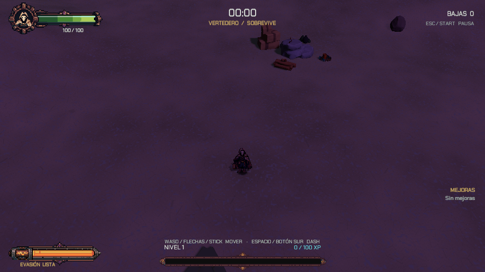

## Qué se puede jugar

| Área | Contenido actual |
| --- | --- |
| Control | Movimiento con teclado o mando, dash direccional con invulnerabilidad, apoyo sobre relieve y escaleras. |
| Arma | Linterna de cuatro pulsos con autoapuntado; alcance, cadencia, cobertura y daño modificables durante la partida. |
| Enemigos | Residual, Interceptor, Coloso, Mortero, Polilla y el jefe Gólgora, representado por el MataColeccionista. |
| Progresión | Experiencia, subida de nivel y selección de tres opciones entre 35 mejoras implementadas. |
| Escenario | Arena de 200 × 200 m, desniveles, obstáculos, lava, acceso subterráneo y portal al almacén. |
| Variantes | Entrada del jefe a los tres o a los ocho minutos, según la escena cargada. El combate del jefe continúa hasta resolver la partida. |
| Colección | Cinco personajes en el sistema de fusión por rareza, ocho espacios de exposición y guardado local del inventario y la fusión. |
| Interfaz | Vida, experiencia, nivel, tiempo, bajas, dash, mejoras, pausa, resultados y estadísticas del jugador. |
| Presentación | Sprites animados, modelos 3D, avisos de ataques, números de daño, partículas, cadenas eléctricas, hielo, dispositivos y efectos de recogida. |

## Recorrer el avance

- [[01 - Jugabilidad]] explica el recorrido de una partida.
- [[03 - Enemigos y NPC]] reúne los seis enemigos, sus reglas, sus representaciones actuales y GIFs capturados en la arena.
- [[05 - Progresión]] contiene el catálogo de las 35 mejoras y sus requisitos.
- [[04 - Objetos y Coleccionables]] describe los objetos, la colección y las recetas de fusión que se pueden utilizar.
- [[02 - Personajes y Animación]] incluye las hojas de sprites activas, las fuentes editables y GIFs del Coleccionista y los enemigos dentro de la arena.
- [[06 - Registro visual]] reúne las capturas y los GIFs de interfaz, enemigos y VFX.

Los GIFs de enemigos se registraron en Play Mode el 27 de octubre sobre la arena real, con cámara de detalle, oleadas detenidas y el jugador protegido para observar cada ataque. Los enemigos conservan sus valores y sus animaciones. Los GIFs de mejoras son recortes de capturas de Unity de la revisión visual del 26 de octubre; los componentes y recursos que dibujan esos efectos coinciden con los del avance actual. Los atlas son los PNG utilizados por el juego. Las condiciones de las capturas se explican en [[06 - Registro visual]].

---

# 01 - Visión

# Ficha del proyecto

| Campo | Información |
| --- | --- |
| Nombre | EchoScrap |
| Versión del GDD | 0.4.0 |
| Estado | Versión jugable en iteración, con combate, progresión, jefe, almacén y fusión. |
| Actualización | 27 de octubre de 2026 |
| Plataforma | PC, Windows, un jugador local. |
| Motor | Unity 6000.6.3f1, Universal Render Pipeline. |
| Lenguaje | C#; shaders en HLSL. |
| Perspectiva | Entorno 3D con personajes y efectos 2D; cámara de combate inclinada a 50°. |
| Repositorio del juego | https://github.com/ShiroRex/EchoScrap |
| Revisión del juego documentada | [0fca1ec](https://github.com/ShiroRex/EchoScrap/commit/0fca1ec7fd55aefc700b8d4c9b7698d36157b88d) |
| Repositorio del GDD | https://github.com/ShiroRex/GDD-Echoscrap |

## Equipo

- **Mora Alejandro Angel Gabriel:** líder y coordinación del proyecto.
- **Sierra Sosa David Alejandro:** desarrollo, diseño funcional y balance.
- **Cupul Dzul Mirian Leticia:** personajes y animación.
- **Obispo Navarro Samuel Alejandro:** entornos e interfaz.
- **Nuñez Chan Luis Fernando:** audio, narrativa, UX y calidad.

## El juego en una frase

El Coleccionista recorre un vertedero dimensional mientras su linterna abre huecos en una horda creciente. La experiencia recogida permite combinar mejoras durante la partida y preparar el enfrentamiento contra el MataColeccionista.

La versión documentada incluye una arena de 200 × 200 m, cinco enemigos de horda, un jefe y 35 mejoras. La estación de fusión conecta la exploración de la arena con una colección local de cinco personajes expuestos en el almacén.

---

# Visión del juego

EchoScrap combina supervivencia frente a hordas y construcción de una configuración de combate durante cada partida. El jugador controla el movimiento y el dash del Coleccionista; la linterna adquiere automáticamente al enemigo más cercano dentro de su alcance. Esto permite concentrarse en las rutas de escape, las zonas peligrosas y la recogida de experiencia.

Cada subida de nivel detiene el combate y ofrece hasta tres cartas. Las decisiones cambian la forma de sobrevivir: ampliar la luz, aumentar su cadencia, congelar enemigos, colocar minas, rodearse de sierras o sostenerse mediante curación y armadura.

La presión culmina con Gólgora, representado por el MataColeccionista. El jefe combina avance, ataques anunciados en el suelo y bombardeos. La partida termina cuando cae el jugador o el jefe; el tiempo de aparición no concede por sí mismo una victoria.

El mundo jugable también permite visitar una bóveda conectada por un portal. Allí se exponen los personajes de la colección de fusión. El inventario y los procesos de esa estación se conservan localmente entre aperturas de la aplicación.

Las decisiones de movimiento, recogida y selección de cartas sostienen el ritmo de cada expedición.

---

# Público y plataforma

EchoScrap es una experiencia de acción y supervivencia para PC con Windows y un solo jugador. El combate usa teclado y ratón o mando. El movimiento y la esquiva son acciones directas; el arma principal funciona con autoapuntado.

La elección de mejoras introduce pausas de decisión entre los momentos de movimiento continuo. Las escenas de tres y ocho minutos determinan cuándo aparece el jefe, de modo que permiten observar el mismo núcleo de combate con dos tiempos de entrada distintos. La duración total también depende del enfrentamiento final y del tiempo dedicado a los menús.

La lectura del peligro se apoya en áreas y trayectorias visibles, animaciones de anticipación, barras y texto. El menú de pausa permite reducir decoración y sacudidas y elegir cuánto detalle muestran las estadísticas.

---

# Pilares de diseño

## Movimiento que abre oportunidades

El desplazamiento a 8 m/s, el dash y el empuje del cuarto pulso permiten atravesar huecos y modificar la posición de la horda. El arma apunta por su cuenta, por lo que moverse y atacar pueden ocurrir en direcciones diferentes.

## Configuraciones que cambian durante la partida

Las 35 mejoras combinan estadísticas, ataques automáticos, dispositivos, control de masas y supervivencia. Los requisitos de algunas cartas relacionan las decisiones: Cero absoluto parte de Freón, mientras que las mejoras de explosión requieren una fuente de explosiones.

## Ataques que se pueden leer

La embestida del Coloso, el ácido del Mortero, la mecha de la Polilla y las áreas de Gólgora muestran sus avisos antes de resolver el daño. Las señales esenciales se conservan con efectos reducidos.

## Un mundo que conecta combate y colección

El vertedero contiene obstáculos, lava y un acceso al almacén. La fusión combina rarezas y produce personajes para las vitrinas; el inventario se guarda localmente. El recorrido por el portal conserva al mismo jugador y pausa el combate mientras visita la bóveda.

---

# 02 - Diseño

# Jugabilidad

La partida empieza con el Coleccionista en la arena. El jugador mueve al personaje, usa el dash para salir de zonas comprometidas y se aproxima a las gemas y botiquines que dejan los enemigos. La linterna busca al enemigo vivo más cercano dentro de su alcance, aunque el personaje se desplace en otra dirección.

## Bucle de combate

1. Moverse para mantener una ruta de escape y acercarse a las recompensas.
2. Dañar a la horda con la linterna y las habilidades obtenidas.
3. Recoger experiencia y elegir una mejora cuando sube el nivel.
4. Responder a nuevas composiciones de enemigos y a sus ataques especiales.
5. Enfrentarse a Gólgora cuando se alcanza el tiempo configurado.
6. Consultar el resultado y reiniciar una nueva partida.

La selección de cartas pausa el combate. Si una recogida produce varias subidas de nivel, las elecciones se resuelven una tras otra antes de continuar.

## Cierre

La vida del jugador a cero produce derrota. La muerte de Gólgora con el jugador vivo produce victoria. Si ambos mueren en el mismo paso de simulación, prevalece la derrota. Los resultados muestran tiempo, nivel, bajas y experiencia obtenida.

## Exploración y fusión

La estación de fusión se encuentra en la arena, junto al acceso a la bóveda. Se abre con E a corta distancia. El jugador elige tres ingredientes, inicia el proceso y puede seguir jugando mientras avanza el temporizador. Al terminar decide entre coleccionar o liberar el resultado.

El portal lleva al almacén sin cambiar de escena. Se conserva la salud y la configuración de la partida y se detienen oleadas, jefe y peligros del combate durante la visita. El regreso recupera esa misma sesión.

---

# Mecánicas

## Movimiento y dash

El movimiento parte de 8 m/s, con aceleración de 80 m/s² y frenado de 70 m/s². La diagonal mantiene la misma velocidad máxima. La dirección de entrada se interpreta respecto a la cámara y el personaje se apoya sobre el relieve y las escaleras del escenario.

El dash avanza a 22 m/s durante 0,15 s, aproximadamente 3,3 m si el recorrido está libre. Concede invulnerabilidad durante ese intervalo y atraviesa cuerpos enemigos. Los muros y obstáculos sólidos limitan el recorrido. La recarga base es de un segundo desde el final.

## Linterna

| Parámetro base | Valor |
| --- | ---: |
| Alcance | 7 m |
| Apertura del cono | 60° |
| Daño de cada pulso | 3,75 sobrenatural |
| Pulsos por ráfaga | 4 |
| Separación entre pulsos | 0,2 s |
| Descanso entre ráfagas | 0,4 s |
| Impulso del cuarto pulso | 10 m/s, modulado por la susceptibilidad del enemigo |

La ráfaga base emite en 0,2, 0,4, 0,6 y 0,8 s y vuelve a empezar tras el descanso. La linterna busca objetivos en 360° dentro de su alcance y aplica los impactos a su cono frontal. Sin objetivos, vuelve hacia la orientación de movimiento. Rayo solar elimina el descanso, aumenta el alcance base a 14 m y multiplica el daño por 2,5.

## Salud y daño

El Coleccionista empieza con 100 HP y 0,4 s de protección después de recibir daño. El daño puede ser físico o sobrenatural según su fuente; los números conservan esa categoría. La armadura reduce el daño recibido hasta un límite del 60%. La probabilidad crítica empieza en 0% y su multiplicador base es ×1,75.

Los números muestran la salud realmente perdida. Los impactos normales de una ráfaga pueden agruparse, mientras que los críticos se distinguen con tamaño, color y un signo de exclamación. Una ejecución causada por la mejora correspondiente muestra «EJECUTADO».

## Recogida

El imán base alcanza 2,5 m y atrae los objetos a 12 m/s. Las gemas conceden experiencia; el botiquín base recupera 15 HP. El contacto con lava, ácido y áreas de ataque utiliza las mismas reglas de salud e invulnerabilidad que el resto del combate.

Las mejoras modifican estos parámetros o añaden acciones automáticas. Sus niveles y efectos se describen en [[05 - Progresión]].

---

# Sistemas

| Sistema | Funcionamiento en la versión jugable |
| --- | --- |
| Entradas y locomoción | Lectura de teclado y mando, movimiento respecto a cámara, dash, colisiones y apoyo sobre el terreno. |
| Sesión | Reloj de juego, razones de pausa, entrada del jefe, resultados y reinicio. |
| Salud y daño | HP, armadura, críticos, protección temporal, curación y muerte. |
| Linterna | Autoapuntado, cuatro pulsos, empuje final y cambios por mejoras. |
| Enemigos | Cinco arquetipos de horda y Gólgora; navegación, ataques, estados y reutilización de instancias. |
| Oleadas | Apariciones fuera de cámara, grupos por fase, límites de población y transición al jefe. |
| Progresión | XP acumulada, subida de nivel y cola de elecciones. |
| Mejoras | Catálogo de 35 cartas, ofertas sin duplicados, requisitos, límites de nivel y reintentos. |
| Habilidades y VFX | Proyectiles, sierras, minas, torreta, explosiones, frío, curación, rayos y recogida. |
| Almacén | Viaje por portal al espacio de exposición, conservación del jugador y suspensión temporal del combate. |
| Fusión | Recetas de tres ingredientes, tiempos, sorteo por rareza, elección del resultado e inventario guardado. |
| Interfaz | HUD, pausa, estadísticas, cartas y resultados. |

El reloj de la sesión permite detener las reglas de combate sin detener las animaciones de interfaz que acompañan una elección. La pausa manual, la pérdida de foco y las cartas mantienen sus propias razones de pausa; resolver una de ellas no reanuda una partida que continúa detenida por otra.

La simulación comunica daño, muerte, dash, experiencia y resultados a la presentación. El aspecto de un efecto no determina su daño: el aviso y la resolución de un ataque comparten sus medidas y su calendario.

---

# Controles

| Acción | Teclado y ratón | Mando |
| --- | --- | --- |
| Moverse | WASD o flechas | Stick izquierdo o cruceta |
| Dash | Espacio | Botón sur: A / Cruz |
| Pausar | Esc | Start |
| Elegir directamente una carta | 1, 2 o 3; clic en su botón | Navegación y confirmación |
| Cambiar la carta enfocada | A/D, izquierda/derecha o puntero | Stick o cruceta |
| Confirmar carta | Enter o clic | Botón sur: A / Cruz |
| Reintentar la oferta con Sintonizador | R o botón de la interfaz | Botón norte |
| Abrir la estación de fusión | E, dentro de su distancia de interacción | — |

El ataque de la linterna es automático. El jugador controla el desplazamiento para acercar enemigos a su alcance y abrir rutas de escape.

Espacio se reserva al dash y no confirma cartas. Al abrir una elección se exige soltar la confirmación anterior para evitar elecciones accidentales. El botón usado al recuperar el foco de la aplicación también debe soltarse antes de confirmar.

El laboratorio añade controles de ensayo: Tab muestra su panel, R reinicia el laboratorio y los botones permiten generar, inspeccionar, congelar o retirar enemigos. Estos controles pertenecen a esa escena de pruebas.

---

# Progresión

## Experiencia y elecciones

El Coleccionista empieza en nivel 1. La primera subida necesita 100 XP; el siguiente umbral es el anterior multiplicado por 1,5 y redondeado a entero. La experiencia que sobra se conserva para el siguiente nivel. Una misma recogida puede acumular varias elecciones.

Cada elección ofrece hasta tres cartas distintas. La rareza base se sortea con pesos Común 60, Rara 25, Épica 12 y Legendaria 3, considerando únicamente las rarezas que todavía tienen cartas válidas. Después se elige una carta de esa rareza. Las cartas al máximo se retiran de la oferta.

Sintonizador permite gastar reintentos durante la sesión. También mueve peso hacia raras y épicas: cinco y tres puntos por nivel, respectivamente, desde el peso común. El peso legendario permanece en tres.

## Catálogo de 35 mejoras

Las series separadas por barras corresponden a sus niveles. Los valores describen la mejora por sí sola; otras cartas pueden modificar daño, radios, críticos y estadísticas finales.

| ID | Mejora | Rareza | Nivel máximo | Efecto actual | Tipo de daño |
| --- | --- | --- | ---: | --- | --- |
| FLASH_01 | Más alcance | Común | 5 | +1 m de alcance y +10° de apertura por nivel. | Sobrenatural |
| FLASH_02 | Pulso rápido | Común | 5 | +15% de velocidad de ataque por nivel; reduce el intervalo y el descanso. | Sobrenatural |
| FLASH_03 | Prisma voltaico | Rara | 3 | El cuarto pulso enlaza 2/3/4 enemigos a 5 m, con 40/60/80% del daño del impacto inicial. | Sobrenatural |
| FLASH_04 | Golpe potente | Épica | 3 | Daño ×1,5/1,8/2,2 y más empuje; reduce 20° la apertura al adquirirla. | Sobrenatural |
| FLASH_05 | Rayo solar | Legendaria | 1 | Suprime el descanso, establece 14 m de alcance base y multiplica el daño de luz por 2,5. | Sobrenatural |
| DASH_01 | Dash ágil | Común | 5 | +8% de velocidad de dash y -10% de recarga por nivel. | Sin daño directo |
| DASH_02 | Onda sísmica | Rara | 3 | Al terminar el dash: 25/45/70 de daño y aturdimiento de 0,6/0,9/1,2 s. | Físico |
| DASH_03 | Holo-señuelo | Épica | 3 | Deja una copia que atrae enemigos durante 2/2,5/3 s; su implosión causa 50/85/120 de daño. | Sobrenatural |
| DASH_04 | Cataclismo | Legendaria | 1 | Dash con recarga de 0,5 s, explosión de salida de 120 y cuchilla de llegada de 80. | Físico |
| BIO_01 | Más vida | Común | 5 | +20 HP máximos y curación de 15 HP en cada adquisición. | Sin daño directo |
| BIO_02 | Sifón | Rara | 3 | El cuarto pulso tiene 12/20/30% de curar 2/3/4 HP por enemigo alcanzado. | Sin daño directo |
| BIO_03 | Nanobots | Épica | 3 | Regenera 1/2/3 HP cada 2,5 s; al quedar bajo 20% de vida puede proteger 2 s, con recarga de 60 s. | Sin daño directo |
| BIO_04 | Nova de plasma | Legendaria | 1 | Cada 15 HP de curación sobrante generan una nova de 80 de daño y 6 m de radio. | Sobrenatural |
| GREED_01 | Imán | Común | 5 | +2 m al radio de recogida por nivel. | Sin daño directo |
| GREED_02 | Chatarrero | Común | 5 | +15% de experiencia recibida por nivel. | Sin daño directo |
| GREED_03 | Botiquín mejor | Rara | 3 | Botiquines de 17/19/21 HP; aumentan también sus probabilidades de aparición. | Sin daño directo |
| GREED_04 | Sintonizador | Épica | 3 | Concede 1/2/3 reintentos totales y aumenta el peso de ofertas raras y épicas. | Sin daño directo |
| GREED_05 | Pulso colector | Legendaria | 1 | Atrae gemas y botiquines del mapa al adquirirla y al subir de nivel. | Sin daño directo |
| CRIT_01 | Óptica precisa | Común | 5 | +8 puntos porcentuales de probabilidad crítica por nivel. | Según ataque |
| CRIT_02 | Calibración letal | Común | 5 | +0,2 al multiplicador crítico por nivel, desde ×1,75. | Según ataque |
| CRIT_03 | Ejecución | Rara | 3 | Remata tras un golpe a enemigos bajo 6/8/10% de vida; excluye a los jefes. | Según ataque |
| CRIT_04 | Ráfaga crítica | Épica | 3 | Un crítico en el cuarto pulso garantiza 2/3/4 críticos al inicio de la siguiente ráfaga. | Según ataque |
| CRIT_05 | Ojo del verdugo | Legendaria | 1 | +20 puntos de crítico; contra objetivos bajo 35% de vida, críticos ×3 y aturdimiento cercano. | Según ataque |
| DEMO_01 | Pólvora volátil | Común | 5 | +12% de daño y +15% de radio de explosión por nivel. | Según explosión |
| DEMO_02 | Reacción en cadena | Rara | 3 | 25/40/55% de provocar una explosión de 35/60/90 al morir un enemigo. | Físico |
| DEMO_03 | Minas de chatarra | Épica | 3 | Coloca una mina cada 4/3,2/2,5 s; explosión de 70/110/160 en 4 m de radio. | Físico |
| DEMO_04 | Termobárica | Legendaria | 1 | Tras 0,4 s, una implosión repite el 75% del daño de la explosión y atrae enemigos. | Sobrenatural |
| SCRAP_01 | Blindaje | Común | 5 | +4 puntos porcentuales de armadura y +10 HP máximos por nivel. | Sin daño directo |
| SCRAP_02 | Micro-ensamblador | Rara | 3 | Cada 15 gemas recogidas lanza un proyectil guiado de 40/70/105. | Físico |
| SCRAP_03 | Sierras orbitales | Épica | 3 | 2/3/4 sierras giran a 2,5 m; cada contacto causa 18/28/40 y empuja. | Físico |
| SCRAP_04 | Torreta centinela | Legendaria | 1 | Aparece cada 10 s, dura 8 s y dispara ráfagas de tres proyectiles de 35 a 8 m. | Físico |
| CRYO_01 | Freón residual | Común | 5 | La luz ralentiza 12/20/28/36/44% durante 1,5 s. | Sobrenatural |
| CRYO_02 | Cero absoluto | Rara | 3 | Congela tras 4/3/3 pulsos durante 1,2/1,8/2,4 s; el congelado recibe 30% más de daño. | Sobrenatural |
| CRYO_03 | Ventisca | Épica | 3 | Cada 6/5/4 s: onda de 30/50/75 en 5,5 m que congela 1,5 s. | Sobrenatural |
| CRYO_04 | Quiebre de hielo | Legendaria | 1 | Una muerte congelada emite seis esquirlas perforantes de 50 que congelan 1,5 s. | Sobrenatural |

## Requisitos y combinaciones

- **Pólvora volátil y Termobárica:** necesitan una fuente de explosiones en la configuración.
- **Cero absoluto:** requiere Freón residual.
- **Quiebre de hielo:** necesita Cero absoluto o Ventisca.
- **Ráfaga crítica:** requiere una probabilidad crítica mayor que cero.

Prisma voltaico se activa desde el cuarto pulso de luz y su daño derivado no inicia otra cadena. La repetición de Termobárica tampoco vuelve a repetirse a sí misma. Estos límites permiten combinar efectos sin crear bucles de activación.

## Oleadas

| Tiempo de combate | Tamaño del grupo | Intervalo |
| --- | ---: | --- |
| 0:00–1:00 | 1 | 1,2 s |
| 1:00–2:00 | 2 | 0,8 s |
| 2:00–3:00 | 3 | 0,6 s |
| 3:00–5:00 | 4 | 0,4 a 0,32 s |
| 5:00–8:00 | 4 | 0,32 a 0,2 s |

Los grupos cambian de composición y se colocan fuera de cámara, sobre suelo válido y sin solapar obstáculos ni actores. El límite normal es de 150 vivos. Las escenas con jefe a los tres minutos recorren los primeros tramos; la de ocho minutos utiliza la escalada completa.

Las mejoras de estadísticas y probabilidades se representan en las cartas y el HUD. Los efectos visuales observables se reúnen con sus GIFs en [[06 - Registro visual]].

---

# Economía y recursos

## Recursos durante el combate

La experiencia pertenece a la partida en curso. Los enemigos normales dejan gemas con 10, 15, 25 o 50 XP según su arquetipo. Al recogerlas se aplica el multiplicador de Chatarrero y se comprueba si alcanza para subir de nivel. Las elecciones se consumen mediante el menú de mejoras.

Los botiquines recuperan 15 HP de base. Su probabilidad inicial es del 3% en enemigos normales y del 8% en los de recompensa fuerte, como Coloso y Mortero. Hay un intervalo mínimo de seis segundos entre apariciones, un máximo de cinco botiquines en el suelo y una duración de 22 s antes de caducar. Botiquín mejor eleva curación y probabilidades según su nivel.

## Inventario de fusión

La colección mantiene cantidades de Lobito, Mago, Demonio, Shireen y Yanikua. En el montaje actual los cuatro personajes base están disponibles como ingredientes ilimitados. El proceso no descuenta copias de ese suministro; el resultado coleccionado sí aumenta la cantidad guardada.

Las ocho plazas de exposición muestran personajes de la colección. Un duplicado aumenta su cantidad, y los resultados sin una plaza libre permanecen en el inventario. La elección Liberar descarta únicamente el resultado de esa fusión.

Las probabilidades y los tiempos de las recetas están en [[04 - Objetos y Coleccionables]]. Las mejoras de combate se restablecen al reiniciar; el inventario de la estación conserva su guardado local.

---

# Reglas y estados del juego

## Estados de la sesión

| Estado | Qué ocurre |
| --- | --- |
| Combate | Avanzan el reloj, enemigos, oleadas, ataques y recogida. |
| Elección de mejora | La simulación de combate está detenida; las cartas y su confirmación siguen presentándose. |
| Pausa | Se bloquean acciones de combate y se muestra el menú. |
| Visita al almacén | El jugador puede recorrer la bóveda; el combate y sus peligros están suspendidos. |
| Entrada de Gólgora | Se retira la horda y se prepara la aparición del jefe en una posición segura. |
| Victoria | El jefe ha muerto y el jugador sigue vivo; se presenta el cierre y el resumen. |
| Derrota | El jugador ha perdido toda su vida; se detienen la sesión y los controles. |

## Entrada y cierre del jefe

La entrada ocurre a los 180 o 480 s, según la escena. La horda ordinaria se retira sin recompensas y se limpian amenazas pendientes. Gólgora necesita espacio libre para activar su colisión: durante su entrada no es un objetivo válido de la linterna.

Mientras está activo recibe apoyo en grupos de hasta cuatro enemigos cada cuatro segundos, con límite de 24 secuaces. La composición sigue el orden Residual, Residual, Mortero y Polilla.

La victoria exige derrotar al jefe. Si el jugador muere en el mismo paso en que cae Gólgora, el resultado es derrota. La presentación de victoria incluye la explosión final, la absorción de una gema y 500 XP de cierre para el resumen; esa cifra no abre nuevas elecciones de cartas.

Reiniciar limpia los enemigos, peligros, objetos y efectos de la sesión, restablece al jugador y vuelve al inicio del combate. Las preferencias visuales de la sesión se conservan y la colección guardada pertenece a la estación de fusión.

---

# 03 - Historia y Mundo

# Premisa y trama

El Coleccionista era un humano obsesionado con acumular rarezas. Una entidad le ofreció acceso a un mundo donde podría construir la colección definitiva. La oferta lo llevó al Vertedero de Ecos: un nexo al que llegan restos de realidades destruidas y del que no encuentra una salida.

Al cruzar pierde sus recuerdos, pero conserva el impulso de recolectar. Entre metal, ruinas y criaturas residuales, su linterna se convierte en la herramienta con la que abre espacio para seguir moviéndose. El almacén es su refugio y el lugar donde expone lo que reúne.

Gólgora, el MataColeccionista, representa al guardián de ese lugar. El enfrentamiento con él da forma al cierre de cada expedición. La derrota detiene el intento; la victoria resuelve el combate, pero el mundo continúa como escenario de nuevas partidas.

La premisa acompaña la experiencia mediante el personaje, el entorno, la colección y el ciclo de supervivencia. El recorrido jugable de la versión actual está descrito en [[01 - Jugabilidad]], y los mensajes visibles durante el juego se recogen en [[04 - Diálogos y Narrativa]].

---

# Mundo

El Vertedero de Ecos es un espacio atemporal donde se mezclan restos de épocas y realidades distintas. La chatarra, las ruinas y la energía residual le dan unidad a esa mezcla: todo aparece desgastado, desplazado de su origen y sometido a una misma amenaza.

## Lugares presentes

| Lugar | Forma en la versión jugable | Relación con la experiencia |
| --- | --- | --- |
| Arena del Vertedero | Espacio de 200 × 200 m con relieve, obstáculos y lava. | Movimiento, horda, recogida de experiencia y encuentro con Gólgora. |
| Acceso subterráneo | Escalera, muros, rellano y portal. | Une el espacio de combate con la bóveda. |
| Almacén | Sala 3D con pasillo, ocho espacios de exposición y portal de regreso. | Muestra los personajes de la colección durante una visita segura. |
| Estación de fusión | Máquina con cámara interior y persiana, situada en la arena. | Combina tres ingredientes y presenta un personaje como resultado. |

Los Ecos se expresan como gemas de experiencia que dejan los enemigos. La colección reúne cinco personajes de procedencias visuales diferentes: Lobito, Mago, Demonio, Shireen y Yanikua. La fusión y la exposición los conectan con la actividad del Coleccionista dentro del mundo.

La entidad del pacto pertenece al trasfondo de la premisa. Gólgora es el adversario presente en el combate final. La distinción mantiene separadas la causa del encierro y la amenaza que el jugador enfrenta en la arena.

---

# Personajes

## El Coleccionista

Es el personaje que controla el jugador. Su silueta reúne capucha clara, máscara con pico, ropa oscura y un farol. La luz se orienta de forma independiente del desplazamiento y sirve como arma principal. El juego utiliza sprites de reposo, marcha, dash y muerte en cuatro direcciones.

## Gólgora: el MataColeccionista

Es el jefe del combate. Su presencia combina un cuerpo 3D, un arma pesada y zonas de magma luminoso. La marcha y los ataques del modelo acompañan los avisos de suelo y el bombardeo que definen su encuentro.

## Personajes de la colección de fusión

| Personaje | Rareza en el sistema actual | Aparición en el juego |
| --- | --- | --- |
| Lobito | Común | Ingrediente base y personaje expuesto en la bóveda. |
| Mago | Raro | Ingrediente base y personaje expuesto en la bóveda. |
| Demonio | Épico | Ingrediente base y personaje expuesto en la bóveda. |
| Shireen | Épico | Ingrediente base y personaje expuesto en la bóveda. |
| Yanikua | Legendario | Resultado de la receta especial de fusión. |

Los archivos Demonio y Demonio2 corresponden a dos vistas del mismo personaje. El catálogo de la estación los registra como una sola entrada.

Las reglas de obtención, duplicados y exposición se describen en [[04 - Objetos y Coleccionables]]. Las hojas de sprites de combate están en [[02 - Personajes y Animación]].

---

# Diálogos y narrativa

La información que acompaña al jugador se presenta mediante los nombres, los entornos y los mensajes de interfaz. Los enemigos se reconocen por sus siluetas y sus patrones; el encuentro con Gólgora se anuncia mediante su presentación y su barra de vida.

Las cartas explican el beneficio de cada elección y muestran sus valores. La estación informa de ingredientes, probabilidades, tiempo restante y resultado. Los mensajes «VICTORIA» y «DERROTA» cierran la expedición junto a sus estadísticas.

Estas señales forman la comunicación visible de la versión jugable. El mundo y la premisa se recogen en [[01 - Premisa y Trama]] y [[02 - Mundo]].

---

# 04 - Contenido

# Estructura del contenido

| Contenido jugable | Cantidad y funcionamiento actual |
| --- | --- |
| Protagonista | El Coleccionista. |
| Escenario | Vertedero de 200 × 200 m, con relieve, obstáculos, lava y acceso subterráneo. |
| Almacén | Bóveda accesible por portal, con ocho espacios de exposición. |
| Enemigos de horda | Cinco: Residual, Interceptor, Coloso, Mortero y Polilla. |
| Jefe | Gólgora, representado por el MataColeccionista. |
| Mejoras | 35 cartas en cuatro rarezas, con niveles, requisitos y efectos activos. |
| Objetos de combate | Gemas de experiencia y botiquines. |
| Colección de fusión | Cinco personajes; cantidades, espacios de exposición y proceso guardados. |
| Escenas de prueba | Laboratorio de enemigos, sandbox de locomoción y sandbox de combate. |

El contenido principal se monta en CombatArena. CombatArena_3Min y CombatArena_8Min conservan el mismo mundo y utilizan ajustes independientes para el tiempo de entrada del jefe. El laboratorio permite observar enemigos de forma aislada y ajustar situaciones sin activar una partida de supervivencia.

---

# Niveles

## El Vertedero

La arena principal mide 200 × 200 m. El suelo tiene relieve y los grupos de chatarra, rocas, árboles secos y otros obstáculos forman corredores y zonas de paso. Los límites físicos mantienen al jugador dentro del escenario. El centro conserva espacio para la entrada del jefe.

La lava es una superficie peligrosa con material animado y luz propia. La iluminación del escenario es tenue y violeta; la linterna, los avisos y las habilidades aportan puntos de contraste.

## Acceso y bóveda

En el sector sureste, una escalera desciende hacia el portal. El acceso profundo ocupa unos 23 m, baja 8 m y permite volver a subir. El portal conecta con el almacén, situado en otra zona de la misma escena. El viaje conserva al jugador y suspende la simulación de combate mientras permanece dentro.

La bóveda contiene ocho espacios de exposición a ambos lados de un pasillo y un portal de retorno. La estación de fusión se encuentra fuera, en la arena, cerca de la entrada al acceso.

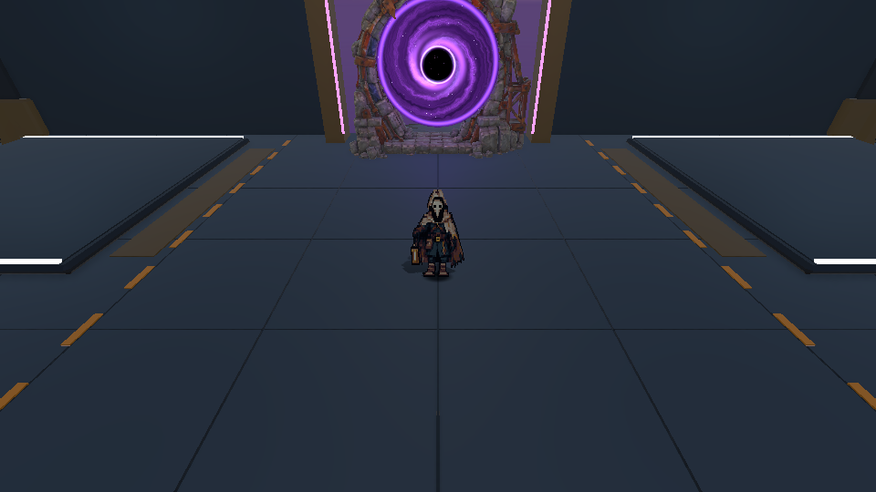

## Escenas disponibles

| Escena | Uso | Entrada del jefe |
| --- | --- | ---: |
| CombatArena | Arena original del montaje actual | 3:00 |
| CombatArena_3Min | Variante de entrada rápida | 3:00 |
| CombatArena_8Min | Variante de supervivencia larga | 8:00 |
| EnemyLaboratory | Generación e inspección manual de enemigos | Manual |
| LocomotionSandbox / CombatSandbox | Comprobaciones aisladas de movimiento y combate | Sin el flujo completo de supervivencia |

El tiempo indica la aparición del jefe, no la duración total de la sesión. Las cartas, la pausa y la visita al almacén detienen el reloj de combate.

---

# Enemigos y NPC

La horda reúne cinco arquetipos y el cierre de partida utiliza un jefe. Cada uno se diferencia por su velocidad, su forma de acercarse y el espacio que obliga a defender. Los valores siguientes corresponden a los ajustes actuales de la arena.

| Enemigo | Vida | Velocidad | Daño principal | XP al morir | Representación actual |
| --- | ---: | ---: | --- | ---: | --- |
| Residual | 15 HP | 3,5 m/s ±15% | Contacto: 10 cada 0,5 s | 10 | Geometría 3D y animación de presentación. |
| Interceptor | 9 HP | 6,2 m/s ±10% | Contacto: 8 cada 0,5 s | 10 | Geometría 3D de perfil bajo y estela. |
| Coloso | 80 HP | 1,8 m/s | Contacto o carga: 25 | 50 | Geometría 3D pesada con preparación y embestida. |
| Mortero | 25 HP | 2,2 m/s ±10% | Contacto: 5; ácido: 5 cada 0,5 s | 25 | Sprite animado Campana, de cuatro direcciones. |
| Polilla | 12 HP | 4,8 m/s ±10% | Explosión: 35 | 15 | Sprite animado Reactor, de cuatro direcciones. |
| Gólgora / MataColeccionista | 1500 HP | 1,6 m/s | Contacto 30; pisotón 40; impacto de bombardeo 25 | 500 de cierre en el resumen | Modelo 3D animado y VFX de magma. |

## Residual

Persigue al jugador, se separa de los demás enemigos y busca paso alrededor de obstáculos. Su función es formar la masa de la horda y dejar gemas accesibles. Una ráfaga base de cuatro pulsos suma sus 15 HP cuando todos los impactos alcanzan al objetivo. El cuarto pulso puede desplazarlo.

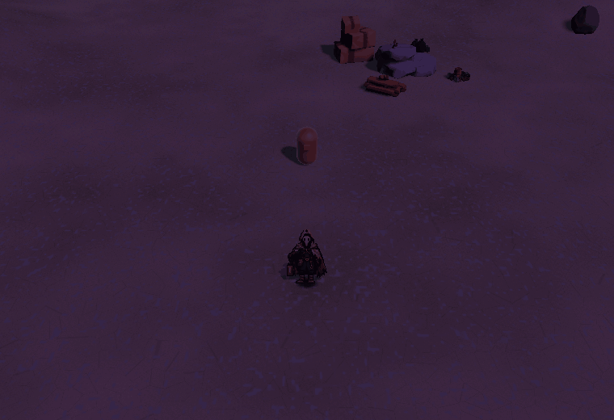

## Interceptor

Anticipa hasta 0,4 s del desplazamiento del jugador, limitado a una velocidad de referencia de 8 m/s. A corta distancia pasa a perseguir su posición actual. Su frenado tras el empuje es menor que el del Residual, por lo que puede deslizarse más lejos.

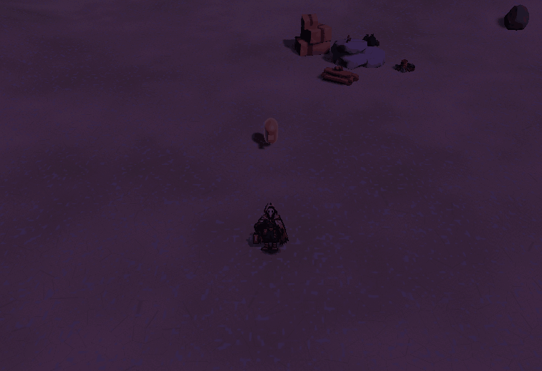

## Coloso

Es un cuerpo sólido y pesado, inmune al empuje. Cuando tiene la carga disponible y el jugador está a 8 m o menos, se detiene, fija la dirección y muestra un corredor de aviso durante 0,8 s. Embiste a 12 m/s durante 0,35 s, hasta 4,2 m si el camino está libre. Las paredes detienen el recorrido y la dirección no sigue corrigiéndose tras el aviso.

Después se recupera durante 0,6 s. La preparación y la recuperación no infligen contacto; el dash permite atravesar su cuerpo durante la ventana de invulnerabilidad. El intervalo entre cargas parte de un sorteo de 5–7 s.

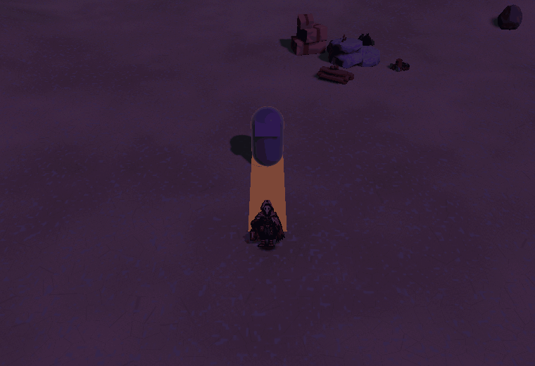

## Mortero: Campana

Mantiene una banda de distancia entre 5,5 y 6,5 m y dispara hasta 12 m. El intervalo es de cinco segundos, con 0,45 s de aviso y 0,85 s de vuelo. El proyectil deja un charco de radio 1,2 m durante tres segundos; el ácido causa 5 de daño cada 0,5 s. La arena limita a seis los Morteros simultáneos.

Su hoja activa contiene 112 fotogramas de 64 × 64: flotación, carga, disparo, recuperación y muerte en cuatro direcciones.

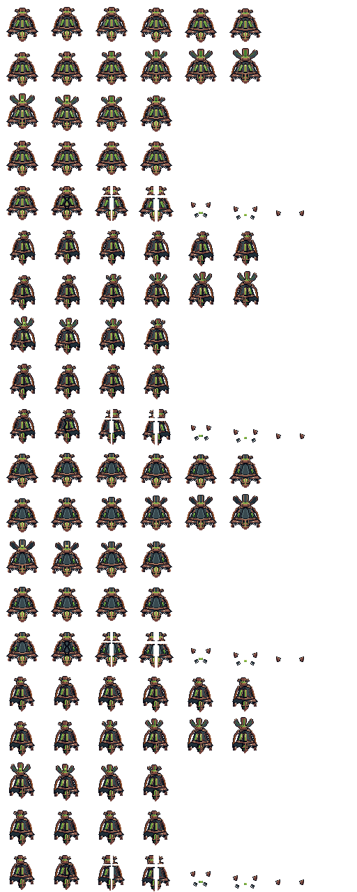

[Fuente editable del Mortero](Media/Avance_2026-10-27/Spritesheets/Mortero.aseprite).

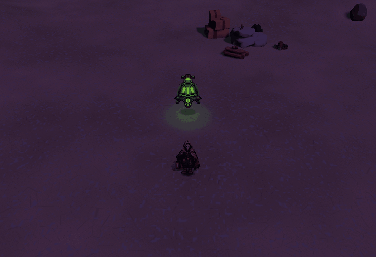

## Polilla: Reactor

Se acerca hasta cebar su explosión. La mecha por proximidad dura 0,9 s; si el cebado procede de daño letal dura 1,2 s. El radio de explosión es de 3 m y afecta al jugador y a otros enemigos. Durante la mecha sigue aceptando empuje, lo que permite desplazarla hacia la horda.

La hoja activa contiene 62 fotogramas de 64 × 64: vuelo y cebado en cuatro direcciones, más una secuencia de estallido de seis fotogramas.

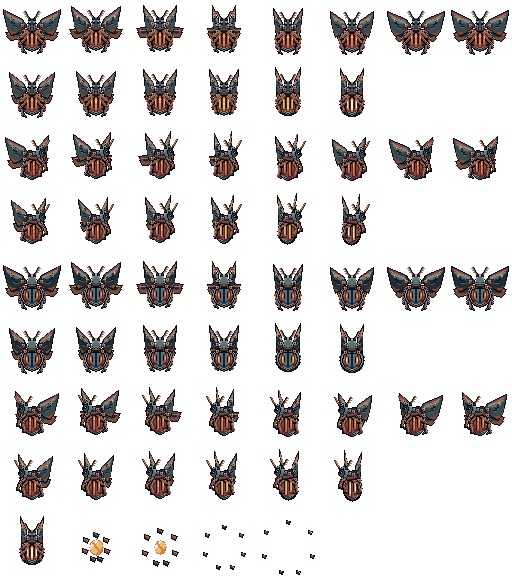

[Fuente editable de la Polilla](Media/Avance_2026-10-27/Spritesheets/PolillaReactor.aseprite).

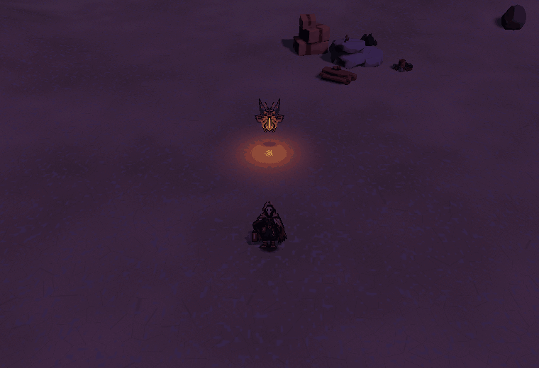

## Gólgora: MataColeccionista

Es inmune al empuje y alterna ataques sin solaparlos. A corta distancia prepara un pisotón de radio 5 m durante 1,2 s. El pisotón causa 40 de daño al jugador y puede alcanzar a los secuaces. Su bombardeo prepara el lanzamiento durante 0,4 s, fija tres posiciones y envía proyectiles con 0,65 s de vuelo. El impacto causa 25 de daño en 2,5 m de radio y deja zonas de cuatro segundos que causan 5 cada 0,5 s. Tras el ataque se recupera durante 0,8 s. Los enfriamientos del pisotón y del bombardeo son de seis y ocho segundos desde sus respectivas preparaciones. Al bajar de la mitad de vida cambia la presentación del núcleo, conservando las estadísticas del encuentro.

El modelo reproduce surgimiento, marcha pesada, martillazo o barrido y lanzamiento de proyectiles. Su muerte desencadena la presentación final y la resolución de victoria cuando el jugador sigue vivo.

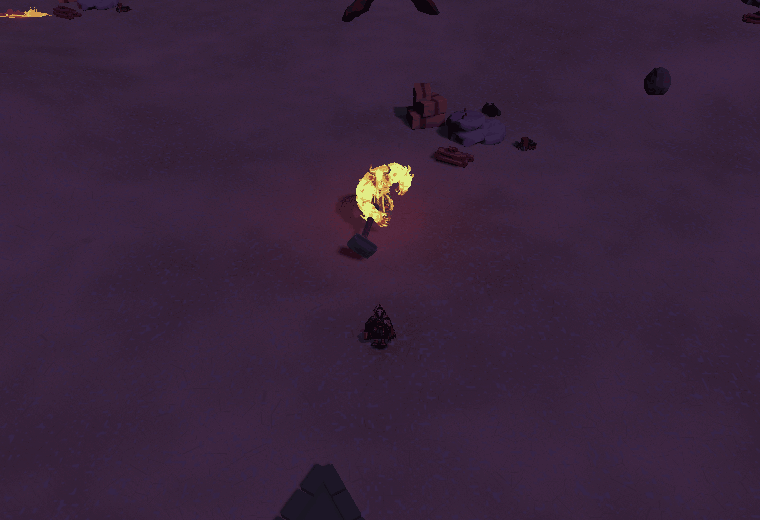

Las hojas de sprites corresponden al Mortero y a la Polilla. Los otros tres enemigos de horda usan la geometría que se ve en los GIFs; Gólgora utiliza un modelo animado. Todas las secuencias de esta página proceden de la arena ejecutándose en Unity, con cámara de detalle y jugador protegido para observar los patrones.

---

# Objetos y coleccionables

## Gemas y botiquines

Las gemas permanecen en la arena hasta su recogida y conceden la XP del enemigo que las dejó. Los botiquines recuperan 15 HP de base y caducan tras 22 s. Ambos responden al imán del jugador y al Pulso colector. El objeto se consume al llegar al personaje, conservando su valor durante el desplazamiento.

## Colección de la estación

| Personaje | Rareza | Disponibilidad actual |
| --- | --- | --- |
| Lobito | Común | Ingrediente base ilimitado. |
| Mago | Raro | Ingrediente base ilimitado. |
| Demonio | Épico | Ingrediente base ilimitado. |
| Shireen | Épico | Ingrediente base ilimitado. |
| Yanikua | Legendario | Resultado de la receta especial; protegido como ingrediente. |

Demonio y Demonio2 son vistas del mismo personaje. La colección guarda cantidades por personaje y ocho plazas de exposición. Los duplicados aumentan la cantidad del inventario. Si las plazas están llenas, una especie nueva puede sustituir una exposición repetida; la copia sustituida sigue en el inventario.

## Recetas de tres ingredientes

| Composición | Tiempo de proceso | Común | Raro | Épico | Yanikua |
| --- | ---: | ---: | ---: | ---: | ---: |
| Tres comunes | 60 s | 70% | 25% | 5% | 0% |
| Algún raro, sin épicos | 120 s | 20% | 60% | 20% | 0% |
| Algún épico, sin cumplir la receta especial | 180 s | 0% | 20% | 80% | 0% |
| Dos épicos y un raro o épico | 180 s | 0% | 0% | 99% | 1% |

Los resultados épicos se reparten entre Demonio y Shireen. El sorteo se resuelve una sola vez al iniciar y se guarda para conservarlo al volver a abrir la aplicación.

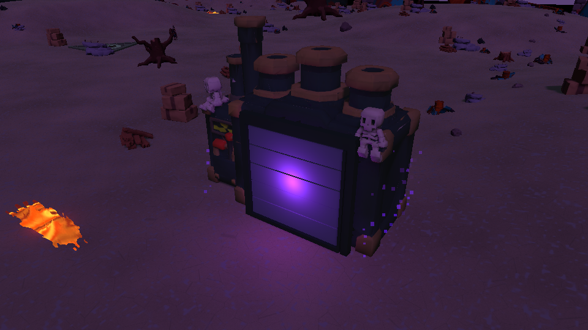

La elección de ingredientes pausa el combate. Al iniciar se cierra el menú y el proceso avanza durante el juego activo, también al visitar la bóveda. La pausa detiene ese progreso y el tiempo fuera de la aplicación no lo adelanta. Al finalizar se abre la persiana; el resultado espera la elección Coleccionar o Liberar antes de permitir otra fusión.

---

# Misiones y desafíos

La expedición propone una condición principal: sobrevivir a la horda y derrotar a Gólgora con el Coleccionista vivo. El jefe aparece en el tiempo fijado por la escena, tres u ocho minutos, y el enfrentamiento continúa hasta resolver el resultado.

Los desafíos surgen de la combinación de enemigos y del escenario: atravesar huecos con el dash, recoger XP sin entrar en ácido o lava, desplazar a una Polilla cebada, esquivar la embestida del Coloso y mantener una ruta segura durante el bombardeo del jefe.

La selección de cartas cambia las herramientas disponibles para resolver esas situaciones. El resumen final recoge tiempo, nivel, bajas y XP; Reiniciar permite volver a intentarlo desde el inicio.

La estación de fusión añade una actividad paralela: preparar una receta, continuar jugando mientras transcurre y decidir qué hacer con el resultado. Su colección se conserva mediante guardado local.

---

# 05 - Arte y Audio

# Dirección de arte

El montaje actual combina un escenario 3D de formas angulares con sprites de pixel art, modelos animados y efectos de partículas. El vertedero utiliza metal, roca, madera y chatarra en tonos oscuros; la luz y los avisos separan los elementos activos del fondo.

La cámara de combate está inclinada a 50°. Los sprites mantienen su lectura dentro de ese mundo mediante planos iluminados, sombras de contacto y orientación por direcciones. El Coleccionista, el Mortero y la Polilla usan hojas con celdas de 64 × 64 píxeles.

## Color y lectura

| Uso | Colores presentes |
| --- | --- |
| Fondo y estructuras | Azules, grises fríos y violetas oscuros. |
| Chatarra y armaduras | Cobre, marrón, óxido y acero apagado. |
| Luz y energía | Cian, oro cálido, violeta y tonos claros. |
| Ácido | Verdes luminosos sobre suelo oscuro. |
| Peligro anunciado | Ámbar y naranja, acompañado por contornos y progreso del área. |
| Hielo | Tinte celeste, cristales y niebla fría. |

La paleta de referencia es Apollo. El volumen, las siluetas y los cambios de pose acompañan al color: el Coloso se prepara antes de cargar, el Mortero abre su emisor y la Polilla cambia de ritmo al cebarse. Los efectos reducidos conservan la información necesaria para leer esos ataques.

---

# Personajes y animación

## Recursos de la versión actual

| Personaje | Recurso | Animaciones presentes |
| --- | --- | --- |
| Coleccionista | Atlas de 108 fotogramas, celdas de 64 × 64, cuatro direcciones. | Reposo: 8; marcha: 8; dash: 3; muerte: 8 por dirección. |
| Mortero Campana | Atlas de 112 fotogramas, celdas de 64 × 64, cuatro direcciones. | Flotación: 6; carga: 6; disparo: 4; recuperación: 4; muerte: 8 por dirección. |
| Polilla Reactor | Atlas de 62 fotogramas, celdas de 64 × 64. | Vuelo: 8 y cebado: 6 por dirección; estallido compartido: 6. |
| Residual e Interceptor | Geometría y materiales 3D. | Orientación, inclinación de locomoción, reacción al daño y muerte. |
| Coloso | Geometría y materiales 3D. | Marcha, compresión de preparación, embestida y recuperación. |
| Gólgora / MataColeccionista | Modelo 3D con animaciones. | Entrada, marcha pesada, golpes y lanzamiento; cierre con efectos de muerte. |

## El Coleccionista

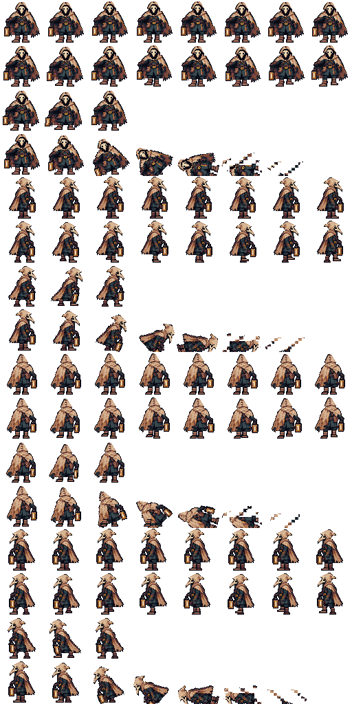

[Abrir fuente editable del Coleccionista](Media/Avance_2026-10-27/Spritesheets/Coleccionista.aseprite).

Su sprite se apoya en el terreno y recibe iluminación del mundo. El farol acompaña al personaje y la presentación del haz sigue el apuntado del arma. El daño se expresa mediante flashes sin convertir cada impacto en una interrupción del movimiento.

### Animaciones dentro de la arena

Estas secuencias muestran al Coleccionista en CombatArena, con una cámara de detalle que permite observar el sprite sobre el terreno y su iluminación real.

**Reposo.** El personaje conserva su postura y el movimiento del ciclo de espera.

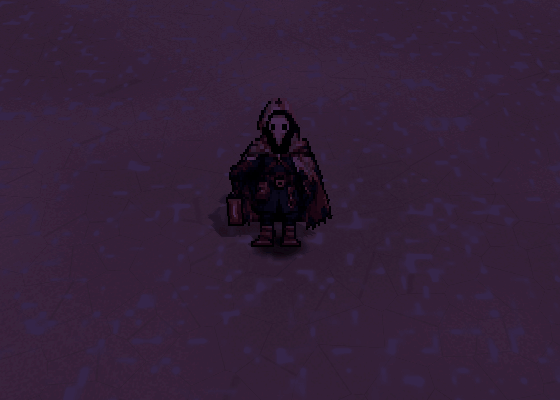

**Marcha en cuatro direcciones.** El cambio de vista y el ciclo de pasos acompañan el desplazamiento por el escenario.

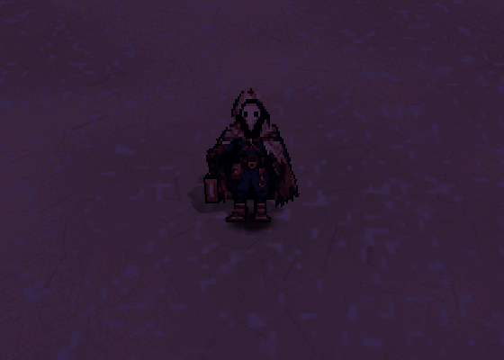

**Dash.** La secuencia incluye dos desplazamientos y las imágenes residuales que deja el personaje.

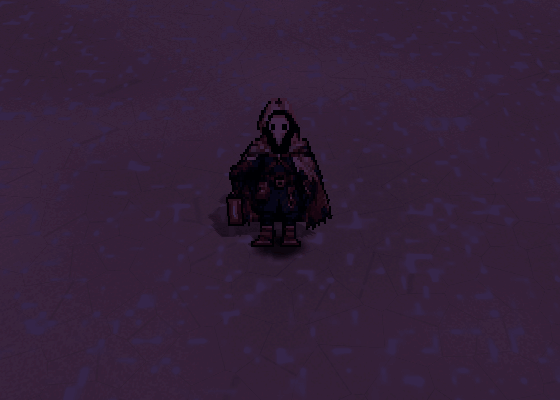

**Muerte.** El impacto da paso a la caída y a la desaparición del sprite y su sombra.

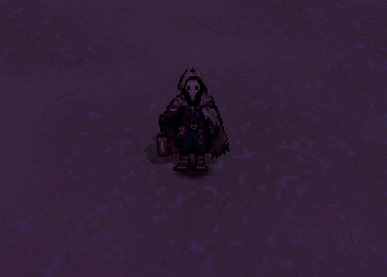

## El Mortero Campana

El Mortero encadena flotación, preparación, disparo y recuperación con su ataque de ácido. El GIF muestra cómo se integra el sprite con el aviso del ataque y el proyectil dentro del escenario.

## La Polilla Reactor

La Polilla distingue vuelo, cebado y explosión. La secuencia permite ver la transición de aproximación a detonación junto al jugador.

## Enemigos con representación 3D

El Residual, el Interceptor y el Coloso utilizan geometría 3D. Sus movimientos y deformaciones se registran directamente en la arena; no disponen de una hoja de sprites de personaje.

**Residual.** Aproximación y movimiento de su cuerpo durante la persecución.

**Interceptor.** Desplazamiento y orientación del cuerpo al perseguir al Coleccionista.

**Coloso.** Preparación, embestida y recuperación del ataque.

**Gólgora / MataColeccionista.** El modelo animado acompaña su marcha pesada y sus ataques en la arena.

Las reglas de cada enemigo se describen en [[03 - Enemigos y NPC]].

Las normales, sombras, flashes, tintes de frío y partículas complementan los fotogramas originales. La elección de una cámara o una condición visual distinta no cambia las reglas de los ataques.

---

# Entornos

El Vertedero es una arena de 200 × 200 m con suelo de relieve, restos industriales, rocas, árboles secos y grupos de objetos que fragmentan las rutas. El centro y el perímetro conservan zonas de paso; los obstáculos tienen colisiones que participan en la navegación y el dash.

La lava utiliza un shader animado. Su brillo y las partes de magma del MataColeccionista mantienen puntos de lectura en las zonas oscuras. El acceso a la bóveda combina muros de piedra, escalera, rellano y un portal con horizonte animado y partículas en espiral.

El almacén se encuentra separado de la arena dentro de la misma escena. Sus ocho espacios de exposición forman un recorrido a ambos lados del pasillo. El portal de retorno devuelve al jugador al acceso del combate y reactiva la sesión que estaba suspendida.

La estación de fusión tiene una persiana móvil, espacio interior para el resultado, rótulo de estado y partículas violetas. La animación de apertura permite ver el personaje obtenido antes de coleccionarlo o liberarlo.

---

# Interfaz visual

El HUD muestra vida, experiencia, nivel, tiempo, bajas, recarga de dash y mejoras adquiridas. La vida diferencia el valor inmediato del daño reciente; el borde de salud crítica se activa al 30%. La barra de XP usa su recurso de pixel art, anima el llenado y pulsa al subir de nivel.

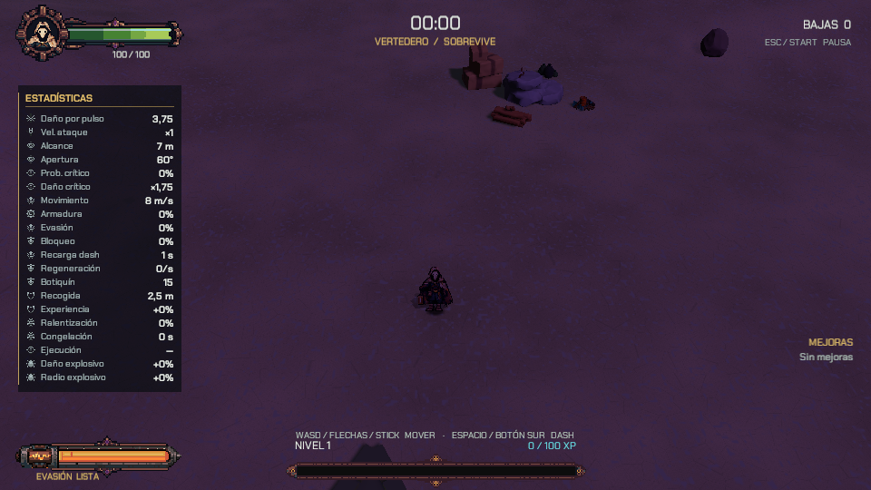

Las cartas comparten marcos por rareza, diez familias de iconos y botones de elección. El texto muestra nombre, tipo de daño, nivel y cambio de la propiedad principal. Las etiquetas NUEVA y la flecha de subida distinguen una primera adquisición de una mejora repetida. El enfoque se identifica mediante borde y texto.

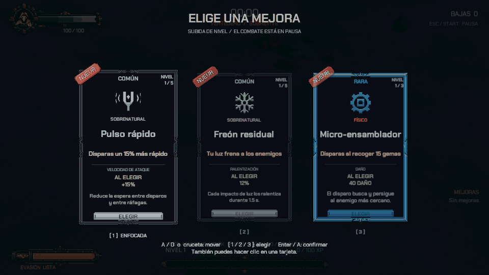

La presentación incluye entrada escalonada, confirmación y una inclinación suave al mover el puntero. Los efectos reducidos conservan la identificación estática y retiran el movimiento decorativo.

La pausa reúne preferencias visuales, modo de estadísticas, Reanudar y Reiniciar. Los resultados utilizan un resumen de tiempo, nivel, bajas y XP. La tipografía de HUD, cartas y daño es Chakra Petch.

---

# Audio y música

Los registros de esta edición son imágenes y GIFs de la versión jugable. El formato GIF conserva la secuencia visual y sus tiempos, pero no contiene una pista de audio. Las demostraciones permiten revisar animación, anticipación e impacto visual de los ataques.

La autoría del área de audio corresponde al reparto del equipo descrito en [[02 - Roles y Responsabilidades]]. Este registro de avance no atribuye una banda sonora o efectos sonoros a las capturas mostradas.

---

# Registro visual de la versión jugable

Las imágenes de esta página proceden de Unity o de los atlas activos del proyecto. Los GIFs de enemigos y cartas se registraron el 27 de octubre de 2026 sobre CombatArena. Se utilizó una cámara de detalle, el jugador protegido y las oleadas detenidas para poder observar cada patrón. Los PNG se unieron a 12 fotogramas por segundo.

Los cuatro GIFs del Coleccionista se capturaron también en CombatArena el 27 de octubre, a 24 fotogramas por segundo, con una cámara de detalle que sigue al jugador. El reposo, la marcha en cuatro direcciones, los dos dashes y la muerte se reproducen con los componentes del juego. Las secuencias se recortaron alrededor del personaje para facilitar su lectura.

Los GIFs de VFX proceden de la revisión visual del 26 de octubre: recortes de capturas de cámara de 1280 × 720 en escenas controladas de mejoras. Sus sistemas de rayos, partículas y materiales coinciden con los del montaje actual. Estas demostraciones muestran el efecto en funcionamiento; no son mediciones de FPS ni reproducciones de una partida completa.

## Enemigos

Los seis registros y las hojas activas de Mortero y Polilla están incorporados en [[03 - Enemigos y NPC]]. [[02 - Personajes y Animación]] reúne también esos seis GIFs junto a los atlas, la tabla de clips y las cuatro animaciones del Coleccionista dentro de la arena.

## Prisma voltaico

El cuarto pulso produce enlaces sucesivos entre objetivos. El núcleo luminoso y los saltos permiten seguir el recorrido de la cadena.

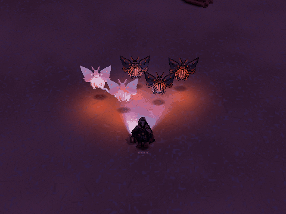

## Ralentización y congelación

El tinte celeste identifica la ralentización. Al congelarse, el enemigo recibe cristales, escarcha y niebla sin perder la textura de su cuerpo o sprite.

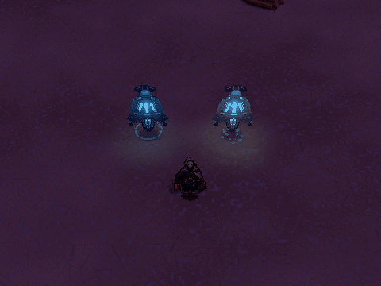

## Minas y explosiones

La detonación combina expansión, humo y fragmentos. El área de daño pertenece a la simulación y no al tamaño aparente del humo.

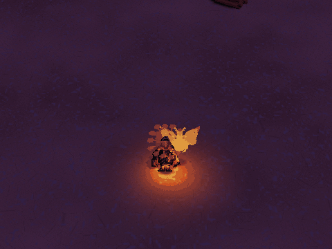

## Nova de plasma

La curación sobrante puede desencadenar una expansión de plasma alrededor del jugador. El registro muestra su aparición y su disipación.

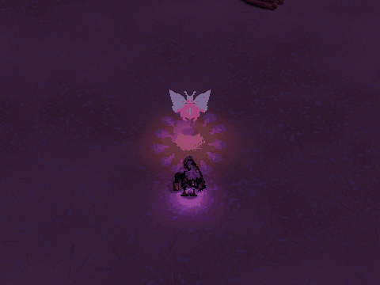

## Nanobots

La superficie de energía rodea el cuerpo y responde a los impactos con ondas y motas. Su presencia visual acompaña las reglas de regeneración y protección de la mejora; no equivale a inmunidad permanente.

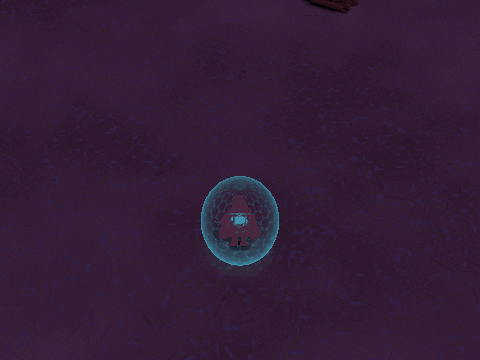

## Sierras orbitales

Las cuchillas giran alrededor del Coleccionista. El metal, las estelas de viento y las chispas permiten distinguir su giro y sus contactos.

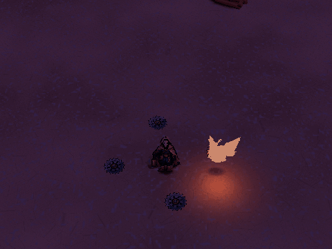

## Pulso colector

Los objetos reales se desplazan hacia el jugador mediante trayectorias curvas. La XP o curación se recibe al llegar, y cada objeto conserva su valor durante el vuelo.

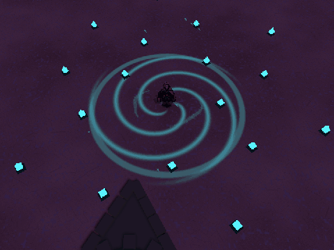

## Onda sísmica

La expansión al terminar el dash marca la aplicación de daño y control a los enemigos cercanos.

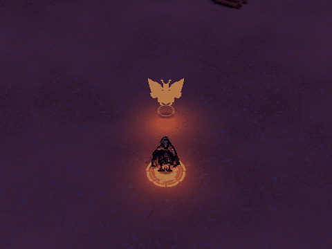

## Números de daño

Los números salen con impulso y caen en arco. El físico usa amarillo y naranja crítico; el sobrenatural, rosa violeta y morado crítico. Los críticos añaden un signo de exclamación.

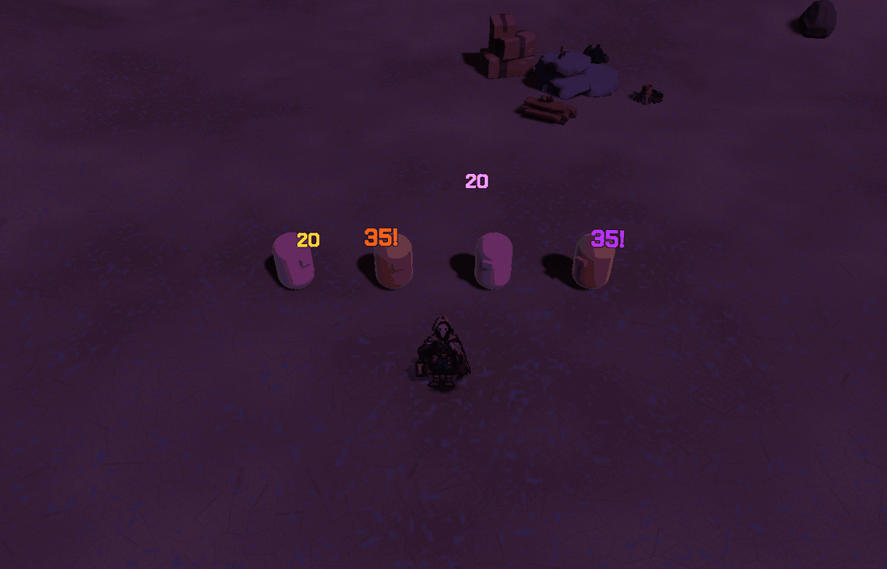

Las mejoras que cambian estadísticas, probabilidades u ofertas se describen en el catálogo. Una captura de partículas no demuestra por sí sola una variación de cadencia, una probabilidad de crítico o un cambio de rareza.

---

# 06 - Experiencia

# UX y flujo del jugador

El jugador entra directamente en la arena preparada. La linterna responde automáticamente y el HUD presenta los recursos necesarios para moverse, recoger experiencia y reconocer la recarga del dash.

Una subida de nivel detiene el combate y abre tres opciones. La selección confirma una mejora y devuelve el control, o presenta la siguiente elección si todavía hay niveles acumulados. La pulsación que confirma no se reutiliza para producir un dash accidental.

La estación de fusión abre un menú local con ingredientes, probabilidades y tiempo de proceso. El resultado se resuelve mediante Coleccionar o Liberar. El portal permite recorrer las vitrinas sin mantener la horda activa durante esa visita.

Gólgora dispone de barra de vida y marcador cuando queda fuera de la pantalla. Al resolverse la sesión, el resumen comunica victoria o derrota y ofrece el reinicio. El cierre de victoria deja un breve tiempo para ver la presentación de la gema antes del resumen.

---

# UI y menús

| Interfaz | Información y acciones disponibles |
| --- | --- |
| HUD | Vida, XP, nivel, cronómetro, bajas, dash y mejoras. |
| Selección de mejora | Hasta tres cartas con rareza, nivel, beneficio y valores; reintento cuando Sintonizador lo permite. |
| Pausa | Reanudar, Reiniciar, ajustes visuales y modo de estadísticas. |
| Estadísticas | Completa: 20 valores efectivos; Reducida: seis valores principales; Sin: panel oculto. |
| Fusión | Tres ingredientes, probabilidades, inicio del proceso y decisión sobre el resultado. |
| Resultados | Victoria o derrota, tiempo, nivel, bajas, XP y reinicio. |
| Laboratorio | Tipo y cantidad de enemigos, inspección, daño de prueba, congelación, pausa y avance de simulación. |

La navegación de cartas acepta ratón, teclado y mando. El puntero inmóvil no desplaza el enfoque realizado con otro dispositivo. Los paneles se adaptan a la resolución mediante escalado de interfaz y los modos de estadísticas reorganizan sus filas.

---

# Accesibilidad

El menú de pausa permite ajustar la intensidad de la sacudida de cámara y la decoración, además de activar efectos reducidos. Esta condición elimina movimiento y partículas decorativas mientras conserva avisos de ataque, indicadores y señales esenciales.

Las cartas comunican selección mediante borde y texto. La rareza tiene nombre escrito y los críticos utilizan un signo de exclamación además del color. Los ataques de área se reconocen por contorno, extensión y progreso de su aviso.

El modo de estadísticas se puede mostrar completo, reducido u oculto. Las preferencias visuales se mantienen al reiniciar la sesión. La pausa y la pérdida de foco bloquean el control de combate para evitar entradas retenidas al regresar.

---

# Guardado y configuración

## Datos de la estación de fusión

La colección usa un guardado local bajo la clave `EchoScrap.FusionPrototype.v1` de PlayerPrefs. El contenido serializado incluye cantidades de los cinco personajes, las ocho plazas de exposición, fase del proceso, resultado sorteado y tiempo restante.

Se guarda al iniciar una fusión, cambiar de fase, resolver el resultado, durante el proceso y al cerrar. El resultado se sortea una vez al comienzo y se conserva durante una recarga. El tiempo fuera de la aplicación no hace avanzar la fusión.

Al cargar se validan tamaños de inventario, identificadores y temporizadores. Si el contenido no puede leerse se recupera el estado inicial del sistema. Los cuatro ingredientes base conservan la disponibilidad ilimitada del montaje actual.

## Estado de la partida

La vida, XP, nivel y cartas elegidas pertenecen a la sesión. Reiniciar comienza una configuración de combate nueva. La visita al almacén conserva al mismo jugador y sus valores mientras suspende el combate.

Los ajustes de decoración, efectos reducidos, sacudida y presentación de estadísticas pertenecen a las opciones disponibles de la sesión y se conservan durante su reinicio. El guardado permanente documentado en esta página corresponde al inventario y al proceso de fusión.

---

# 07 - Tecnología

# Arquitectura técnica

El proyecto activo es `EchoScrap/`. La arena guarda los objetos, referencias y ajustes necesarios para iniciar la partida desde Unity. El arranque enlaza al jugador con los sistemas de combate y reutiliza la sesión al reiniciar.

| Responsabilidad | Componentes actuales |
| --- | --- |
| Composición de la arena | CombatGameBootstrap |
| Tiempo, pausas y resultado | CombatSession, GameplayClock, CombatOutcomeResolver |
| Entradas y movimiento | PlayerInputReader, PlayerMotor, TerrainPlayerCollision |
| Salud y estadísticas | PlayerHealth, PlayerRuntimeStats, PlayerCombatSettings |
| Arma | FlashlightWeapon y su presentación |
| Enemigos | EnemyActor, EnemyPool, navegación y módulos de ataques |
| Horda y jefe | CombatWaveDirector, CombatWaveSettings, BossEncounter, GolgoraActor |
| Progresión y cartas | CombatProgression, UpgradeDraftController, UpgradeCatalog |
| Habilidades y presentación | UpgradeCombatRuntime, UpgradeEffectPool, VoltaicChainRenderer |
| Mundo y colección | WarehouseTravel, WarehouseCameraDirector, FusionStation, FusionProgress |
| Interfaz | CombatHud, UpgradeDraftPresentation, PlayerStatsReadout, DamageNumberPresenter |

El daño, las muertes, el dash y otros cambios se comunican mediante eventos de la sesión. La presentación reacciona a esos eventos sin resolver por su cuenta el resultado de los ataques. El cierre de victoria o derrota se decide después de los impactos del paso de simulación.

Los enemigos, objetos y efectos utilizan reservas reutilizables. La semilla de combate y la de presentación están separadas para que los cambios decorativos no cambien los sorteos jugables.

---

# Motor y herramientas

| Tecnología | Uso en el proyecto actual |
| --- | --- |
| Unity 6000.6.3f1 | Escenas, física, integración, Play Mode y ejecutable Windows. |
| URP 17.6.0 | Iluminación, materiales, shaders y render de los registros visuales. |
| Input System 1.20.0 | Teclado, ratón y mando. |
| Cinemachine 6.6.0 | Seguimiento de cámara y ajustes del recorrido por el almacén. |
| Unity Test Framework 1.8.0 | Pruebas de reglas, integración y capturas controladas. |
| C# | Sistemas del juego y herramientas activas del Editor. |
| HLSL | Luz, magma, portal, materiales de interfaz y efectos. |
| Aseprite | Fuentes editables, animaciones, atlas e interfaz de pixel art. |
| Blender | Preparación y edición de modelos 3D. |
| Obsidian / Markdown | Redacción del GDD y presentación de imágenes y GIFs. |
| Git y GitHub | Versionado separado del juego y del documento. |

## Organización

El juego guarda código en `Assets/_Project/Scripts`, escenas en `Scenes`, ajustes en `Settings` y recursos visuales en `Art` y `Resources`. Las fuentes finales editables se conservan en `ArtSource`.

El Editor mantiene herramientas para el laboratorio, el balance, el inspector de la linterna y la conexión del arte actual. Los generadores de montajes anteriores, los informes auxiliares y las galerías de revisión se archivaron fuera del proyecto del juego. Los medios seleccionados para este GDD se encuentran en su propia carpeta `Media/Avance_2026-10-27`.

---

# Requisitos técnicos

La plataforma utilizada por el proyecto es Windows PC. La escena y sus variantes se ejecutan en Unity 6000.6.3f1 con URP, Input System y Cinemachine. La población normal del director está limitada a 150 enemigos vivos; el valor de 250 pertenece al modo separado de estrés.

## Alcance de los registros

Las capturas nuevas del GDD se generaron a 960 × 540 en una copia externa del proyecto, con render Direct3D11 y una cámara de detalle. Las secuencias de mejoras conservan recortes de capturas de 1280 × 720. Los ajustes del ensayo permiten observar efectos sin convertirlos en una medición de rendimiento del juego completo.

El archivo de desarrollo contiene mediciones de builds anteriores y perfiles del Editor con distintas poblaciones y efectos. Cada resultado corresponde a su fecha, hardware y configuración. Esta edición no presenta una tasa mínima de FPS ni una especificación mínima de hardware como si estuvieran certificadas para cualquier equipo.

El uso normal de teclado o mando, los límites de la arena, las pausas, el reinicio y los ajustes visuales están descritos en sus secciones funcionales. La documentación del comportamiento y la medición del rendimiento se mantienen como comprobaciones diferentes.

---

# Datos y persistencia

Los valores del jugador y de los enemigos se configuran mediante assets. Las oleadas cuentan con ajustes independientes para las escenas normal y rápida. El catálogo de mejoras contiene 35 identificadores y una tabla de ajustes de sus efectos.

## Datos de la sesión

El reloj, la semilla, vida, XP, nivel, cartas, enemigos, peligros y objetos pertenecen al combate activo. El reinicio restaura sus valores y limpia sus instancias y efectos. La visita al almacén conserva esa sesión en memoria.

## Datos que se conservan localmente

`FusionProgress` serializa inventario, plazas, fase, resultado y temporizadores en JSON dentro de PlayerPrefs. La versión del formato es 1 y su clave es `EchoScrap.FusionPrototype.v1`. El sistema valida los datos al cargar y conserva el resultado de una fusión comenzada.

Los atlas y las fuentes editables contienen los fotogramas y sus tiempos. Los materiales y recursos de efectos se referencian desde el proyecto para mantener disponibles sus texturas y shaders en la ejecución.

---

# Seguridad y riesgos técnicos

El inventario de fusión se conserva de forma local. Al cargarlo se validan sus arrays, identificadores y temporizadores antes de continuar el proceso. La colección y el estado del combate se gestionan por separado.

## Comportamientos que requieren atención al revisar cambios

- Un objeto reciclado debe limpiar sus estados, objetivos y efectos antes de volver a aparecer.
- La pausa debe detener temporizadores de combate y mantener la coherencia al recuperar el foco.
- Un ataque anunciado debe conservar su área, posición y tiempo de resolución.
- La saturación de una reserva de peligros debe posponer el ataque sin sustituir zonas ya anunciadas.
- La entrada del jefe necesita espacio libre para no activar colisiones encima del jugador.
- El guardado de una fusión debe conservar el resultado ya sorteado, incluidos los reinicios de la aplicación.

Los generadores históricos del escenario se conservan en el archivo externo. El montaje actual vive en sus escenas y assets, evitando que una herramienta de una fase anterior reemplace colocaciones posteriores.

---

# 08 - Producción

# Alcance de la versión jugable

El avance contiene un escenario de supervivencia con un protagonista, cinco arquetipos de horda y un jefe. El jugador puede completar el combate, consultar el resultado y reiniciar. La escena de tres minutos y la de ocho minutos comparten mapa y sistemas, con distinto tiempo de aparición del jefe.

La progresión de combate reúne 35 mejoras funcionales, cuatro rarezas, niveles y requisitos. La presentación incluye sprites animados del Coleccionista, Mortero y Polilla, un modelo animado del MataColeccionista y efectos de luz, daño, frío, explosiones, dispositivos y recogida.

El escenario incorpora relieve, colisiones, lava, acceso subterráneo y almacén visitable por portal. La estación de fusión permite combinar tres ingredientes, esperar el resultado y guardarlo en una colección de cinco personajes con ocho espacios de exposición. Los ingredientes base son ilimitados en este montaje.

El laboratorio de enemigos y los sandboxes permiten observar reglas de forma aislada. Los registros incluidos en el GDD documentan esa versión y sus recursos actuales.

---

# Roles y Responsabilidades

## Objetivo de este reparto

El reparto organiza el mantenimiento del GDD y el trabajo del equipo sobre la versión jugable. La documentación combina reglas actuales, recursos integrados y registros visuales para que cada área pueda revisar el mismo estado del juego.

El equipo consta de cinco integrantes con roles definidos. Sierra Sosa David Alejandro es responsable del balance, las mecánicas y el diseño funcional y técnico del juego; Mora Alejandro Angel Gabriel coordina la visión global y la producción; Cupul Dzul Mirian Leticia (Artista 1) lleva dirección de arte, personajes y animación; Obispo Navarro Samuel Alejandro (Artista 2) lleva mundo, entornos e interfaz visual y colabora en audio; y Nuñez Chan Luis Fernando lleva la narrativa presentada al jugador, audio, experiencia de usuario (UX/UI), calidad (QA) y referencias.

## Equipo y responsabilidad principal

| Integrante / Rol | Responsabilidad en el GDD | Apartados como redactor |
|---|---|---:|
| **Mora Alejandro Angel Gabriel** (Líder) | Visión, premisa, alcance, producción, acuerdos y cierre de entrega. | 12 |
| **Sierra Sosa David Alejandro** (Desarrollo y diseño de juego) | Mecánicas, balance, contenido jugable, tecnología y guardado. | 18 |
| **Cupul Dzul Mirian Leticia** (Artista 1) | Dirección visual, fichas de personajes y animaciones. | 3 |
| **Obispo Navarro Samuel Alejandro** (Artista 2 — apoya audio) | Mundo, entornos e interfaz visual; apoyo al responsable de audio. | 3 |
| **Nuñez Chan Luis Fernando** (Audio, UX y apoyo general) | Narrativa presentada al jugador, sonido, UX, QA y referencias. | 11 |

La cantidad de archivos no mide la carga por sí sola: una ficha de animaciones o un inventario de interfaz requiere un nivel alto de detalle. Se aprovechan las reglas documentadas por David y se distribuyen revisión, narrativa y calidad para que cada área pueda cerrarse con coherencia.

## Cómo se entrega cada apartado

- **Redactor:** escribe y deja el apartado completo, coherente y enlazado. Hay exactamente uno por archivo.
- **Revisor:** lee el borrador, verifica su coherencia y devuelve observaciones; no edita en paralelo sin coordinarse.
- **Apoyos:** aportan datos o recursos concretos cuando el apartado los necesita. No sustituyen al redactor.
- **David valida reglas, valores y viabilidad técnica.** Los artistas deciden su presentación visual; el responsable de audio decide su presentación sonora.
- **El líder coordina decisiones globales de alcance y la entrega.** Los cambios que afecten a varias áreas se acuerdan con el equipo.
- **El profesor aprueba el GDD.** La revisión interna del equipo no equivale a aprobación docente.

Un apartado está listo cuando contiene decisiones propias de *EchoScrap*, sus límites y casos relevantes, y coincide con los documentos relacionados. Cuando algo no aplica, debe explicarse; no se añaden funciones sólo por aparecer como ejemplo en la plantilla.

## Asignación por apartado

| Apartado | Redactor | Revisor |
|---|---|---|
| 01 - Visión · 01 - Ficha del Proyecto | Mora Alejandro Angel Gabriel (Líder) | Sierra Sosa David Alejandro |
| 01 - Visión · 02 - Visión del Juego | Mora Alejandro Angel Gabriel (Líder) | Sierra Sosa David Alejandro |
| 01 - Visión · 03 - Público y Plataforma | Mora Alejandro Angel Gabriel (Líder) | Sierra Sosa David Alejandro |
| 01 - Visión · 04 - Pilares de Diseño | Mora Alejandro Angel Gabriel (Líder) | Sierra Sosa David Alejandro |
| 02 - Diseño · 01 - Jugabilidad | Sierra Sosa David Alejandro | Nuñez Chan Luis Fernando |
| 02 - Diseño · 02 - Mecánicas | Sierra Sosa David Alejandro | Nuñez Chan Luis Fernando |
| 02 - Diseño · 03 - Sistemas | Sierra Sosa David Alejandro | Nuñez Chan Luis Fernando |
| 02 - Diseño · 04 - Controles | Sierra Sosa David Alejandro | Nuñez Chan Luis Fernando |
| 02 - Diseño · 05 - Progresión | Sierra Sosa David Alejandro | Nuñez Chan Luis Fernando |
| 02 - Diseño · 06 - Economía y Recursos | Sierra Sosa David Alejandro | Mora Alejandro Angel Gabriel (Líder) |
| 02 - Diseño · 07 - Reglas y Estados del Juego | Sierra Sosa David Alejandro | Nuñez Chan Luis Fernando |
| 03 - Historia y Mundo · 01 - Premisa y Trama | Mora Alejandro Angel Gabriel (Líder) | Nuñez Chan Luis Fernando |
| 03 - Historia y Mundo · 02 - Mundo | Obispo Navarro Samuel Alejandro (Artista 2) | Mora Alejandro Angel Gabriel (Líder) |
| 03 - Historia y Mundo · 03 - Personajes | Cupul Dzul Mirian Leticia (Artista 1) | Mora Alejandro Angel Gabriel (Líder) |
| 03 - Historia y Mundo · 04 - Diálogos y Narrativa | Nuñez Chan Luis Fernando | Mora Alejandro Angel Gabriel (Líder) |
| 04 - Contenido · 01 - Estructura del Contenido | Sierra Sosa David Alejandro | Mora Alejandro Angel Gabriel (Líder) |
| 04 - Contenido · 02 - Niveles | Sierra Sosa David Alejandro | Obispo Navarro Samuel Alejandro (Artista 2) |
| 04 - Contenido · 03 - Enemigos y NPC | Sierra Sosa David Alejandro | Nuñez Chan Luis Fernando |
| 04 - Contenido · 04 - Objetos y Coleccionables | Sierra Sosa David Alejandro | Nuñez Chan Luis Fernando |
| 04 - Contenido · 05 - Misiones y Desafíos | Sierra Sosa David Alejandro | Mora Alejandro Angel Gabriel (Líder) |
| 05 - Arte y Audio · 01 - Dirección de Arte | Cupul Dzul Mirian Leticia (Artista 1) | Obispo Navarro Samuel Alejandro (Artista 2) |
| 05 - Arte y Audio · 02 - Personajes y Animación | Cupul Dzul Mirian Leticia (Artista 1) | Obispo Navarro Samuel Alejandro (Artista 2) |
| 05 - Arte y Audio · 03 - Entornos | Obispo Navarro Samuel Alejandro (Artista 2) | Cupul Dzul Mirian Leticia (Artista 1) |
| 05 - Arte y Audio · 04 - Interfaz Visual | Obispo Navarro Samuel Alejandro (Artista 2) | Cupul Dzul Mirian Leticia (Artista 1) |
| 05 - Arte y Audio · 05 - Audio y Música | Nuñez Chan Luis Fernando | Obispo Navarro Samuel Alejandro (Artista 2) |
| 06 - Experiencia · 01 - UX y Flujo del Jugador | Nuñez Chan Luis Fernando | Sierra Sosa David Alejandro |
| 06 - Experiencia · 02 - UI y Menús | Nuñez Chan Luis Fernando | Sierra Sosa David Alejandro |
| 06 - Experiencia · 03 - Accesibilidad | Nuñez Chan Luis Fernando | Sierra Sosa David Alejandro |
| 06 - Experiencia · 04 - Guardado y Configuración | Sierra Sosa David Alejandro | Nuñez Chan Luis Fernando |
| 07 - Tecnología · 01 - Arquitectura Técnica | Sierra Sosa David Alejandro | Nuñez Chan Luis Fernando |
| 07 - Tecnología · 02 - Motor y Herramientas | Sierra Sosa David Alejandro | Mora Alejandro Angel Gabriel (Líder) |
| 07 - Tecnología · 03 - Requisitos Técnicos | Sierra Sosa David Alejandro | Nuñez Chan Luis Fernando |
| 07 - Tecnología · 04 - Datos y Persistencia | Sierra Sosa David Alejandro | Nuñez Chan Luis Fernando |
| 07 - Tecnología · 05 - Seguridad y Riesgos Técnicos | Sierra Sosa David Alejandro | Mora Alejandro Angel Gabriel (Líder) |
| 08 - Producción · 01 - Alcance | Mora Alejandro Angel Gabriel (Líder) | Sierra Sosa David Alejandro |
| 08 - Producción · 02 - Roles y Responsabilidades | Mora Alejandro Angel Gabriel (Líder) | Sierra Sosa David Alejandro |
| 08 - Producción · 03 - Roadmap | Mora Alejandro Angel Gabriel (Líder) | Sierra Sosa David Alejandro |
| 08 - Producción · 04 - Backlog del Proyecto | Mora Alejandro Angel Gabriel (Líder) | Sierra Sosa David Alejandro |
| 08 - Producción · 05 - Gestión de Cambios | Mora Alejandro Angel Gabriel (Líder) | Sierra Sosa David Alejandro |
| 09 - Calidad · 01 - Criterios de Calidad | Nuñez Chan Luis Fernando | Sierra Sosa David Alejandro |
| 09 - Calidad · 02 - Pruebas | Nuñez Chan Luis Fernando | Sierra Sosa David Alejandro |
| 09 - Calidad · 03 - Bugs y Seguimiento | Nuñez Chan Luis Fernando | Sierra Sosa David Alejandro |
| 09 - Calidad · 04 - Criterios de Aceptación | Nuñez Chan Luis Fernando | Sierra Sosa David Alejandro |
| 10 - Referencia · 01 - Glosario | Nuñez Chan Luis Fernando | Sierra Sosa David Alejandro |
| 10 - Referencia · 02 - Referencias e Inspiración | Nuñez Chan Luis Fernando | Mora Alejandro Angel Gabriel (Líder) |
| 10 - Referencia · 03 - Registro de Decisiones | Mora Alejandro Angel Gabriel (Líder) | Sierra Sosa David Alejandro |
| 10 - Referencia · 04 - Historial de Versiones | Mora Alejandro Angel Gabriel (Líder) | Nuñez Chan Luis Fernando |

Los apoyos y el entregable específico de cada archivo se detallan en la matriz de reparto. Cada área proporciona sus referencias al responsable que las consolida en `10 - Referencia/02 - Referencias e Inspiración.md`.

## Qué corresponde específicamente a David

1. **02 — Diseño: los siete apartados.** Jugabilidad, Mecánicas, Sistemas, Controles, Progresión, Economía y Recursos, Reglas y Estados del Juego.
2. **04 — Contenido: los cinco apartados.** Estructura del Contenido, Niveles, Enemigos y NPC, Objetos y Coleccionables, Misiones y Desafíos.
3. **06 — Experiencia: Guardado y Configuración.**
4. **07 — Tecnología: los cinco apartados.** Arquitectura, Motor y Herramientas, Requisitos, Datos y Persistencia, Seguridad y Riesgos Técnicos.

En Niveles, David define dimensiones, límites, *spawn* y función jugable; Samuel (Artista 2) prepara el esquema y la ambientación. En Enemigos, David define comportamiento, estadísticas y ataques; Mirian (Artista 1) prepara aspecto y animaciones en sus apartados. En Objetos, David define efectos y condiciones; los artistas especifican iconos y representación visual.

Además revisa Visión y Producción, el flujo funcional de UX/UI, accesibilidad, glosario y criterios de prueba. Revisar estos archivos no lo convierte en su redactor.

## Dependencias para avanzar

1. El líder cierra con el equipo qué incluye la entrega, el MVP y el juego final.
2. David entrega las reglas y el catálogo de contenido con valores canónicos.
3. Los artistas y audio documentan presentación y recursos necesarios usando esas reglas.
4. Luis Fernando (Audio y apoyo general) redacta UX y QA; David verifica las reglas y los resultados esperados.
5. El líder integra observaciones, actualiza la versión y prepara la entrega al profesor.

El trabajo puede avanzar en paralelo en las partes que no dependan de una decisión pendiente. Una modificación de balance o alcance debe registrarse y comunicarse para que no queden valores distintos en dos páginas.

## Índice y biblioteca

El líder mantiene `00 - Índice.md`, la navegación y la autoría de la guía. La sección 11 es biblioteca de consulta; se conserva como referencia y no se reparte como siete tareas nuevas de diseño del juego.

---

# Hitos del desarrollo documentado

| Periodo | Resultado incorporado al juego |
| --- | --- |
| 21–22 de octubre | Proyecto Unity, locomoción, cámara, salud, dash y linterna. |
| 22 de octubre | Cinco enemigos de horda, XP, botiquines, cartas, oleadas, Gólgora, HUD y cierre de partida. |
| 23–24 de octubre | Ajustes de aparición y balance, sprites animados, iluminación, cartas y presentación de daños. |
| 24–25 de octubre | Mundo 3D, MataColeccionista, acceso a la bóveda, colisiones y laboratorio de enemigos. |
| 25–26 de octubre | Catálogo de 35 mejoras, variantes de tres y ocho minutos, interfaz y estadísticas del jugador. |
| 26 de octubre | Fusión por rareza, colección expuesta, barra de XP, magma, portal y renovación de VFX. |
| 27 de octubre | Limpieza de material auxiliar del repositorio y actualización del GDD con registros del juego. |

Las reglas y los recursos de estas entregas se desarrollan en las secciones de diseño, contenido y registro visual.

---

# Registro de entregas del proyecto

| Entrega | Evidencia funcional en el avance |
| --- | --- |
| Control del Coleccionista | Movimiento, dash, colisiones y cámara utilizables en la arena. |
| Combate | Linterna automática, salud, críticos, daño y curación. |
| Enemigos | Cinco arquetipos y Gólgora con sus ataques y presentaciones. |
| Progresión | XP, subidas de nivel y 35 mejoras seleccionables. |
| Flujo de partida | Oleadas, entrada del jefe, victoria, derrota y reinicio. |
| Mundo | Arena de 200 m, relieve, obstáculos, lava, escalera, portal y almacén. |
| Fusión | Recetas por rareza, temporizador, resultado, colección y guardado local. |
| Presentación | Sprites, modelo del jefe, HUD, cartas, partículas y efectos de mejoras. |
| Herramientas | Laboratorio, balance y conectores del arte actual. |
| Documentación visual | Atlas activos, fuentes editables y GIFs de enemigos, cartas y VFX registrados en Unity. |

Los detalles jugables se mantienen en las secciones de diseño y contenido. Este registro agrupa las entregas existentes para su revisión conjunta.

---

# Gestión de Cambios

## Descripción de la sección

El diseño de un videojuego evoluciona durante la revisión del equipo y la retroalimentación del profesor. Esta sección establece el protocolo para evaluar y registrar modificaciones sin romper la coherencia entre apartados.

## Flujo para aprobar un cambio

1. **Propuesta:** Cualquier integrante identifica una necesidad de ajuste (de balance, alcance, arte o interfaz) y describe el motivo y los archivos afectados.
2. **Validación técnica y de reglas:** Sierra Sosa David Alejandro verifica cómo impacta el cambio en las estadísticas, las 35 mejoras, el rendimiento o la persistencia.
3. **Coordinación y cierre:** Mora Alejandro Angel Gabriel (Líder) confirma que el cambio respeta el alcance de entrega y coordina la actualización simultánea en todos los documentos relacionados antes de subirlo al repositorio.

## Registro de cambios aplicados al diseño

| Fecha | Cambio | Motivo | Impacto en otros sistemas | Responsable | Estado |
|---|---|---|---|---|---|
| **15/10/2026** | Unificación de historia de origen del Coleccionista (humano atrapado por un pacto engañoso). | Alinear `01 - Visión` y `03 - Historia y Mundo` bajo una sola premisa narrativa. | Actualización de fichas de lore y descripción general del protagonista. | Mora Alejandro Angel Gabriel / Nuñez Chan Luis Fernando | Histórico |
| **15/10/2026** | Eliminación de divisas residuales y fijación de **hasta 3 Entidades equipables** con **+1 nivel por duplicado**. | Simplificar la meta-progresión y hacer que cada victoria contra Gólgora sea significativa. | Sincronización de `02 - Diseño`, `04 - Contenido`, `05 - Interfaz Visual`, `06 - Experiencia` y `07 - Datos y Persistencia`. | Sierra Sosa David Alejandro / Mora Alejandro Angel Gabriel | Histórico |
| **15/10/2026** | Definición de **muros perimetrales físicos** de chatarra y cámara cenital unificada a **60°**. | Delimitar físicamente la arena de $120 \times 120\text{ m}$ y estandarizar la proyección de *sprites* 2D en el entorno 3D. | Ajuste en `02 - Mecánicas`, `04 - Niveles`, `05 - Entornos` y `05 - Personajes y Animación`. | Sierra Sosa David Alejandro / Obispo Navarro Samuel Alejandro | Histórico |
| **16/10/2026** | Invocación periódica de esbirros por Gólgora cada $4.0\text{ s}$ en la Fase 5. | Mantener activas las mejoras de área, curación y recolección de XP durante el jefe final. | Actualización de `02 - Sistemas`, `04 - Niveles`, `04 - Enemigos y NPC` y `05 - Personajes y Animación`. | Sierra Sosa David Alejandro | Histórico |

## Montaje documentado el 27/10/2026

El avance actual utiliza arena de 200 × 200 m y cámara de combate a 50°. Las reglas, recursos y registros de la edición 0.4.0 sustituyen las descripciones anteriores cuando difieren del juego. Se incorporan las variantes de tres y ocho minutos, el catálogo activo de 35 mejoras, las representaciones reales de los enemigos y el sistema de fusión con su colección de cinco personajes.

---

# 09 - Calidad

# Criterios de calidad

El avance se revisa por su coherencia entre regla, control y representación. La respuesta al movimiento, la forma de los avisos, los valores de las cartas y la limpieza del reinicio se observan como partes de la misma experiencia.

| Aspecto | Comprobación |
| --- | --- |
| Control | El personaje responde a teclado y mando y el dash respeta paredes. |
| Lectura | Los avisos preceden al daño y los efectos reducidos conservan sus señales esenciales. |
| Progresión | Las ofertas respetan requisitos y niveles máximos; una adquisición aplica el cambio indicado. |
| Sesión | La pausa, las elecciones, el almacén y el resultado mantienen coherente el reloj. |
| Persistencia | El inventario y la fusión se recuperan con datos válidos al volver a abrir. |
| Documentación | Las imágenes muestran recursos existentes y sus pies explican el contexto de captura. |

Los valores y las representaciones se revisan juntos para mantener coherente la experiencia de juego.

---

# Pruebas

El proyecto dispone de pruebas de reglas e integración para movimiento, dash, daño, enemigos, oleadas, cartas, recogida, pausa, resultados, colisiones y fusión. El laboratorio permite generar los seis tipos de enemigo y observar sus estados de forma manual.

## Registro visual de esta edición

El 27 de octubre se ejecutó una captura automatizada en Play Mode sobre una copia externa del proyecto actual. Se registraron los seis enemigos, la entrada de cartas, el HUD, las estadísticas, la estación de fusión y el almacén. El proceso terminó correctamente y produjo imágenes mediante el render de Unity.

Las secuencias usan una cámara de detalle y un jugador protegido para que cada ataque sea visible. Sus valores de enemigos permanecen intactos. Los GIFs de VFX incorporan registros de la revisión visual del 26 de octubre, con los mismos componentes de presentación del avance actual.

Las capturas y la verificación de documentos no sustituyen una ejecución de toda la suite ni una partida completa. Esta actualización no presenta el resultado de un subconjunto como si acreditara todas las pruebas del juego.

---

# Bugs y seguimiento

La revisión del avance se apoya en situaciones reproducibles y en el código y los recursos presentes. Una captura acredita el aspecto de ese momento; un comportamiento se contrasta además con su regla y su ejecución.

## Límites observados del montaje

La población de enemigos cuenta también a los que quedan lejos de cámara. Una retirada continua puede dejar a gran parte de la horda fuera de la zona visible y reducir la presión cercana cuando el límite de población ya está ocupado.

La escena rápida cambia el momento de entrada del jefe; conserva las fases de oleadas del montaje y no representa una compresión proporcional de todos los tiempos de la escena larga.

Las pruebas de estos casos se describen mediante su escenario y su resultado, para poder repetir la misma situación al revisar un cambio.

---

# Criterios de aceptación del avance

| Parte | Comportamiento definido por la versión actual |
| --- | --- |
| Movimiento | Teclado y mando mueven al Coleccionista; la diagonal está limitada y el apoyo sigue el escenario. |
| Dash | Recorre el espacio libre, atraviesa enemigos durante su protección y se detiene ante paredes. |
| Linterna | Adquiere objetivos, emite cuatro pulsos y aplica el empuje final según el enemigo. |
| Enemigos | Cada arquetipo usa sus valores, navegación y ataque especial; el jefe alterna sus patrones. |
| XP y cartas | La XP produce elecciones y el draft muestra opciones válidas con sus niveles y valores. |
| Resultado | Muerte del jugador: derrota; muerte del jefe con jugador vivo: victoria; empate: derrota. |
| Reinicio | Se limpian actores, peligros y efectos de la partida y se restauran sus estadísticas. |
| Almacén | El viaje conserva al jugador y suspende el combate hasta regresar. |
| Fusión | Tres ingredientes producen un sorteo único; el resultado se colecciona o libera y el proceso se guarda localmente. |
| Registro visual | Los atlas coinciden con los recursos activos y los GIFs se obtienen del render del juego. |

Los apartados de diseño explican los valores y las condiciones de estas reglas. [[02 - Pruebas]] identifica qué se comprobó al preparar los registros de esta edición.

---

# 10 - Referencia

# Glosario

| Término | Uso en la versión actual |
| --- | --- |
| Coleccionista | Personaje controlado por el jugador, equipado con linterna y dash. |
| Vertedero de Ecos | Escenario de combate de 200 × 200 m. |
| Almacén o bóveda | Espacio 3D de exposición conectado a la arena por un portal. |
| Coleccionable | Personaje del inventario de fusión; el catálogo actual contiene cinco. |
| Eco o gema de XP | Objeto que concede experiencia de la partida; los arquetipos normales entregan 10, 15, 25 o 50 XP. |
| Linterna | Arma sobrenatural con autoapuntado, cuatro pulsos y empuje en el último. |
| Rayo solar | Mejora legendaria FLASH_05: 14 m de alcance base, daño ×2,5 y ráfagas sin descanso. |
| Dash | Desplazamiento evasivo de 0,15 s con invulnerabilidad y recorrido limitado por obstáculos. |
| Gólgora / MataColeccionista | Jefe de 1500 HP con modelo 3D animado, pisotón y bombardeo. |
| Draft o selección de mejoras | Elección pausada de hasta tres cartas válidas al subir de nivel. |
| Reintento | Cambio de oferta consumible concedido por Sintonizador. |
| Fusión | Proceso de tres ingredientes con tiempo y sorteo por rareza. |
| I-frames | Periodo de protección temporal frente al daño. |
| Atlas o spritesheet | Imagen que reúne los fotogramas usados por un personaje. |
| VFX | Representación visual de ataques, estados y otras acciones mediante luz, partículas, materiales o geometría. |
| Efectos reducidos | Condición de presentación que retira decoración y conserva las señales esenciales. |
| Pool | Reserva de instancias que se reutilizan al crear y retirar actores, objetos o efectos. |

Las cifras y condiciones de cada término se desarrollan en las secciones de diseño, contenido y registro visual.

---

# Referencias e Inspiración

## Descripción de la sección

Registra los videojuegos y obras utilizadas como referencia de diseño, arte, narrativa y ritmo para *EchoScrap*.

## Referencias principales

| Nombre | Aspecto de referencia | Qué nos interesa tomar | Qué NO buscamos copiar |
|---|---|---|---|
| **Vampire Survivors** | Bucle de supervivencia, escalado de hordas y selección pausada de mejoras al subir de nivel. | La claridad del bucle de absorción magnética de gemas de XP, la satisfacción de limpiar oleadas masivas y la pausa táctica de 3 opciones al subir de nivel. | La ausencia de esquive activo (*Dash*) y las partidas de 30 minutos; *EchoScrap* concentra la partida en 8–10 minutos con posicionamiento táctico. |
| **Brotato / 20 Minutes Till Dawn** | Construcción de *builds* compactas y sinergias entre mejoras pasivas y activas en arenas cerradas. | La legibilidad de las estadísticas del personaje, los topes defensivos claros y la tensión dentro de un perímetro delimitado. | El sistema de tienda con moneda entre oleadas; en *EchoScrap* la progresión en partida ocurre por nivel de XP y la meta-progresión por captura de Entidades en victoria. |
| **Risk of Rain Returns / Hyper Light Drifter** | Dirección de arte *pixel art* de alto contraste, paleta cromática y atmósfera melancólica de mundos en ruinas. | El uso de sombras profundas (paleta Apollo) contrastadas con cianos y ámbares brillantes para mantener legibles los ataques y peligros. | La exploración de mapas laberínticos abiertos o plataformas de salto. |
| **Enter the Gungeon** | Respuesta kinestésica del *Dash* con invulnerabilidad (*i-frames*) y telegrafiado visual de ataques enemigos. | La precisión del esquive para atravesar cercos o proyectiles y los indicadores claros antes de una explosión o pisotón. | El apuntado manual de doble *stick* con recarga de munición tradicional. |
| **Resident Evil (Archivos y vitrinas)** | Narrativa indirecta mediante fichas de registro e inspección en calma. | El formato de textos breves (35–65 palabras) en las fichas de las Entidades del Almacén que revelan el trasfondo del pacto y de Gólgora sin cortar la acción con cinemáticas. | La gestión de inventario limitado por casillas de supervivencia clásica. |

> [!warning] Propiedad intelectual
> Todas las referencias sirven únicamente como guía de análisis mecánico, visual y de ritmo; todos los *sprites*, modelos 3D, textos y pistas de *EchoScrap* se diseñan de forma original para el proyecto.

---

# Registro de decisiones vigentes

Las decisiones de esta edición se contrastan con el montaje jugable documentado el 27 de octubre de 2026.

| Área | Decisión reflejada en el juego | Consecuencia |
| --- | --- | --- |
| Control | Movimiento y apuntado de la linterna desacoplados. | El jugador puede retirarse mientras ataca a una amenaza en otra dirección. |
| Dash | Protección temporal y paso entre enemigos, con límites sólidos del escenario. | La esquiva abre rutas sin atravesar muros. |
| Mundo y cámara | Arena de 200 m y cámara de combate a 50°. | La documentación coincide con la escala y proyección actuales. |
| Partida | Variantes con jefe a tres y ocho minutos; victoria por derrota del jefe. | El tiempo marca una transición y no una victoria automática. |
| Mejoras | 35 cartas activas con cuatro rarezas, niveles y requisitos. | Las ofertas y la descripción del GDD utilizan el catálogo del juego. |
| Enemigos | Atlas para Mortero y Polilla; geometría para Residual, Interceptor y Coloso; modelo animado para Gólgora. | Cada recurso se presenta con su representación real. |
| Colección | Cinco personajes, fusión por rareza, ocho espacios e ingredientes base ilimitados. | Se documentan las reglas de obtención y guardado del sistema actual. |
| Documentación visual | Capturas de Unity y atlas activos con contexto de registro. | Las ilustraciones permiten revisar lo que funciona dentro del juego. |

El historial de versiones conserva las fechas de evolución del documento. Las capturas y los textos de esta edición describen la versión jugable actual.

---

# Historial de Versiones

## Descripción de la sección

Registra los cambios importantes realizados al GDD. Esto permite conocer cómo evolucionó el diseño y cuándo se modificó una decisión.

## Formato

| Versión | Fecha | Cambios principales | Responsable |
|---|---|---|---|
| **0.1.0** | 25/09/2026 | Creación inicial de la estructura documental del GDD. | Mora Alejandro Angel Gabriel |
| **0.1.1** | 25/09/2026 | Redacción de la Sección 01 - Visión (Ficha, Concepto, Público y Pilares). | Mora Alejandro Angel Gabriel |
| **0.2.0** | 04/10/2026 | Documentación de la **Sección 02 - Diseño** (Jugabilidad, Mecánicas, Sistemas, Controles, Progresión, Economía y Estados), los 5 arquetipos de enemigos de horda, Gólgora y la arquitectura técnica. | Sierra Sosa David Alejandro / Mora Alejandro Angel Gabriel |
| **0.3.0** | 16/10/2026 | Consolidación del documento de diseño, narrativa, mecánicas, catálogo de mejoras y organización del equipo. | Equipo EchoScrap |
| **0.4.0** | 27/10/2026 | Actualización al proyecto jugable EchoScrap: reglas y valores actuales, seis enemigos, 35 mejoras, mundo de 200 m, almacén y fusión; atlas activos y GIFs de enemigos, cartas y VFX capturados en Unity. | Sierra Sosa David Alejandro |

## Convención sugerida

- **MAJOR:** cambios estructurales importantes.
- **MINOR:** nuevas secciones o características relevantes.
- **PATCH:** correcciones, aclaraciones y pequeños ajustes.

> [!example] Ejemplo
> `1.2.3` → versión mayor 1, versión menor 2, corrección 3.

---
