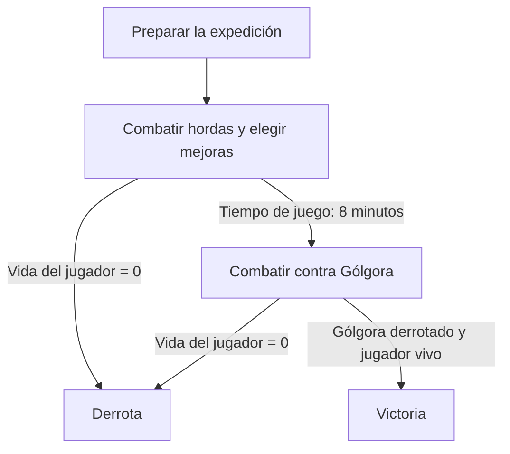
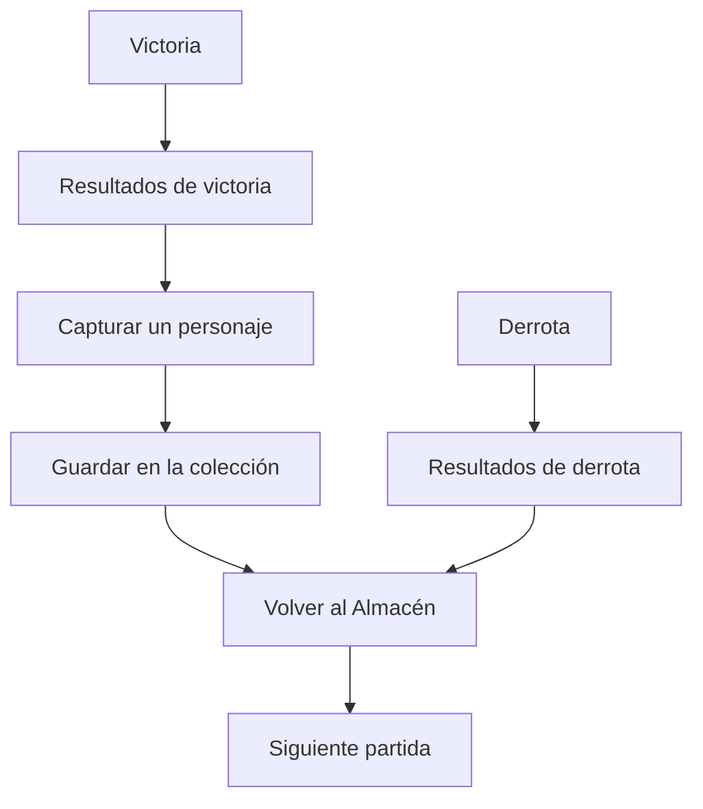

# Jugabilidad

## Descripción de la sección

La jugabilidad de *EchoScrap* combina **supervivencia y construcción de una configuración de combate durante cada run** con **recolección y equipamiento permanente de personajes entre runs**. La colección es una parte central del juego: cada expedición ganada permite capturar un personaje para el Almacén del Coleccionista.

## Bucle completo del juego

El flujo se separa en dos diagramas: **qué ocurre durante la partida** y **qué ocurre después de su resultado**.

### Durante la partida

Durante las hordas se repite el ciclo de moverse, combatir, recoger XP y elegir mejoras. Al minuto 8 aparece Gólgora; su combate continúa hasta victoria o derrota.

### Después de la partida

- **Victoria:** resultados → captura de un personaje → colección → Almacén.
- **Derrota:** resultados → Almacén. No concede un personaje.
- **En el Almacén:** revisar los personajes que ya se poseen, elegir el equipamiento y comenzar la siguiente expedición.

El ciclo tiene dos escalas:

1. **Durante la run:** maniobrar entre enemigos, combatir automáticamente, recoger experiencia, elegir mejoras y resistir una presión creciente hasta enfrentar a Gólgora.
2. **Entre runs:** tras una victoria, obtener un personaje capturado; tras cualquier resultado, revisar la colección del Almacén, equipar personajes que aporten habilidades o estadísticas y preparar la siguiente expedición.

Los personajes equipados modifican las posibilidades del Coleccionista. Las mejoras elegidas durante una run permiten desarrollar la configuración de esa partida; la colección se conserva para las siguientes expediciones.

## Recolección de personajes: núcleo del juego

Al finalizar **una run en victoria**, el jugador obtiene **un personaje que el Coleccionista secuestra del Vertedero de Ecos**. Capturar personajes recompensa haber derrotado a Gólgora y alimenta la progresión permanente. **Una derrota no concede un personaje:** el jugador conserva su colección previa y puede preparar otro intento.

Estos personajes son **los últimos supervivientes de sus respectivas dimensiones destruidas**. Su procedencia permite que tengan distintos estilos de dibujo, siluetas e identidades visuales, conservando el pixel art como lenguaje común. La colección reúne personajes de mundos diferentes, con identidad propia.

El Almacén permite revisar la colección y **equipar hasta 3 entidades por partida** para que otorguen habilidades pasivas o bonificaciones de estadísticas al Coleccionista. El jugador prepara así nuevas combinaciones antes de cada expedición y prueba su utilidad durante el combate.

La adquisición se resuelve al confirmar la victoria mediante la **Ruleta de Extracción**, que selecciona aleatoriamente una entidad según su rareza. **Si en la ruleta sale una entidad que el jugador ya poseía, el duplicado suma +1 nivel a esa entidad**, incrementando la potencia de su efecto pasivo. El listado detallado de entidades y sus efectos específicos se termina de definir en equipo dentro de [[04 - Objetos y Coleccionables]].

## Bucle durante la run

1. **Posicionamiento:** moverse por la arena, leer las amenazas y conservar rutas de escape.
2. **Combate automático:** la linterna autoapunta hacia el enemigo vivo más cercano dentro de su alcance, de forma independiente de la dirección de movimiento.
3. **Evasión:** usar el dash para reposicionarse y atravesar situaciones peligrosas durante su ventana de invulnerabilidad.
4. **Recolección:** acercarse a las gemas de XP y botiquines para aprovechar su atracción magnética.
5. **Mejora de la partida:** al subir de nivel, se pausa y se ofrecen hasta tres cartas elegibles; el jugador elige una.
6. **Escalada:** enfrentar combinaciones y cantidades de enemigos progresivamente más exigentes.
7. **Clímax:** desde el minuto 8, combatir contra Gólgora y los esbirros que invoca hasta derrotarlo o perder toda la vida.
8. **Resultado:** si se gana, girar la Ruleta de Extracción para capturar una entidad (o subirla de nivel si es duplicada) e incorporarla al Almacén; si se pierde, mostrar la pantalla de derrota. En ambos casos, regresar al Almacén para preparar otra expedición.

## Acciones principales del jugador

| Acción | Entrada | Propósito | Resultado |
|---|---|---|---|
| **Moverse** | WASD, flechas o stick izquierdo | Posicionarse y esquivar amenazas. | Desplazamiento sobre el plano de la arena; el cuerpo acompaña la dirección de movimiento. |
| **Atacar con la linterna** | Automático | Dañar y contener enemigos cercanos. | El haz autoapunta, aplica cuatro pulsos por ráfaga y produce retroceso en el último pulso a los enemigos que lo admiten. |
| **Usar el dash** | Espacio o botón sur del mando | Escapar de cercos y reposicionarse. | Desplazamiento rápido con invulnerabilidad durante el dash. |
| **Recoger recursos** | Proximidad | Obtener XP y recuperar vida. | Las gemas y los botiquines se atraen hacia el jugador al entrar en su radio magnético. |
| **Elegir una mejora** | Teclado, mando o clic en la interfaz | Desarrollar la configuración de la run. | Se elige entre hasta tres cartas elegibles y se resuelven las elecciones pendientes; si no quedan opciones, se informa y se permite continuar. |
| **Revisar y equipar entidades** | Navegación en el Almacén | Preparar la siguiente expedición. | Las 3 entidades equipadas otorgan habilidades pasivas o modifican estadísticas del Coleccionista. |

Los valores de velocidad, alcance, apertura, daño, cadencia y cooldown se documentan en [[02 - Mecánicas]] y [[05 - Progresión]], para mantener una referencia de balance común.

## Experiencia segundo a segundo

- **Lectura del peligro:** reconocer enemigos cercanos, proyectiles, ataques telegrafiados y áreas dañinas.
- **Gestión de distancias:** acercarse a los recursos y elegir rutas que permitan seguir atacando sin quedar rodeado contra los muros perimetrales.
- **Combate desacoplado:** el jugador puede avanzar, desplazarse lateralmente o retroceder mientras la linterna enfoca un objetivo. No necesita caminar hacia el enemigo para causarle daño.
- **Uso del dash:** reservarlo para escapar de una amenaza, atravesar una zona peligrosa o alcanzar recursos.
- **Decisiones de configuración:** aprovechar la pausa de subida de nivel para valorar cada mejora según los efectos actuales, las entidades equipadas y la situación.

## Experiencia minuto a minuto

La dificultad aumenta continuamente durante los ocho minutos previos al jefe. Los primeros tres minutos introducen las mecánicas principales; desde el minuto 3:00 hasta el 8:00 la presión crece de forma gradual minuto a minuto hasta el clímax. Los intervalos y la composición se especifican en [[02 - Niveles]] y [[05 - Progresión]].

| Tiempo de juego | Etapa | Experiencia buscada |
|---|---|---|
| **0:00–1:00** | Calentamiento | Comprender movimiento, autoapuntado, recolección y primeras mejoras. |
| **1:00–2:00** | Presión media | Afrontar amenazas más rápidas y elegir rutas de recolección. |
| **2:00–3:00** | Cerco | Usar dash y retroceso para conservar espacio frente a grupos. |
| **3:00–4:00** | Presión combinada | Resolver grupos con funciones distintas y seguir recogiendo recursos mientras aumenta el ritmo de aparición. |
| **4:00–5:00** | Rutas comprometidas | Afrontar más presencia de enemigos resistentes y ataques que dificultan conservar una ruta segura. |
| **5:00–6:00** | Control de zona | Combinar evasión de proyectiles y áreas dañinas con la presión del combate cercano. |
| **6:00–7:00** | Amenazas simultáneas | Gestionar combinaciones más frecuentes de artillería, tanques y enemigos explosivos. |
| **7:00–8:00** | Máxima presión de horda | Resistir la mayor frecuencia de refuerzo y las combinaciones más exigentes antes del jefe. |
| **Desde 8:00** | Juicio de Gólgora | Esquivar los ataques del jefe y derrotarlo mientras invoca esbirros en la arena. |

**Escalada continua de 3:00 a 8:00:** el intervalo de aparición disminuye gradualmente y la composición se orienta hacia combinaciones más peligrosas. Alcanzar el límite de población no cancela la escalada: los nuevos grupos que sustituyan bajas siguen la composición y cadencia del momento, sin exceder el máximo de enemigos.

El minuto 8 marca **la aparición del jefe**, no la victoria ni el fin automático de la run. La duración total comprende los ocho minutos iniciales y el tiempo necesario para resolver el combate con Gólgora.

Las pausas y la selección de mejoras detienen el tiempo de juego; no adelantan las fases ni la aparición del jefe.

## Condición de victoria

La run termina en victoria cuando **Gólgora es derrotado y el Coleccionista conserva vida**.

Se detiene la actividad de combate, se muestra el resultado de la expedición y se activa la Ruleta de Extracción para capturar una entidad (o subirla de nivel si ya se poseía). Después, el jugador vuelve al Almacén para revisar su colección y preparar otra run.

## Condición de derrota

La run termina en derrota cuando **la vida del Coleccionista llega a cero**, cualquiera que sea la fuente de daño que haya superado sus defensas e invulnerabilidad: contacto de enemigos, proyectiles, explosiones o áreas dañinas.

Al resolverse la derrota, se detiene el combate y se presenta el resultado. El jugador regresa al Almacén **sin girar la ruleta ni capturar una entidad**; la colección que tenía antes de la run permanece intacta para el siguiente intento.

**Resolución de muerte simultánea:** Si la salud del Coleccionista y la de Gólgora llegan a cero en el mismo instante, la partida se resuelve estrictamente como **Derrota**, dado que el Coleccionista debe sobrevivir al encuentro para realizar la extracción ([[07 - Reglas y Estados del Juego]]).

## Experiencia a largo plazo

- **Ampliar la colección:** reunir supervivientes de distintas dimensiones y conocer su identidad.
- **Preparar combinaciones:** equipar personajes cuyos efectos se complementen y probarlos en las siguientes expediciones.
- **Dominar la supervivencia:** aprender el comportamiento de cada enemigo y mejorar las decisiones de movimiento y recolección.
- **Superar a Gólgora:** convertir la configuración preparada y las mejoras de la run en una respuesta eficaz al combate final.

Cada victoria amplía o actualiza la colección mediante una adquisición permanente. Una derrota permite revisar qué falló y probar otra configuración con los personajes que ya se poseen.

## Ritmo y retroalimentación

La partida alterna acción continua y pausas breves de decisión al subir de nivel. El combate final concentra la tensión en los ataques de Gólgora. La victoria conduce a resultados y captura; la derrota conduce a resultados sin captura. Después, el jugador vuelve al Almacén y prepara otra expedición.

El jugador debe poder reconocer qué lo dañó, cuándo está protegido, qué zonas son peligrosas, cuándo recibe una mejora y qué personaje obtuvo. La iluminación de la linterna orienta el ataque; **el daño se aplica durante sus pulsos**, de acuerdo con las reglas del arma.

Los detalles de presentación se coordinan con [[04 - Interfaz Visual]], [[05 - Audio y Música]] y [[01 - UX y Flujo del Jugador]].

> **Navegación:** [[00 - Índice]] · ← [[04 - Pilares de Diseño]] · [[02 - Mecánicas]] →
