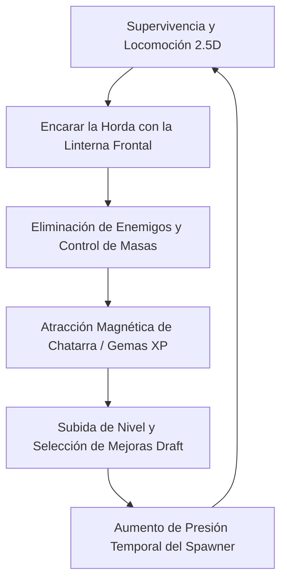

# Jugabilidad

## Descripción de la sección

La jugabilidad explica **qué hace el jugador, qué recibe a cambio y cómo evoluciona la experiencia** durante una partida de *EchoScrap*.

---

## Bucle principal de juego (Core Gameplay Loop)

El núcleo jugable de *EchoScrap* es un ciclo continuo de supervivencia activa, control de masas frontal y progreso táctico:

1. **Posicionamiento y Avance:** El jugador maniobra en una arena abierta 2.5D esquivando y canalizando los flancos del enjambre.
2. **Combate Direccional Frontal:** Al desplazarse hacia el enemigo, el foco cónico de la linterna daña y empuja a la vanguardia de la horda.
3. **Evasión Táctica (Dash):** Cuando la horda amenaza con cerrarse, el jugador usa el Dash para atravesar líneas con invulnerabilidad temporal (*i-frames*).
4. **Cosecha de Recursos:** Los enemigos destruidos dejan caer Chatarra (Gemas de XP) que son atraídas magnéticamente al aproximarse.
5. **Mejora In-Run (Level Up):** La acumulación de Chatarra dispara la pausa táctica con selección entre 3 mejoras de atributos o habilidades.
6. **Escalada Temporal:** La partida aumenta dinámicamente de dificultad cada minuto mediante nuevas fases de generación en racimos.

---

## Acciones principales del jugador

| Acción | Entrada | Propósito | Resultado Inmediato |
|---|---|---|---|
| **Locomoción 2.5D** | WASD / Stick Izquierdo | Posicionarse en la arena y orientar el ataque frontal. | Desplazamiento fluido en plano XZ a 8.0 m/s con rotación suave hacia la dirección de avance. |
| **Ataque Frontal Continuo** | Automático (hacia el avance) | Dañar y contener el avance de la vanguardia enemiga. | Cono de luz de 60° y 6m que emite pulsos de daño (5 pts / 0.2s) y empuja físicamente hacia atrás (*knockback*). |
| **Dash Evasivo** | Espacio / Botón Sur (Gamepad) | Escapar de cercos y reposicionarse agresivamente. | Impulso súbito a 22 m/s durante 0.15s con invulnerabilidad total (*i-frames*) frente a daño por contacto. |
| **Recolección Magnética** | Proximidad (Pasiva) | Recoger Chatarra y Ecos para acumular experiencia. | Las gemas a menos de 2.5m vuelan a 12 m/s hacia el jugador y se suman a la barra de XP. |
| **Selección de Mejoras** | Clic / Botón en UI | Personalizar la build de combate durante la partida. | Pausa total (`Time.timeScale = 0`), selección entre 3 opciones de stats/habilidades y reanudación inmediata. |

---

## Experiencia segundo a segundo

* **Lectura de distancias y flancos:** El jugador evalúa continuamente la distancia respecto a los enemigos más cercanos. La velocidad de los enemigos (3.5 m/s ±15%) y su tendencia a flanquear exige correcciones de trayectoria continuas.
* **Control de masas con el foco:** Al encarar a los enemigos, el cono de luz los ilumina, frena y empuja, abriendo pasillos seguros en la masa.
* **Respuesta refleja:** Si un enemigo consigue cerrar el paso o acorralar al jugador, este activa el Dash para atravesarlo de forma segura gracias a los *i-frames*, girando inmediatamente para volver a iluminarlo.

---

## Experiencia minuto a minuto

La presión de la horda está regulada por una curva temporal estructurada en 4 fases:

* **Minuto 0:00 a 1:00 (Fase 1 - Calentamiento):** Enemigos individuales aparecen cada 1.2s. El jugador se familiariza con el movimiento, prueba el empuje de la linterna y consigue sus primeros 1-2 niveles.
* **Minuto 1:00 a 2:00 (Fase 2 - Presión Media):** El intervalo se reduce a 0.8s y los enemigos nacen en parejas (racimos de 2). Ya no es posible eliminar a todos antes del siguiente spawn; el jugador debe aprender a circular y agrupar.
* **Minuto 2:00 a 3:00 (Fase 3 - Cerco en Racimo):** Los spawns ocurren cada 0.6s en racimos de 3. La horda empieza a rodear al jugador; el uso rítmico del Dash se vuelve obligatorio para no ser atrapado en las esquinas de la pantalla.
* **Minuto 3:00 en adelante (Fase 4 - Muro Extremo):** Spawns cada 0.4s en racimos de 4 enemigos simultáneos, acelerando hasta el tope de seguridad de 150 enemigos activos. Solo una build con buen daño y cobertura puede sostener el cerco.

---

## Experiencia a largo plazo

* **Construcción de Sinergias (Build Crafting):** Probar distintas combinaciones entre daño directo de la linterna, apertura angular del cono, radio de recolección y estadísticas de velocidad y salud.
* **Tensión hacia el Clímax:** Resistir las oleadas finales hasta el minuto 8-10, donde el coloso *Gólgora* desciende a la arena para el enfrentamiento definitivo.
* **Meta-progresión del Almacén:** Regresar tras cada partida para exhibir y potenciar las Entidades capturadas, desbloqueando nuevos modificadores iniciales.

---

## Condición de victoria

* **Objetivo de la Partida:** Sobrevivir a la totalidad del temporizador del vertedero (8 a 10 minutos) y derrotar a la entidad titánica de juicio (*Gólgora*).
* **Resultado:** Extracción exitosa de los Ecos acumulados y regreso triunfal al Almacén del Coleccionista.

---

## Condición de derrota

* **Causa:** Reducción de la salud del jugador a cero (`currentHealth <= 0`) como consecuencia del daño por contacto reiterado de la horda.
* **Resultado:** Muerte del Coleccionista, pérdida de la chatarra no consolidada y reinicio de la arena.

---

## Ritmo

El ritmo alterna ráfagas de alta adrenalina y momentos de reflexión táctica:

* **Acción Continua:** El enjambre no da tregua; el movimiento constante es necesario para evitar ser envuelto.
* **Pausas Tácticas de Alivio (Draft UI):** Cada subida de nivel detiene el tiempo por completo. El jugador respira, evalúa el estado de su build y elige su siguiente mejora sin presión temporal.
* **Sensación de Bola de Nieve (Snowball Effect):** Al inicio el jugador huye y recorta enemigos en los bordes; a medida que acumula niveles y amplía su cono de luz, pasa a barrer cuadrantes enteros del mapa.

---

## Principios de interacción

1. **Claridad HD-2D Absoluta:** La malla procedural del cono proyectada en el suelo coincide de forma exacta con los límites matemáticos de detección de daño. Lo que está iluminado recibe daño; lo que está en sombra no.
2. **Agresividad Recompensada:** El daño solo se produce hacia el frente del avance. El juego premia encarar la amenaza y castiga la huida pasiva.
3. **Invulnerabilidad Confiable:** Durante el Dash (0.15s) y tras recibir daño (0.40s de gracia), los *i-frames* son absolutos contra impactos de enemigos, representados con parpadeo visual del material (`MaterialPropertyBlock`).
4. **Físicas y Knockback Coherentes:** Los impactos no detienen bruscamente al enemigo; aplican una fuerza impulsiva con fricción desaceleradora continua para una respuesta kinestésica satisfactoria.

---

> **Navegación:** [[00 - Índice]] · ← [[04 - Pilares de Diseño]] · [[02 - Mecánicas]] →
