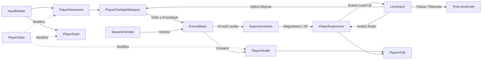

# Sistemas del Juego

## Descripción de la sección

Los sistemas son conjuntos de reglas, componentes de software y datos que trabajan juntos de forma modular para sostener la experiencia de *EchoScrap*.

En esta sección se documenta el inventario de sistemas implementados en el código de Unity, sus dependencias, flujos de datos e interacciones.

---

## Inventario de sistemas

| Sistema | Propósito | Scripts / Clases Clave | Dependencias | Estado |
|---|---|---|---|---|
| **Sistema de Entradas Desacopladas** | Captura hardware (teclado/gamepad) y expone acciones abstractas con soporte de remapeo. | `InputReader.cs` | Unity New Input System | **Completado / Operativo** |
| **Sistema de Locomoción y Control** | Administra aceleración, rotación suave y movimiento cinemático 2.5D en plano XZ. | `PlayerMovement.cs`, `PlayerController25D.cs` | `InputReader`, `Rigidbody`, `PlayerStats` | **Completado / Operativo** |
| **Sistema de Evasión (Dash)** | Provee traslación rápida con invulnerabilidad temporal (*i-frames*) y control de recarga. | `PlayerDash.cs` | `InputReader`, `PlayerMovement`, `PlayerStats` | **Completado / Operativo** |
| **Sistema de Combate Cónico** | Proyecta daño periódico y knockback en arco frontal; genera cono visual procedural y luz. | `PlayerFlashlightWeapon.cs` | `MeshFilter`, `LineRenderer`, `Light`, `EnemyBasic` | **Completado / Operativo** |
| **Sistema de Atributos Modulares** | Calcula valores base y modificadores de stats (Flat, PercentAdd, PercentMult). | `PlayerStats.cs`, `CharacterStat.cs`, `StatModifier.cs` | Ninguna (Autónomo) | **Completado / Operativo** |
| **Sistema de Salud y Daño** | Gestiona vida actual/máxima, mitigación, invulnerabilidad post-daño y feedback visual. | `PlayerHealth.cs` | `PlayerStats`, `PlayerHUD`, `MaterialPropertyBlock` | **Completado / Operativo** |
| **Sistema de IA y Flanqueo** | Controla navegación de hordas, separación no-alocativa, flanqueo y knockback físico. | `EnemyBasic.cs` | `Rigidbody`, `PlayerHealth`, `ExperienceGem` | **Completado / Operativo** |
| **Sistema de Generación Temporal** | Escala la curva de dificultad mediante 4 fases de tiempo con racimos (*clusters*) y límite de población. | `SpawnerSimple.cs` | `EnemyBasic`, `Transform` del jugador | **Completado / Operativo** |
| **Sistema de Recolección y Magnetismo** | Gestiona la caída, atracción cuadrática y absorción de gemas de XP. | `ExperienceGem.cs` | `PlayerExperience`, `Transform` del jugador | **Completado / Operativo** |
| **Sistema de Progresión (XP / Level Up)** | Acumula experiencia con escalado x1.5 y dispara la pausa táctica de selección de mejoras. | `PlayerExperience.cs`, `LevelUpUI.cs` | `PlayerHUD`, `PlayerFlashlightWeapon` | **Completado / Operativo** |
| **Sistema de HUD y Retroalimentación** | Muestra barras de vida y experiencia en tiempo real construidas con TextMeshPro. | `PlayerHUD.cs` | `TextMeshProUGUI`, `Image`, Unity Canvas | **Completado / Operativo** |
| **Sistema de Cámara 2.5D** | Seguimiento suave en plano horizontal con elevación e inclinación isométrica fija. | `CameraFollow25D.cs` | `Transform` del jugador | **Completado / Operativo** |

---

## Detalle de sistemas clave

### 1. Sistema de Atributos y Estadísticas Modulares (`PlayerStats`)

**Objetivo:**  
Centralizar todas las estadísticas numéricas del jugador permitiendo que habilidades, cartas de mejora o futuras reliquias apliquen bonificadores de forma acumulativa y segura sin modificar valores en duro (*hardcoded*).

**Entradas:**  
Adición o remoción de `StatModifier` con su respectivo tipo:
* `Flat` (+X directo).
* `PercentAdd` (+X% aditivo sobre el total base).
* `PercentMult` (*X multiplicativo final).

**Procesamiento:**  
Cada atributo (`CharacterStat`) ordena y calcula su valor de forma limpia:
$$\text{ValorFinal} = \left( \text{Base} + \sum \text{Flat} \right) \times \left(1 + \sum \text{PercentAdd} \right) \times \prod (1 + \text{PercentMult})$$

**Salidas:**  
Propiedades evaluadas en tiempo real: `MoveSpeed`, `Acceleration`, `Deceleration`, `RotationSpeed`, `DashSpeed`, `DashDuration`, `DashCooldown`, `MaxHealth`, `AttackDamage`, `AttackSpeed`, `Defense`.

---

### 2. Sistema de IA de Horda y Flanqueo (`EnemyBasic`)

**Objetivo:**  
Garantizar enjambres densos y amenazantes con 60 FPS estables, eliminando por completo la alocación de memoria dinámica durante la simulación.

**Entradas:**  
Posición continua del jugador en XZ, detección de vecinos circundantes en layer física `Enemy`.

**Procesamiento / Reglas:**
* **Búfer Estático No-Alocativo:** Utiliza `Physics.OverlapSphereNonAlloc` con un array estático de 16 posiciones (`neighborBuffer[16]`) para calcular la repulsión mutua (`separationStrength = 5.5`) sin generar basura en el *Garbage Collector*.
* **Flanqueo Perimetral:** Si un enemigo detecta un obstáculo o compañero enfrente, añade un vector ortogonal hacia su signo asignado (`flankSign`), envolviendo al jugador.
* **Knockback Físico Integrado:** Al recibir daño, suma un impulso vectorial (`knockbackImpulse = 5f`) y lo amortigua frame a frame en `FixedUpdate` mediante una fricción exponencial (`knockbackFriction = 18f`).

**Salidas:**  
Movimiento coordinado en el plano, colisión y daño al jugador, instanciación de gemas al morir.

---

### 3. Sistema de Generación Temporal (`SpawnerSimple`)

**Objetivo:**  
Regular la tensión de la partida ajustando dinámicamente el volumen y frecuencia de aparición de enemigos según el tiempo transcurrido.

**Fases de Presión:**
1. **Fase 1 (0:00 - 1:00):** Intervalo 1.2s | Racimo (*Cluster*): 1 enemigo.
2. **Fase 2 (1:00 - 2:00):** Intervalo 0.8s | Racimo: 2 enemigos en arco cerrado.
3. **Fase 3 (2:00 - 3:00):** Intervalo 0.6s | Racimo: 3 enemigos simultáneos.
4. **Fase 4 (3:00+):** Intervalo 0.4s | Racimo: 4 enemigos continuos.

**Mecanismo de Seguridad:**  
Monitorea continuamente la cantidad de enemigos activos (`ActiveEnemies.Count`). Si alcanza el tope de seguridad de **150 enemigos**, el spawner detiene la invocación hasta que el jugador despeje la arena, protegiendo la tasa de refresco a 60 FPS.

**Controles de Prueba y Filtros de Spawn (Inspector Debug):**  
Para facilitar el testeo y calibración en aislamiento de cada arquetipo por el equipo de diseño:
* **Modo Exclusivo de Pruebas (`SpawnModeOverride`):** Menú desplegable en el Inspector que permite forzar al 100% la aparición de un único arquetipo (`SoloBasicos`, `SoloInterceptores`, `SoloColosos`, `SoloMorteros`, `SoloPolillas`) para probar su comportamiento en cualquier momento sin esperar a fases avanzadas.
* **Filtros Individuales:** Banderas booleanas (`permitirBasicos`, `permitirInterceptores`, `permitirColosos`, `permitirMorteros`, `permitirPolillas`) que permiten prohibir o habilitar arquetipos específicos en tiempo real desde el editor de Unity.

---

## Relaciones entre sistemas

---

> **Navegación:** [[00 - Índice]] · ← [[02 - Mecánicas]] · [[04 - Controles]] →
