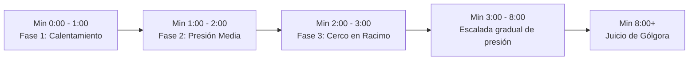
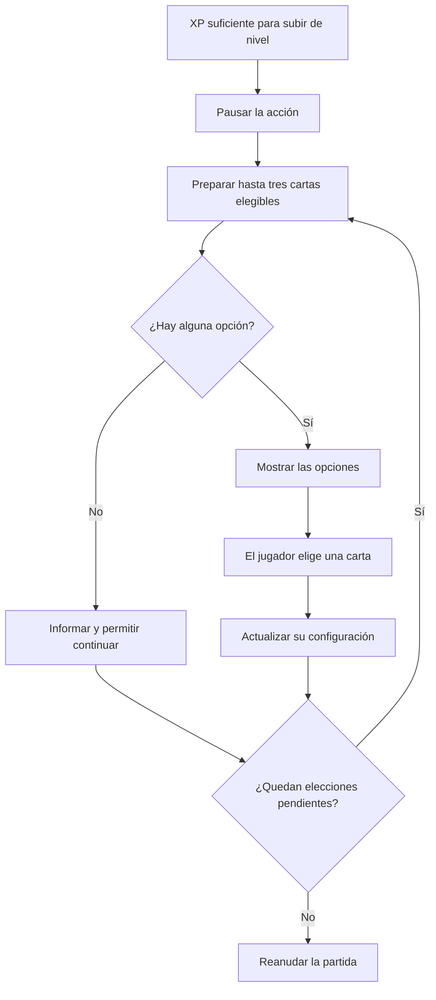

# Progresión

## Descripción de la sección

Explica cómo evoluciona la partida desde el primer segundo hasta el clímax final y cómo progresa el jugador entre diferentes partidas. 

La progresión en *EchoScrap* funciona en dos niveles:
1. **Dentro de la partida (*In-Run*):** Subir de nivel recogiendo chatarra/XP, eligiendo cartas de mejora y enfrentando oleadas cada vez más intensas hasta llegar al jefe final.
2. **Entre partidas (*Meta-progresión en el Almacén*):** Capturar un personaje al ganar, conservar la colección y elegir los personajes equipados antes de volver al vertedero.

---

## Progresión en partida (*In-Run*)

La partida comprende **ocho minutos iniciales de horda con dificultad creciente**, seguidos del combate con Gólgora. El jefe se combate hasta derrotarlo o perder toda la vida; la run no termina automáticamente al minuto 10.

### 1. Curva de Dificultad por Tiempo (Aparición de Enemigos)

| Fase Temporal | Frecuencia de Aparición | Tamaño del Grupo (*Racimo*) | Enemigos en Pantalla | Qué experimenta el Jugador |
|---|---|---|---|---|
| **Fase 1: Calentamiento (0:00 a 1:00)** | Referencia inicial: 1.2 segundos | 1 enemigo individual | 10 a 20 enemigos | Aprender movimiento, autoapuntado, recolección y primeras mejoras. |
| **Fase 2: Presión Media (1:00 a 2:00)** | Cada 0.8 segundos | Parejas (2 enemigos juntos) | 30 a 50 enemigos | Empiezan a aparecer los primeros enemigos rápidos; subes a niveles 2 y 3. |
| **Fase 3: Cerco en Racimo (2:00 a 3:00)** | Cada 0.6 segundos | Tríos (3 enemigos simultáneos) | 60 a 90 enemigos | La horda intenta rodearte; es momento de usar el Dash para abrirse paso. |
| **Fase 4: Escalada intensa (3:00 a 8:00)** | Disminuye continuamente de 0.4 a 0.2 segundos como propuesta inicial | Grupos de 4; composición cada vez más exigente | Hasta 150 enemigos (límite) | Adaptarse a presión creciente: sostener una configuración al minuto 3 no garantiza sostenerla hasta el 8. |
| **Fase 5: El Juicio (Minuto 8:00+)** | Termina la escalada de horda; goteo de apoyo del jefe según su ficha | Aparece **Gólgora** | 1 jefe + secuaces controlados | Combatir hasta victoria o derrota; sólo la victoria concede un personaje capturado. |

---

### Escalada dentro de la fase intensa

La fase de 3:00 a 8:00 es una **curva por tiempo**, no una configuración fija de cinco minutos. El intervalo de aparición se interpola entre referencias, mientras la composición aumenta gradualmente la presión de enemigos resistentes, artillería y amenazas explosivas.

**Propuesta inicial de cadencia, pendiente de validación de balance:**

| Tiempo | Intervalo objetivo entre grupos | Cambio de presión |
|---|---:|---|
| **3:00** | 0.40 s | Comienza la presión combinada. |
| **4:00** | 0.36 s | Aumenta la presencia de enemigos que comprometen rutas. |
| **5:00** | 0.32 s | Crece la presión de proyectiles y áreas dañinas. |
| **6:00** | 0.28 s | Se vuelven más frecuentes las combinaciones de amenazas. |
| **7:00** | 0.24 s | Refuerzos más rápidos y mezcla más exigente. |
| **8:00, antes de la transición al jefe** | 0.20 s | Punto final de la curva; empieza el Juicio de Gólgora. |

Entre dos referencias se aplica una transición lineal: por ejemplo, a 3:30 el intervalo objetivo es 0.38 s. La presión no permanece constante durante un minuto completo.

El límite de **150 enemigos activos** se conserva como referencia del GDD existente.

**Propuesta de gestión de saturación, pendiente de validación:** descartar los nacimientos que no quepan, en lugar de acumularlos para producir una oleada de golpe al liberarse espacio; usar la cadencia y composición actuales para las nuevas apariciones, sin sustituir instantáneamente a enemigos vivos.

La composición debe cambiar además de la frecuencia. Si sólo aumentara el número de intentos de spawn cuando la arena ya está llena, el límite de población volvería a producir una meseta. Los pesos por arquetipo se cerrarán en la tabla de balance; los hitos indican la dirección de la presión, no una primera aparición obligatoria de cada enemigo.

Los valores anteriores son una referencia de diseño para ajustar mediante pruebas posteriores a la aprobación del GDD. El comportamiento se implementará después de aprobar el GDD y se ajustará mediante las pruebas previstas.

---

## Mejoras individuales y construcción de la configuración de combate

El sistema de progresión de *EchoScrap* se fundamenta en la construcción modular de configuraciones de combate (*builds*), inspirándose en las sinergias emergentes de títulos como *The Binding of Isaac*. 

El diseño contempla un catálogo cerrado de **35 cartas de mejora** estructuradas en **4 niveles de rareza**. Cada vez que el Coleccionista acumula la experiencia necesaria para subir de nivel, la acción se detiene en una pausa táctica y se despliega una interfaz de draft con hasta tres cartas elegibles.

El diagrama describe el flujo funcional que seguirá el sistema de subida de nivel: al seleccionar una carta, se actualizan los modificadores del personaje y las mejoras de ataque de la linterna entrarán en vigor al iniciar la siguiente ráfaga completa.

---

### Criterio de diseño: piezas individuales e interacciones

Cada mejora funcionará con un efecto propio e identificable. La configuración de combate se construirá de forma orgánica a partir de las decisiones del jugador durante los 8 minutos de la run. Elegir una primera carta no fuerza a un arquetipo rígido, sino que abre caminos para experimentar con distintas combinaciones.

Las mejoras interactuarán mediante los efectos que producen, modifican o requieren:

- **Sinergias favorables:** Un efecto potencia directamente el funcionamiento de otro (por ejemplo, combinar *Lente de Cuarzo* para ampliar la apertura del cono y contrarrestar la reducción angular de *Foco Sobrecargado*).
- **Efectos independientes:** Mejoras que coexisten sumando utilidad sin alterar la lógica de otras (como ganar velocidad de movimiento mientras se porta armadura).
- **Habilidades condicionales:** El beneficio requiere una fuente o estado previo para activarse (como las chispas de *Prisma de Refracción*, que nacen al impactar el 4.º pulso).
- **Compensación de costes y ventajas:** Ciertas cartas aportan una ventaja masiva a cambio de un sacrificio deliberado (por ejemplo, *Foco* reduce el ángulo de cobertura pero multiplica el daño frontal).

### Elección inteligente, utilidad y azar

El sistema de selección filtrará de forma inteligente las opciones para garantizar que cada carta ofrecida tenga utilidad práctica o potencie capacidades ya disponibles:

1. **Exclusión de cartas saturadas:** Si una carta ya alcanzó su nivel máximo (Tier máximo), se retira automáticamente del bombo de selección.
2. **Requisitos de activación:** Cartas especializadas como *Pólvora de Chatarra* solo se presentarán si el jugador ya posee al menos una fuente de daño explosivo (como minas terrestres o el cataclismo del dash).
3. **Selección sin repeticiones:** En cada tirada de 3 cartas, las opciones ofrecidas serán distintas entre sí.
4. **Re-rolls tácticos:** Si el jugador cuenta con la carta `GREED_04` (Sintonizador de Frecuencia), podrá solicitar un nuevo reparto de 3 opciones aleatorias.
5. **Ajuste de probabilidades:** Si el jugador mejora su sintonizador, la probabilidad de ver cartas Raras y Súper Raras aumentará proporcionalmente.

---

### 1. Jerarquía de Rarezas y Distribución Ponderada

El sistema de draft evaluará la rareza de cada opción mediante un sistema ponderado por pesos. La tabla siguiente define las probabilidades base de aparición:

| Rareza         | Abreviatura | Probabilidad Base | Color Hex / Visual | Rol en la Build                                                                                           |
| -------------- | :---------: | :---------------: | :----------------: | --------------------------------------------------------------------------------------------------------- |
| **Normal**     |     `N`     |     **60.0%**     |     `#7A8B99`      | Escalado plano y continuo de atributos base (daño, vida, velocidad, imán, ángulo). Max Tier: 5.           |
| **Rara**       |     `R`     |     **25.0%**     |     `#1E88E5`      | Modificadores cualitativos, efectos secundarios y sinergias directas de combate. Max Tier: 3.             |
| **Super Rara** |    `SR`     |     **12.0%**     |     `#AB47BC`      | Habilidades activas secundarias automáticas (minas, señuelos, sierras orbitales, ventiscas). Max Tier: 3. |
| **Legendaria** |    `SSR`    |     **3.0%**      |     `#FFB300`      | Mutaciones de juego determinantes (*Game-changers* y evoluciones definitivas de arma). Max Tier: 1.       |

---

### 2. Catálogo individual de 35 mejoras

A continuación se lista el catálogo completo de las 35 cartas diseñadas para el juego, ordenadas alfabéticamente junto con su identificador interno, categoría de rareza y nivel máximo de mejora (Tier):

* **`BIO_01` · Aleación Bio-Compuesta (N - Max Tier 5):** +20 salud máxima y cura 15 HP al instante por tier.
* **`FLASH_02` · Balasto de Alta Frecuencia (N - Max Tier 5):** +15% de velocidad de ataque por nivel (hasta +75% respecto a la base). Acelera la cadencia de la linterna reduciendo proporcionalmente el tiempo entre pulsos y el descanso de enfriamiento. Con el Hiper-Rayo Solar, acelera el flujo de emisión continuo.
* **`SCRAP_01` · Blindaje de Drones (N - Max Tier 5):** +4 armadura/defensa plana y +10 de salud máxima por tier.
* **`CRIT_02` · Calibración Focal Letal (N - Max Tier 5):** +20% daño crítico por tier (de x1.5 hasta x2.5).
* **`DASH_04` · Cataclismo Cinético (SSR - Max Tier 1):** El dash detona una explosión de 120 de daño en el punto de origen y proyecta una cuchilla de choque en la trayectoria final. Fija el CD del dash en 0.5s.
* **`CRYO_02` · Cero Absoluto (R - Max Tier 3):** Enemigos ralentizados que reciban 4/3/3 pulsos de luz se congelan durante 1.2s/1.8s/2.4s y reciben +30% de daño adicional.
* **`GREED_02` · Chatarrero Oportunista (N - Max Tier 5):** +15% de experiencia por cada gema de chatarra recogida por tier.
* **`FLASH_04` · Foco Sobrecargado (SR - Max Tier 3):** Estrecha el cono en -20° una sola vez; incrementa el daño primario en +50%/+80%/+120% y el retroceso final en +8/+14/+20 según nivel. Cada escalón sustituye al anterior. Conserva coste y beneficios en modo solar.
* **`CRYO_01` · Freón Residual (N - Max Tier 5):** La linterna ralentiza a los enemigos impactados un 12%/20%/28%/36%/44% durante 1.5s.
* **`FLASH_05` · Hiper-Rayo Solar (SSR - Max Tier 1):** Transforma la emisión en un haz cónico continuo de 14m base, conserva apertura y bonos, y elimina el descanso. Mantiene impactos discretos agrupados de cuatro y sus efectos finales. Multiplica por x2.5 el daño primario de cada grupo: con los tiempos base equivale a x3.75 de DPS directo respecto al modo normal.
* **`DASH_03` · Holo-Señuelo de Chatarra (SR - Max Tier 3):** Al iniciar el dash, despliega un señuelo durante 2.0s/2.5s/3.0s que atrae enemigos e implosiona causando 50/85/120 de daño en 4m.
* **`FLASH_01` · Lente de Cuarzo Reforzado (N - Max Tier 5):** +1.0m de alcance y +10° de apertura por nivel (hasta +5.0m y +50°). Se suma al alcance base normal de 7m o solar de 14m; conserva su efecto en ambos modos.
* **`SCRAP_02` · Micro-Ensamblador de Chatarra (R - Max Tier 3):** Cada 15 gemas recogidas, dispara un proyectil guiado de 40/70/105 de daño al enemigo más próximo.
* **`DEMO_03` · Minas Terrestres de Desguace (SR - Max Tier 3):** Despliega automáticamente una mina cada 4.0s/3.2s/2.5s que causa 70/110/160 de daño en 4.0m al pisarla.
* **`BIO_03` · Nanobots de Reparación Activa (SR - Max Tier 3):** Regenera 1/2/3 HP cada 2.5s; al caer por debajo del 20% de HP otorga invulnerabilidad durante 2.0s (CD: 60s).
* **`BIO_04` · Nova de Plasma por Sobrecuración (SSR - Max Tier 1):** Toda la curación que exceda la vida máxima se acumula; al alcanzar 15 HP de exceso, desata una Nova de Plasma de 80 daño en 6.0m.
* **`GREED_01` · Núcleo Supermagnético (N - Max Tier 5):** +2.0m de radio de atracción de gemas y botiquines por tier (hasta +10.0m total).
* **`CRIT_05` · Ojo del Verdugo (SSR - Max Tier 1):** +20% probabilidad crítica; golpes críticos a enemigos con <35% HP causan daño x3.0 y desatan un aturdimiento en área de 1.0s.
* **`DASH_02` · Onda Sísmica / Shockwave (R - Max Tier 3):** Al terminar el dash, desata una onda de 3.5m/4.5m/5.5m que empuja 8m, aturde 0.6s/0.9s/1.2s y causa 25/45/70 de daño.
* **`CRIT_01` · Óptica de Cuarzo de Precisión (N - Max Tier 5):** +8% probabilidad crítica por tier (hasta +40%). Multiplicador base x1.5.
* **`DEMO_01` · Pólvora de Chatarra Volátil (N - Max Tier 5):** +15% radio y +12% daño de explosiones propias por nivel. Solo aparecerá en el draft si el jugador ya cuenta con alguna fuente de daño explosivo (como minas terrestres o el cataclismo del dash).
* **`FLASH_03` · Prisma de Refracción Ígneo (R - Max Tier 3):** Al conectar el 4.º pulso de la linterna, el enemigo impactado libera 2/3/4 chispas de plasma hacia enemigos cercanos en un radio de 5m, infligiendo el 40%/60%/80% del daño del impacto.
* **`CRIT_03` · Protocolo de Ejecución (R - Max Tier 3):** Enemigos no-jefes con salud inferior al 12%/16%/20% mueren de inmediato al recibir cualquier daño.
* **`GREED_05` · Pulso Colector Gravitacional (SSR - Max Tier 1):** Al subir de nivel (o activar manualmente), absorbe de inmediato todas las gemas y botiquines de la arena completa.
* **`CRYO_04` · Quiebre de Escarcha / Frost Shatter (SSR - Max Tier 1):** Al morir un enemigo congelado estalla en 6 esquirlas perforantes a 14 m/s que congelan y causan 50 de daño.
* **`CRIT_04` · Ráfaga Crítica en Cadena (SR - Max Tier 3):** Un golpe crítico en el pulso 4 garantiza que los 2/3/4 primeros pulsos de la siguiente ráfaga sean críticos al 100%.
* **`DEMO_02` · Reacción en Cadena de Escombros (R - Max Tier 3):** 25%/40%/55% de probabilidad de que los enemigos abatidos detonen por 35/60/90 de daño en 3.0m.
* **`DASH_01` · Servomotores de Evasión (N - Max Tier 5):** -10% tiempo de recarga y +8% velocidad de dash por tier (hasta -50% CD y +40% Speed).
* **`SCRAP_03` · Sierras Orbitales de Desguace (SR - Max Tier 3):** 2/3/4 sierras dentadas orbitan a 2.5m del jugador a 180°/s, dañando 18/28/40 por contacto y empujando a los agresores.
* **`BIO_02` · Sifón Biomecánico (R - Max Tier 3):** El pulso 4 de la linterna tiene 12%/20%/30% de probabilidad de curar 2/3/4 HP por cada enemigo alcanzado.
* **`GREED_04` · Sintonizador de Frecuencia / Rerolls (SR - Max Tier 3):** Concede 1/2/3 re-rolls de draft por partida y aumenta pasivamente la probabilidad de cartas Raras en +5% y Super Raras en +3%.
* **`DEMO_04` · Sobrecarga Termobárica (SSR - Max Tier 1):** Cada explosión provoca una implosión de vacío tras 0.4s que atrae a los supervivientes al centro y repite el 75% del daño.
* **`GREED_03` · Suministro Médico de Emergencia (R - Max Tier 3):** +4%/+7%/+10% probabilidad de botiquines en enemigos básicos y +15%/+25%/+35% en élites; cada botiquín cura +3/+6/+10 HP extra.
* **`SCRAP_04` · Torreta Centinela de Chatarra (SSR - Max Tier 1):** Cada 10s ensambla una torreta que dura 8s y dispara ráfagas de 3 proyectiles de 35 de daño cada 0.6s con 8m de alcance.
* **`CRYO_03` · Ventisca de Nitrógeno Radial (SR - Max Tier 3):** Cada 6.0s/5.0s/4.0s emite una ráfaga radial de 5.5m que inflige 30/50/75 de daño y congela instantáneamente por 1.5s.

---

### 3. Funcionamiento de la Linterna y Sinergias de Cartas

#### El ciclo de combate de la linterna (Ráfaga de 4 pulsos)

El ataque principal del Coleccionista está diseñado como un arma de control de masas rítmica con auto-apuntado:

* **Cono base:** 7 metros de alcance frontal con una apertura angular de 60°.
* **Cadencia por ráfagas:** La linterna no dispara de forma continua ni tiro por tiro suelto; emite **ráfagas de 4 pulsos de luz**:
  * Los 4 pulsos se emiten en un lapso de **0.8 segundos** (un impacto cada 0.2s: al 0.2s, 0.4s, 0.6s y 0.8s).
  * Al terminar el 4.º pulso, la linterna tiene un breve descanso de enfriamiento de **0.4 segundos**.
  * El ciclo completo dura **1.2 segundos** (0.8s de disparo activo + 0.4s de descanso).
* **Daño base:** 15 puntos de daño total por ráfaga completa (repartidos en 3.75 puntos por pulso).
* **El 4.º impacto (Golpe de gracia y control):** Los tres primeros pulsos dañan a los enemigos dentro del cono; **el 4.º pulso aplica el empuje físico (*knockback* de 10 m/s)** que abre espacio para respirar y activa efectos especiales de cartas (como chispas o robo de vida).
* **Aceleración por velocidad de ataque (`FLASH_02 · Balasto`):** Cada nivel de Balasto otorga +15% de velocidad de ataque, reduciendo tanto el intervalo entre pulsos como el descanso de 0.4s de forma proporcional, permitiendo disparar ráfagas más seguidas.

---

#### Modificadores de forma y potencia: Lente y Foco

* **`FLASH_01 · Lente de Cuarzo` (Amplitud y alcance):** Suma **+1.0 metro de alcance** y **+10° de apertura** por nivel (hasta +5m y +50° al nivel 5). Facilita cubrir más área y golpear a más enemigos al mismo tiempo.
* **`FLASH_04 · Foco Sobrecargado` (Concentración y daño):** Estrecha el cono en **-20°** a cambio de un aumento masivo de daño (**+50%, +80%, +120%**) y mayor fuerza de empuje en el 4.º pulso (+8, +14, +20).
* **Sinergia Lente + Foco:** Funcionan de manera complementaria; el aumento de ángulo de *Lente* ayuda a compensar la reducción de apertura de *Foco*, logrando un haz largo, potente y con buena cobertura.

---

#### Evolución legendaria: Hiper-Rayo Solar (`FLASH_05`)

Al elegir la carta SSR **`FLASH_05 · Hiper-Rayo Solar`**, la linterna experimenta su transformación definitiva:

1. **Duplica el alcance:** El alcance base pasa de 7 a **14 metros de largo**.
2. **Haz continuo sin pausas:** La luz se mantiene encendida de forma permanente, **eliminando el descanso de 0.4 segundos entre ráfagas**.
3. **Multiplicador de potencia (×3.75 DPS):** Aunque la luz visualmente no se apaga, el daño se sigue aplicando en grupos de 4 pulsos cada 0.2s con empuje en el 4.º impacto. Al sumar el bono de daño (×2.5) y eliminar el tiempo de enfriamiento, el daño por segundo efectivo se multiplica casi por 4 frente a la linterna básica.
4. **Conserva la forma de cono:** El Hiper-Rayo no se transforma en una línea recta delgada; se mantiene como un haz cónico amplio, conservando todos los bonos de apertura de *Lente* que el jugador haya acumulado.

---

#### Efectos especiales y daño derivado: Prisma y Pólvora

* **`FLASH_03 · Prisma de Refracción` (Chispas en cadena):** Al conectar el 4.º pulso de la ráfaga contra un enemigo, de su cuerpo brotan chispas dirigidas hacia hasta 2, 3 o 4 enemigos cercanos en un radio de 5 metros.
  * *Regla técnica:* Las chispas son daño derivado independiente; no cuentan como pulsos de linterna para evitar bucles infinitos de activación que congelen el juego.
* **`DEMO_01 · Pólvora de Chatarra` (Potenciador de explosiones):** Aumenta el radio (+15%) y el daño (+12%) de todas las fuentes de explosión propias (como las minas de desguace o el cataclismo del dash).
  * *Regla de filtrado inteligente:* Para evitar que el jugador gaste una subida de nivel en una carta inútil, *Pólvora* **solo aparecerá en la selección de 3 cartas si el jugador ya posee al menos una carta que cause explosiones**.

---

#### Tabla de Sinergias Clave entre Cartas

| Combinación de Cartas | Comportamiento y Sinergia Resultante |
|---|---|
| **Lente + Foco** | Lente amplía el alcance y recupera el ángulo que resta Foco, logrando un haz de largo alcance con daño devastador. |
| **Foco + Sierras Orbitales** | Aunque el cono frontal sea más estrecho, las sierras orbitando al Coleccionista protegen los costados y la espalda. |
| **Hiper-Rayo Solar + Prisma o Sifón** | Como el modo solar dispara sin pausas, el 4.º impacto ocurre más frecuentemente, liberando chispas y curación continua. |
| **Pólvora + Minas o Cataclismo** | Pólvora amplía directamente el radio de detonación y el daño de las minas y de las explosiones provocadas por el dash. |
| **Sifón / Botiquines + Nova de Plasma (`BIO_04`)** | Toda la curación que supere el 100% de salud acumula sobrecuración; al juntar 15 HP de exceso detona la Nova de Plasma. |

---

#### Reglas de aplicación y pausa

* **Pausa táctica:** Durante la pantalla de selección de cartas, la simulación se congela por completo (`Time.timeScale = 0`). Ningún enemigo puede moverse, atacar ni infligir daño mientras el jugador lee y decide su mejora.
* **Activación limpia en el siguiente ciclo:** Las mejoras elegidas en el menú de pausa se aplican a partir de la siguiente ráfaga completa de la linterna, asegurando un cálculo matemático limpio sin interrumpir animaciones a la mitad.

---

### 4. Especificación Técnica de Sprites de Aseprite (Hoja para Artistas)

Para mantener la estética retro pixel-art del proyecto sin generar arte procedural en código, los iconos de las cartas son elaborados manualmente en **Aseprite** siguiendo las especificaciones siguientes:

* **Resolución estándar:** `64 x 64` píxeles por icono.
* **Formato de exportación:** PNG de 32 bits con fondo transparente (`RGBA32`).
* **Ubicación en Unity:** `Assets/_Project/Sprites/Cards/Icons/`.
* **Configuración del Sprite Importer en Unity:**
  * Texture Type: `Sprite (2D and UI)`
  * Sprite Mode: `Single`
  * Pixels Per Unit: `64`
  * Filter Mode: `Point (no filter)`
  * Compression: `None`

#### Propuesta de Iconografía para el Área de Arte

A continuación se detalla la propuesta de iconos en pixel art (64×64 píxeles) como referencia estética para el equipo de arte, orientando los motivos visuales y paletas de color sugeridas para cada tipo de mejora:

| Archivo PNG                | Efecto representado / rareza | Elemento Visual Principal                             | Paleta Sugerida                                     |
| -------------------------- | ---------------------------- | ----------------------------------------------------- | --------------------------------------------------- |
| `icon_dash_motors.png`     | Dash (N)                     | Bota mecánica reforzada con toberas de escape         | Cian `#00E5FF` y Grafito `#263238`                  |
| `icon_dash_shockwave.png`  | Dash (R/SR)                  | Onda sísmica expansiva que agrieta el suelo           | Amarillo Ocre `#FFD54F` y Humo `#455A64`            |
| `icon_dash_cataclysm.png`  | Dash (SSR)                   | Estela de velocidad supersónica rompiendo la barrera  | Blanco Titanio `#FFFFFF` y Azul Eléctrico `#2979FF` |
| `icon_solar_lens.png`      | Linterna (N/R)               | Cono de luz focalizado atravesando lente de cuarzo    | Amarillo Sol `#FFEE58` y Ámbar `#FFA000`            |
| `icon_solar_hyperbeam.png` | Linterna (SSR)               | Prisma reflector disparando rayo láser continuo       | Carmesí Solar `#FF1744` y Dorado `#FFD700`          |
| `icon_demo_powder.png`     | Demolición (N/R)             | Barril de chatarra con mecha encendida y chispas      | Naranja Fuego `#FF6D00` y Negro Hollín `#212121`    |
| `icon_demo_mine.png`       | Demolición (SR/SSR)          | Mina terrestre con sensor de presión luminoso rojo    | Carmesí `#D50000` y Plomo `#37474F`                 |
| `icon_scrap_armor.png`     | Automatismos (N)             | Placas superpuestas de metal remachadas               | Gris Acero `#90A4AE` y Herrumbre `#8D6E63`          |
| `icon_scrap_saw.png`       | Automatismos (SR)            | Hoja circular de sierra dentada con centro giratorio  | Plata Pulida `#CFD8DC` y Naranja Chispa `#FF9100`   |
| `icon_scrap_turret.png`    | Automatismos (SSR)           | Torreta trípode con cañón doble y tolva de chatarra   | Bronce Industrial `#BCAAA4` y Verde LED `#00E676`   |
| `icon_bio_alloy.png`       | Supervivencia (N/R)          | Matriz biomecánica con fibras musculares sintéticas   | Verde Esmeralda `#00C853` y Titanio `#455A64`       |
| `icon_bio_nanobots.png`    | Supervivencia (SR/SSR)       | Frasco de infusión con enjambre de micro-robots       | Cian Médico `#00B0FF` y Blanco Puro `#FFFFFF`       |
| `icon_cryo_frost.png`      | Criogenia (N/R)              | Cilindro de refrigerante freón soltando gas gélido    | Celeste Glaciar `#80D8FF` y Azul Frío `#0288D1`     |
| `icon_cryo_shatter.png`    | Criogenia (SR/SSR)           | Cristal de hielo hexagonal resquebrajándose           | Blanco Escarcha `#E0F7FA` y Cobalto `#0D47A1`       |
| `icon_crit_crosshair.png`  | Precisión (Todos)            | Retícula de mira telescópica apuntando a un engranaje | Rojo Láser `#FF1744` y Negro Mate `#1A1A1A`         |
| `icon_greed_magnet.png`    | Avaricia (Todos)             | Electroimán en herradura con líneas de atracción      | Púrpura Neón `#AA00FF` y Oro Brillante `#FFD600`    |

---

## Curva de Experiencia (Subida de Niveles)

Para que el jugador no suba de nivel de forma descontrolada, la experiencia requerida aumenta con cada nivel de manera progresiva.

**Fórmula de experiencia:**  
$$\text{XP Siguiente} = \text{XP Anterior} \times 1.5$$

*(O de forma equivalente: la experiencia requerida anterior más un 50% de incremento).*

* **Cálculo de progresión por nivel:**
  * **Nivel 1:** `100 XP` base (equivale a 10 gemas de 10 XP c/u).
  * **Nivel 2:** $100 \times 1.5 = \mathbf{150\text{ XP}}$ (requiere 15 gemas).
  * **Nivel 3:** $150 \times 1.5 = \mathbf{225\text{ XP}}$ (requiere 23 gemas).
  * **Nivel 4:** $225 \times 1.5 = \mathbf{338\text{ XP}}$ (redondeado; requiere 34 gemas).
  * **Nivel 5:** $338 \times 1.5 = \mathbf{507\text{ XP}}$ (redondeado; requiere 51 gemas).
  * **Nivel 6:** $507 \times 1.5 = \mathbf{760\text{ XP}}$ (redondeado; requiere 76 gemas).

Esta progresión logra que los primeros 2 o 3 niveles se consigan en los primeros minutos (dando satisfacción inmediata al jugador), mientras que los niveles altos exigen sobrevivir y barrer oleadas grandes en las fases avanzadas.

---

## Curva de aprendizaje del jugador

1. **Minuto 1 (Fundamentos):** Comprender el kiting táctico: desplazarse con agilidad mientras la linterna autoapunta a los enemigos cercanos, aprovechando el retroceso del cono para abrir vías de escape (Pilar 1: Agresividad y Kiting Táctico 360°).
2. **Minuto 2 (Recolección Segura):** Entender que el empuje final de la ráfaga aparta a los enemigos y deja libre el camino para absorber la chatarra con el imán y recoger botiquines (+15 HP) soltados por los enemigos.
3. **Minuto 3 (Dominio del Dash):** Usar el Dash no para huir al rincón del mapa, sino para atravesar la horda con invulnerabilidad y adentrarse a recolectar gemas y botiquines en áreas disputadas.
4. **Minutos 4 a 8 (Optimización de Build):** Equilibrar las cartas entre daño, cadencia de ráfaga, área de luz y magnetismo para resistir hasta la llegada del jefe.
5. **Minuto 8+ (Duelo de Jefe):** Esquivar los ataques telegrafiados de Gólgora (Pisotón y Bombardeo) y usar el dash estratégicamente para derrotarlo mientras se aprovechan los esbirros menores a goteo para recargar salud.

---

## Meta-progresión proyectada (El Almacén del Coleccionista)

Al terminar la partida:

* **Victoria:** se obtiene un personaje capturado para la colección del Almacén.
* **Derrota:** se regresa al Almacén sin capturar un personaje; la colección previa se conserva.
* Las reglas de extracción de Ecos y materiales se definen en [[06 - Economía y Recursos]]; no se confunden con la captura de personajes, que es exclusiva de victoria.
* El catálogo previsto contiene **14 entidades capturables**. Los personajes que ya se poseen se equipan para otorgar habilidades o estadísticas al Coleccionista; las reglas de mejora de rango se definirán junto con su balance y economía. La adquisición de un personaje capturado se resuelve únicamente después de una victoria.

---

> **Navegación:** [[00 - Índice]] · ← [[04 - Controles]] · [[06 - Economía y Recursos]] →
