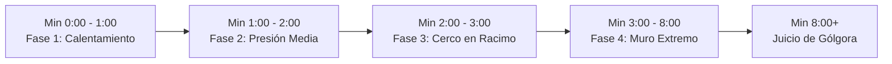

# Progresión

## Descripción de la sección

Explica cómo evoluciona la experiencia desde el primer segundo hasta el desenlace de la partida y a través de sesiones sucesivas. La progresión en *EchoScrap* opera en dos niveles: la **progresión dentro de la partida (*In-Run*)** y la **meta-progresión entre partidas (*Almacén del Coleccionista*)**.

---

## Progresión en partida (*In-Run*)

La partida dura entre 8 y 10 minutos, estructurada en etapas dinámicas donde la presión enemiga y el poder del jugador escalan de manera sincronizada:

### 1. Curva de Dificultad Temporal (Comportamiento del Spawner)

| Fase Temporal | Intervalo de Spawn | Tamaño del Racimo (*Cluster*) | Densidad Esperada | Dinámica del Jugador |
|---|---|---|---|---|
| **Fase 1: Calentamiento (0:00 a 1:00)** | 1.2 segundos | 1 enemigo individual | 10 a 20 enemigos | Aprender a canalizar y familiarizarse con el cono de luz. |
| **Fase 2: Presión Media (1:00 a 2:00)** | 0.8 segundos | 2 enemigos en arco | 30 a 50 enemigos | Comenzar a rodear la horda; primeras subidas de nivel (Niveles 2 a 4). |
| **Fase 3: Cerco en Racimo (2:00 a 3:00)** | 0.6 segundos | 3 enemigos simultáneos | 60 a 90 enemigos | El flanqueo lateral obliga a sincronizar el Dash para no quedar rodeado. |
| **Fase 4: Muro Extremo (3:00+)** | 0.4 segundos | 4 enemigos continuos | Hasta 150 enemigos (Tope) | Requiere DPS alto y buen cono de cobertura para no ser abrumado. |

---

## Progresión del personaje e inventario de mejoras

Cada vez que el Coleccionista recolecta suficientes gemas de XP para llenar la barra de progreso, el juego se pausa y se presenta un draft de mejoras:

### Tabla de Desbloqueos y Mejoras (Level Up Draft)

| Carta de Mejora | Parámetros que Modifica | Magnitud del Incremento | Impacto en Combate |
|---|---|---|---|
| **Potencia de Fuego** | `PlayerFlashlightWeapon.damagePerTick` | **+3.0 Daño** por pulso | Reduce la cantidad de ticks requeridos para eliminar enemigos básicos (de 3 ticks a 2 ticks iniciales). |
| **Ampliación de Cobertura** | `PlayerFlashlightWeapon.angle` `PlayerFlashlightWeapon.range` | **+15.0° Ángulo** **+1.0m Alcance** | Ensancha el arco frontal y la distancia de seguridad, permitiendo contener hordas más anchas sin fugas por los lados. |
| **Imán de Chatarra** | `PlayerExperience.pickupRadius` | **+1.5 Metros** de radio | Permite recolectar gemas a mayor distancia sin tener que exponerse adentrándose en el núcleo de la horda. |

---

## Curva de Experiencia y Escalado

La experiencia requerida para subir de nivel crece con una progresión exponencial para evitar una inflación desmedida de mejoras:

$$\text{XPRequerida}_{N+1} = \text{Round}\left( \text{XPRequerida}_N \times 1.5 \right)$$

* **Nivel 1:** 100 XP (Requiere 10 gemas básicas de 10 XP c/u).
* **Nivel 2:** 150 XP (Requiere 15 gemas).
* **Nivel 3:** 225 XP (Requiere 23 gemas).
* **Nivel 4:** 338 XP (Requiere 34 gemas).
* **Nivel 5:** 506 XP (Requiere 51 gemas).
* **Nivel 6:** 759 XP (Requiere 76 gemas).

Esta progresión garantiza que los primeros niveles se desbloqueen con rapidez (otorgando gratificación temprana), mientras que los niveles avanzados exigen barrer oleadas densas en la Fase 3 y Fase 4.

---

## Curva de aprendizaje del jugador

1. **Minuto 1 (Fundamentos):** Entender que caminar hacia el enemigo es la forma de atacarlo (Agresividad Frontal).
2. **Minuto 2 (Recolección Segura):** Aprender que la chatarra queda atrás tras el empuje del cono y usar el radio magnético para absorberla sin retroceder innecesariamente.
3. **Minuto 3 (Dominio del Dash):** Usar el Dash no solo como huida, sino como herramienta para atravesar la horda ileso gracias a los *i-frames* y girar inmediatamente para encararla.
4. **Minuto 4 en adelante (Optimización de Build):** Equilibrar las elecciones entre daño bruto, cobertura de área y facilidad de recolección.

---

## Meta-progresión proyectada (El Almacén del Coleccionista)

Al terminar la partida (por muerte o supervivencia):
* Los Ecos y materiales recuperados se invierten en la vitrina del Almacén.
* Se desbloquean y suben de rango las **14 Entidades Capturadas**, las cuales se equipan para modificar los atributos iniciales del Coleccionista (más vida, mayor velocidad base, reducción del cooldown del dash) antes de descender nuevamente al vertedero.

---

> **Navegación:** [[00 - Índice]] · ← [[04 - Controles]] · [[06 - Economía y Recursos]] →
