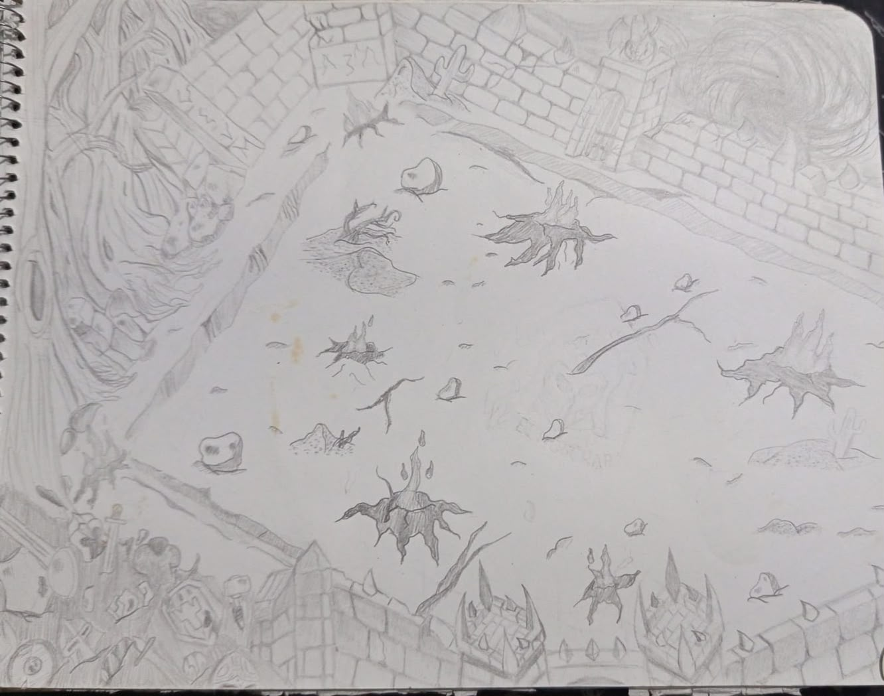
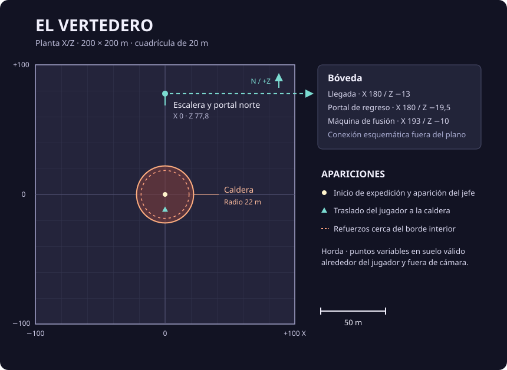
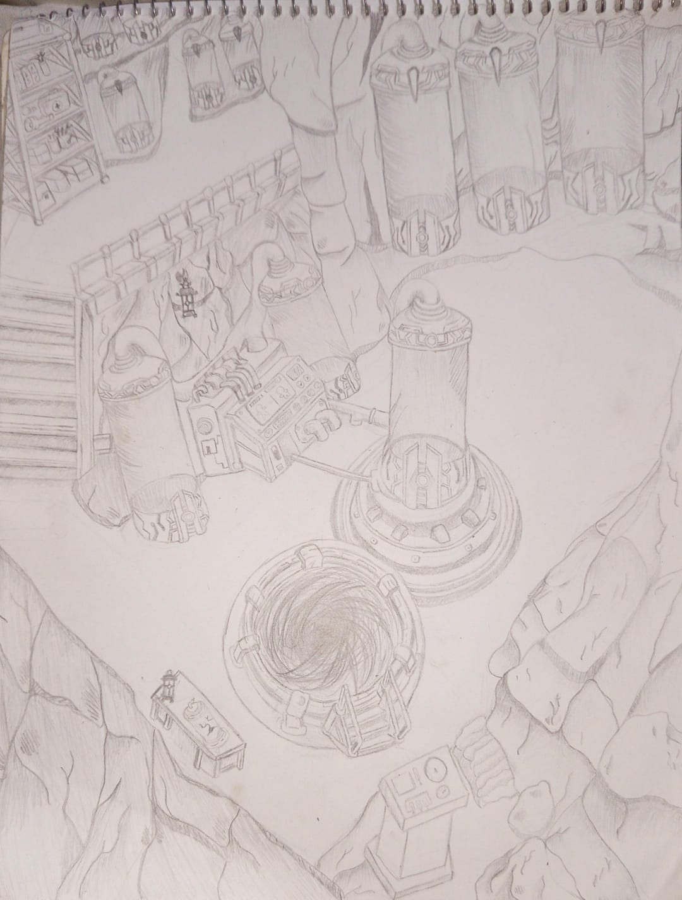
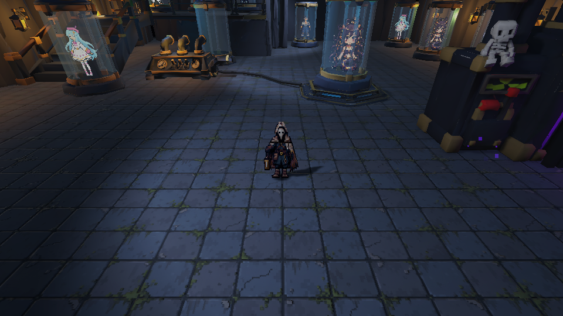

# Niveles

## El Vertedero

La arena mide 200 × 200 m. El suelo tiene relieve y los grupos de chatarra, rocas, árboles y restos industriales forman rutas y obstáculos. Los límites físicos contienen al jugador.

El centro alberga una caldera de 22 m de radio. Al aparecer Gólgora se cierra el perímetro, se traslada al jugador con protección y la cámara adopta un encuadre que contiene a ambos combatientes. Los refuerzos se anuncian junto al borde interior.

Las tres zonas de lava fija están desactivadas en CombatArena. El magma de los ataques del jefe continúa activo. La iluminación exterior utiliza tonos violetas, niebla, haces y partículas ambientales; el perfil aplica una cámara a 35,5° con campo de visión de 34°.

### Plano a escala y arte conceptual

La planta usa coordenadas X/Z de Unity y una cuadrícula de 20 m. La expedición y Gólgora empiezan en el centro de la arena, en momentos distintos. Al comenzar el encuentro, el jugador se coloca 12 m al sur del centro. La línea discontinua del acceso norte representa el traslado por portal a la sala de la bóveda, fuera de los límites de la arena.

La horda busca una posición dinámica fuera de cámara alrededor del jugador y dentro del perímetro. El anillo central indica el recinto de refuerzos y combate del jefe. El plano esquematiza las conexiones y límites jugables. El relieve y los obstáculos individuales se consultan en la escena. Las reglas de aparición están en [[05 - Progresión]].

## Acceso norte y bóveda

El acceso al almacén está al norte de la arena, alrededor de x = 0 y z = 78. La escalera baja hasta el portal. La bóveda ocupa otra zona de la misma escena; el portal traslada al mismo jugador sin descargar el mundo.

La sala modular tiene diez puestos: los tres primeros corresponden al equipo y otros siete a la exposición de copias disponibles. La máquina de fusión está dentro. Su cámara utiliza una inclinación de 32° y campo de visión de 65°, con límites de seguimiento para mantener la sala encuadrada.

Al preparar una expedición, el portal abre la selección de ronda. Durante una visita desde el combate se conserva la sesión y se suspenden sus enemigos y peligros hasta volver.

## Escenas y rondas

| Elemento | Uso | Entrada del jefe |
| --- | --- | --- |
| MainMenu | Menú inicial independiente del mundo de combate. | No aplica |
| CombatArena · Ronda demo | Mundo principal con ajustes rápidos seleccionados en la bóveda. | 3:00; 3600 HP |
| CombatArena · Ronda completa | Mismo mundo con escalada de ocho minutos. | 8:00; 9000 HP |
| CombatArena_3Min / CombatArena_8Min | Variantes guardadas para desarrollo; fuera de la lista principal de compilación. | Según su asset |
| EnemyLaboratory | Generación e inspección manual de ocho arquetipos. | Manual |
| LocomotionSandbox / CombatSandbox | Comprobaciones aisladas. | Sin flujo completo |

El tiempo indica cuándo empieza la entrada del jefe. Las cartas, pausas y visitas a la bóveda detienen el reloj de combate.

> **Navegación:** [[00 - Índice]] · [[00 - Avance jugable]]
