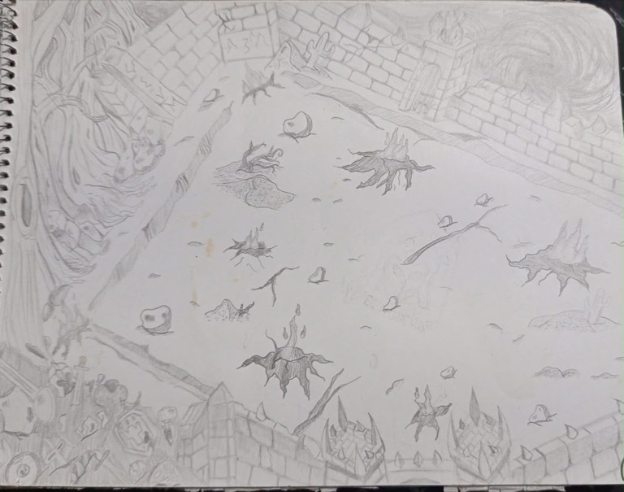
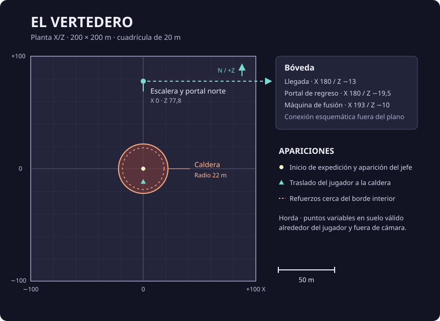
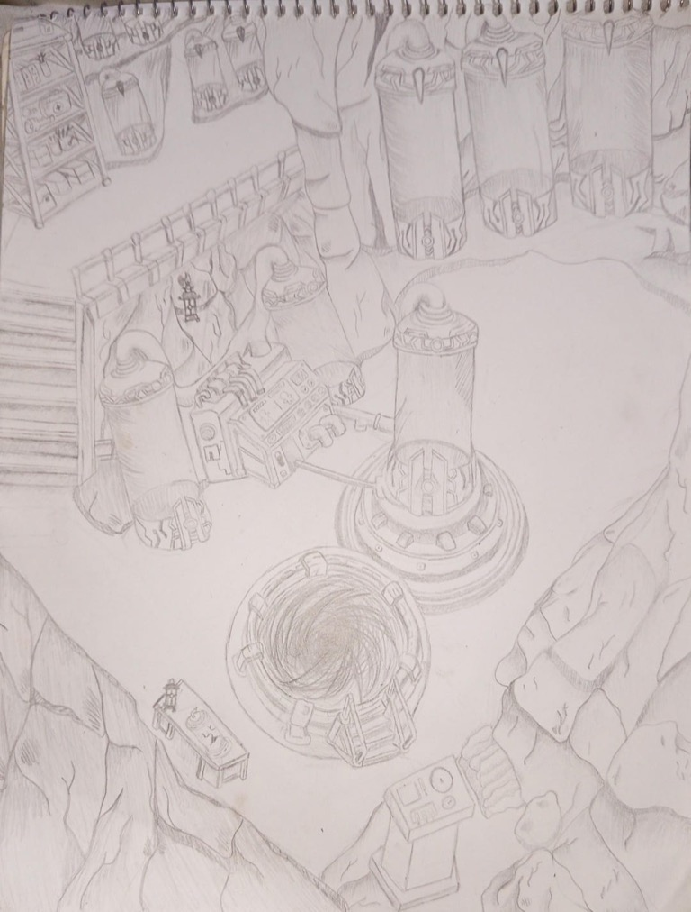
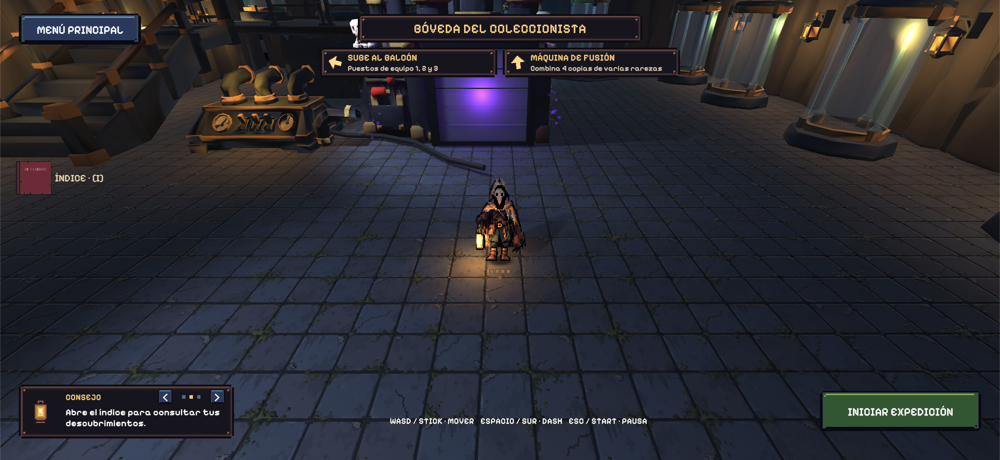

# Niveles

## El Vertedero

La arena mide `200 × 200 m`. El suelo tiene relieve y los grupos de chatarra, rocas, árboles y restos industriales forman rutas y obstáculos. Los límites físicos contienen al jugador.

El centro alberga una caldera de `22 m` de radio. Al aparecer Gólgora se cierra el perímetro, se traslada al jugador con protección y la cámara adopta un encuadre que contiene a ambos combatientes. Los refuerzos se anuncian junto al borde interior.

Las tres zonas de lava fija están desactivadas en `CombatArena`. El magma de los ataques del jefe continúa activo. La iluminación exterior utiliza tonos violetas, niebla, haces y partículas ambientales; el perfil aplica una cámara a `35,5°` con campo de visión de `34°`.

### Plano a escala y arte conceptual

La planta usa coordenadas X/Z de Unity y una cuadrícula de `20 m`. La expedición y Gólgora empiezan en el centro de la arena, en momentos distintos. Al comenzar el encuentro, el jugador se coloca `12 m` al sur del centro. La línea discontinua del acceso norte representa el traslado por portal a la sala de la bóveda, fuera de los límites de la arena.

La horda busca una posición dinámica fuera de cámara alrededor del jugador y dentro del perímetro. El anillo central indica el recinto de refuerzos y combate del jefe. Las reglas de aparición se detallan en [[05 - Progresión]].

## Acceso norte y bóveda

El acceso al almacén está al norte de la arena, alrededor de `x = 0` y `z = 78`. La escalera baja hasta el portal. La bóveda ocupa otra zona de la misma escena; el portal traslada al mismo jugador sin descargar el mundo.

La sala modular se organiza en dos niveles conectados por rampas y contiene exactamente **dieciocho pedestales físicos** (`displays[18]`, equivalentes al límite máximo de **18 unidades** de la colección):

- **Balcón superior (puestos 1 a 3):** alberga los **3 puestos de equipo activo**, señalizados en el mundo con los rótulos 3D **`EQUIPO 1`**, **`EQUIPO 2`** y **`EQUIPO 3`** (`E · EQUIPAR` / `E · EDITAR` y `T` para desequipar rápido).
- **Planta inferior (puestos 4 a 18 y pared trasera):** alberga los **15 puestos de exposición y reserva** (`E · LIBERAR` para liberar copias con confirmación) y la **máquina de fusión** ubicada en la pared trasera (`(189, 0, 28,88)`, `E · FUSIONAR` / `E · VER FUSIÓN`, `30 s` fijos de duración), junto con texturizado de basalto pixel art, fracturas de roca con relieve, bloqueo bajo escalera/balcón e iluminación interior acotada (`WarehouseLightScope`).

El HUD de la bóveda acompaña el recorrido con dos tarjetas direccionales superiores (`VaultDirections`), el botón superior izquierdo **`ÍNDICE · [I]`** para abrir el Índice de Colección y el panel inferior izquierdo de consejos rotatorios (`VaultTips`). Su cámara utiliza una inclinación de `32°` y campo de visión de `65°`, con límites de seguimiento para mantener la sala encuadrada.

*Captura de referencia de la Bóveda (`734e2a5`) mostrando `VaultDirections`, `ÍNDICE · [I]`, `EQUIPO 1..3` y `VaultTips`; en la versión `0.7.0`, la bóveda aloja `18` pedestales físicos (`DisplaySlots[18]`) y la máquina de fusión se sitúa en la pared trasera.*

Al preparar una expedición, el portal abre la selección de ronda (`ELIGE LA RONDA`). Durante una visita desde el combate se conserva la sesión y se suspenden sus enemigos y peligros hasta volver.

## Escenas y rondas

| Elemento | Uso | Entrada del jefe y salud |
| --- | --- | --- |
| `MainMenu` | Menú inicial independiente del mundo de combate. | No aplica |
| `CombatArena` · Ronda demo | Mundo principal con escalada rápida seleccionada en la bóveda. | `3:00` (`180 s`); `3 600 HP` (asset demo) |
| `CombatArena` · Ronda completa | Mismo mundo con escalada completa de ocho minutos (y exclusión de apariciones dentro de edificios cerrados mediante `OverlapsBlockedInterior`). | `8:00` (`480 s`); `9 000 HP` (`Golgora_Complete.asset`) |
| `CombatArena_3Min` / `CombatArena_8Min` | Variantes guardadas para desarrollo; fuera de la lista principal de compilación. | Según su asset |
| `EnemyLaboratory` | Generación e inspección manual de los ocho arquetipos. | Manual |
| `LocomotionSandbox` / `CombatSandbox` | Comprobaciones aisladas de locomoción y combate. | Sin flujo completo |

El tiempo indica cuándo empieza la entrada del jefe. Las cartas, pausas y visitas a la bóveda detienen el reloj de combate.

> **Navegación:** [[00 - Índice]] · [[00 - Avance jugable]]
