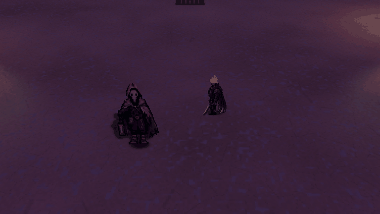
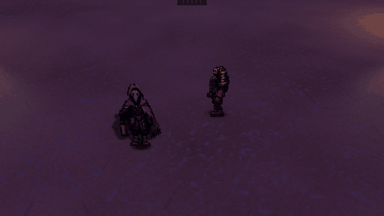

# Enemigos y NPC

El combate tiene cinco arquetipos de horda, dos élites y Gólgora. Las cifras de esta página corresponden a sus assets actuales. Las fichas visuales, spritesheets, fuentes editables y GIFs por acción se reúnen en [[02 - Personajes y Animación]]. Caballero Fantasma y Centinela de Cobre (gólem) usan sus sprites animados integrados, con normales, emisión y secuencias ligadas a los estados de combate.

| Enemigo | Vida | Velocidad base | Daño principal | XP |
| --- | ---: | ---: | --- | ---: |
| Residual / Esqueleto | 15 HP | 3,5 m/s ±15% | Contacto: 10; recarga de contacto 0,5 s. | 10 |
| Interceptor | 9 HP | 6,2 m/s ±10% | Contacto: 8; recarga de contacto 0,5 s. | 10 |
| Coloso / Wendigo | 80 HP | 1,8 m/s | Contacto o carga: 25. | 50 |
| Mortero Campana | 25 HP | 2,2 m/s ±10% | Contacto: 5; ácido: 5 cada 0,5 s. | 25 |
| Polilla Reactor | 12 HP | 4,8 m/s ±10% | Explosión: 35. | 15 |
| Caballero Fantasma | 110 HP | 2,8 m/s | Barrido sobrenatural: 22. | 65 |
| Centinela de Cobre | 160 HP | 1,7 m/s | Abanico de tres proyectiles físicos: 16 por impacto. | 80 |
| Gólgora / MataColeccionista | 3600 HP demo; 9000 completa | 1,6 m/s en primera fase | Contacto: 30; seis patrones descritos más abajo. | 500 de cierre |

## Residual: Esqueleto

Forma la masa básica de la horda. Persigue al jugador, se separa de otros cuerpos y busca paso entre obstáculos. Los cuatro pulsos base suman sus 15 HP cuando todos aciertan. Acepta empuje y su ataque de contacto se acompaña de la animación de golpe.

[Ver spritesheet, fuente editable y GIFs de todas sus acciones](../05%20-%20Arte%20y%20Audio/02%20-%20Personajes%20y%20Animaci%C3%B3n.md#residual-esqueleto).

## Interceptor: galgo de chatarra

Anticipa hasta 0,4 s del movimiento del jugador, con una velocidad de referencia limitada a 8 m/s. A corta distancia pasa a perseguir la posición actual. Su menor frenado tras el empuje le permite deslizarse más lejos que el Residual.

[Ver spritesheet, fuente editable y GIFs de todas sus acciones](../05%20-%20Arte%20y%20Audio/02%20-%20Personajes%20y%20Animaci%C3%B3n.md#interceptor-galgo-de-chatarra).

## Coloso: Wendigo

Es pesado, sólido e inmune al empuje. Cuando dispone de carga y el jugador está a 8 m o menos, fija la dirección y muestra un corredor durante 0,8 s. Embiste a 12 m/s durante 0,35 s, unos 4,2 m libres, y se recupera durante 0,6 s. Las paredes detienen el recorrido; la dirección queda comprometida tras el aviso. El intervalo entre cargas se sortea entre cinco y siete segundos.

Preparación y recuperación no infligen contacto. El dash permite atravesar su cuerpo durante la protección.

[Ver spritesheet, fuente editable y GIFs de todas sus acciones](../05%20-%20Arte%20y%20Audio/02%20-%20Personajes%20y%20Animaci%C3%B3n.md#coloso-wendigo).

## Mortero: Campana

Mantiene una banda de distancia entre 5,5 y 6,5 m y ataca hasta 12 m. Tiene un intervalo de cinco segundos, aviso de 0,45 s y vuelo de 0,85 s. El proyectil deja un charco de radio 1,2 m durante tres segundos, con 5 de daño cada 0,5 s. El director limita los Morteros simultáneos a seis.

[Ver spritesheet, fuente editable y GIFs de todas sus acciones](../05%20-%20Arte%20y%20Audio/02%20-%20Personajes%20y%20Animaci%C3%B3n.md#mortero-campana).

## Polilla: Reactor

Se aproxima hasta cebar la explosión. La mecha por proximidad dura 0,9 s; si procede de daño letal, 1,2 s. Explota en un radio de 3 m y afecta al jugador y a otros enemigos. Durante la mecha acepta empuje, por lo que puede desplazarse hacia la horda.

[Ver spritesheet, fuente editable y GIFs de todas sus acciones](../05%20-%20Arte%20y%20Audio/02%20-%20Personajes%20y%20Animaci%C3%B3n.md#polilla-reactor).

## Caballero Fantasma

Es uno de los dos élites. Recibe el 25% del daño físico y el daño sobrenatural completo. Su barrido tiene 3,6 m de alcance, arco de 120°, daño sobrenatural de 22, preparación de 0,8 s, recuperación de 0,8 s y recarga de 3,5 s. No causa daño por contacto normal.

El cuerpo usa su sprite de 224 fotogramas. La preparación ocupa 0,8 s; el ataque de seis fotogramas y la recuperación de seis comparten los 0,8 s posteriores al barrido real. La animación no añade impactos. Los ciclos y la captura actual están en [[02 - Personajes y Animación]].

## Centinela de Cobre

Recibe el 25% del daño sobrenatural salvo durante la recuperación, cuando se abre su ventana de vulnerabilidad y recibe el daño completo. El daño físico se mantiene completo. Prepara un abanico de tres proyectiles durante un segundo, se recupera dos y recarga en 3,5 s. El alcance es de 11 m y cada impacto causa 16 de daño físico. Es pesado, inmune al empuje y no causa contacto normal.

La presentación anuncia los rayos del abanico y muestra «Vulnerable» en su recuperación. Los misiles tienen animación, iluminación y un límite de luces simultáneas. El cuerpo usa su sprite de 288 fotogramas: abre las compuertas durante 0,3 s y prepara 0,7 s antes del disparo real; después reproduce disparo de 0,4 s, vulnerabilidad de 1,3 s y cierre de 0,3 s dentro de los 2 s de recuperación. Mantiene la vulnerabilidad de combate durante esa recuperación completa.

Los élites empiezan a aparecer desde los 90 s y se alternan cada 25 s cuando hay capacidad, con un límite conjunto de dos vivos. Sus efectos de barrido y proyectiles están en [[06 - Registro visual]].

## Gólgora: MataColeccionista

La ronda demo usa 3600 HP y la completa 9000 HP. La entrada ocurre a los tres u ocho minutos y retira la horda ordinaria sin recompensas. El jugador se traslada con protección a una caldera de 22 m de radio cuyo perímetro se cierra. Una presentación con título y rugido precede al combate; la cámara encuadra al jugador y al jefe.

Gólgora usa un modelo 3D animado y efectos de magma propios. Las capturas de sus seis patrones se muestran en [[02 - Personajes y Animación]].

| Patrón | Regla de primera fase, salvo donde se indica |
| --- | --- |
| Martillazo | Círculo de 3 m, situado 3 m por delante; 40 de daño, preparación de 1,2 s, recuperación de 1 s y recarga de 6 s. Puede dañar y empujar secuaces. |
| Barrido | Radio de 6 m y arco de 180°; 30 de daño, preparación y recuperación de 1 s, recarga de 7 s. |
| Bombardeo | Tres posiciones previstas; 25 de daño en radio 2,5 m, preparación de 0,7 s, vuelo base de 0,8 s y recarga de 8 s. Deja magma durante 4 s. |
| Cerco de magma | Salto al centro, impacto de llegada y ondas expansivas con un hueco de 60°. Las ondas avanzan a 6 m/s y causan 30 de daño. Una onda en primera fase y tres en segunda, separadas 1,3 s y con el hueco rotado 45°. |
| Fisura de magma | Cinco puntos a lo largo de una línea hacia el jugador, hasta 22 m; 24 de daño en radio 1,4 m. Preparación de 1,1 s, recuperación de 0,8 s, recarga de 10 s y zonas de 3 s. |
| Lluvia de escoria | Segunda fase: cinco impactos alrededor de la posición prevista, 26 de daño en radio 1,8 m. Preparación base de 1,35 s, vuelo base de 0,9 s, recuperación de 1 s y recarga de 14 s antes de los modificadores de fase. Zonas de 3,5 s. |

Las zonas de magma de estos proyectiles causan 5 de daño cada 0,5 s. El cerco empieza a estar disponible a los doce segundos de combate del jefe y después se programa con una recarga base de 18 s al completar la secuencia.

[Ver los seis patrones de Gólgora en GIFs capturados en Unity](../05%20-%20Arte%20y%20Audio/02%20-%20Personajes%20y%20Animaci%C3%B3n.md#g%C3%B3lgora-matacoleccionista).

### Segunda fase y resistencia al control

Al llegar al 50% de vida se inicia una transición protegida con rugido. La velocidad pasa a ×1,3; las preparaciones de los ataques que usan ese modificador, a ×0,85; las recuperaciones y recargas, a ×0,75. El cerco emite tres ondas y se incorpora la lluvia de escoria.

Gólgora es inmune al empuje. La ralentización tiene un máximo del 25%. Congelaciones y aturdimientos se reducen al 35% de su duración, con un máximo de 0,6 s y una ventana de inmunidad posterior de 1,5 s. Durante introducción, transición y salto no admite el control normal y no recibe daño. El estado activo del cerco aplica su reducción de daño configurada del 35%.

### Refuerzos y cierre

El director solicita grupos de hasta cuatro cada cuatro segundos. La caldera limita el conjunto a ocho secuaces y apariciones pendientes, con 0,9 s de aviso. La composición rota entre Residual, Residual, Mortero y Polilla. Cerco y transición de fase suspenden esos refuerzos y retiran los presentes.

La muerte de Gólgora cierra el encuentro si el jugador vive. La presentación final incluye la absorción de una gema y 500 XP de resumen, sin nuevas cartas. Si el jugador muere en el mismo paso, prevalece la derrota.

> **Navegación:** [[00 - Índice]] · [[00 - Avance jugable]]
