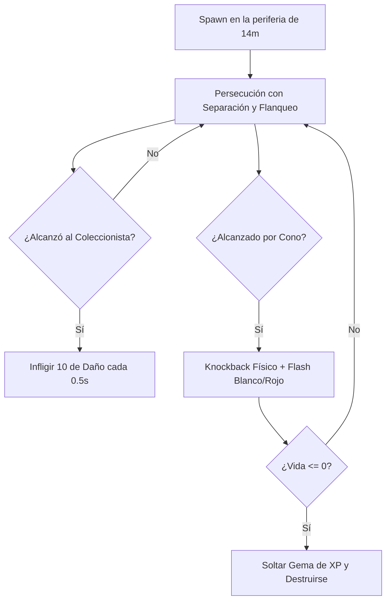

# Enemigos y NPC

## Descripción de la sección

Documenta las entidades no jugables controladas por la inteligencia artificial del juego, sus atributos cuantitativos, roles de combate y comportamiento dentro del enjambre.

---

## Catálogo de Enemigos Implementados

### 1. Enemigo Básico Residual (`EnemyBasic`)

**Rol de combate:**  
Horda / Carne de cañón (*Swarm Fodder*). Su propósito es ejercer presión numérica constante, rodear al jugador aprovechando la superioridad de masa y obligar al uso continuo de la linterna y el dash para abrir brechas.

**Comportamiento de IA:**  
* **Persecución activa:** Persigue continuamente la coordenada del jugador en el plano XZ.
* **Separación de vecinos (*Zero GC Flocking*):** Utiliza un búfer preasignado (`neighborBuffer[16]`) para calcular fuerzas de repulsión mutua (radio 1.4m, fuerza 5.5), evitando solapamiento antiestético.
* **Flanqueo inteligente:** Al toparse de frente con otros enemigos que bloquean su avance directo, aplica una fuerza lateral tangencial (fuerza 4.0, radio 1.2m) para envolver al jugador por los costados.
* **Micro-ondulación orgánica:** Introduce una semilla sinusoidal (`wanderIntensity = 0.35`) que rompe patrones rígidos o líneas rectas.

**Atributos numéricos:**
* **Vida máxima:** `15.0` puntos de salud.
* **Daño por contacto:** `10.0` puntos de daño al colisionar con el jugador.
* **Intervalo de daño (*Damage Cooldown*):** `0.50` segundos por enemigo.
* **Velocidad de avance:** `3.5 m/s` base con variación aleatoria individual de `±15%` (rango entre 2.97 y 4.02 m/s).
* **Física de Retroceso (*Knockback*):** Al ser impactado por la linterna, recibe un impulso de `5.0 m/s` en dirección opuesta al jugador, desacelerando rápidamente con una fricción de `18.0 m/s²`.

**Ataques y detección:**
* **Ataque:** Colisión física directa por contacto con el collider del jugador.
* **Rango de detección:** Global en la arena activa (orientación continua hacia el objetivo).

**Debilidades:**
* Alta susceptibilidad al empuje del cono de luz.
* Baja reserva de salud (cae tras 3 impactos base del cono de luz, o 2 impactos con la primera mejora de daño).

**Recompensa al morir:**
* Instancia inmediatamente en su posición final de muerte `1` Gema de Chatarra / XP (`Gem_XP.prefab`), equivalente a **10 XP**.

**Diagrama de Estados de IA:**

---

### 2. El Coloso (`EnemyColossus`)

**Rol de combate:**  
Rompe-líneas / Tanque (*Line Breaker / Heavy Tank*). Diseñado para ignorar por completo el retroceso de la linterna y avanzar de forma implacable, forzando al jugador a romper su posición de kiting o utilizar el Ghosting del Dash para atravesarlo.

**Comportamiento de IA:**  
* **Avance implacable:** Persecución directa hacia el jugador en el plano XZ sin atenuación frontal ni frenado por congestión.
* **Inmunidad al empuje de horda:** Sobrescribe `GetSeparationAndPush` ignorando la repulsión de vecinos y el "soft push" del jugador.
* **Cuerpo físico sólido:** Su collider no es trigger (`isTrigger = false`), bloqueando físicamente el paso del jugador a pie; solo es atravesable durante el Dash gracias al descarte de colisión entre capas.

**Atributos numéricos:**
* **Vida máxima:** `80.0` puntos de salud.
* **Daño por contacto:** `25.0` puntos de daño al colisionar con el jugador.
* **Intervalo de daño (*Damage Cooldown*):** `0.50` segundos.
* **Velocidad de avance:** `1.8 m/s` (pesado y constante con variación de `±5%`).
* **Física de Retroceso (*Knockback*):** Inmune al 100% (`knockbackImpulse = 0`).

**Recompensa al morir:**
* Instancia `1` Gema de Chatarra / XP de alta densidad equivalente a **50 XP**.

---

## Catálogo de NPC (Proyectados para el Almacén)

### 1. El Custodio de las Reliquias (NPC del Almacén)

* **Función:** Administrador de la vitrina de entidades capturadas y comerciante de mejoras permanentes.
* **Ubicación:** Refugio / Almacén del Coleccionista (fuera de la arena).
* **Interacción:** Permite invertir los Ecos consolidados tras cada partida para desbloquear y equipar entidades.

---

> **Navegación:** [[00 - Índice]] · ← [[02 - Niveles]] · [[04 - Objetos y Coleccionables]] →
