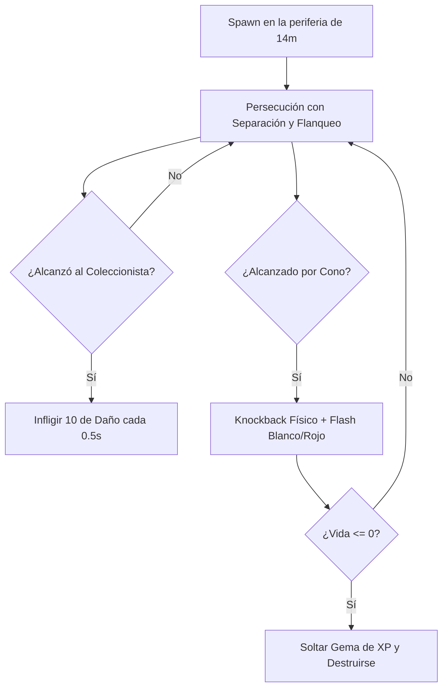
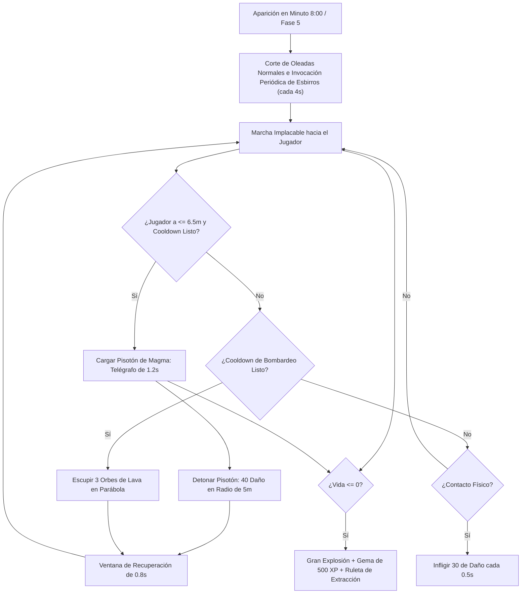

# Enemigos y NPC

## Descripción de la sección

Documenta las entidades no jugables controladas por la inteligencia artificial del juego, sus atributos cuantitativos, roles de combate y comportamiento dentro del enjambre.

---

## Catálogo de enemigos previstos

A continuación se especifican los arquetipos de enemigos diseñados para componer las oleadas del Vertedero de Ecos, detallando sus atributos de balance inicial, roles tácticos y comportamientos de inteligencia artificial.

### 1. Enemigo Básico Residual

**Rol de combate:**  
Horda / Carne de cañón (*Swarm Fodder*). Su propósito es ejercer presión numérica constante, rodear al jugador aprovechando la superioridad de masa y obligar al uso continuo de la linterna y el dash para abrir brechas.

**Comportamiento de IA:**  
* **Persecución activa:** Camina directamente hacia el jugador en todo momento.
* **Separación física:** Mantiene un pequeño espacio personal con otros enemigos para no encimarse ni verse amontonados de forma irreal.
* **Flanqueo (evitar fila india):** Si tiene a otro compañero delante bloqueándole el paso, se abre hacia la izquierda o derecha para rodear al jugador.
* **Variación individual de velocidad:** Fluctuación aleatoria de $\pm15\%$ asignada al aparecer, rompiendo la sincronía de avance para generar un flujo de masa orgánico en el enjambre.

**Atributos numéricos:**
* **Vida máxima:** `15.0` puntos de salud.
* **Daño por contacto:** `10.0` puntos de daño al tocar al jugador.
* **Tiempo entre golpes:** `0.50` segundos (medio segundo de respiro).
* **Velocidad de avance:** `3.5 m/s` (con variación aleatoria de ±15% entre individuos).
* **Física de Retroceso (*Knockback*):** Al recibir el pulso final (4º impacto) de la ráfaga de la linterna, es empujado físicamente hacia atrás.

**Ataques y detección:**
* **Ataque:** Chocar físicamente contra el jugador.
* **Rango de detección:** Global en la arena (siempre conoce la posición del Coleccionista).

**Debilidades:**
* Muy vulnerable a la luz: una ráfaga completa de la linterna (4 pulsos de 3.75 = 15 de daño) lo destruye de inmediato. Con una mejora de daño, cae incluso más rápido.

**Recompensa al morir:**
* **Gema de Chatarra (XP):** Suelta `1` Gema de Chatarra / XP equivalente a **10 XP** (100% garantizada).
* **Botiquín de Reparación:** **4%** de probabilidad de soltar un Botiquín de Chatarra Médica (+15 HP).

**Diagrama de Estados de IA:**

---

### 2. El Interceptor

**Rol de combate:**  
Corta-caminos / Rusher (*Path Interceptor / Rusher*). Diseñado para anticipar el vector de desplazamiento del jugador y cerrarle el paso frontalmente, castigando las tácticas de kiting en círculos continuos.

**Comportamiento de IA:**  
* **Predicción de Trayectoria (*Lead Target*):** En lugar de perseguir la posición actual del jugador, proyecta su posición futura en función de la velocidad y dirección del jugador con un tiempo de anticipación de `0.4s`.
* **Convergencia a corta distancia:** Al acercarse a menos de 1.2 metros, conmuta a persecución directa para evitar orbitar en torno al jugador.
* **Counterplay con Dash:** La velocidad de predicción está acotada a la velocidad base del jugador (8 m/s). Si el jugador ejecuta un Dash (22 m/s), la velocidad real supera el umbral previsto por el Interceptor, engañándolo exitosamente y abriendo una ventana táctica de escape.
* **Vulnerabilidad al retroceso:** Por su complexión ágil y ligera, posee una resistencia negativa al knockback (-20%), saliendo despedido a gran distancia con el impacto final del haz de luz.

**Atributos numéricos:**
* **Vida máxima:** `7.0` - `9.0` puntos de salud.
* **Daño por contacto:** `8.0` puntos de daño al colisionar con el jugador.
* **Intervalo de daño:** `0.50` segundos.
* **Velocidad de avance:** `6.2 m/s` con variación individual de `±10%`.
* **Física de Retroceso (*Knockback*):** Resistencia -20% (impulso de retroceso de `8.5 m/s`, fricción atenuada de `12.0 m/s²`).

**Recompensa al morir:**
* **Gema de Chatarra (XP):** Suelta `1` Gema de Chatarra / XP equivalente a **10 XP** (100% garantizada).
* **Botiquín de Reparación:** **4%** de probabilidad de soltar un Botiquín de Chatarra Médica (+15 HP).

---

### 3. El Coloso

**Rol de combate:**  
Rompe-líneas / Tanque (*Line Breaker / Heavy Tank*). Diseñado para ignorar por completo el retroceso de la linterna y avanzar de forma implacable, forzando al jugador a romper su posición de kiting o utilizar la fase intangible del Dash para atravesarlo.

**Comportamiento de IA:**  
* **Avance implacable:** Camina directo hacia el jugador con paso pesado y constante.
* **Inmunidad al empuje:** Avanza como una apisonadora; no se aparta por otros enemigos ni se frena por nada.
* **Cuerpo físico sólido:** Es un muro viviente. Caminando a pie bloquea el paso por completo; la única forma de atravesarlo es usando el Dash gracias a su ventana de invulnerabilidad.

**Atributos numéricos:**
* **Vida máxima:** `80.0` puntos de salud.
* **Daño por contacto:** `25.0` puntos de daño al tocar al jugador.
* **Tiempo entre golpes:** `0.50` segundos.
* **Velocidad de avance:** `1.8 m/s` (lento pero imparable).
* **Física de Retroceso (*Knockback*):** Inmune al 100% (la luz de la linterna jamás lo hace retroceder).

**Recompensa al morir:**
* **Gema de Chatarra (XP):** Suelta `1` Gema de Chatarra / XP de alta densidad equivalente a **50 XP** (100% garantizada).
* **Botiquín de Reparación:** **25%** de probabilidad garantizada de soltar un Botiquín de Chatarra Médica (+15 HP), recompensando el alto esfuerzo necesario para derribar a un tanque pesado.

---

### 4. El Mortero

**Rol de combate:**  
Zoner / Control de arena (*Area Denial / Artillery*). Su objetivo es mantenerse a distancia media y escupir charcos corrosivos en el suelo para ensuciar la arena y cortar rutas de escape seguras.

**Comportamiento de IA:**  
* **Posicionamiento táctico:** Se aproxima al jugador hasta alcanzar una distancia de seguridad de ~7 metros.
* **Control de zona muerta y retroceso suave:** Entre 6.5m y 7.5m frena su avance frontal por completo. Si el jugador intenta acortar distancia (< 6.5m), retrocede suavemente para restablecer la distancia óptima de disparo.
* **Ataque de Mortero:** Escupe periódicamente un proyectil balístico en arco parabólico que detona al tocar tierra formando un charco corrosivo.
* **Charco Corrosivo:** Permanece activo exactamente 4 segundos en el suelo, infligiendo 5 de daño cada 0.5 segundos al jugador si pisa el área.

**Atributos numéricos:**
* **Vida máxima:** `25.0` puntos de salud.
* **Daño por contacto:** `5.0` puntos de daño al colisionar con el jugador.
* **Intervalo de daño:** `0.50` segundos.
* **Velocidad de avance:** `2.2 m/s` con variación individual de `±10%`.
* **Física de Retroceso (*Knockback*):** 20% de resistencia (impulso de retroceso de `4.0 m/s`, fricción de `18.0 m/s²`).
* **Cadencia de disparo:** `3.5` segundos por proyectil.

**Recompensa al morir:**
* **Gema de Chatarra (XP):** Suelta `1` Gema de Chatarra / XP equivalente a **25 XP** (100% garantizada).
* **Botiquín de Reparación:** **25%** de probabilidad garantizada de soltar un Botiquín de Chatarra Médica (+15 HP), premiando al jugador por arriesgarse a neutralizar la artillería enemiga.

---

### 5. La Polilla

**Rol de combate:**  
Kamikaze / Bomba táctica (*Suicide Bomber / Tactical Disruptor*). Enemigo ágil y ligero con tendencia autodestructiva que genera momentos de alta tensión y recompensa el posicionamiento rápido del jugador.

**Comportamiento de IA:**  
* **Abalanzamiento kamikaze:** Se desplaza velozmente (4.8 m/s) en dirección directa al jugador.
* **Cebado y cuenta atrás de 0.5s:** Al recibir daño letal o al aproximarse a menos de 2.0 metros del jugador, frena su avance motriz y entra en fase de sobrecarga, parpadeando a alta frecuencia en ámbar reactivo.
* **Counterplay con la Linterna:** Durante los 0.5s de cebado, la Polilla mantiene su física de knockback activa. Si el jugador la empuja con el haz de luz hacia el enjambre antes de que detone, la explosión resultante destruye y dispersa a la propia horda (*friendly fire* táctico).
* **Detonación radial:** Al concluir el tiempo de cebado, estalla en un radio de 3.0 metros, infligiendo 35 de daño tanto al jugador (si permanece dentro del radio) como a todos los enemigos circundantes.

**Atributos numéricos:**
* **Vida máxima:** `12.0` puntos de salud.
* **Daño por contacto / explosión:** `35.0` puntos de daño.
* **Velocidad de avance:** `4.8 m/s` con variación individual de `±10%`.
* **Física de Retroceso (*Knockback*):** 0% de resistencia (impulso de retroceso de `5.0 m/s`, fricción de `18.0 m/s²`).
* **Radio de detonación:** `3.0` metros.
* **Tiempo de fusible (*Primed duration*):** `0.50` segundos.

**Recompensa al morir:**
* **Gema de Chatarra (XP):** Suelta `1` Gema de Chatarra / XP equivalente a **15 XP** (100% garantizada).
* **Botiquín de Reparación:** **4%** de probabilidad de soltar un Botiquín de Chatarra Médica (+15 HP).

---

### 6. Gólgora, el Juicio del Vertedero (Jefe Final)

**Rol de combate:**  
Jefe de Clímax y Prueba Final (*Endgame Boss / DPS & Positioning Gatekeeper*). Es la cúspide de la partida (Pilar 4: *"8 Minutes to Judgement"*). Aparece en el minuto 8:00 para juzgar al Coleccionista, obligándolo a demostrar que su *build* de mejoras posee suficiente potencia de fuego, movilidad con el *Dash* y gestión espacial para sobrevivir a un coloso titánico y sus ataques de área masivos.

**Lore y Contexto Temático:**  
Gólgora no es un autómata ordinario: es una mole ancestral de chatarra fundida y magma sintético que duerme en el lecho del vertedero. Cuando el Coleccionista absorbe demasiados Ecos y altera el equilibrio de la arena, Gólgora despierta como manifestación destructiva del propio desguace para purificar a los intrusos.

**Comportamiento de IA y Fases de Combate:**  
* **Marcha Implacable:** Avanza a paso constante e inamovible (1.6 m/s) directamente hacia el jugador. Su cuerpo físico colosal es un obstáculo sólido infranqueable a pie; sólo puede ser atravesado mediante los *i-frames* del *Dash*.
* **Inmunidad Total al Haz de Luz:** Posee un 100% de resistencia al retroceso (*Knockback*). A diferencia de los enemigos básicos o polillas, ningún disparo de la linterna lo detiene ni lo empuja hacia atrás.
* **Ataque 1 — Pisotón de Magma (*Magma Stomp*):**
  * Se activa cuando el jugador entra en su radio cercano de amenaza ($\le 6.5\text{ m}$).
  * Gólgora planta sus extremidades y despliega un círculo de advertencia telegrafiado en el suelo de 5.0 metros de radio.
  * El disco de advertencia se llena durante 1.2 segundos, pasando de ámbar a rojo intenso. Al completarse, impacta el suelo generando una explosión procedural de fuego y ondas de choque que inflige 40 puntos de daño directo al jugador si permanece en el área.
  * Los esbirros menores atrapados en la onda expansiva reciben 50.0 puntos de daño colateral con retroceso físico.
  * Tras el pisotón, entra en un periodo de recuperación de 0.8 segundos donde queda inmóvil, otorgando una ventana táctica de castigo libre al jugador.
* **Ataque 2 — Bombardeo de Lava (*Lava Mortar Barrage*):**
  * Se activa periódicamente cada 8 segundos.
  * Gólgora canaliza energía térmica durante 0.4 segundos y escupe 3 proyectiles balísticos de magma en arco parabólico: uno dirigido a la posición proyectada del jugador y dos hacia sus flancos laterales.
* **Corte de Oleadas Normales e Invocación de Esbirros:** Al detonar la Fase 5 (minuto 8:00), cesa la escalada de oleadas normales del nivel y la onda sísmica de emergencia de Gólgora pulveriza instantáneamente a la horda previa sin soltar gemas de XP (evitando regalar niveles gratuitos al iniciar el clímax). Durante todo el combate final, **Gólgora invoca periódicamente enemigos menores como esbirros cada 4.0 segundos**; esto mantiene la presión táctica y garantiza que el jugador cuente con objetivos secundarios para obtener botiquines de reparación (+15 HP), activar efectos por muerte y provocar explosiones tácticas con polillas para dañar al propio Gólgora.

**Atributos numéricos:**
* **Escala visual:** `3.5x` (calibrada para perspectiva cenital a `60°`, garantizando presencia titánica sin ocluir proyectiles, telégrafos ni el cono de luz).
* **Vida máxima:** `1500.0` puntos de salud (requiere ráfagas concentradas y mejoras continuas de daño).
* **Daño por contacto:** `30.0` puntos de daño al tocar al jugador.
* **Daño del Pisotón (*Magma Stomp*):** `40.0` puntos de daño en un radio de `5.0` metros al jugador.
* **Daño colateral del Pisotón a esbirros:** `50.0` puntos de daño con retroceso.
* **Tiempo de advertencia del Pisotón:** `1.2` segundos (telegrafiado visible en suelo).
* **Cadencia del Pisotón:** Cooldown de `6.0` segundos.
* **Proyectiles del Bombardeo:** `3` orbes de lava con dispersión angular de $\pm60^\circ$.
* **Cadencia del Bombardeo:** Cooldown de `8.0` segundos.
* **Velocidad de avance:** `1.6 m/s` (paso pesado y regular).
* **Física de Retroceso (*Knockback*):** Inmune al 100% (`0.0 m/s`).
* **Ventana de vulnerabilidad post-ataque:** `0.80` segundos de inmovilidad tras el pisotón.

**Condición de Victoria y Recompensa:**
* Al reducir la salud de Gólgora a 0:
  * Detona una explosión cinemática masiva de 8 metros.
  * Instancia una **Gema de Chatarra Legendaria** equivalente a **500 XP**.
  * Dispara el estado global de **Victoria**, activando la **Ruleta de Extracción** para secuestrar y reclamar una entidad dimensional permanente (o sumarle **+1 nivel** si ya se encontraba en el Almacén).
  * Despliega la pantalla de victoria cinematográfica con cámara lenta, permitiendo al jugador volver al Almacén con su entidad capturada.

**Diagrama de Estados de IA de Gólgora:**

---

## Personajes No Jugables (NPC)

* **Alcance del proyecto:** **No aplica.**
* **Justificación de diseño:** *EchoScrap* es una experiencia de supervivencia en solitario. Dentro de la arena de combate no existen NPCs aliados ni neutrales, y la navegación y gestión en el Almacén se realiza directamente a través de menús de interfaz, por lo que no se contempla el desarrollo de personajes no jugables interactivos.

---

> **Navegación:** [[00 - Índice]] · ← [[02 - Niveles]] · [[04 - Objetos y Coleccionables]] →
