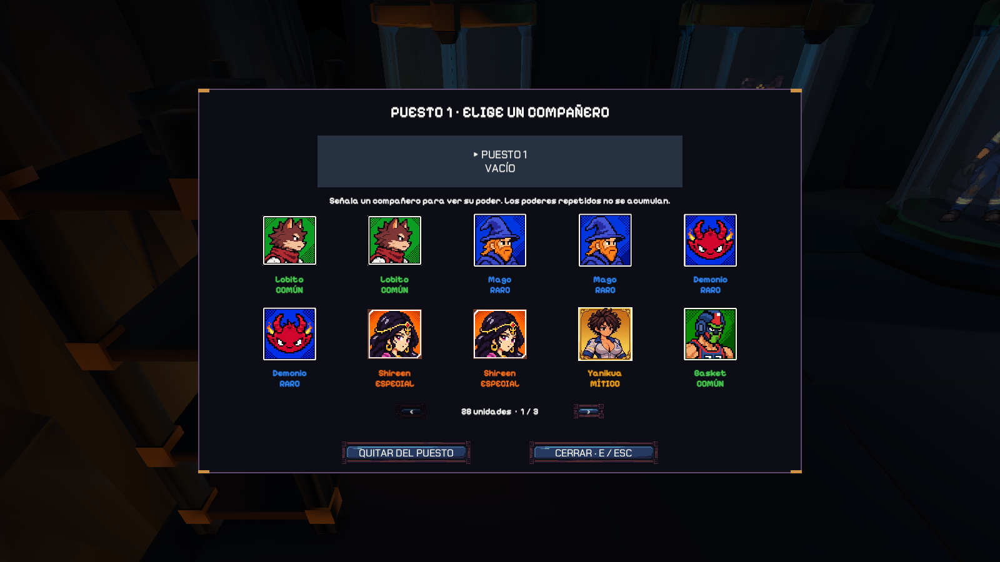
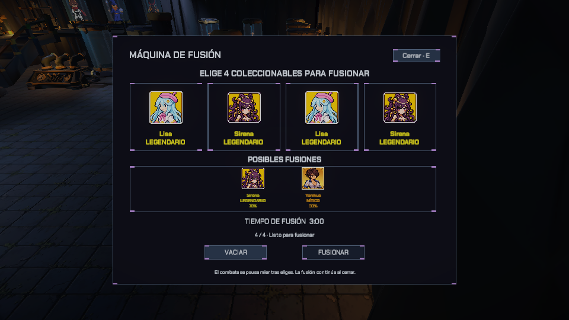

# Objetos y coleccionables

## Gemas y botiquines

Las gemas conceden la XP del enemigo derrotado y permanecen en el escenario hasta recogerse (fusionándose entre sí cuando caen a menos de `0,75 m`). Los botiquines curan `15 HP` de base (`17 / 19 / 21 HP` con `GREED_03`) y caducan tras `22 s`. Ambos responden al imán del jugador y a *Pulso colector* (`GREED_05`).

## Catálogo de 15 entidades de la colección

La colección registra permanentemente hasta **15 entidades descubiertas** (`discovered[15]`) y almacena un **máximo estricto de 10 unidades en posesión** (`FusionProgress.Capacity = 10`, `owned[15]` cuya suma nunca supera `10`). Nueve entidades aparecen como fragmentos en la arena y seis se obtienen mediante la máquina de fusión.

| ID | Entidad | Rareza en catálogo | Fuente | Poder de acompañante al equiparla (`CompanionPowerRuntime`) |
| ---: | --- | --- | --- | --- |
| 0 | Lobito | Común | Arena · 25% | `+10 HP` máximos. |
| 1 | Mago | Raro (Poco común) | Arena · 10% | Lanza un proyectil mágico perforante de `18` de daño base cada `10 s`. |
| 2 | Demonio | Raro (Poco común) | Arena · 10% | `+15%` de daño; `30%` de probabilidad de aplicar quemadura de `4` de daño base/s durante `3 s`. |
| 3 | Shireen | Especial (Rara) | Arena · 5% | Cura `2 HP` cada `5 s`. |
| 4 | Yanikua | Mítico (Legendaria) | Fusión (exclusiva) | Duplica la salud máxima (`×2`); `+20%` de daño y `+15%` de velocidad de movimiento; **1 salvación ante golpe letal por expedición** (restaura al `30%` de HP máx. y otorga `3 s` de invulnerabilidad). No puede usarse como ingrediente de fusión. |
| 5 | Basket | Común | Arena · 25% | `+10%` de velocidad de movimiento. |
| 6 | Hada | Épico | Arena · 7% | Bloquea por completo `1` golpe cada `20 s`. |
| 7 | Lisa | Legendario | Arena · 3% | `+20%` de cadencia de ataque; cada `12 s` congela `2 s` en un radio de `8 m` (a Gólgora lo ralentiza hasta su tope del `25%`). |
| 8 | Reaper | Común | Fusión | `+8%` de daño. |
| 9 | Chico Emo | Raro (Poco común) | Fusión | Duplica la velocidad de movimiento durante `2 s` al terminar el dash. |
| 10 | Conde Alucard | Especial (Rara) | Fusión | Cura `1 HP` por cada `5` bajas enemigas. |
| 11 | Murciélago Cristal | Épico | Fusión | Cada `8 s` emite una onda de `15` de daño base en `8 m` que ralentiza un `40%` durante `3 s`. |
| 12 | Sirena | Legendario | Fusión | Cada `15 s` emite una onda en `8 m` que empuja `4 m` y cura el `5%` de la salud máxima. |
| 13 | Soldier | Especial (Rara) | Arena · 5% | `+15 HP` máximos y `-15%` de daño recibido (`×0,85` en `PlayerHealth`; además de `+10%` de armadura en `PlayerRuntimeStats`). |
| 14 | Joel | Raro (Poco común) | Arena · 10% | `+15%` de cadencia de ataque. |

*(Nota de arquitectura en `PlayerRuntimeStats`)*: el calculador de estadísticas incluye también los ganchos de acompañante para *Golem* (`+10%` de armadura), *Caballero* (`+15%` de probabilidad de bloqueo), *Orco* (`×1,15` de velocidad de movimiento) y *Dragón Infernal* referenciados en las tablas de probabilidades por rareza de `GROUND_TRUTH.md`.

Cada `30 s` de combate activo se intenta generar entre `1` y `3` fragmentos en posiciones válidas del mapa, con un máximo de `12` activos simultáneamente y `10 s` de duración por aparición. El jugador debe acercarse a menos de `2,5 m` con línea de visión despejada y pulsar **`E`**.

## Capacidad máxima de 10 unidades y bloqueo por inventario lleno

La colección admite un máximo estricto de **10 unidades en total** (`FusionProgress.Capacity = 10`), que se corresponden uno a uno con los **10 pedestales físicos de la bóveda** (`displays[10]`): **3 puestos de equipo activo** en el balcón superior (puestos 1 a 3, `slot 0..2`) y **7 puestos de exposición/reserva** en la planta inferior (puestos 4 a 10, `slot 3..9`).

- **Bloqueo de recogida en la arena (`CollectibleShard.cs`, `CollectiblePickupFeedback.cs`):** si el jugador ya posee `10/10` unidades (`!FusionProgress.HasCollectionSpace`), no puede recoger más fragmentos en combate y aparece el aviso flotante **`INVENTARIO LLENO / LIBERA ESPACIO`**.
- **Bloqueo de reclamo en la máquina de fusión (`FusionStationUI.cs:198-202`):** si el jugador intenta reclamar el resultado de una fusión teniendo `10/10` unidades, la máquina muestra **`INVENTARIO LLENO · LIBERA ESPACIO`** (*"Tu colección tiene 10 unidades. Libera una en la bóveda y vuelve: el resultado de esta fusión seguirá aquí."*) y mantiene el resultado guardado en estado `AwaitingDecision` hasta que libere espacio en algún pedestal de la bóveda.

## Interacción con los puestos de la bóveda y señalización

La bóveda cuenta con señalización completa en el mundo y en el HUD (`GameMenuView.cs`, `CollectibleDisplay.cs`):

1. **Rótulos 3D sobre los pedestales del balcón:** **`EQUIPO 1`**, **`EQUIPO 2`** y **`EQUIPO 3`**.
2. **Indicadores direccionales superiores (`VaultDirections`):** dos tarjetas dinámicas en la parte superior con flechas (`▲`, `▼`, `◄`, `►`, `●`) que apuntan en tiempo real hacia la **Máquina de Fusión** (*"MÁQUINA DE FUSIÓN · Combina 4 copias de la misma rareza"*, *"BAJA A FUSIÓN"* o *"E · MÁQUINA DE FUSIÓN"*) y hacia los **Puestos de Equipo** (*"SUBE AL BALCÓN · Puestos de equipo 1, 2 y 3"*, *"EQUIPAR ENTIDADES"* o *"PUESTO 1..3 · EQUIPAR/EDITAR"*).
3. **Panel rotatorio de consejos (`VaultTips`):** tarjeta en la esquina inferior izquierda con la etiqueta **`CONSEJO`** que rota cada `8 s` entre tres indicaciones (balcón de equipo, máquina de fusión y liberación en planta baja), o prioriza *"Pulsa E frente a un puesto para equipar tu primer coleccionable"* cuando `OwnedCount > 0 && !HasEquippedOnce`.

Las interacciones de cada nivel de la bóveda son:

- **Puestos 1 a 3 (balcón superior, equipo activo — `CompanionSystem.cs`, `CompanionView.cs`, `VaultReleaseInteraction.cs`):**
  - El aviso contextual al acercarse es **`E · EQUIPAR`** (si el puesto está vacío) o **`E · EDITAR`** (si está ocupado).
  - Pulsar **`E`** abre siempre el selector de acompañantes (`CompanionView`, encabezado `PUESTO DE EQUIPO 1/2/3`, subtítulo `ELIGE UNA ENTIDAD DESCUBIERTA PARA ESTE PUESTO`). Su barra inferior ofrece tres botones: **`QUITAR DEL PUESTO`** (desequipa la unidad y la devuelve a un hueco libre de la planta inferior), **`LIBERAR COPIA`** (abre el modal de confirmación para eliminar la copia de la colección) y **`CERRAR · E / ESC`**.
  - Además, al estar frente a un puesto de equipo ocupado en el mundo, pulsar **`T`** retira directamente la unidad del puesto de equipo sin abrir el menú (`CompanionSystem.ClearSlot`).
- **Puestos 4 a 10 (planta inferior, exposición/reserva — `VaultReleaseInteraction.cs`):**
  - Al acercarse a un puesto ocupado, el aviso contextual es **`E · LIBERAR`**.
  - Pulsar **`E`** abre el cuadro de confirmación **`LIBERAR UNIDAD`**: *"¿Seguro que quieres liberar a `<Nombre>`? Esta unidad desaparecerá de tu colección."* con los botones **`CANCELAR`** (`Esc`) y **`LIBERAR`** (`E`, `Enter` o `Espacio`).
  - Al confirmar (`FusionProgress.ReleaseUnit`), se descuenta `1` de `owned[id]`, se conserva permanentemente `discovered[id]` en el Índice de Colección, se reordenan los puestos de exposición por rareza y se guarda en `PlayerPrefs`.

*Nota sobre la captura histórica: la imagen muestra la cuadrícula del selector de puesto antes de añadir la barra inferior unificada con los botones `QUITAR DEL PUESTO`, `LIBERAR COPIA` y `CERRAR · E / ESC` en `9eed59f`.*

## Índice de Colección (`VaultCollectionIndex.cs`, tecla `[I]`)

Dentro de la bóveda, pulsar la tecla **`I`** o hacer clic en el botón superior izquierdo **`ÍNDICE · [I]`** (`VaultIndexHint`) abre el **Índice de Colección**, que pausa la simulación (`PauseReason.FusionMenu`) y se cierra con `I`, `Esc` o el botón **`CERRAR · [I]`**.

- **Encabezado:** muestra el título **`ÍNDICE DE COLECCIÓN`** y el contador en vivo **`{descubiertos} / 15 DESCUBIERTOS · {en posesión} / 10 UNIDADES`**.
- **Pestaña 1 — `POR RAREZAS`:** muestra las **15 entidades** del juego y permite filtrar por **`TODAS`** o por cada una de las **6 rarezas** (*Comunes, Poco comunes, Raras, Épicas, Legendarias, Míticas*). Las entidades aún no descubiertas se representan como **siluetas negras** (`Color(0.03, 0.03, 0.04, 0.96)`), con nombre **`???`** y estado **`NO ENCONTRADO`** / **`SILUETA BLOQUEADA`** (*"Aún no has registrado esta entidad. Encuéntrala en la arena o mediante la máquina de fusión para revelar su retrato y su efecto de compañero."*).
- **Pestaña 2 — `EN TU BÓVEDA`:** lista únicamente las unidades actualmente en posesión (`hasta 10 unidades`), indicando en cada tarjeta si se encuentra **`EN EQUIPO ACTIVO`** (puestos 1–3) o **`EN BÓVEDA`** (puestos 4–10).
- **Panel derecho de inspección (`PanelDetalleIndice`):** al seleccionar cualquier entidad descubierta, muestra su insignia de rareza, retrato ampliado, fuente de obtención, copias actuales en posesión (`xN`) y la descripción completa de su **poder de compañero**.

## Máquina de fusión (`FusionProgress.cs`, `FusionStation.cs`, `FusionStationUI.cs`, `CollectibleUnitGrid.cs`)

La estación central de la bóveda se abre con **`E`** (**`E · FUSIONAR`** cuando está libre o en cuenta atrás, o **`E · VER FUSIÓN`** cuando un resultado aguarda en `AwaitingDecision`).

### Reglas de ingredientes y duración fija de 30 segundos

1. **Duración fija de 30 segundos (`FusionRecipe.FusionSeconds = 30`):** **todas las fusiones duran exactamente `30 s` (`00:30`)**, sin importar la rareza de los ingredientes. El temporizador avanza en tiempo real (`Time.unscaledDeltaTime`) y persiste entre escenas.
2. **Cuatro unidades de la misma rareza (excluida Yanikua):** requiere 4 copias de la misma banda de rareza (pueden ser de la misma entidad o de distintas entidades dentro de esa rareza). **Yanikua** (`id = 4`) está explícitamente excluida como ingrediente (`id != 4`).
3. **Uso permitido de copias equipadas (`EN EQUIPO 1/2/3`):** en el selector de unidades de la máquina (`CollectibleUnitGrid.cs`), las copias equipadas en los puestos 1 a 3 del balcón **sí se pueden seleccionar como ingredientes** y aparecen con la etiqueta **`EN EQUIPO 1/2/3`** (mientras que las ya asignadas a otra ranura de la máquina muestran `RANURA 1..4`). Al pulsar **`CONFIRMAR`** (`FusionProgress.Begin`), si las copias seleccionadas superan las copias en reserva, el sistema las desequipa automáticamente de sus puestos de equipo y consume las 4 unidades.

### Probabilidades de fusión y redondeo en interfaz

| Receta de entrada (4 copias de la misma rareza) | Duración | Pesos internos por entidad (`FusionProgress.cs`) | Porcentajes mostrados en UI (`Mathf.RoundToInt`, `FusionStationUI.cs:168`) y bandas de rareza (`GROUND_TRUTH.md`) |
| --- | ---: | --- | --- |
| **4 Comunes** | `30 s` (`00:30`) | Reaper `60%` · Chico Emo `40%` | UI: **`60%`** / **`40%`** *(Por rareza: 50% Poco común, 35% Rara, 15% Épica)* |
| **4 Poco comunes (Raros)** | `30 s` (`00:30`) | Chico Emo `60%` · Conde Alucard `40%` | UI: **`60%`** / **`40%`** *(Por rareza: 65% Rara, 35% Épica)* |
| **4 Raras (Especiales)** | `30 s` (`00:30`) | Conde Alucard `60%` · Murciélago Cristal `40%` | UI: **`60%`** / **`40%`** *(Por rareza: 75% Épica, 25% Legendaria)* |
| **4 Épicas** | `30 s` (`00:30`) | **Murciélago Cristal `59,4%` · Sirena `39,6%` · Yanikua `1%`** | UI redondeado a enteros: **`60%` Murciélago Cristal · `40%` Sirena · `1%` Yanikua** |
| **4 Legendarias** *(interpolación superior)* | `30 s` (`00:30`) | Sirena `70%` · Yanikua `30%` | UI: **`70%`** / **`30%`** |

### Flujo de ventanas de la estación

- **Ventana principal (`Marco_Fusion`):** presenta las 4 ranuras en cruz (`Cuadro_Fusion` + `Cruz`), el botón superior derecho **`X`** para cerrar, el desglose de probabilidades redondeadas a enteros y los botones inferiores **`VACIAR`** y **`CONFIRMAR`**.
- **Selector de ranura (`MiGaraje`):** muestra en cuadrícula las unidades disponibles (incluidas `EN EQUIPO 1/2/3`) junto a los botones **`QUITAR INGREDIENTE`** y **`VOLVER`**.
- **Pantalla de resultado (`AwaitingDecision`):** al completarse los `30 s` y abrir la estación con `E · VER FUSIÓN`, se reproduce la animación de apertura y se muestra la unidad obtenida con un **único botón de acción: `COLECCIONAR`** (más la `X` de cierre). **No existe botón "Liberar" en la pantalla de resultado de la máquina**; la liberación se realiza en los pedestales de la bóveda.

> **Navegación:** [[00 - Índice]] · [[00 - Avance jugable]]
