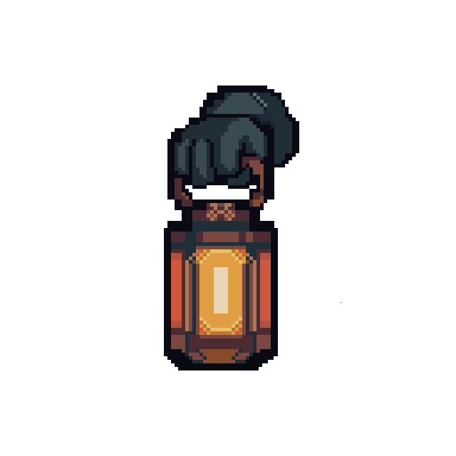
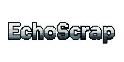
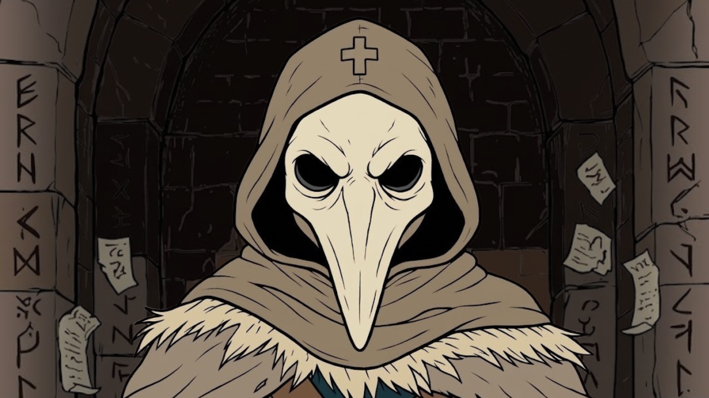

# Dirección de arte

El juego combina un escenario 3D de formas angulares con sprites de pixel art, un jefe con modelo 3D animado y efectos de luz y partículas. Metal, roca, madera y chatarra ocupan el fondo oscuro; las siluetas, los avisos de suelo y las fuentes luminosas separan con nitidez lo que requiere atención inmediata.

El perfil exterior coloca la cámara a `35,5°` con campo de visión de `34°`. La bóveda usa una perspectiva propia (`32°` y `65°` de FOV) y el encuentro de Gólgora adapta la distancia para encuadrar a ambos combatientes dentro de la caldera. El Coleccionista se representa en un plano vertical con proporciones fijas dentro del mundo.

| Uso | Tratamiento presente |
| --- | --- |
| Exterior | Azules y violetas oscuros, niebla, haces y polvo ambiental. |
| Materiales | Acero apagado, cobre, óxido, piedra y madera. |
| Jugador | Capucha clara, farol y haz automático; brillo pasivo en la bóveda. |
| Ácido | Verde brillante sobre el terreno oscuro. |
| Peligro anunciado | Ámbar y naranja, contornos definidos y progreso visible. |
| Hielo | Tinte celeste, cristales y niebla fría. |
| Jefe | Armadura oscura, núcleo incandescente y efectos de magma. |
| Colección e interfaz | Tipografía unificada **`Pixelify Sans`**, retratos enmarcados, rótulos 3D `EQUIPO 1..3`, colores por rareza y siluetas negras (`???`) para entidades aún no descubiertas en el Índice de Colección (`[I]`). |

Apollo permanece como referencia de paleta. Los sprites activos del Coleccionista, Mortero y Polilla usan celdas de `64 × 64`; Esqueleto, Interceptor, Wendigo, Caballero Fantasma y Centinela de Cobre usan `96 × 96`. Sus atlas y animaciones están en [[02 - Personajes y Animación]].

El deslizador de **Efectos decorativos** (`0%` a `100%` en la pestaña `General` de pausa) reduce decoración y movimiento accesorio por debajo del `99,9%`, conservando intactos todos los avisos de peligro necesarios para jugar.

## Identidad visual, logotipos y portadas

Los recursos de identidad gráfica de *EchoScrap* y sus archivos fuente editables se reúnen en `Media/Identidad/` (además de los editables de HUD, botones y marcos de cartas en `ArtSource/UI/` dentro del proyecto de Unity):

| Recurso | Archivo | Uso / Descripción |
| --- | --- | --- |
| **Isotipo (Logo)** | [EchoScrap-logo.svg](../Media/Identidad/EchoScrap-logo.svg) | Emblema vectorial del Coleccionista para icono y material gráfico del proyecto. |
| **Logotipo (Título)** | [EchoScrap-titulo.svg](../Media/Identidad/EchoScrap-titulo.svg) · [Editable `.aseprite`](../Media/Identidad/EchoScrap-titulo.aseprite) | Tipografía gráfica oficial *ECHOSCRAP* en formato vectorial y fuente editable pixel art. |
| **Portada horizontal** | [Portada_EchoScrap.png](../Media/Identidad/Portada_EchoScrap.png) | Ilustración principal de portada con el Coleccionista frente al umbral rúnico de la bóveda. |
| **Tarjeta vertical y arte fuente** | [Tarjeta_EchoScrap.png](../Media/Identidad/Tarjeta_EchoScrap.png) · [Vectorial `.svg`](../Media/Identidad/EchoScrap-arte.svg) | Tarjeta de presentación (`810 × 1080`) para difusión del proyecto y página de distribución. |

  

> **Navegación:** [[00 - Índice]] · [[00 - Avance jugable]]
