# Personajes y animación

Esta página reúne las fichas visuales del Coleccionista, los cinco enemigos de horda, los dos élites y Gólgora. Cada enemigo de horda tiene su spritesheet, la fuente editable y los GIFs de todas sus acciones. Los recursos y capturas corresponden al 4 de noviembre de 2026; esta organización documental se revisó el 5 de noviembre.

Las reglas y cifras de combate se consultan en [[03 - Enemigos y NPC]]. La identidad y el papel general de cada personaje se recogen en [[03 - Personajes]].

## Recursos actuales y estado de integración

| Personaje o arquetipo | Recurso y estado | Animaciones por dirección |
| --- | --- | --- |
| Coleccionista | Sprite integrado; atlas de 108 fotogramas de 64 × 64. | Reposo 8, marcha 8, dash 3 y muerte 8. |
| Residual / Esqueleto | Sprite integrado; atlas de 144 fotogramas de 96 × 96. | Reposo 8, marcha 8, ataque 8, impacto 4 y muerte 8. |
| Interceptor / galgo de chatarra | Sprite integrado; atlas de 152 fotogramas de 96 × 96. | Reposo 6, marcha 12, ataque 6, impacto 4 y muerte 10. |
| Coloso / Wendigo | Sprite integrado; atlas de 200 fotogramas de 96 × 96. | Reposo 8, marcha 8, preparación 8, carga 6, recuperación 6, impacto 4 y muerte 10. |
| Mortero Campana | Sprite integrado; atlas de 112 fotogramas de 64 × 64. | Flotación 6, carga 6, disparo 4, recuperación 4 y muerte 8. |
| Polilla Reactor | Sprite integrado; atlas de 62 fotogramas de 64 × 64. | Vuelo 8 y cebado 6; estallido común de 6. |
| Caballero Fantasma | Arte de sprite preparado; integración en Unity pendiente. La representación jugable documentada usa geometría y VFX. | Los ciclos del nuevo sprite quedan pendientes de comprobar dentro del juego. |
| Centinela de Cobre / gólem | Arte de sprite preparado; integración en Unity pendiente. La representación jugable documentada usa geometría y VFX. | Los ciclos del nuevo sprite quedan pendientes de comprobar dentro del juego. |
| Gólgora / MataColeccionista | Modelo 3D animado integrado y VFX de magma. | Entrada, locomoción, martillazo, barrido, lanzamiento, salto y presentación final. |

## Cómo leer las previsualizaciones

Los GIFs de atlas colocan juntas las cuatro vistas y usan sus fotogramas y tiempos exportados. La escala es el doble del píxel original, sin interpolación. El estallido de la Polilla es una acción compartida. El bucle facilita revisar una acción; los golpes y las muertes se reproducen según su estado durante el juego.

Estas previsualizaciones muestran el recurso de animación. Las luces, sombras, movimiento físico y VFX se observan en las capturas de Unity, identificadas con su fecha y condiciones. Los registros anteriores de octubre que muestran cuerpos geométricos de Residual, Interceptor y Coloso no representan sus sprites actuales.

## El Coleccionista

El farol sigue al personaje y el haz acompaña al apuntado automático. El sprite mantiene un plano vertical con proporciones fijas en el mundo y se apoya sobre el terreno. La iluminación, sombras y reacciones al daño se añaden durante la ejecución.

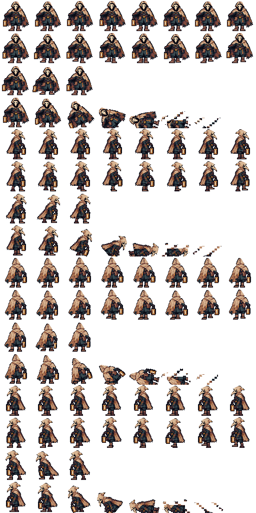

[Fuente editable del Coleccionista](../Media/Avance_2026-11-04/Spritesheets/Coleccionista.aseprite).

| Animación | Cuatro direcciones |
| --- | --- |
| Reposo |  |
| Marcha |  |
| Dash | 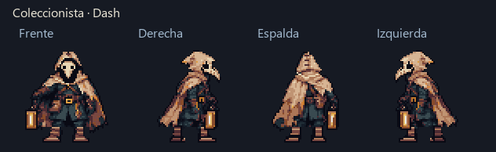 |
| Muerte | 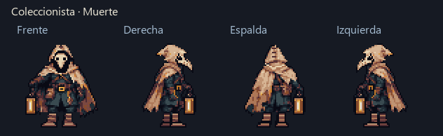 |

## Residual: Esqueleto

Es la masa básica de la horda. Su representación actual es un esqueleto animado en cuatro direcciones. La marcha acompaña la persecución y el ataque acompaña el contacto; impacto y muerte permiten reconocer la respuesta al daño.

Su atlas tiene 144 fotogramas de 96 × 96: reposo, marcha y ataque de ocho, impacto de cuatro y muerte de ocho por dirección.

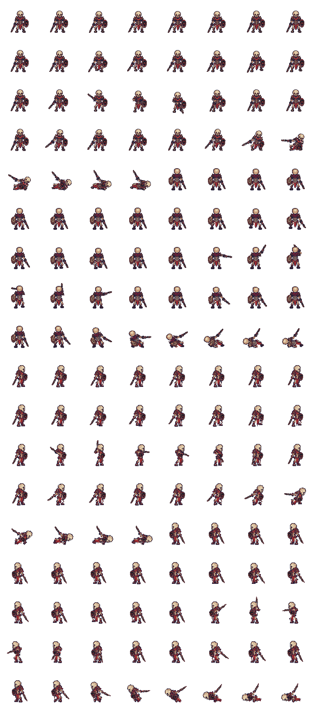

[Fuente editable](../Media/Avance_2026-11-04/Spritesheets/Esqueleto.aseprite).

| Animación | Cuatro direcciones |
| --- | --- |
| Reposo | 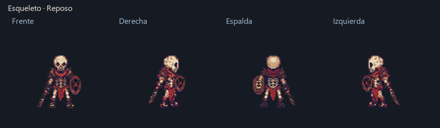 |
| Marcha |  |
| Ataque |  |
| Impacto recibido | 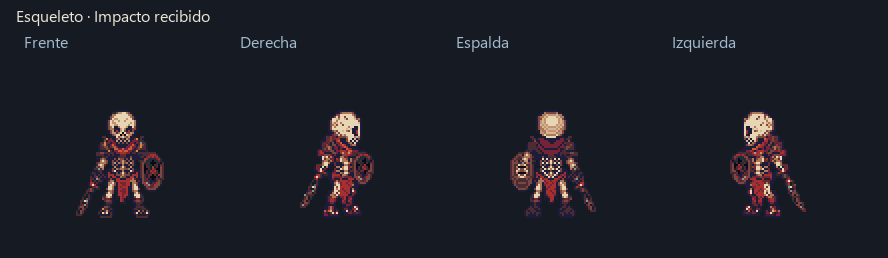 |
| Muerte |  |

## Interceptor: galgo de chatarra

Es el perseguidor rápido de la horda. El galgo de chatarra sustituye su antigua representación geométrica. Su silueta baja y la marcha rápida distinguen la persecución del Residual.

El atlas tiene 152 fotogramas de 96 × 96: reposo de seis, marcha de doce, ataque de seis, impacto de cuatro y muerte de diez por dirección. El sprite de galgo sustituye su representación geométrica anterior.

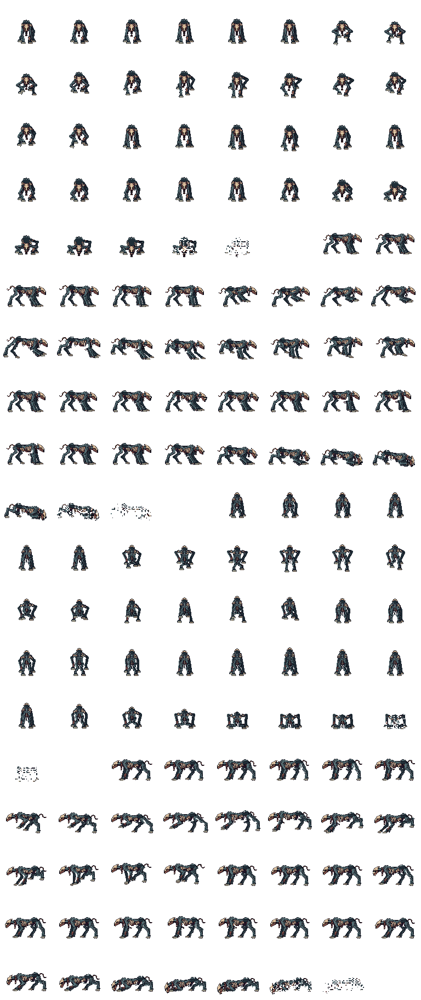

[Fuente editable](../Media/Avance_2026-11-04/Spritesheets/Interceptor.aseprite).

| Animación | Cuatro direcciones |
| --- | --- |
| Reposo | 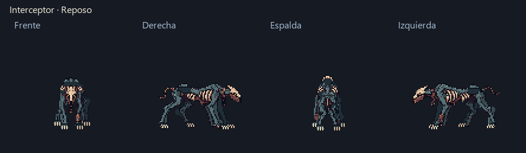 |
| Marcha | 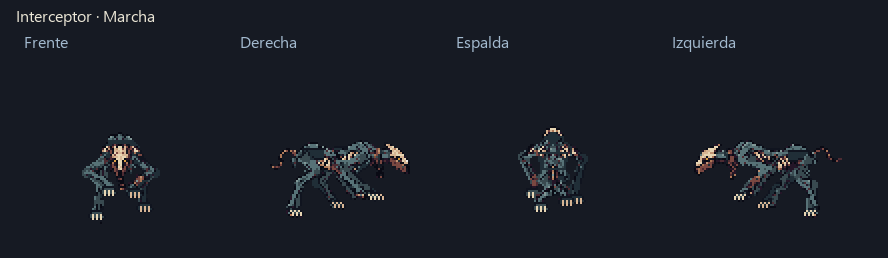 |
| Ataque | 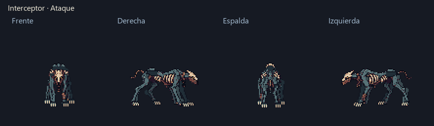 |
| Impacto recibido | 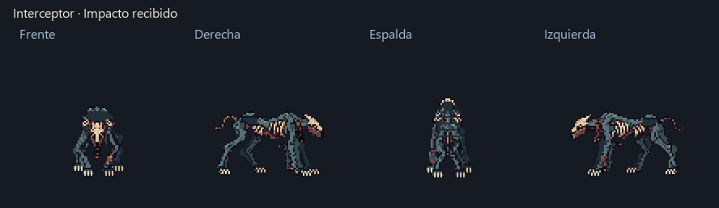 |
| Muerte | 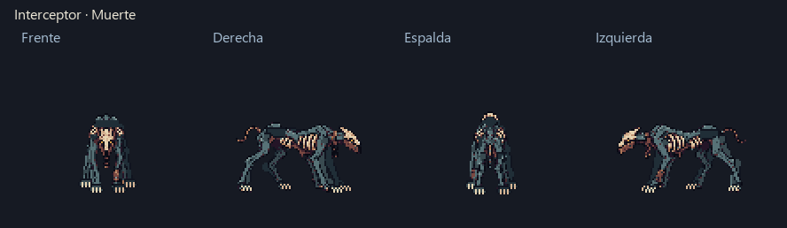 |

## Coloso: Wendigo

Es el enemigo pesado que abre corredores con su embestida. El sprite de Wendigo acompaña la marcha, la preparación, la carga y la recuperación; cada estado tiene su propio ciclo para que se lea la secuencia del ataque.

El atlas de Wendigo tiene 200 fotogramas de 96 × 96: reposo, marcha y preparación de ocho; embestida y recuperación de seis; impacto de cuatro y muerte de diez por dirección.

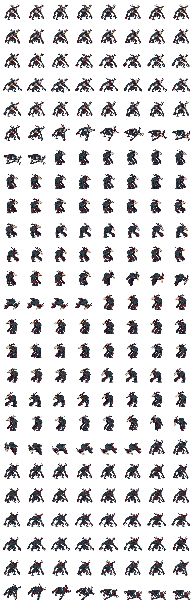

[Fuente editable](../Media/Avance_2026-11-04/Spritesheets/Wendigo.aseprite).

| Animación | Cuatro direcciones |
| --- | --- |
| Reposo |  |
| Marcha | 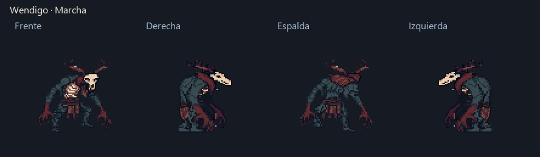 |
| Preparación de carga | 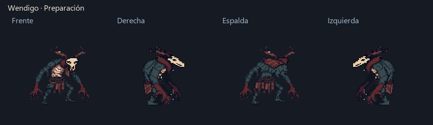 |
| Embestida | 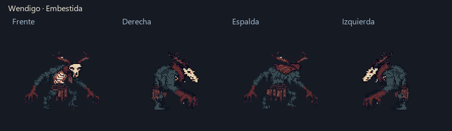 |
| Recuperación | 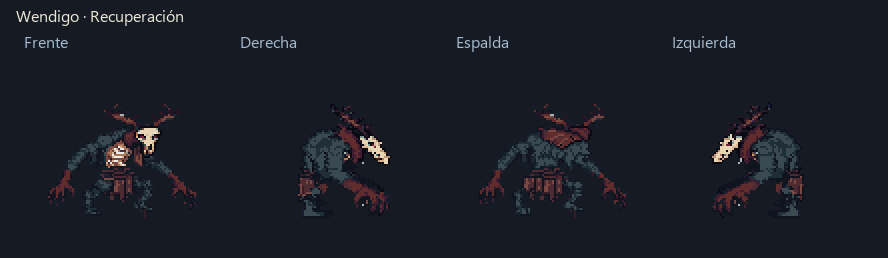 |
| Impacto recibido | 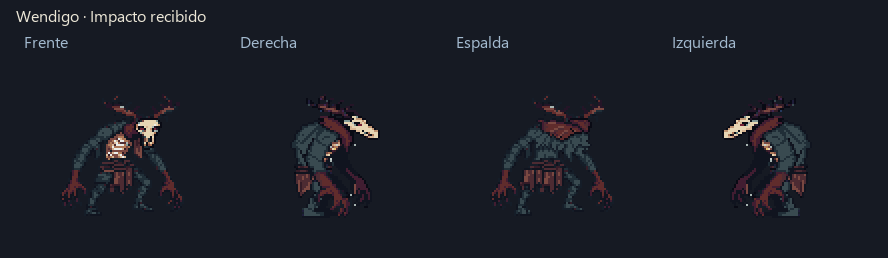 |
| Muerte | 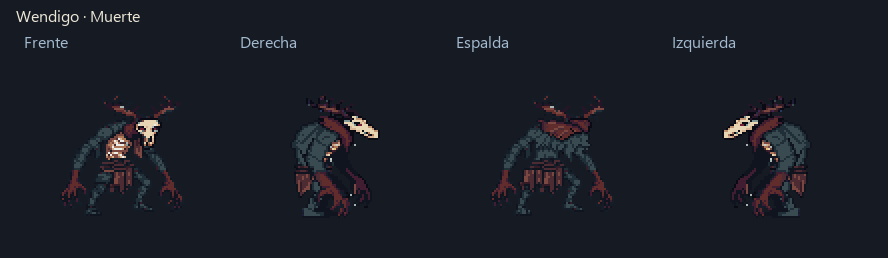 |

## Mortero: Campana

Es la artillería de la horda. Su cuerpo de campana flotante encadena flotación, carga del emisor, disparo y recuperación. El proyectil y el charco de ácido se añaden durante la ejecución en Unity.

Su atlas contiene 112 fotogramas de 64 × 64: flotación y carga de seis, disparo y recuperación de cuatro, y muerte de ocho por dirección.

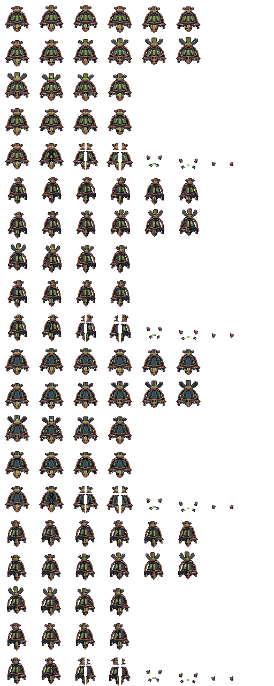

[Fuente editable](../Media/Avance_2026-11-04/Spritesheets/Mortero.aseprite).

| Animación | Cuatro direcciones |
| --- | --- |
| Flotación | 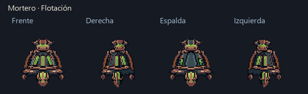 |
| Carga del emisor | 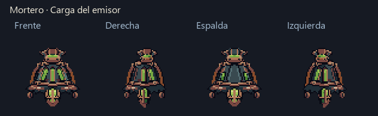 |
| Disparo | 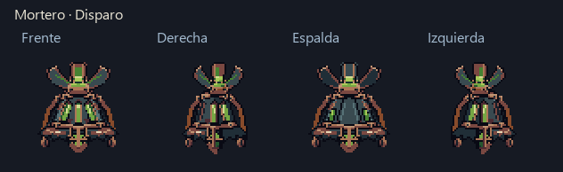 |
| Recuperación | 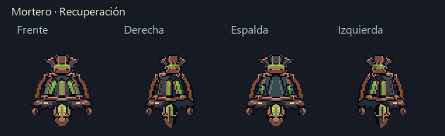 |
| Muerte | 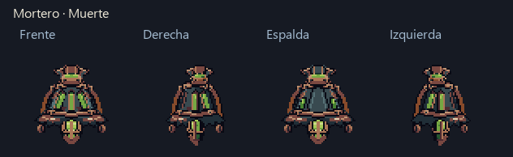 |

## Polilla: Reactor

Es el enemigo explosivo de la horda. Su presentación distingue el vuelo de aproximación, el cebado de la mecha y el estallido. Vuelo y cebado tienen cuatro vistas; el estallido es compartido.

Su atlas tiene 62 fotogramas de 64 × 64: vuelo de ocho y cebado de seis por dirección, más seis de estallido compartido.

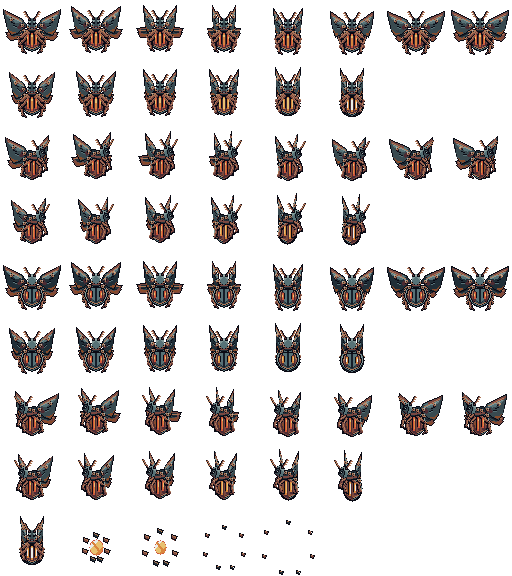

[Fuente editable](../Media/Avance_2026-11-04/Spritesheets/PolillaReactor.aseprite).

| Animación | Cuatro direcciones |
| --- | --- |
| Vuelo | 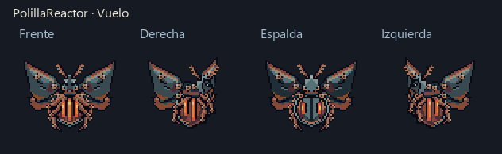 |
| Cebado | 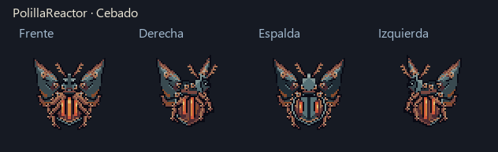 |
| Estallido compartido | 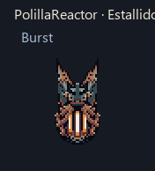 |

## Caballero Fantasma

Élite de barrido sobrenatural y resistencia al daño físico. Su presentación jugable documentada todavía usa geometría de personaje y un efecto animado para el barrido.

**Pendiente: integrar el sprite en Unity.** El arte del personaje está preparado, pero falta conectar sus ciclos a la locomoción, preparación, ataque, recuperación, impacto y muerte del enemigo. Después de esa conexión se incorporarán aquí el atlas y los GIFs verificados dentro del juego.

La captura del montaje geométrico conservada en [[03 - Enemigos y NPC]] corresponde al 4 de noviembre. Sirve como referencia de combate; no valida la integración del nuevo sprite.

## Centinela de Cobre: gólem

Élite pesado de proyectiles físicos y resistencia al daño sobrenatural. El gólem se denomina Centinela de Cobre en los ajustes del juego. Su ataque abre una ventana de vulnerabilidad durante la recuperación.

**Pendiente: integrar el sprite en Unity.** El arte está preparado, pero falta conectar los ciclos del cuerpo y la secuencia de apertura, preparación, disparo, vulnerabilidad y cierre con los estados del enemigo. Después de esa conexión se incorporarán aquí el atlas y los GIFs verificados dentro del juego.

La captura del montaje geométrico conservada en [[03 - Enemigos y NPC]] corresponde al 4 de noviembre. El efecto animado de los misiles pertenece a los VFX y no confirma que el sprite del cuerpo esté integrado.

## Gólgora: MataColeccionista

Es el jefe de la expedición. Su cuerpo pesado, arma y magma se representan con un modelo 3D animado integrado. Sus recursos de magma son efectos propios; el personaje no utiliza un spritesheet 2D.

### Ataques dentro de la arena

Las siguientes capturas de Unity son del 4 de noviembre de 2026. Cada patrón se invocó de forma aislada, con jugador protegido, cámara de detalle y oleadas detenidas. La lluvia corresponde a la segunda fase. Permiten observar el modelo y sus efectos durante el ataque.

| Ataque en Unity | Registro |
| --- | --- |
| Martillazo | 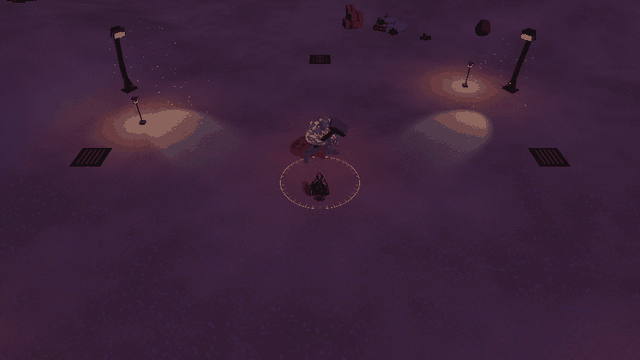 |
| Barrido | 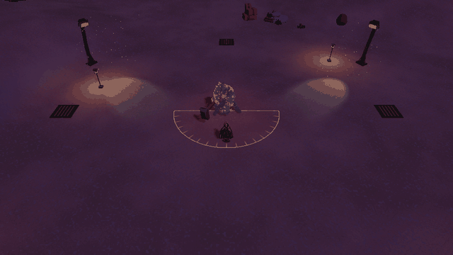 |
| Bombardeo |  |
| Cerco y salto central | 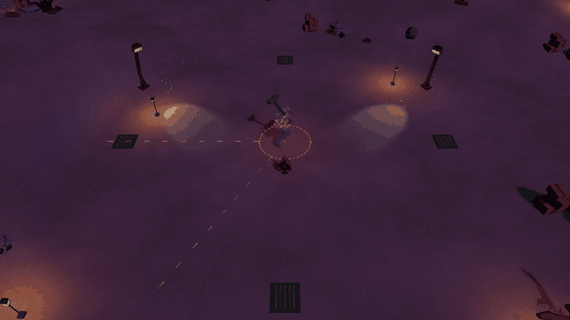 |
| Fisura | 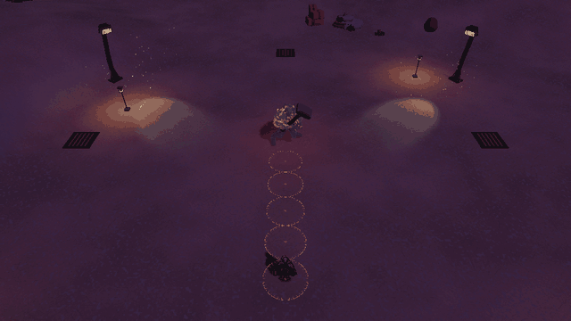 |
| Lluvia de segunda fase | 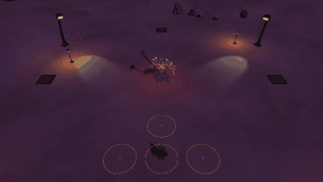 |

Los daños, tiempos, fases, refuerzos y reglas de cierre están en [[03 - Enemigos y NPC]]. Los efectos de ataques y mejoras se reúnen en [[06 - Registro visual]].

> **Navegación:** [[00 - Índice]] · [[00 - Avance jugable]]
