# Entornos

El Vertedero ocupa `200 × 200 m` de relieve, restos industriales, rocas y árboles. Las colisiones participan en las rutas del jugador y de los enemigos. El acceso a la bóveda se encuentra al norte (`x = 0, z = 78`) y desciende hasta el portal.

El centro contiene la caldera de Gólgora (`22 m` de radio), con perímetro que se cierra durante el encuentro, avisos para refuerzos y materiales que responden a su activación. Los ataques aportan ondas, impactos, meteoros y zonas de magma. Las tres zonas de lava fija del mapa están desactivadas en el montaje actual.

La iluminación exterior utiliza un perfil compartido de luz, atmósfera y enfoque. La niebla y los haces acompañan los puntos luminosos sin sustituir los contornos que anuncian daño.

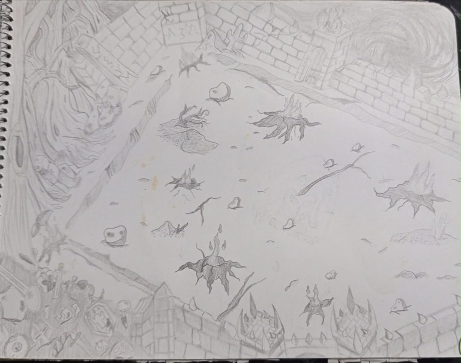

*Boceto conceptual del exterior: el perímetro reúne fragmentos de distintos mundos colapsados (murallas de piedra, raíces gigantes, cúmulos de armas y escudos, grietas en el terreno y el vórtice del portal al norte).*

## La Bóveda (Almacén del Coleccionista)

La bóveda modular ocupa una sala separada dentro de la misma escena, articulada en dos niveles mediante rampas laterales para alojar sus **10 pedestales físicos** (equivalentes al límite de **10 unidades** de la colección):

- **Balcón superior (puestos 1 a 3):** contiene los tres pedestales de equipo activo con rótulos 3D flotantes **`EQUIPO 1`**, **`EQUIPO 2`** y **`EQUIPO 3`**.
- **Planta inferior (puestos 4 a 10 y máquina central):** contiene los siete pedestales de exposición/reserva, la máquina de fusión en el centro y el portal de salida hacia la arena.

La cámara interior emplea una inclinación de `32°` y campo de visión de `65°`, con límites de seguimiento ajustados al recinto, mientras el HUD superpone las tarjetas direccionales (`VaultDirections`), el acceso al Índice de Colección (`ÍNDICE · [I]`) y el panel de consejos (`VaultTips`).

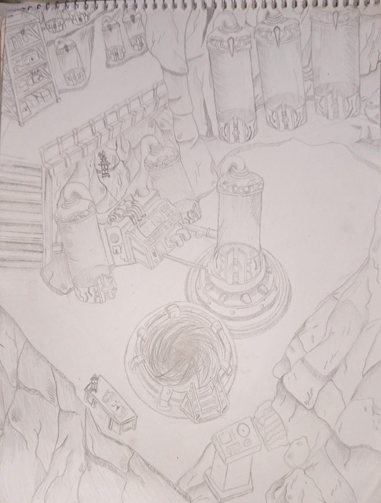

*Boceto conceptual del almacén: cápsulas cilíndricas de contención para las entidades, consola y cámara central de la máquina de fusión, escaleras de acceso y el portal circular en el suelo.*

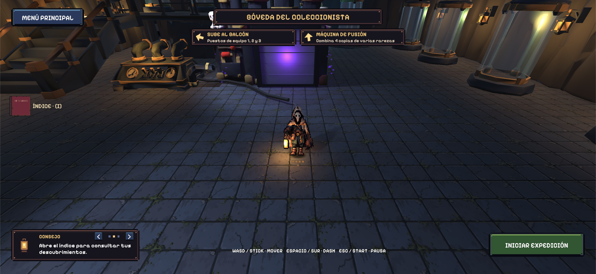
*Captura de la Bóveda en la versión final (`b381ef4`), mostrando las tarjetas direccionales superiores (`VaultDirections`), el botón superior izquierdo `ÍNDICE · [I]`, los rótulos 3D de pedestales `EQUIPO 1..3` y el panel de consejos rotatorio `CONSEJO` (`VaultTips`).*

La máquina de fusión combina cámara de resultado, persiana móvil, aura de partículas y efectos de humo al abrirse tras completar su cuenta atrás de `30 s` (`00:30`).

## Galería de bocetos conceptuales de elementos del juego

Diseños conceptuales dibujados a mano durante la preproducción de los elementos de entorno, mecánicas e interfaz de *EchoScrap*, resguardados en `Media/ConceptArt/Elementos/`.

| Elemento | Boceto conceptual a mano |
| --- | --- |
| **El Vertedero (Arena exterior)** | 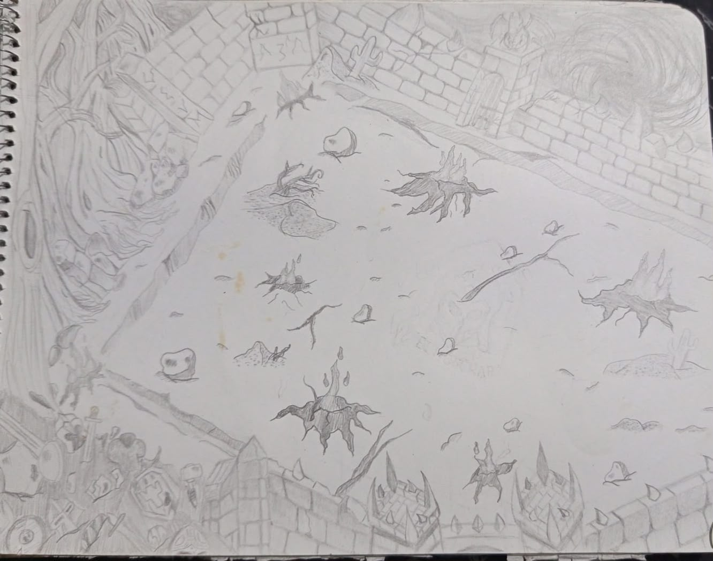 |
| **La Bóveda (Almacén)** | 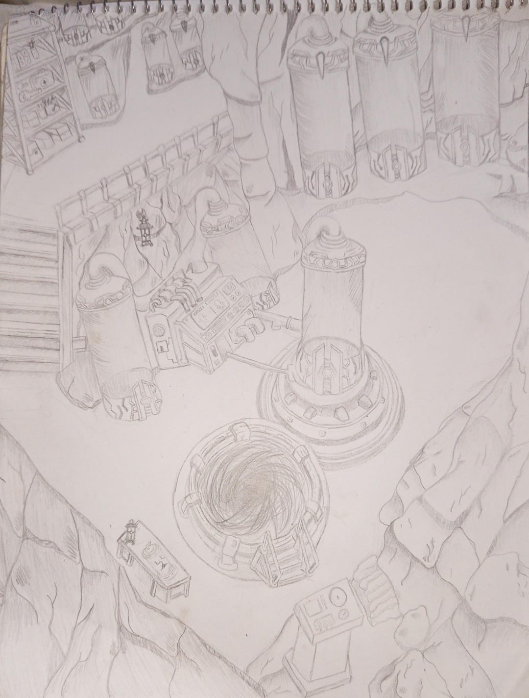 |
| **Portal Dimensional** | 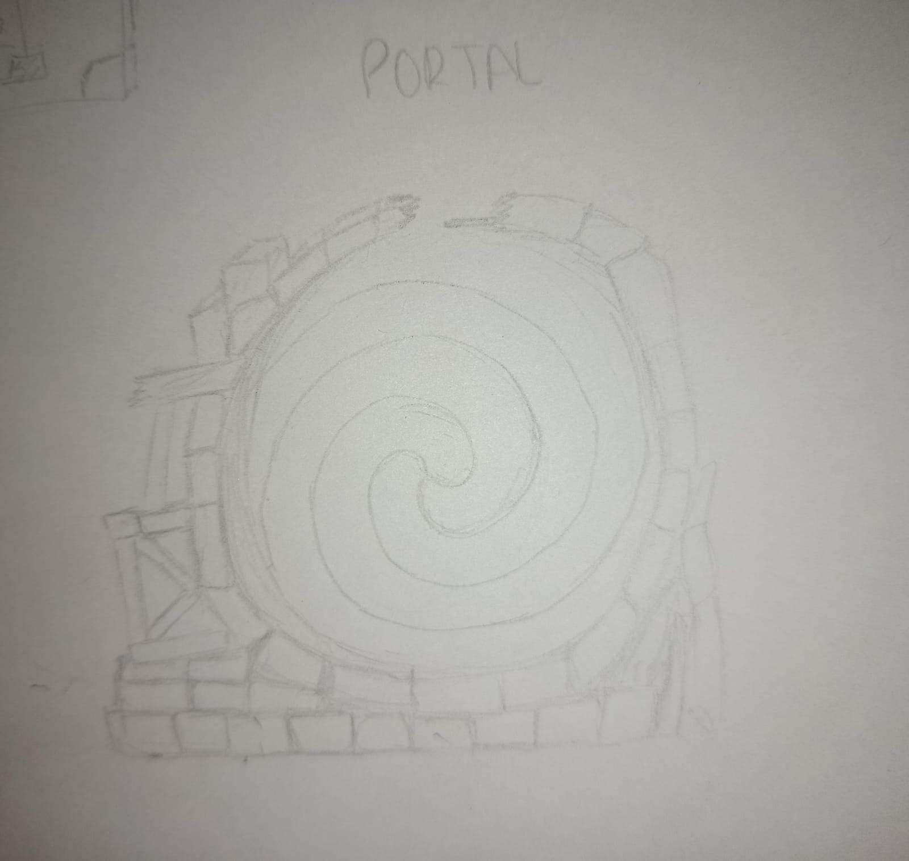 |
| **Máquina de Fusión** | 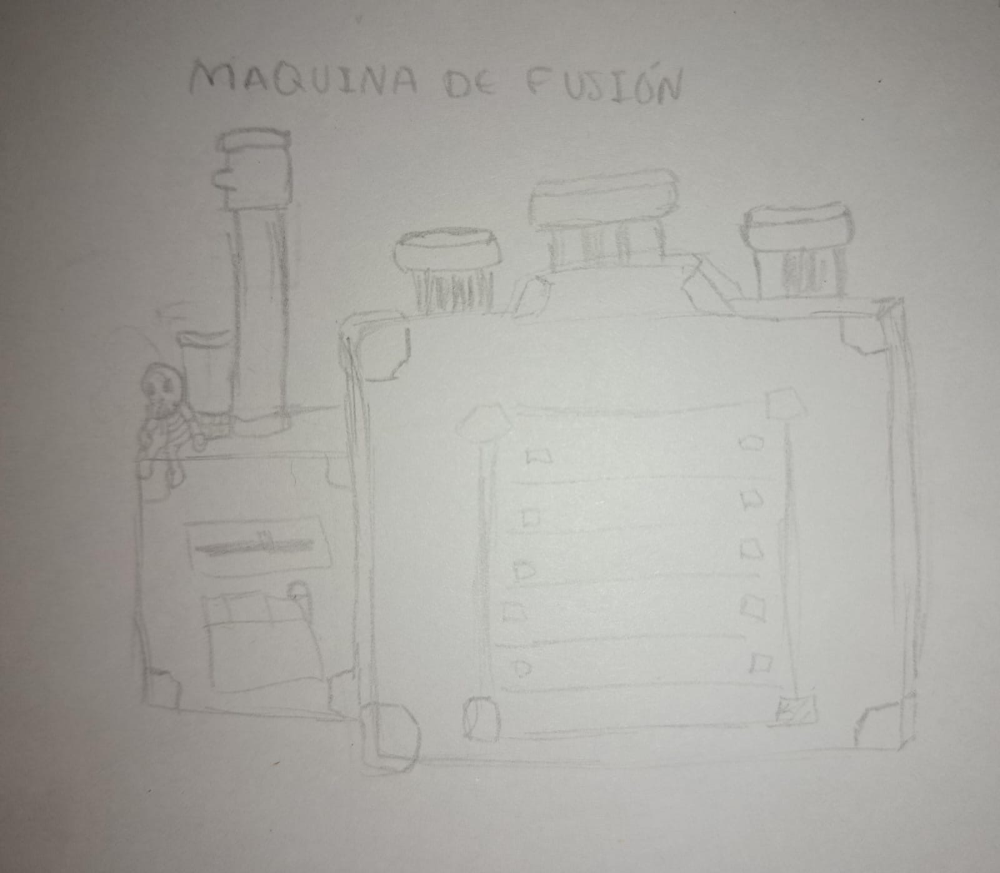 |
| **Libro del Bestiario (Índice de Colección)** | 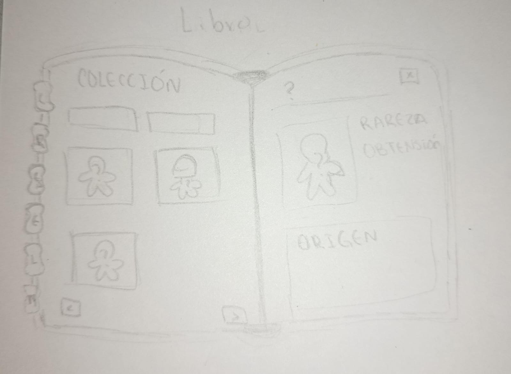 |
| **Menú de Pausa y Ajustes** | 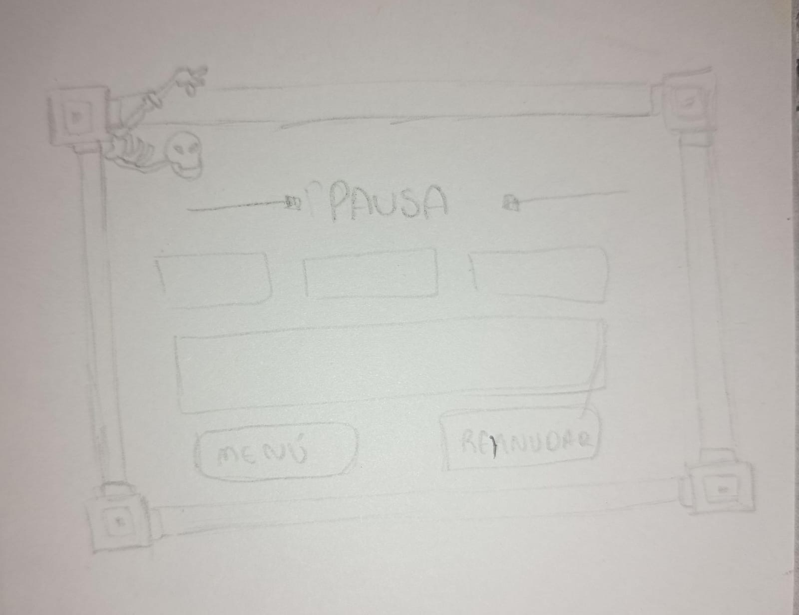 |
| **Elementos del entorno e interfaz (Lámina 1)** | 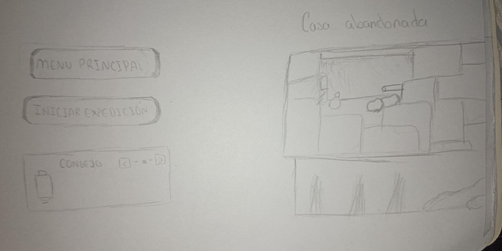 |
| **Elementos del entorno e interfaz (Lámina 2)** | 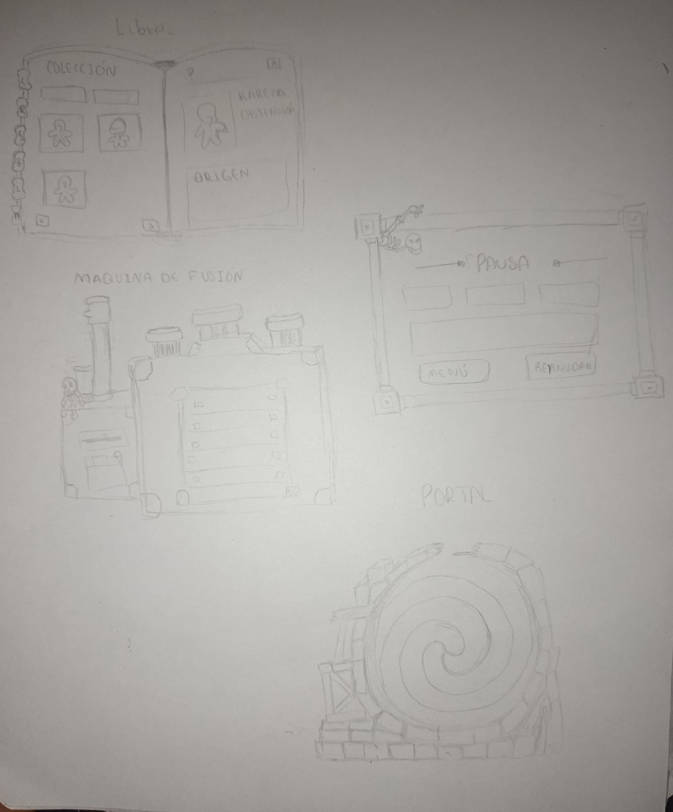 |
| **Elementos del entorno e interfaz (Lámina 3)** | 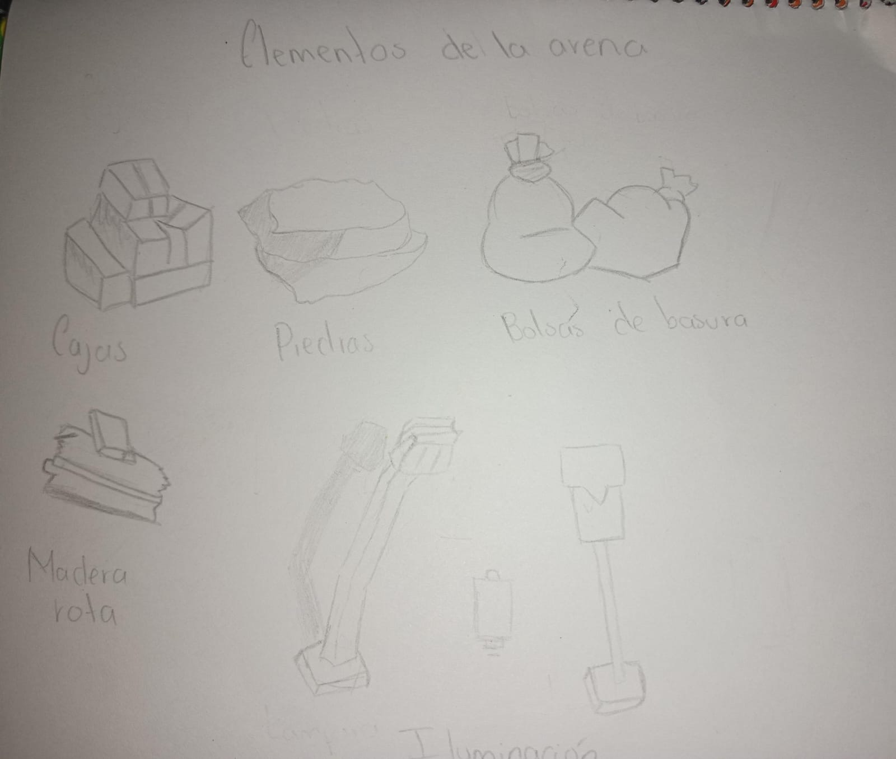 |
| **Elementos del entorno e interfaz (Lámina 4)** | 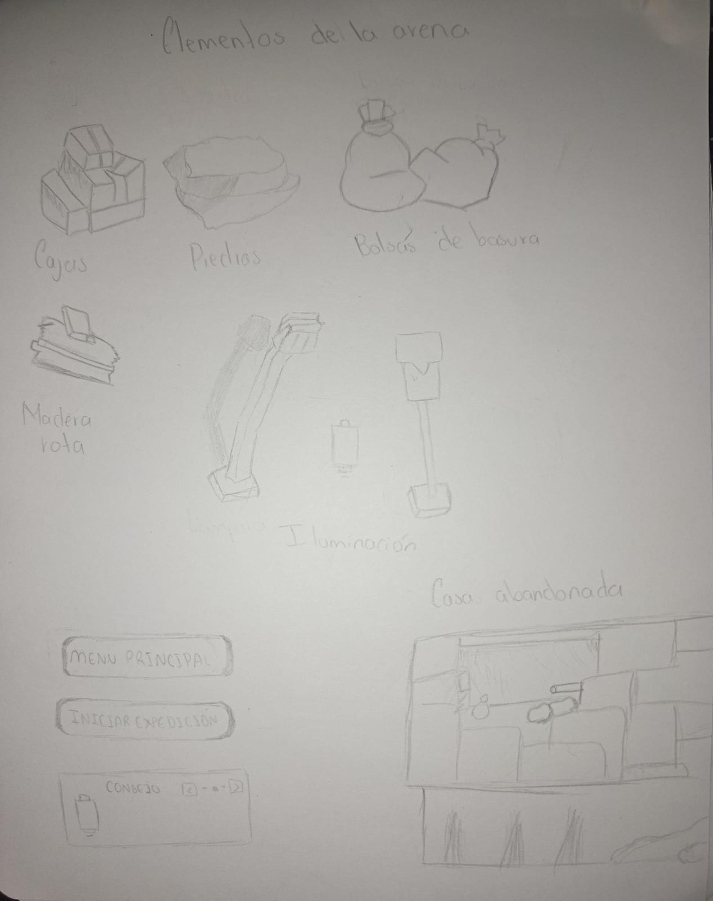 |

> **Navegación:** [[00 - Índice]] · [[00 - Avance jugable]]
