# Interfaz visual

## Tipografía unificada (`Pixelify Sans`)

Toda la interfaz del juego utiliza de manera unificada la familia tipográfica **`Pixelify Sans`** (`PixelifySans-Regular.ttf` y `PixelifySans-SemiBold.ttf`, configurada en `Typography.asset`, `UpgradeCardSkin.asset` y los generadores de interfaz en código), abarcando menús, HUD de combate, cartas de mejora, paneles de la bóveda, Índice de Colección y números flotantes de daño.

## Menú inicial y selección de ronda

El menú inicial utiliza un portal animado, entidades de la colección en órbita y botones para **Continuar**, **Nueva colección**, **Configuración** y **Salir**. Al elegir **Nueva colección**, el modal `¿NUEVA COLECCIÓN?` incluye el campo **`NOMBRE DEL JUGADOR (RANKING)...`** (máximo `20` caracteres visibles, reservado en línea mediante `GamertagRegistry` y sincronizado con `EventLeaderboardSync`, o vacío para práctica). La transición al mundo presenta una pantalla de carga con animación del Coleccionista.

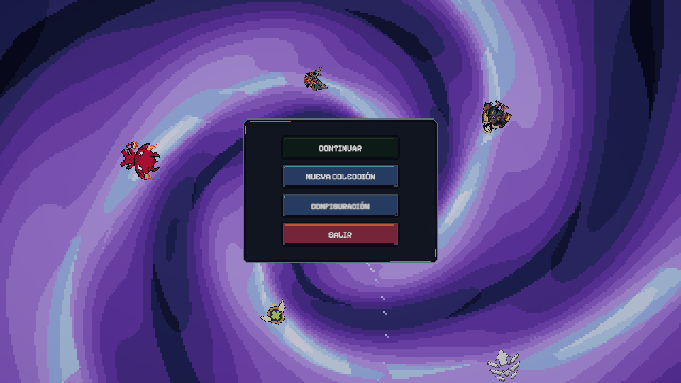

Al acercarse al portal de la bóveda se abre la selección de ronda (**`ELIGE LA RONDA`** — *"Elige una ronda para comenzar."*) con las opciones **`RONDA DEMO`** (`3:00`), **`RONDA COMPLETA`** (`8:00`) o **`SALIR`** (sin campo de nombre, pues el alias de ranking se define al crear la colección). Su confirmación reproduce una animación de entrada y un rugido antes del despliegue en la arena.

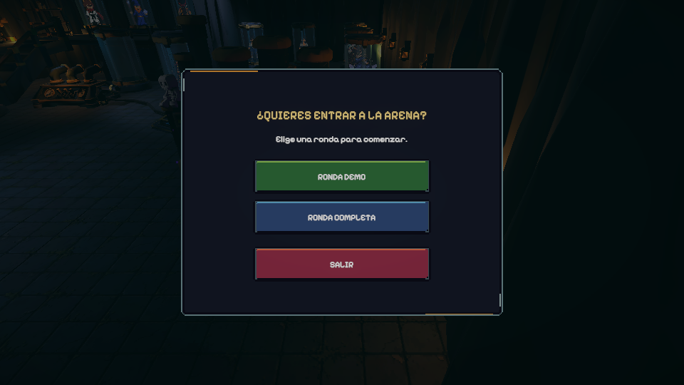

## Interfaz de la bóveda, Índice de Colección y fusión

Dentro de la bóveda, el HUD y el escenario proporcionan guía visual constante:

- **Indicadores direccionales superiores (`VaultDirections`):** dos tarjetas en la franja superior con flechas dinámicas (`▲`, `▼`, `◄`, `►`, `●`) que apuntan hacia la **Máquina de Fusión** (*"MÁQUINA DE FUSIÓN · Combina 4 copias de varias rarezas"*, *"BAJA A FUSIÓN"* o *"E · MÁQUINA DE FUSIÓN"*) y hacia los **Puestos de Equipo** (*"SUBE AL BALCÓN · Puestos de equipo 1, 2 y 3"*, *"EQUIPAR ENTIDADES"* o *"PUESTO 1..3 · EQUIPAR/EDITAR"*).
- **Rótulos 3D y avisos de pedestal:** los tres puestos del balcón muestran en el mundo **`EQUIPO 1`**, **`EQUIPO 2`** y **`EQUIPO 3`** (o `· RESERVA` si están vacíos y exhiben una copia de reserva), con aviso **`E · EQUIPAR`**, **`E · LIBERAR`** o **`E · EDITAR`** (`T` para desequipar rápido en teclado), mientras que los puestos ocupados de la planta baja muestran **`E · LIBERAR`** (que abre el modal **`LIBERAR UNIDAD`** con botones `CANCELAR` y `LIBERAR`).
- **Panel de consejos (`VaultTips`):** tarjeta en la esquina inferior izquierda con la etiqueta **`CONSEJO`** que rota automáticamente cada `8 s` entre *"Equipa coleccionables antes de ir a la arena."*, *"Abre el índice para consultar tus descubrimientos."* y *"Combina cuatro coleccionables en la máquina de fusión."* (o prioriza *"Pulsa E frente a un puesto para equipar tu primer coleccionable."* cuando el jugador tiene copias pero aún no ha equipado ninguna).
- **Índice de Colección (`VaultCollectionIndex.cs`, tecla `[I]`):** accesible mediante `I` o el botón superior izquierdo **`ÍNDICE · [I]`**. Presenta el encabezado **`ÍNDICE DE COLECCIÓN`** con el contador **`{descubiertos} / 15 DESCUBIERTOS · {en posesión} / 10 UNIDADES`**, dos pestañas (**`POR RAREZAS`**, con el filtro **`TODAS`** más las 6 categorías de rareza y siluetas negras **`???`** / `NO ENCONTRADO` / `SILUETA BLOQUEADA` para las no descubiertas, y **`EN TU BÓVEDA`**, que distingue `EN EQUIPO ACTIVO` y `EN BÓVEDA`), un inspector lateral derecho con el poder de compañero y el botón **`CERRAR · [I]`**.
- **Selector de acompañantes (`CompanionView`):** al pulsar `E` en los puestos 1 a 3 del balcón se abre `PUESTO DE EQUIPO 1/2/3 · ELIGE UNA ENTIDAD DESCUBIERTA PARA ESTE PUESTO`, con retratos enmarcados por rareza, la nota de poderes acumulables (*"Los poderes se acumulan por copia equipada."*) y barra inferior con tres botones: **`QUITAR DEL PUESTO`**, **`LIBERAR COPIA`** y **`CERRAR · E / ESC`**.
- **Estación de fusión (`FusionStationUI`):** ventana principal con **4 ranuras en fila horizontal** (`Espacio_0` a `Espacio_3`), temporizador fijo **`TIEMPO DE FUSIÓN  00:30`**, botón superior derecho **`X`**, panel **`POSIBLES RESULTADOS`** actualizado en vivo tanto para misma rareza como para rarezas mixtas (`60%`, `40%`, `1%` en 4 Épicas), botones **`VACIAR`** y **`CONFIRMAR`**, selector de copias (`EN EQUIPO 1/2/3`, `QUITAR INGREDIENTE`, `VOLVER`) y pantalla de resultado con el botón único **`COLECCIONAR`** (o aviso **`INVENTARIO LLENO · LIBERA ESPACIO`** si ya se tienen `10/10` unidades).

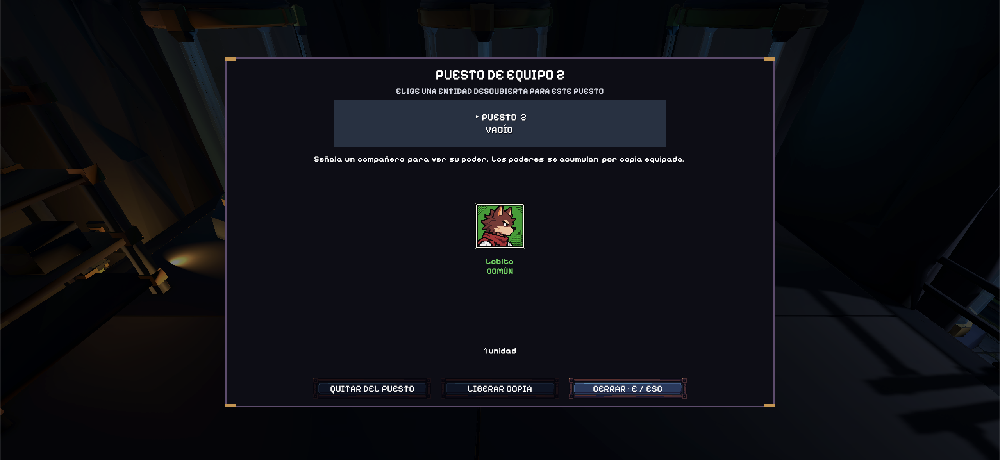
*Selector de acompañantes de la versión final en Unity, con la barra inferior integrada: `QUITAR DEL PUESTO`, `LIBERAR COPIA` y `CERRAR · E / ESC`.*

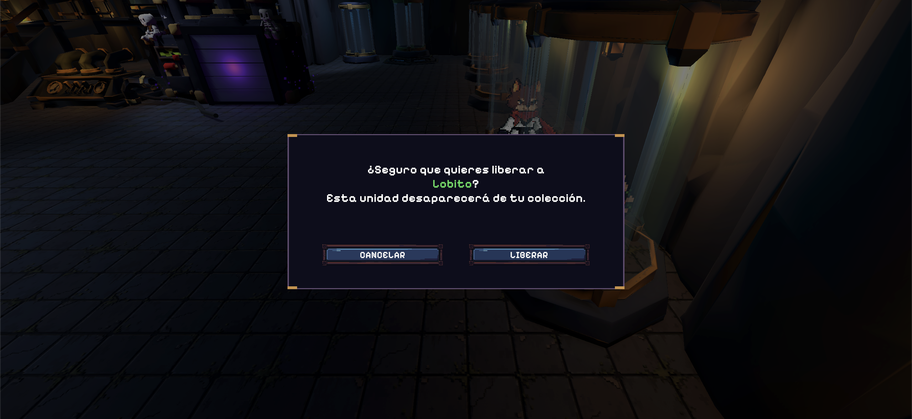
*Modal `LIBERAR UNIDAD` en la Bóveda con opciones `CANCELAR` (`Esc`) y `LIBERAR` (`E` / `Enter` / `Espacio`).*

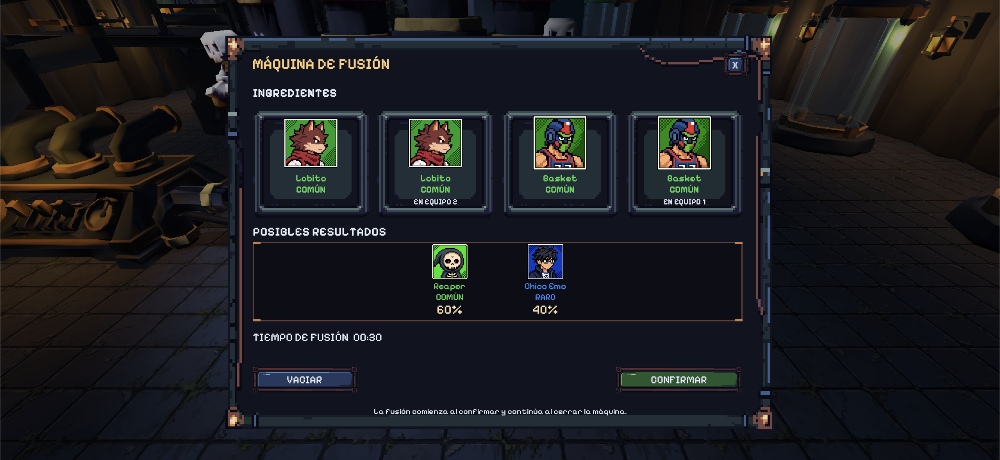
*Ventana de la Máquina de Fusión con sus cuatro ranuras horizontales de ingredientes y desglose de posibles resultados.*

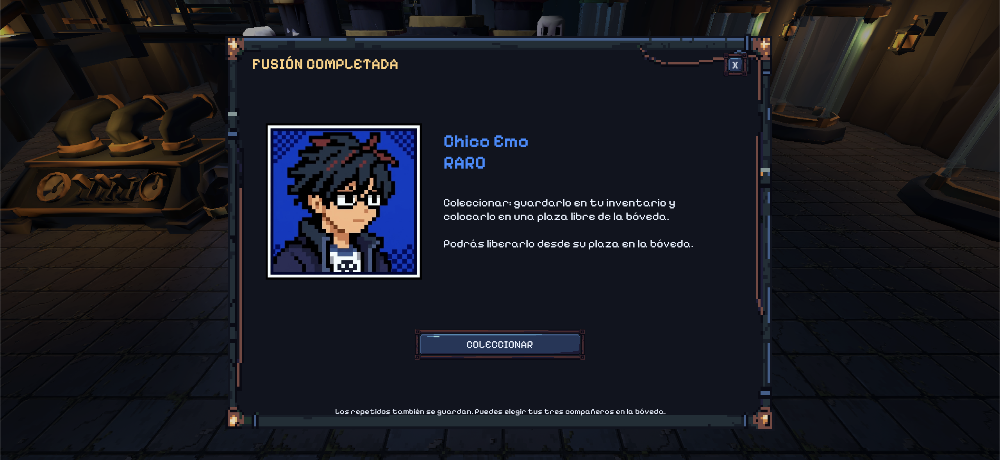
*Pantalla de resultado tras la cuenta atrás de 30 segundos, mostrando la entidad obtenida y el botón único `COLECCIONAR`.*

## HUD de combate, consulta rápida (`Q`) y cartas

El HUD de combate muestra barra de salud, barra de XP y nivel, reloj de incursión, contador de bajas, estado del dash, iconos de mejoras adquiridas, los tres retratos de acompañantes equipados (con insignia de duplicados `×N` y líneas descriptivas de poder si `Atributos de coleccionables` está en `SÍ`) y un minimapa circular con niebla de exploración. Gólgora dispone de su propia barra superior de salud e indicador direccional fuera de pantalla.

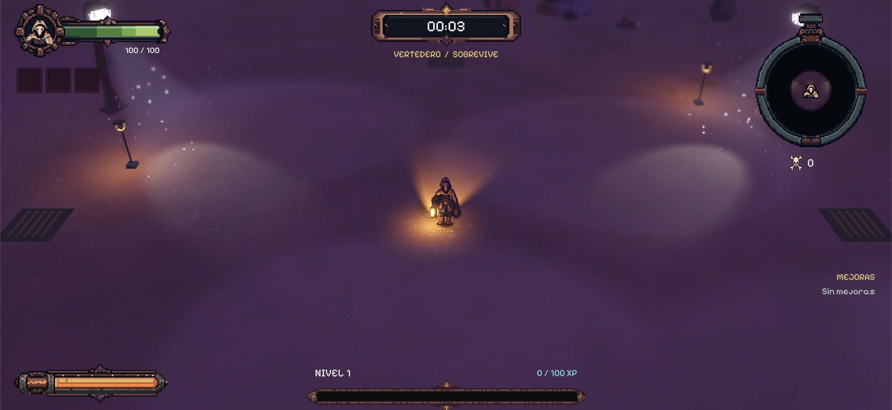

Mantener pulsada la tecla **`Q`** (`CombatHud.IsHudDetailHeld`) despliega temporalmente las **estadísticas completas** (`COMPLETAS`) y las **descripciones de los poderes de los acompañantes equipados**, aunque estén reducidas u ocultas en la configuración.

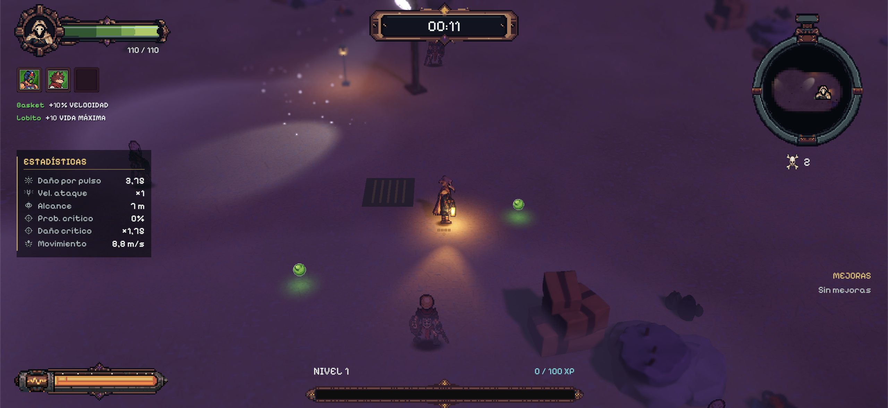
*Despliegue dinámico al mantener `Q` en combate: panel lateral de estadísticas completas y textos de poderes de los 3 acompañantes equipados bajo los retratos.*

Las cartas de subida de nivel presentan marcos por rareza, icono, nombre, nivel actual/máximo, tipo de daño y progresión de valores, además del botón de reintento cuando se dispone de *Sintonizador*.

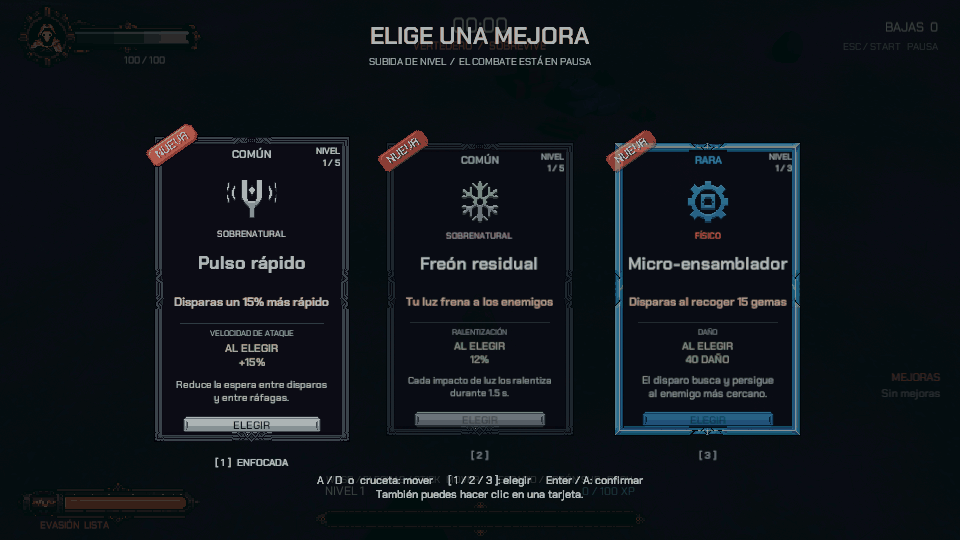

## Configuración, Menú de Pausa en 3 pestañas y resultados

Tanto **`CONFIGURACIÓN`** en el menú inicial como **`PAUSA`** (`Esc` / `Start` durante la partida o en la bóveda) comparten el panel unificado **`MenuSettingsView.cs`**, estructurado en **3 pestañas** más los botones inferiores de acción:

1. **`General`:** deslizadores **`Movimiento de cámara`** (`0%` a `100%`, `ScreenShakeScale`) y **`Efectos decorativos`** (`0%` a `100%`, `VfxDensityScale`), más la casilla **`Efectos reducidos`** en el menú principal.
2. **`Interfaz`:** selector **`Estadísticas generales`** (**`COMPLETAS`**, **`REDUCIDAS`**, **`OCULTAS`**) y selector **`Atributos de coleccionables`** (**`SÍ`** / **`NO`**, `ShowCompanionPowers`).
3. **`Sonido`:** deslizadores **`Volumen general`** (`0%` a `100%`, guardado en `EchoScrap.Audio.MasterVolume`) y **`Música`** (`0%` a `100%`, guardado en `EchoScrap.Audio.MusicVolume`).

En pausa, los botones inferiores permiten **`CONTINUAR`** y **`VOLVER AL MENÚ`** (desde la bóveda) o **`VOLVER A LA BÓVEDA`** (durante una incursión en la arena).

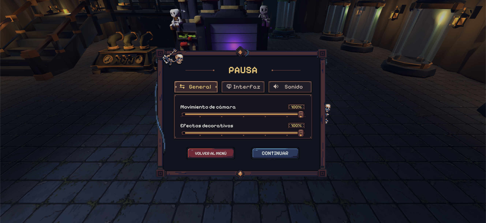
*Menú de Pausa (`Esc` / `Start`) en la versión final: pestañas `General`, `Interfaz` y `Sonido` con deslizadores y botones de acción.*

La pantalla de resultados muestra victoria o derrota, tiempo sobrevivido, nivel, bajas y XP, sincroniza la sesión con el ranking de Firebase (`EventLeaderboardSync`) y ofrece el botón **`VOLVER A LA BÓVEDA`**.

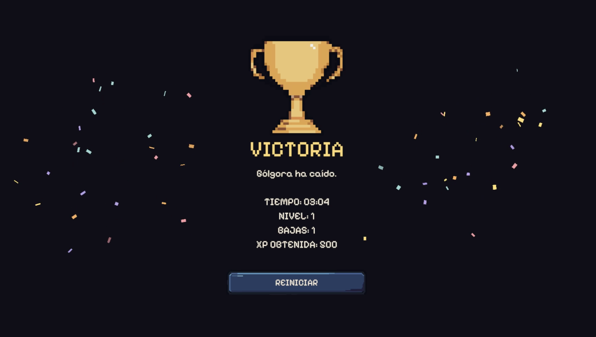

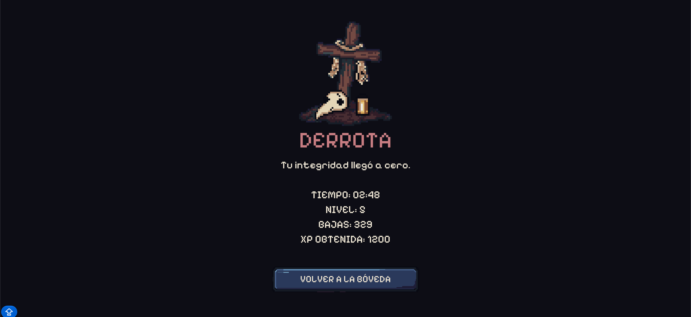

> **Navegación:** [[00 - Índice]] · [[00 - Avance jugable]]
