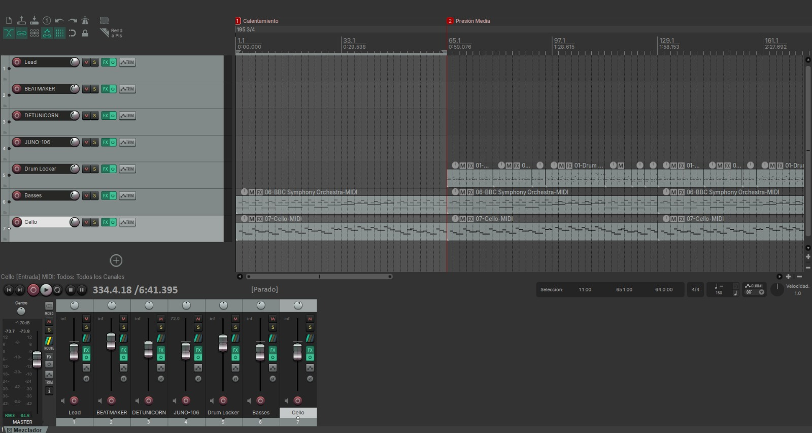
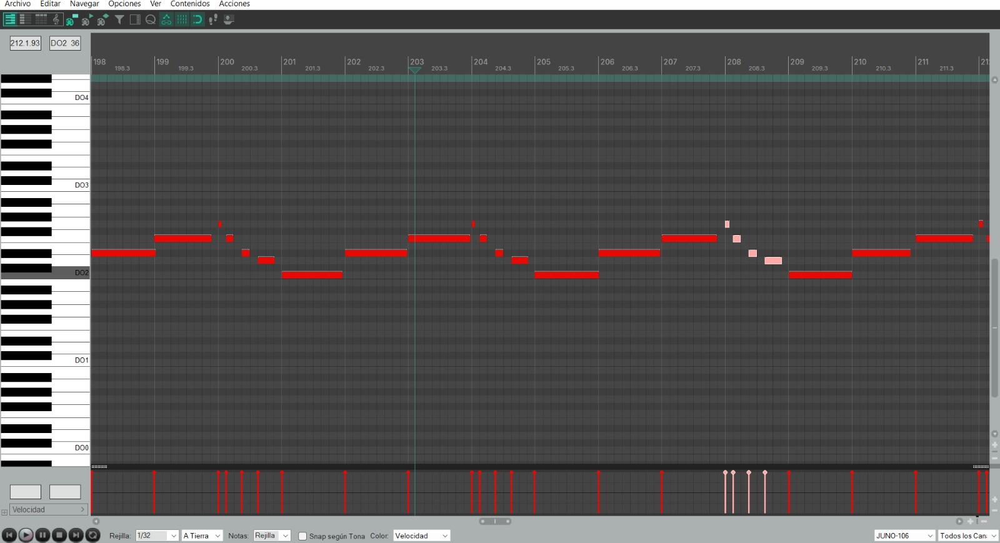
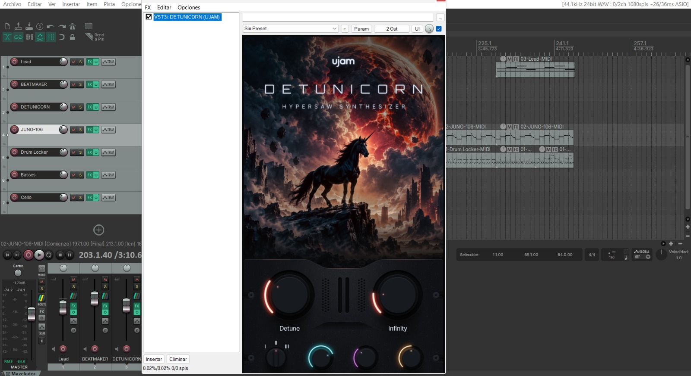
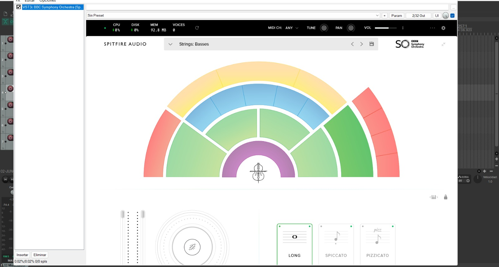

# Audio y música

El juego ya tiene música y efectos integrados. El área sonora acompaña el lugar, los ataques y las acciones del Coleccionista.

| Contexto | Audio presente |
| --- | --- |
| Menú principal | Pista ambiental introductoria con sintetizadores y una dinámica moderada y constante ([Menu.mp3](../Media/Audio/Menu.mp3)). |
| Bóveda | Pista atmosférica propia, orientada a la calma con un matiz de suspenso previo a la incursión; se detiene al salir hacia el combate o al menú ([Boveda_Almacen.mp3](../Media/Audio/Boveda_Almacen.mp3)). |
| Arena | Pista de combate en bucle ([Partida.mp3](../Media/Audio/Partida.mp3)). En el proyecto de Unity el recurso conserva el nombre de prueba `Arena_combat_Test`. |
| Gólgora | Pista de jefe ([Jefe.mp3](../Media/Audio/Jefe.mp3)) con transición desde la arena y reducción de mezcla (*ducking*) durante el rugido. El recurso sigue identificado como prueba en el motor. |
| Linterna | Inicio de ráfaga, tres variantes de pulso, cuarto pulso, descanso, impacto normal y crítico, activación y bucle solar. |
| Experiencia | Sonido de recogida con variación de tono. |
| Transiciones | Entrada del Coleccionista, llegada por portal y rugido al elegir ronda. |
| Fusión | Sonido de apertura de la cámara al revelar el resultado. |
| Jefe | Rugido, pasos, ataques e impactos mediante sus componentes de audio. |

La música de arena y jefe continúa durante la selección de cartas y la pausa manual. La pérdida de foco de la ventana pausa su reproducción. La bóveda tiene su propia mezcla y las transiciones evitan que siga sonando fuera de su contexto.

La pestaña **`Sonido`** del menú de pausa incorpora dos controles independientes persistidos en `PlayerPrefs`: **Volumen general** (`EchoScrap.Audio.MasterVolume`, `0.85` por defecto), que actúa sobre el volumen global de escucha, y **Música** (`EchoScrap.Audio.MusicVolume`, `0.85` por defecto), aplicado sobre las pistas musicales por `ArenaMusicController` y `CombatMusicPlayer`.

## Música durante el juego

### Menú principal

- **Composición y timbre:** tema sintético con arreglos lentos en tonalidad menor y *pads* oscuros que aportan una atmósfera sombría, incorporando un sintetizador con sutil desafinación (*pitch drift*) para emular el comportamiento orgánico de instrumentos analógicos.
- **Estructura y loop:** bucle continuo de baja actividad rítmica diseñado para evitar fatiga auditiva durante estancias prolongadas en los menús.
- **Género, carácter y métrica:** electrónica de carácter melancólico a `75 BPM` en compás de `4/4`, manteniendo un pulso constante y moderado.
- **Muestra de audio:** [Escuchar pista de Menú principal (Menu.mp3)](../Media/Audio/Menu.mp3)

### Bóveda (Almacén)

- **Composición y timbre:** arreglos pausados en tonalidad menor con reverberación convolutiva amplia y fría que emula la acústica de un hangar o contenedor subterráneo, acompañados de ecos incidentales, *pads* oscuros, bombo, sintetizadores y violín para acentuar el misterio del recinto.
- **Estructura y loop:** bucle continuo con base rítmica marcada que acompaña la preparación y anticipa la entrada hacia la arena.
- **Género, carácter y métrica:** electrónica con sintetizador y cuerdas a `120 BPM` en compás de `4/4`, con un pulso constante que equilibra calma e intriga antes de la expedición.
- **Muestra de audio:** [Escuchar pista de la Bóveda (Boveda_Almacen.mp3)](../Media/Audio/Boveda_Almacen.mp3)

### Arena (Partida)

- **Composición y timbre:** tema en tonalidad mayor que inicia con arreglos contenidos y gana densidad rítmica conforme avanza la incursión para sostener la adrenalina del combate, empleando sintetizadores, bombo para marcar el pulso, bajo, platillos, tarola y piano.
- **Estructura y loop:** bucle continuo de alta actividad rítmica con pulso constante y enérgico.
- **Género, carácter y métrica:** electrónica con sintetizador de carácter enérgico a `120 BPM` en compás de `4/4`.
- **Muestra de audio:** [Escuchar pista de Arena (Partida.mp3)](../Media/Audio/Partida.mp3)

### Jefe final (Gólgora)

- **Composición y timbre:** arreglos de alta intensidad desde el primer compás con un enfoque amenazador que sostiene la tensión durante todo el enfrentamiento en la caldera, utilizando dos capas de sintetizadores, tarola y bombo para marcar el pulso.
- **Estructura y loop:** bucle continuo de alta actividad rítmica y carácter adrenalínico.
- **Género, carácter y métrica:** electrónica pura con sintetizador de timbre brillante, digital y agresivo a `120 BPM` en compás de `4/4`.
- **Muestra de audio:** [Escuchar pista del Jefe final (Jefe.mp3)](../Media/Audio/Jefe.mp3)

## Elaboración e instrumentación digital

Las pistas musicales fueron producidas en estación de trabajo de audio digital (DAW) combinando secuenciación MIDI, síntesis sustractiva/*hypersaw* e instrumentación orquestal virtual:

*Estructura multipista y mezcla de canales de la banda sonora.*

*Secuenciación melódica en piano roll con sintetizador virtual `JUNO-106`.*

*Diseño sonoro y ajuste de desafinación (`Detune`) y frecuencias con el sintetizador `UJAM Usynth DETUNICORN`.*

*Instrumento virtual `Spitfire Audio – BBC Symphony Orchestra` utilizado para incorporar las cuerdas y violines en la ambientación de la Bóveda.*

## Procedencia documentada

La mezcla de la linterna utiliza grabaciones de microondas de `pinto0lucas` y contador Geiger de `cookies+policy`. El archivo `Sources.txt` del proyecto registra sus enlaces, la licencia `CC0` indicada para ambas y las transformaciones realizadas: conversión a mono, selección de clics, capas, envolventes y tonos sintetizados. Los WAV entregados son mono, `44,1 kHz` y `16 bits`.

La integración de una pista no implica que sea una composición final. Los nombres de prueba de arena y jefe se mantienen identificados como tales. La autoría y los recursos de cada incorporación deben conservarse en su registro de fuentes.

Los GIFs de este GDD no contienen audio y sirven para revisar animación y VFX. Como excepción documental, esta sección incluye las cuatro pistas musicales del juego (`Menu.mp3`, `Boveda_Almacen.mp3`, `Partida.mp3` y `Jefe.mp3`); los efectos de sonido (SFX) y su mezcla dinámica se comprueban directamente en el juego.

> **Navegación:** [[00 - Índice]] · [[00 - Avance jugable]]
