# Registro visual

## Procedencia de los medios

Esta edición reúne dos tipos de animación:

- **Previsualizaciones de atlas, 4 de noviembre.** Copias de los PNG activos y GIFs compuestos con sus rectángulos, etiquetas y tiempos JSON. Las acciones de personaje muestran cuatro direcciones a escala 2×, sin interpolación. No incluyen la iluminación ni la simulación del juego.
- **Capturas de Unity, 4 de noviembre.** CombatArena ejecutada desde una copia externa del proyecto, a 960 × 540 y doce imágenes por segundo. Se usaron cámara de detalle, jugador protegido y oleadas detenidas. Los patrones del jefe se invocaron individualmente con sus componentes y ajustes; para la lluvia se activó la segunda fase. Las pantallas de preparación utilizan un inventario de muestra, sin guardar esa colección.

Las capturas corresponden al montaje local basado en 30b88c6. Los PNG mantienen 960 × 540 y los GIFs de Unity se exportan a 640 × 360. La vista de detalle permite leer las animaciones y los efectos; no representa el encuadre de toda una partida ni una medición de rendimiento.

## Enemigos y personajes

[[03 - Enemigos y NPC]] contiene los cinco spritesheets completos y los GIFs por acción de Residual, Interceptor, Coloso, Mortero y Polilla. También muestra el barrido del Caballero, el disparo y vulnerabilidad del Centinela y los seis patrones de Gólgora en Unity. [[02 - Personajes y Animación]] añade el atlas y los cuatro grupos de animaciones del Coleccionista.

## Efectos de enemigos

La biblioteca activa contiene quince clips y 120 fotogramas. La siguiente hoja pertenece a esos efectos, no a los cuerpos de los élites o del jefe.

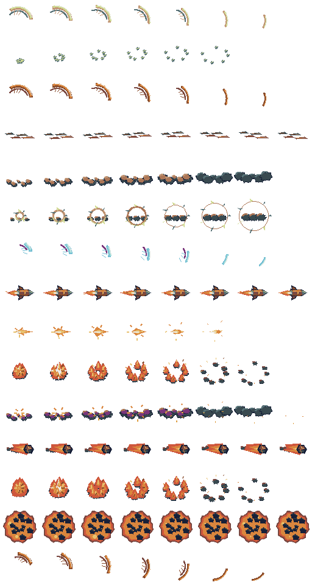

Los GIFs de esta tabla son previsualizaciones del atlas. La iluminación de los misiles, las trayectorias y los avisos de daño se observan en las capturas de los enemigos.

| Efecto | Animación del recurso |
| --- | --- |
| Golpe del Residual | 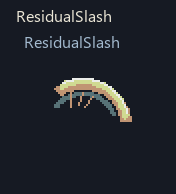 |
| Fragmentos de hueso | 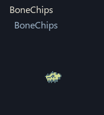 |
| Golpe del Interceptor | 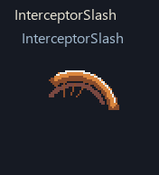 |
| Estela del Interceptor | 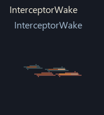 |
| Polvo del Coloso | 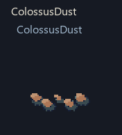 |
| Impacto del Coloso | 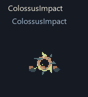 |
| Barrido espectral | 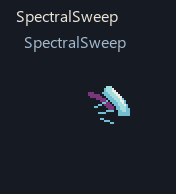 |
| Misil de cobre | 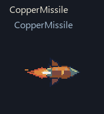 |
| Salida del disparo de cobre | 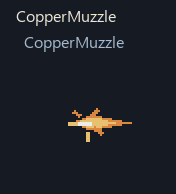 |
| Impacto de cobre | 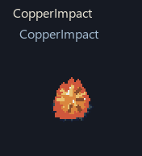 |
| Humo de la Polilla | 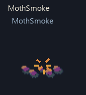 |
| Meteoro de magma | 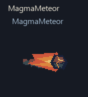 |
| Impacto de magma | 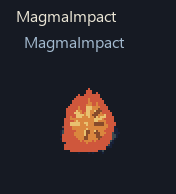 |
| Zona de magma | 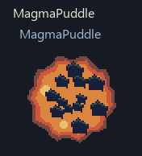 |
| Barrido de magma | 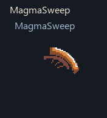 |

## Torreta centinela

La torreta actual usa trípode y cañón separados, orientación del cañón, boca de salida y retroceso. La secuencia de direcciones es una previsualización técnica del recurso preparada el 3 de noviembre; el disparo siguiente se capturó en Unity el 4.

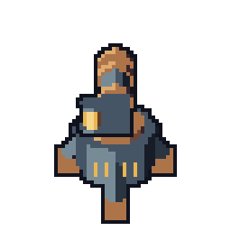

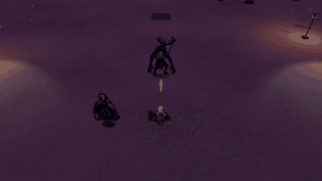

## Efectos de mejoras

Los siguientes GIFs son capturas de Unity del 26 de octubre, conservadas para mostrar efectos de mejoras. Proceden de escenas controladas y recortes de cámara de 1280 × 720. Su fecha y encuadre se mantienen como contexto; no muestran la iluminación exterior renovada de noviembre.

### Prisma voltaico

Los enlaces siguen el cuarto pulso y recorren objetivos sucesivos.

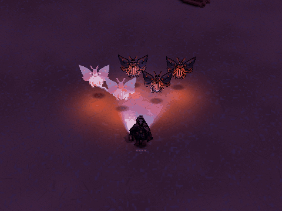

### Frío y congelación

El tinte, cristales y niebla acompañan ralentización y congelación.

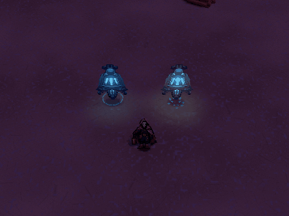

### Minas y explosiones

Expansión, humo y fragmentos acompañan la detonación; el daño lo resuelve la simulación.

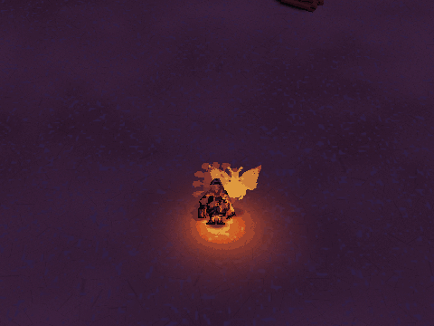

### Nova de plasma

La curación sobrante puede desencadenar la expansión alrededor del jugador.

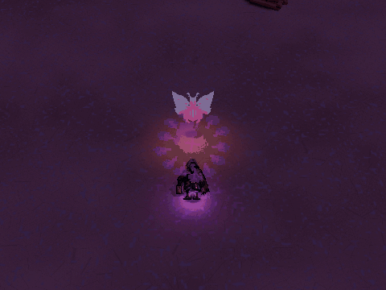

### Nanobots

La superficie de energía y sus ondas acompañan las reglas de regeneración y protección.

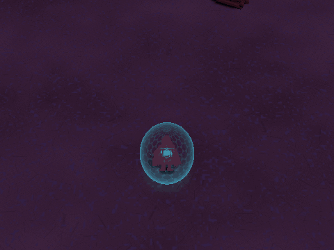

### Sierras orbitales

Las cuchillas, estelas y chispas permiten seguir el giro y sus contactos.

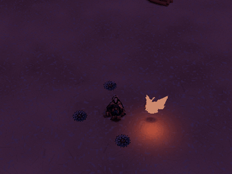

### Pulso colector

Los objetos conservan su valor durante el vuelo y conceden XP o curación al llegar.

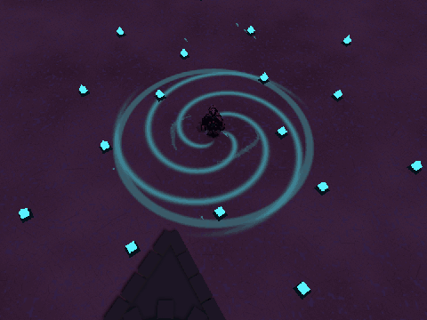

### Onda sísmica

La expansión señala el efecto de daño y control al terminar el dash.

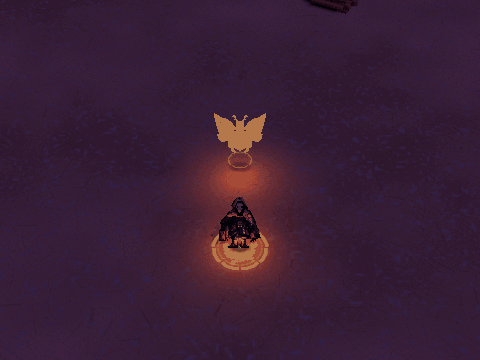

### Números de daño

Los números siguen arcos; el físico usa amarillo y naranja crítico y el sobrenatural rosa violeta y morado crítico.

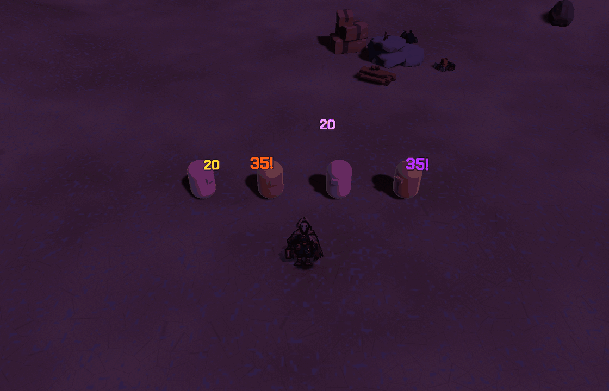

## Alcance de estas imágenes

Los GIFs permiten revisar fotogramas, anticipación, trayectoria e impacto visual. Las cifras de daño, la cadencia, probabilidades y condiciones de activación se contrastan con las reglas del juego. Las animaciones no contienen audio y no certifican un mínimo de FPS.

> **Navegación:** [[00 - Índice]] · [[00 - Avance jugable]]
