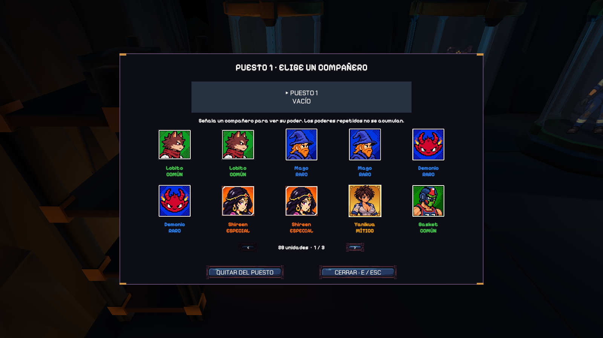

# UX y flujo del jugador

Menú inicial → continuar o crear colección → bóveda → revisar y seleccionar entidades equipadas → elegir ronda demo o completa → expedición → regreso a la bóveda.

## Preparar el equipo en la bóveda

Continuar recupera la colección guardada. Nueva colección empieza con el inventario vacío y restablece la fusión y el equipo, tras confirmar si ya existe progreso.

La preparación incluye revisar los tres puestos de entidades equipadas antes de elegir ronda. Se interactúa con E junto a un puesto vacío y se escoge una copia del inventario. En un puesto ocupado, T desequipa para cambiar la selección y E ofrece liberar la copia con confirmación. Cada entidad indica el poder que aporta. Se puede cambiar o quitar y los puestos pueden quedar vacíos; la primera expedición permite conseguir las primeras copias.

**Situación actual:** el sistema funciona, pero el recorrido puede saltarse esta preparación porque no hay una señalización general clara que la presente. Los avisos de E aparecen al acercarse a un puesto, sin explicar antes por qué conviene visitarlo. Hace falta guiar al jugador hasta esos puestos y relacionar las entidades con sus poderes. Esta mejora sigue pendiente de implementación.

El portal y el botón Iniciar expedición conducen a la selección de ronda. La confirmación se presenta antes de la transición y de la entrada del Coleccionista en la arena.

## Durante la expedición

La linterna ataca automáticamente y el HUD comunica salud, experiencia y dash. El minimapa descubre terreno al recorrerlo. Las entidades nuevas tienen un aviso breve y una interacción E al aproximarse; desaparecen a los diez segundos si no se recogen.

Las subidas de nivel pausan el combate y presentan hasta tres cartas. La confirmación aplica la mejora y continúa, o abre otra elección si hay niveles pendientes. Se evita reutilizar esa pulsación para un dash accidental.

Gólgora anuncia su entrada, se prepara el traslado a la caldera y la cámara mantiene a ambos combatientes encuadrados. El rugido y la transición distinguen su segunda fase.

## Volver a preparar

Victoria y derrota muestran un resumen con Volver a la bóveda. La colección obtenida se conserva y las cartas de combate se restablecen para el siguiente intento. Desde pausa, Abandonar pide confirmación antes de volver.

La fusión es otra actividad de la bóveda: cuatro copias, probabilidades visibles, proceso activo y apertura manual al terminar. Una visita desde una expedición suspende el combate y permite retomar después la misma sesión.

> **Navegación:** [[00 - Índice]] · [[00 - Avance jugable]]
