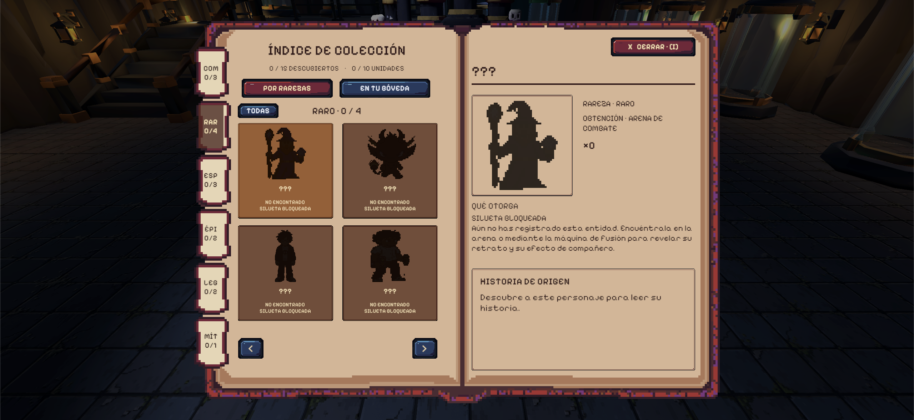
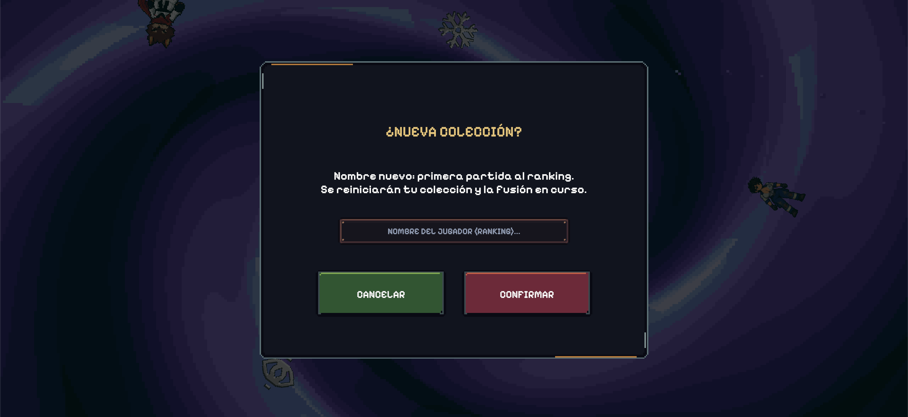

# UI y menús

| Interfaz | Información y acciones (`b381ef4`) |
| --- | --- |
| Menú inicial y Ajustes (`GameMenuView`, `MenuSettingsView`) | Continuar, Nueva colección, Configuración (panel unificado en 3 pestañas: `General` con deslizador y casilla de efectos reducidos, `Interfaz` y `Sonido`) y Salir; en `¿NUEVA COLECCIÓN?` incluye el campo `NOMBRE DEL JUGADOR (RANKING)...` (máx. 20 caracteres, validado contra Firebase mediante `GamertagRegistry.Reserve`, o vacío para práctica). |
| HUD de bóveda (`VaultDirections`, `VaultTips`, `VaultIndexHint`) | Dos tarjetas direccionales superiores con flechas hacia Fusión y Balcón de Equipo, botón superior izquierdo `ÍNDICE · [I]` y tarjeta inferior izquierda `CONSEJO` que rota cada `8 s`. |
| Índice de Colección / Bestiario (`VaultCollectionIndex`, `I` / `Select`) | Contador `{descubiertos} / 15 DESCUBIERTOS · {en posesión} / 10 UNIDADES`, pestañas `POR RAREZAS` (`TODAS` + 6 rarezas; siluetas negras `???` que pasan a retrato a color al recoger o reclamar por primera vez) y `EN TU BÓVEDA` (`EN EQUIPO ACTIVO` / `EN BÓVEDA`), inspector derecho de poder y botón `CERRAR · [I]`. |
| Selector de puesto de equipo (`CompanionView`, puestos 1 a 3) | Se abre con `E` / botón oeste (`E · EQUIPAR` / `E · EDITAR`). Encabezado `PUESTO DE EQUIPO 1/2/3`, subtítulo `ELIGE UNA ENTIDAD DESCUBIERTA PARA ESTE PUESTO`, nota de poderes acumulables por copia equipada y botones inferiores `QUITAR DEL PUESTO`, `LIBERAR COPIA` y `CERRAR · E / ESC`. (`T` / botón norte en el mundo desequipa directamente). |
| Modal de liberación (`VaultReleaseInteraction`) | Se abre con `E` / botón oeste (`E · LIBERAR`) en planta baja o puestos en reserva, o con `LIBERAR COPIA` en el selector. Cuadro `LIBERAR UNIDAD` con botones `CANCELAR` (`Esc` / botón este) y `LIBERAR` (`E`, `Enter` o `Espacio`). |
| Estación de fusión (`FusionStationUI`) | Ventana con 4 ranuras horizontales (`Espacio_0..3`), `TIEMPO DE FUSIÓN 00:30`, botón `X`, panel `POSIBLES RESULTADOS` (misma rareza o rarezas mixtas; `60%`, `40%`, `1%` en 4 Épicas), botones `VACIAR` y `CONFIRMAR`, selector (`EN EQUIPO 1/2/3`, `QUITAR INGREDIENTE`, `VOLVER`), y pantalla de resultado con botón único `COLECCIONAR` (o `INVENTARIO LLENO · LIBERA ESPACIO` si hay `10/10` unidades). |
| Selección de ronda (`ELIGE LA RONDA`) | *"Elige una ronda para comenzar."* con opciones `RONDA DEMO` (`3:00`), `RONDA COMPLETA` (`8:00`) o `SALIR` (`Esc` / botón este). |
| HUD de combate (`CombatHud`) | Salud, XP, nivel, tiempo, bajas, dash, mejoras, tres retratos equipados (con insignia `×N` de copias y poderes si `Atributos de coleccionables = SÍ`), minimapa circular con exploración y consulta rápida manteniendo `Q` o `Select`. |
| Cartas (`UpgradeDraftController`) | Hasta tres opciones; rareza, nivel, efecto, confirmación y reintento con *Sintonizador* (`R` o botón norte). |
| Menú de Pausa (`CombatHud` + `MenuSettingsView`, `Esc` / `Start`) | Comparte las **3 pestañas** de `MenuSettingsView` (`General`: `Movimiento de cámara` y `Efectos decorativos`; `Interfaz`: `Estadísticas generales` `COMPLETAS`/`REDUCIDAS`/`OCULTAS` y `Atributos de coleccionables` `SÍ`/`NO`; `Sonido`: `Volumen general` y `Música`) más los botones `CONTINUAR` y `VOLVER AL MENÚ` (en bóveda) o `VOLVER A LA BÓVEDA` (en arena). |
| Resultados y ranking (`EventLeaderboardSync`) | Victoria o derrota, tiempo, nivel, bajas, XP, sincronización automática con Firebase Realtime Database (`rulesVersion = 2`, visible en vivo en [`https://echoscrap.web.app`](https://echoscrap.web.app)) y botón `VOLVER A LA BÓVEDA`. |
| Laboratorio (`EnemyLaboratory`) | Ocho arquetipos, generación, inspección, daño de prueba, congelación, pausa y avance (`Tab` y `R`). |

## Detalle del panel de estadísticas y consulta rápida (`Q` / `Select`)

Toda la interfaz emplea la fuente **`Pixelify Sans`**. El panel de estadísticas se adapta dinámicamente al número de filas que difieren de su valor base:

- **`COMPLETAS`:** muestra todas las estadísticas modificadas respecto a su base (por cartas o por poderes de acompañantes).
- **`REDUCIDAS`:** filtra los seis valores principales (daño por pulso, velocidad de ataque, alcance, probabilidad crítica, multiplicador crítico y velocidad de movimiento).
- **`OCULTAS`:** oculta el panel durante el combate normal.

En cualquier momento del combate, **mantener pulsada la tecla `Q` (teclado) o el botón `Select` (mando)** activa `CombatHud.IsHudDetailHeld`, desplegando temporalmente las **estadísticas completas** y las **descripciones de los poderes de los tres acompañantes equipados**, independientemente del modo configurado en la pestaña `Interfaz`.

## Vistas del Índice de Colección (Bestiario) y Ranking Web

*Vista de la versión definitiva del bestiario (`Índice de Colección`, tecla `[I]`) con la tipografía unificada Pixelify Sans, contador en vivo, filtros por rareza, siluetas e inspector de compañero.*

*Visor web en vivo ([`https://echoscrap.web.app`](https://echoscrap.web.app)) conectado a Firebase Realtime Database con la clasificación general por puesto, jugador, bajas, tiempo y puntos.*

*Modal `¿NUEVA COLECCIÓN?` con el campo interactivo de gamertag para el ranking.*

> **Navegación:** [[00 - Índice]] · [[00 - Avance jugable]]
