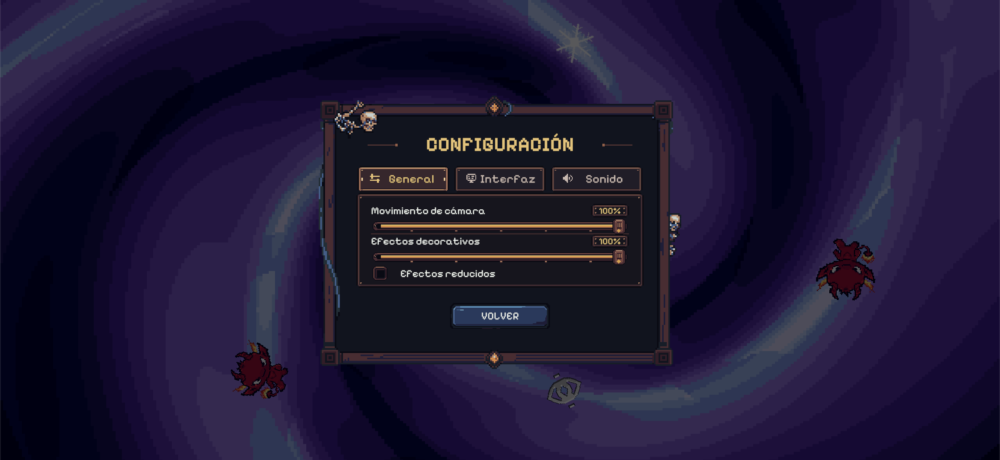
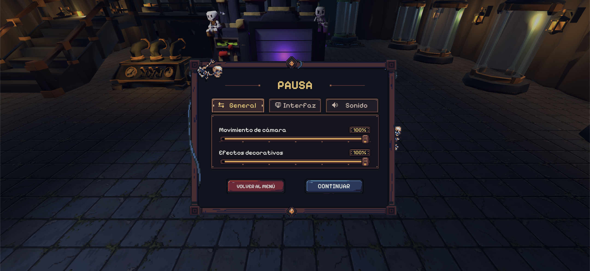

# Accesibilidad

El panel unificado de ajustes (`MenuSettingsView.cs`), compartido tanto en **`CONFIGURACIÓN`** del menú inicial como en **`PAUSA`** (`Esc` / `Start`), organiza las opciones de confort visual, lectura y audio en tres pestañas dedicadas:

- **Pestaña `General`:** deslizadores independientes para **`Movimiento de cámara`** (`0%` a `100%`, `ScreenShakeScale`) y **`Efectos decorativos`** (`0%` a `100%`, `VfxDensityScale`), más la casilla **`Efectos reducidos`** en el menú inicial (conservando íntegros los avisos de ataque y peligro).
- **Pestaña `Interfaz`:** selector **`Estadísticas generales`** (**`COMPLETAS`**, **`REDUCIDAS`**, **`OCULTAS`**) y selector **`Atributos de coleccionables`** (**`SÍ`** / **`NO`**, `ShowCompanionPowers`, para mostrar u ocultar las descripciones de los poderes bajo los 3 retratos del HUD). Además, mantener pulsado **`Q`** (teclado) o **`Select`** (mando) en combate despliega bajo demanda tanto las estadísticas completas como los atributos de coleccionables.
- **Pestaña `Sonido`:** deslizadores independientes para **`Volumen general`** (`0%` a `100%`, `EchoScrap.Audio.MasterVolume`) y **`Música`** (`0%` a `100%`, `EchoScrap.Audio.MusicVolume`).

La pausa y la pérdida de foco de ventana bloquean el control de combate y exigen soltar las entradas activas al regresar para impedir confirmaciones o dashes accidentales.

## Lectura, orientación espacial y formatos comprobados

| Comprobación | Evidencia |
| --- | --- |
| `1920 × 1080`, `16:9` | Verificado en runtime con la tipografía unificada **`Pixelify Sans`**. Incluye HUD de arena y jefe, cartas, panel unificado de ajustes en 3 pestañas, señalización de bóveda, Índice de Colección (`[I]`) y pantallas de resultado. |
| Escala de la interfaz | HUD y menús usan un lienzo de referencia de `1920 × 1080`. Los números flotantes de daño usan `1280 × 720` como referencia de escala. |
| Señalización en la bóveda | Implementada mediante rótulos 3D (`EQUIPO 1..3`), tarjetas direccionales superiores con flechas en vivo (`VaultDirections`), panel inferior de consejos rotatorios cada `8 s` (`VaultTips`) y botón `ÍNDICE · [I]`. |
| Señales redundantes | El daño crítico combina tamaño, color y signo de exclamación (`!`). Las resistencias muestran `Resistido` y las ejecuciones `EJECUTADO`. En el Índice de Colección (`[I]`), las entidades no descubiertas combinan silueta negra, nombre `???` y etiqueta `NO ENCONTRADO` / `SILUETA BLOQUEADA`. |
| Otros tamaños | `1280 × 720`, `2560 × 1440` y relaciones de aspecto distintas de `16:9` se mantienen como comprobaciones adicionales de escalado. |

*Panel unificado de Configuración (`CONFIGURACIÓN`) en el menú principal (`MenuSettingsView.cs`), con las tres pestañas `General`, `Interfaz` y `Sonido` compartidas con el menú de pausa.*

*Menú de Pausa durante la partida (`CombatHud.cs` + `MenuSettingsView.cs`, `Esc` / `Start`), organizado en las tres pestañas `General`, `Interfaz` y `Sonido`.*

## Cobertura de dispositivos de entrada (`b381ef4`)

El sistema de entrada (`Input System 1.20.0`) cubre teclado/ratón y mando en combate (movimiento, dash `A` / `Cruz`), pausa (`Start`), cartas (`1..3` / navegación + `A` / `Y` para Sintonizador), consulta rápida del HUD (`Q` / `Select`), recogida manual de fragmentos (`E` / botón oeste `X` / `Cuadrado`), interacciones de bóveda en pedestales y máquina de fusión (`E` / botón oeste y `T` / botón norte para desequipar rápido en balcón) e Índice de Colección (`I` / `Select`).

> **Navegación:** [[00 - Índice]] · [[00 - Avance jugable]]
