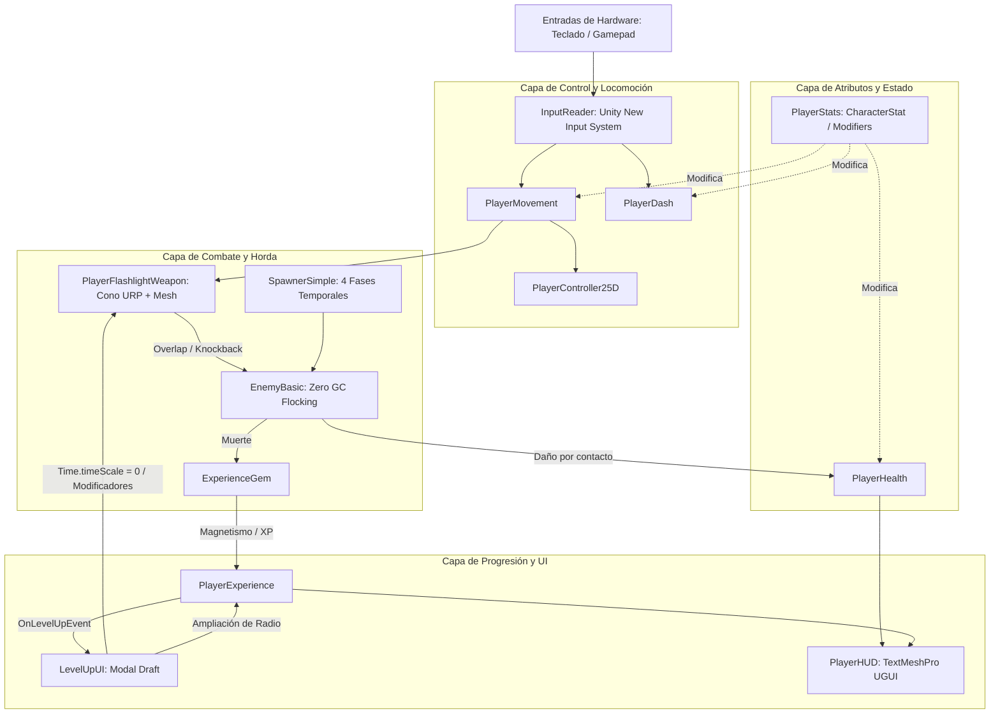

# Arquitectura Técnica

## Descripción de la sección

Explica cómo está construido técnicamente el videojuego en Unity 6, cómo se comunican sus componentes de software y los patrones de diseño aplicados para garantizar rendimiento óptimo a 60 FPS.

---

## Diagrama de arquitectura por capas

---

## Componentes principales y responsabilidades

| Componente | Responsabilidad Técnica | Dependencias Principales |
|---|---|---|
| `InputReader` | Escucha acciones del New Input System, normaliza vectores y gestiona serialización de remapeos en `PlayerPrefs`. | `InputActionAsset`, `UnityEngine.InputSystem` |
| `PlayerMovement` | Gestiona aceleración (80), desaceleración (70) y rotación suave (720°/s) en plano XZ. | `Rigidbody`, `InputReader`, `PlayerStats` |
| `PlayerDash` | Aplica traslación por impulso (22 m/s, 0.15s), gestiona *i-frames* (`IsInvulnerable`) y controla el enfriamiento (1.0s). | `Rigidbody`, `InputReader`, `PlayerMovement` |
| `PlayerFlashlightWeapon` | Detección geométrica cónica (60°, 6m), aplicación de daño periódico (0.20s tick) y renderizado de malla procedural plana. | `MeshFilter`, `LineRenderer`, `Light`, `EnemyBasic` |
| `PlayerStats` | Almacena y calcula estadísticas acumulativas con modificadores `Flat`, `PercentAdd` y `PercentMult`. | `CharacterStat`, `StatModifier` |
| `PlayerHealth` | Controla la vida actual, invulnerabilidad de 0.4s tras recibir impacto y parpadeo visual mediante `MaterialPropertyBlock`. | `PlayerStats`, `PlayerHUD`, `Renderer` |
| `EnemyBasic` | Navegación de horda con separación no-alocativa (`neighborBuffer[16]`), flanqueo perimetral y desaceleración de knockback. | `Rigidbody`, `PlayerHealth`, `ExperienceGem` |
| `SpawnerSimple` | Modula la curva de dificultad en 4 fases temporales, controlando intervalos de tiempo, racimos y tope máximo de 150 enemigos. | `EnemyBasic`, `Transform` |
| `ExperienceGem` | Renderizado de diamante 2.5D, cálculo de proximidad magnética cuadrática y desplazamiento rápido hacia el jugador. | `PlayerExperience`, `Transform` |
| `PlayerExperience` | Acumulación de XP, escalado exponencial de umbral (x1.5) y emisión del evento global `OnLevelUpEvent`. | `LevelUpUI`, `PlayerHUD` |
| `LevelUpUI` | Modal de pausa táctica (`Time.timeScale = 0`), selección entre 3 mejoras y gestión de cola de subidas acumuladas. | `PlayerFlashlightWeapon`, `PlayerExperience` |
| `PlayerHUD` | Presentación gráfica de vida y XP en tiempo real construida con TextMeshPro y sprites estándar. | `TextMeshProUGUI`, `Image`, Canvas |
| `CameraFollow25D` | Seguimiento suave e interpolado de cámara manteniendo ángulo cenital/isométrico constante. | `Transform` |

---

## Principios y patrones de comunicación técnica

1. **Desacoplamiento Mediante Eventos Fuertemente Tipados:**  
   La comunicación crítica entre sistemas (como la subida de nivel hacia la interfaz) se realiza mediante `System.Action<int> OnLevelUpEvent`. Esto permite que la lógica de experiencia no tenga dependencias directas sobre la interfaz de usuario.
2. **Protección Contra Memory Leaks en Editor (Domain Reload):**  
   Los eventos y cachés estáticas implementan métodos decorados con `[RuntimeInitializeOnLoadMethod(RuntimeInitializeLoadType.SubsystemRegistration)]` para limpiar referencias estáticas al reiniciar Play Mode en Unity, evitando pérdidas de memoria.
3. **Optimización de Materiales sin Duplicación de Instancias:**  
   Para efectos visuales de parpadeo por daño (*hit flashes*) en jugador y enemigos, se utiliza `MaterialPropertyBlock` con `Shader.PropertyToID("_BaseColor")` en lugar de instanciar materiales nuevos con `renderer.material`, protegiendo la memoria gráfica y evitando romper el batching de renderizado.
4. **Cálculos Matemáticos Libres de Basura (*Zero Garbage Collection*):**  
   * Ningún sistema crea arrays temporales en Update o FixedUpdate.
   * Las distancias de activación (como en el imán de gemas) se evalúan comparando distancias al cuadrado (`distSqr <= radius * radius`) para evitar la costosa operación de raíz cuadrada (`Vector3.Distance`).

---

> **Navegación:** [[00 - Índice]] · ← [[04 - Guardado y Configuración]] · [[02 - Motor y Herramientas]] →
